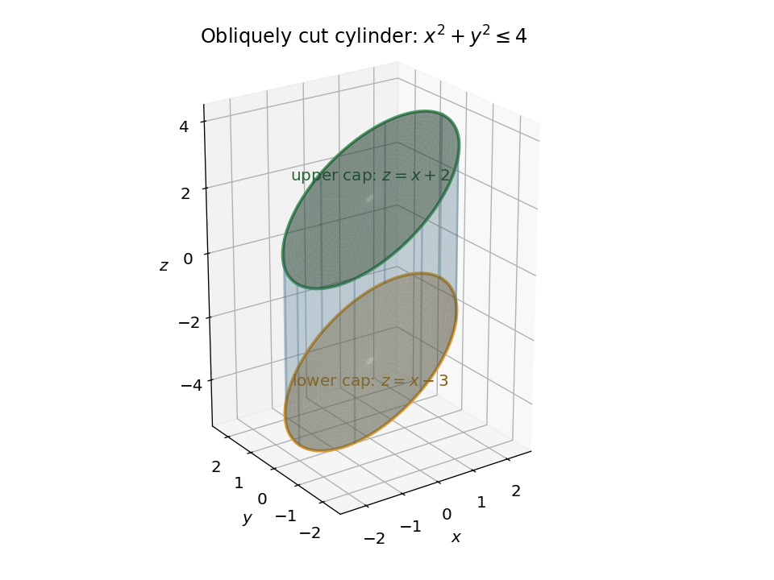

<h1 id="6/solution">Solution</h1>

↑ **Parent:** [6](../6.md)

For the [scalar surface integral over an obliquely cut cylinder](../../../scalar-surface-integral-over-an-obliquely-cut-cylinder.md), split the [scalar surface integral](../../../scalar-surface-integral.md) into the curved [cylinder](../../../cylinder-geometry.md) and its two planar caps. Write $s=z-x$, so the solid has $x^2+y^2\le4$ and $-3\le s\le2$. On the curved [cylinder](../../../cylinder-geometry.md), use the [parametrization](../../../parametric-equation.md)

$$
\mathbf R(\theta,s)=(2\cos\theta,2\sin\theta,2\cos\theta+s),
\qquad 0\le\theta\le2\pi,\quad -3\le s\le2.
$$

The [surface area element](../../../surface-area-element.md) follows from

$$
\mathbf R_\theta\times\mathbf R_s=(2\cos\theta,2\sin\theta,0),\qquad
dS=2\,d\theta\,ds,\qquad x-z=-s.
$$

Consequently the curved contribution is

$$
I_{\rm side}=\int_0^{2\pi}\int_{-3}^{2}(-s)\,2\,ds\,d\theta=10\pi.
$$

On either cap $z=x+s$, the [surface area element](../../../surface-area-element.md) is $\sqrt{1+z_x^2+z_y^2}\,dx\,dy=\sqrt2\,dx\,dy$ over a radius-two [disk](../../../disk-mathematics.md). The lower cap has $x-z=3$ and the upper cap has $x-z=-2$. Thus

$$
I_{\rm lower}=3\sqrt2(4\pi)=12\sqrt2\pi,\qquad
I_{\rm upper}=-2\sqrt2(4\pi)=-8\sqrt2\pi,
$$

and the complete [scalar surface integral](../../../scalar-surface-integral.md) is

$$
\boxed{\iint_S(x-z)\,dS=\pi(10+4\sqrt2).}
$$

The [surface area element](../../../surface-area-element.md) is unsigned: opposite outward normals on the caps do not introduce extra minus signs.

**[Figure 1](#6/image-original-sketch-of-the-solid-inside-the-cylinder-between-two-parallel-sloping-caps). Original sketch of the solid inside the cylinder between two parallel sloping caps**.

## ↑ Ancestors (11)

1. [6](../6.md)
2. [2021 resit](../../2021-resit-split.md)
3. [Past exam of the mathematical methods II course of the University of Oxford](../../split.md)
4. [Mathematical methods II course of the University of Oxford](../../../mathematical-methods-ii-course-of-the-university-of-oxford.md)
5. [Year 1 of the physics course of the University of Oxford](../../../year-1-of-the-physics-course-of-the-university-of-oxford.md)
6. [Physics course of the University of Oxford](../../../physics-course-of-the-university-of-oxford.md)
7. [Undergraduate course of the University of Oxford](../../../undergraduate-course-of-the-university-of-oxford.md)
8. [Course of the University of Oxford](../../../course-of-the-university-of-oxford.md)
9. [University of Oxford](../../../university-of-oxford-split.md)
10. [List of universities](../../../list-of-universities.md)
11. [Codex Wiki](../../../split.md)
