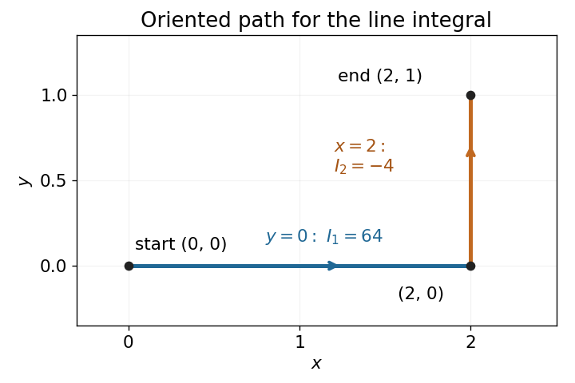

<h1 id="9/b/solution">Solution</h1>

↑ **Parent:** [B](../b.md)

Set $P=10x^4-2xy^3$ and $Q=-3x^2y^2$. Their [partial derivatives](../../../../partial-derivative.md) satisfy $P_y=-6xy^2=Q_x$ throughout $\mathbb R^2$. The [vector field](../../../../vector-field.md) is smooth on the entire [simply connected](../../../../simply-connected-space.md) [plane](../../../../plane.md), so zero [curl](../../../../curl.md) proves [path independence](../../../../path-independence.md).

Choose the broken straight path $(0,0)\to(2,0)\to(2,1)$. Along its horizontal segment $y=0$ and $dy=0$, giving

$$
I_1=\int_0^2 10x^4\,dx=64.
$$

Along its vertical segment $x=2$ and $dx=0$, giving

$$
I_2=\int_0^1-12y^2\,dy=-4.
$$

Therefore the [line integral](../../../../line-integral.md) is

$$
\boxed{I=I_1+I_2=60.}
$$

**[Figure 2](#9/b/image-original-sketch-of-the-chosen-oriented-path-through-the-corner-at-2-0). Original sketch of the chosen oriented path through the corner at (2,0)**

## ↑ Ancestors (12)

1. [B](../b.md)
2. [9](../../9.md)
3. [2021 resit](../../../2021-resit-split.md)
4. [Past exam of the mathematical methods II course of the University of Oxford](../../../split.md)
5. [Mathematical methods II course of the University of Oxford](../../../../mathematical-methods-ii-course-of-the-university-of-oxford.md)
6. [Year 1 of the physics course of the University of Oxford](../../../../year-1-of-the-physics-course-of-the-university-of-oxford.md)
7. [Physics course of the University of Oxford](../../../../physics-course-of-the-university-of-oxford.md)
8. [Undergraduate course of the University of Oxford](../../../../undergraduate-course-of-the-university-of-oxford.md)
9. [Course of the University of Oxford](../../../../course-of-the-university-of-oxford.md)
10. [University of Oxford](../../../../university-of-oxford-split.md)
11. [List of universities](../../../../list-of-universities.md)
12. [Codex Wiki](../../../../split.md)
