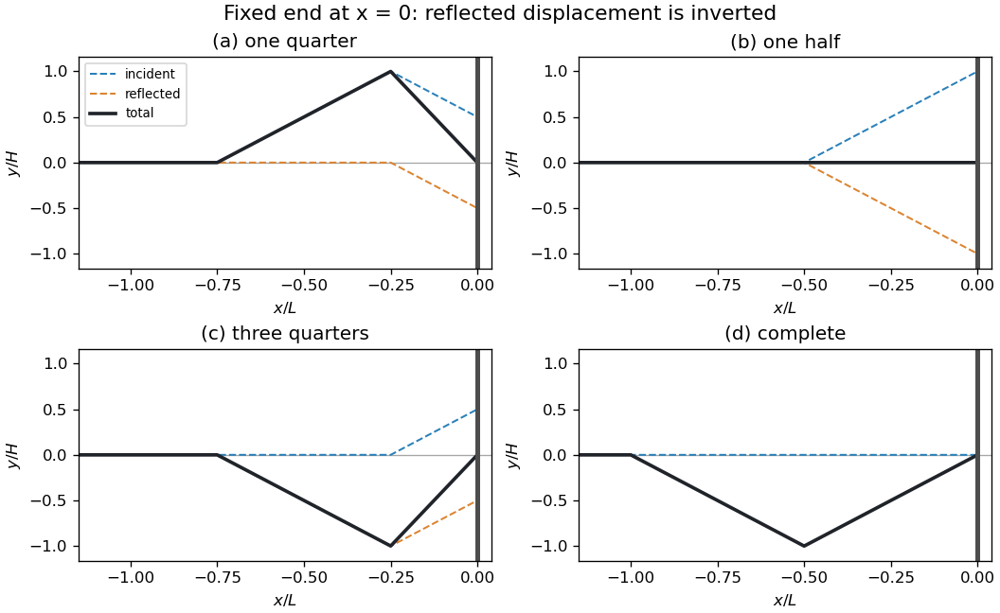
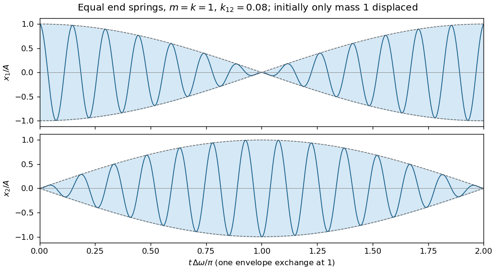
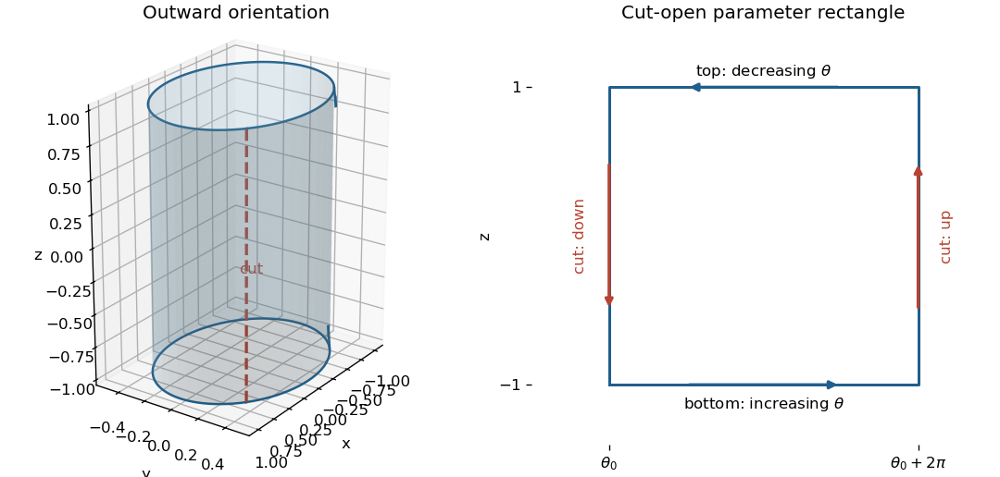
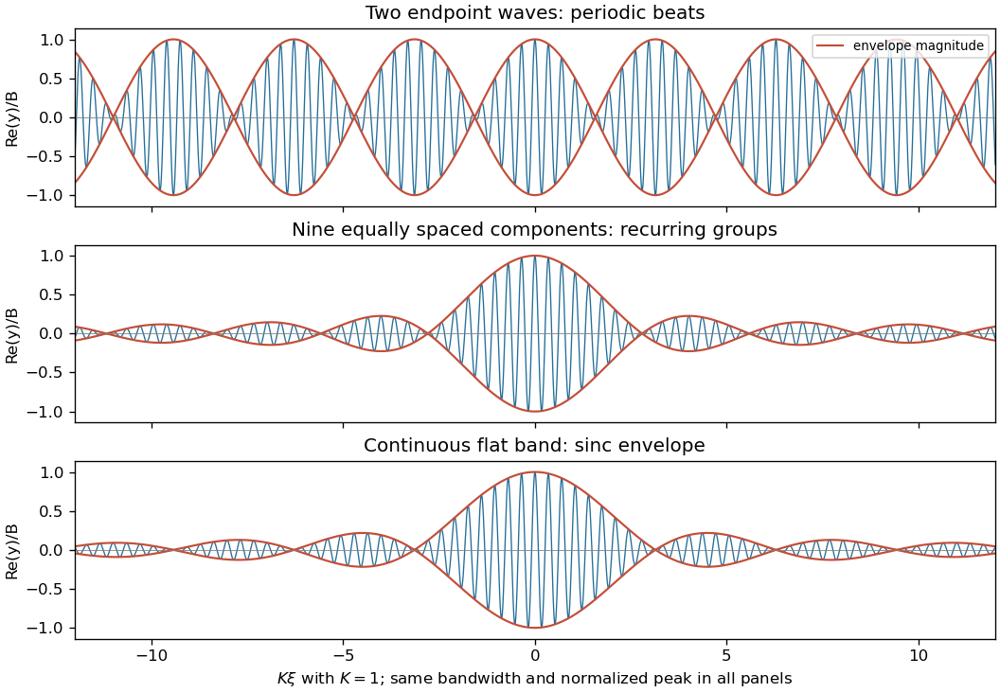

# 2021

↑ **Parent:** [Past exam of the mathematical methods II course of the University of Oxford](../past-exam-of-the-mathematical-methods-ii-course-of-the-university-of-oxford.md)

Source paper: [https://www.whatdotheyknow.com/request/oxford_physics_past_papers_2/response/2340696/attach/9/Physics%20Papers%202020.pdf?cookie_passthrough=1](https://www.whatdotheyknow.com/request/oxford_physics_past_papers_2/response/2340696/attach/9/Physics%20Papers%202020.pdf?cookie_passthrough=1) (ordinary sitting, 10 June 2021; the public bundle filename says 2020).

**Table of contents**

- [1](#1)
  - [i](#1/i)
    - [Solution](#1/i/solution)
  - [ii](#1/ii)
    - [Solution](#1/ii/solution)
  - [iii](#1/iii)
    - [Solution](#1/iii/solution)
- [2](#2)
  - [i](#2/i)
    - [Solution](#2/i/solution)
  - [ii](#2/ii)
    - [Solution](#2/ii/solution)
- [3](#3)
  - [Solution](#3/solution)
- [4](#4)
  - [Solution](#4/solution)
- [5](#5)
  - [Solution](#5/solution)
- [6](#6)
  - [Solution](#6/solution)
- [7](#7)
  - [i](#7/i)
    - [Solution](#7/i/solution)
  - [ii](#7/ii)
    - [Solution](#7/ii/solution)
  - [iii](#7/iii)
    - [Solution](#7/iii/solution)
  - [iv](#7/iv)
    - [a](#7/iv/a)
      - [Solution](#7/iv/a/solution)
    - [b](#7/iv/b)
      - [Solution](#7/iv/b/solution)
    - [c](#7/iv/c)
      - [Solution](#7/iv/c/solution)
    - [d](#7/iv/d)
      - [Solution](#7/iv/d/solution)
- [8](#8)
  - [Solution](#8/solution)
- [9](#9)
  - [i](#9/i)
    - [Solution](#9/i/solution)
  - [ii](#9/ii)
    - [Solution](#9/ii/solution)
  - [iii](#9/iii)
    - [Solution](#9/iii/solution)
- [10](#10)
  - [i](#10/i)
    - [Solution](#10/i/solution)
  - [ii](#10/ii)
    - [Solution](#10/ii/solution)
  - [iii](#10/iii)
    - [Solution](#10/iii/solution)
- [11](#11)
  - [i](#11/i)
    - [Solution](#11/i/solution)
  - [ii](#11/ii)
    - [Solution](#11/ii/solution)
  - [iii](#11/iii)
    - [Solution](#11/iii/solution)
  - [iv](#11/iv)
    - [Solution](#11/iv/solution)
  - [v](#11/v)
    - [Solution](#11/v/solution)
  - [vi](#11/vi)
    - [Solution](#11/vi/solution)

## 1

↑ **Parent:** [2021](2021.md)

<h3 id="1/i">i</h3>

↑ **Parent:** [1](#1)

<h4 id="1/i/solution">Solution</h4>

↑ **Parent:** [I](#1/i)

A [stationary point](../calculus-of-variations.md#stationary-point) occurs where the [derivative](../calculus.md#derivative) vanishes. Here

$$
f'(x)=6+12\sin(3x)=0\quad\Longleftrightarrow\quad\sin(3x)=-\frac12.
$$

The two families are

$$
\boxed{x=\frac{7\pi}{18}+\frac{2n\pi}{3}\quad\text{or}\quad x=\frac{11\pi}{18}+\frac{2n\pi}{3},\qquad n\in\mathbb Z.}
$$

Consequently there are **infinitely many** [stationary points](../calculus-of-variations.md#stationary-point) on the real line. The second [derivative](../calculus.md#derivative) is $36\cos(3x)$: the first family consists of strict [local minima](../analysis.md#local-minimum) and the second of strict [local maxima](../analysis.md#local-maximum).

<h3 id="1/ii">ii</h3>

↑ **Parent:** [1](#1)

<h4 id="1/ii/solution">Solution</h4>

↑ **Parent:** [Ii](#1/ii)

The [product rule](../calculus.md#product-rule) and [chain rule](../calculus.md#chain-rule) give

$$
f'(x)=10e^{3-x^2}(1-2x^2).
$$

The [exponential function](../calculus.md#exponential-function) is strictly positive, so there are exactly **two** [stationary points](../calculus-of-variations.md#stationary-point), at $\boxed{x=\pm1/\sqrt2}$. The [derivative](../calculus.md#derivative) is negative outside these two values and positive between them. Thus the negative value is a strict [local minimum](../analysis.md#local-minimum) and the positive value a strict [local maximum](../analysis.md#local-maximum).

<h3 id="1/iii">iii</h3>

↑ **Parent:** [1](#1)

<h4 id="1/iii/solution">Solution</h4>

↑ **Parent:** [Iii](#1/iii)

By the [product rule](../calculus.md#product-rule) and [chain rule](../calculus.md#chain-rule),

$$
f'(x)=e^{x^2}(1+2x^2)>0\qquad(x\in\mathbb R).
$$

Thus there are $\boxed{0}$ [stationary points](../calculus-of-variations.md#stationary-point); the function is strictly increasing everywhere.

## 2

↑ **Parent:** [2021](2021.md)

<h3 id="2/i">i</h3>

↑ **Parent:** [2](#2)

<h4 id="2/i/solution">Solution</h4>

↑ **Parent:** [I](#2/i)

The [probability density function](../continuous-probability-distribution.md#probability-density-function) is normalized because $\int_1^\infty3x^{-4}\,dx=1$. Its [expected value](../expected-value.md) and second moment are

$$
\mathbb E[X]=3\int_1^\infty x^{-3}\,dx=\frac32,\qquad
\mathbb E[X^2]=3\int_1^\infty x^{-2}\,dx=3.
$$

Both [improper integrals](../real-analysis.md#improper-integral) converge, so the [variance](../variance.md) is

$$
\boxed{\mathbb E[X]=\frac32,\qquad \operatorname{Var}(X)=3-\left(\frac32\right)^2=\frac34.}
$$

<h3 id="2/ii">ii</h3>

↑ **Parent:** [2](#2)

<h4 id="2/ii/solution">Solution</h4>

↑ **Parent:** [Ii](#2/ii)

For a fixed $x\in[0,1]$, the allowed $y$ interval is $[0,\sqrt x]$. Integrating the [joint probability density](../continuous-probability-distribution.md#joint-probability-density) over it gives the [marginal density](../probability-distribution.md#marginal-density)

$$
\boxed{f_X(x)=\begin{cases}\displaystyle\int_0^{\sqrt x}6xy\,dy=3x^2,&0\le x\le1,\\0,&\text{otherwise}.\end{cases}}
$$

For a fixed $y\in[0,1]$, the inequality $y\le\sqrt x$ is equivalent to $x\ge y^2$. The other [marginal density](../probability-distribution.md#marginal-density) is therefore

$$
\boxed{f_Y(y)=\begin{cases}\displaystyle\int_{y^2}^1 6xy\,dx=3y(1-y^4),&0\le y\le1,\\0,&\text{otherwise}.\end{cases}}
$$

As a normalization check, $\int_0^1 3x^2\,dx=1$ and $\int_0^1 3y(1-y^4)\,dy=1$.

## 3

↑ **Parent:** [2021](2021.md)

<h3 id="3/solution">Solution</h3>

↑ **Parent:** [3](#3)

The [arc length](../riemannian-geometry.md#arc-length) of the [helix](../topology.md#helix) follows from its parametrization:

$$
\mathbf r'(t)=\bigl(-10\sin(t-\pi/2),\ 10\cos(t-\pi/2),\ 5\bigr),\qquad
|\mathbf r'(t)|=\sqrt{100+25}=5\sqrt5.
$$

Thus $\ell_h=15\pi\sqrt5\,\mathrm m$. Its endpoint is $(0,20,15\pi)$, at height $h=15\pi\,\mathrm m$.

Under the usual intended interpretation that the descending quarter of a [circle](../topology.md#circle) drops through one [radius](../topology.md#radius), its [radius](../topology.md#radius) is $R=h$. Its [arc length](../riemannian-geometry.md#arc-length) is $\ell_c=\pi R/2=15\pi^2/2\,\mathrm m$, giving

$$
\boxed{\ell_h+\ell_c=15\pi\sqrt5+\frac{15\pi^2}{2}=179.39425397\ldots\,\mathrm m\simeq179\,\mathrm m.}
$$

**The printed smoothness condition is inconsistent.** The terminal [tangent vector](../tangent-vector.md) of the [helix](../topology.md#helix) is $\mathbf r'(3\pi)=(-10,0,5)$. Every [tangent vector](../tangent-vector.md) to a [curve](../topology.md#curve) confined to the $yz$ [plane](../geometry-and-topology.md#plane) has zero $x$ component, so no such [regular curve](../differential-geometry.md#regular-curve) can join this [helix](../topology.md#helix) with a common [tangent line](../calculus.md#tangent-line). Moreover, the [helix](../topology.md#helix) is still rising at that endpoint. Thus no smooth ride satisfying all the literal conditions exists.

Even after allowing a corner, a quarter of a [circle](../topology.md#circle) reaching the ground does not alone determine its [radius](../topology.md#radius): the orientation of its endpoint radii must also be specified. For example, in the $yz$ [plane](../geometry-and-topology.md#plane), the circular arc

$$
y=20+R\bigl(\cos\theta-\cos\theta_0\bigr),\quad
z=h+R\bigl(\sin\theta-\sin\theta_0\bigr),\quad
\theta_0-\pi/2\le\theta\le\theta_0,
$$

traversed toward decreasing $\theta$, descends monotonically for $0\le\theta_0\le\pi/2$ and reaches $z=0$ when $R=h/(\sin\theta_0+\cos\theta_0)$. Choosing $\theta_0=\pi/4$ gives $R=h/\sqrt2$, whereas $\theta_0=\pi/2$ gives $R=h$. The numerical answer above is conditional on the intended $R=h$ geometry; it does not repair the impossible smooth join.

## 4

↑ **Parent:** [2021](2021.md)

<h3 id="4/solution">Solution</h3>

↑ **Parent:** [4](#4)

At their intersection, $x^2+y^2=1$ and $z^2=1$. The [gradients](../multivariable-calculus.md#gradient) of the defining functions give [normal vectors](../differential-geometry.md#normal-vector) to the [sphere](../euclidean-geometry.md#sphere) and [cylinder](../geometry-and-topology.md#cylinder-geometry):

$$
\mathbf n_s=(2x,2y,2z),\qquad \mathbf n_c=(2x,2y,0).
$$

The acute angle between the [tangent planes](../tangent-vector.md#tangent-plane) is the acute angle between these [normal vectors](../differential-geometry.md#normal-vector). Their [dot product](../inner-product.md#dot-product) gives

$$
\cos\alpha=\frac{|\mathbf n_s\cdot\mathbf n_c|}{|\mathbf n_s|\,|\mathbf n_c|}
=\frac4{(2\sqrt2)(2)}=\frac1{\sqrt2},\qquad
\boxed{\alpha=\frac\pi4=45^\circ.}
$$

It is the same at every intersection point; the supplementary oriented angle is $135^\circ$.

## 5

↑ **Parent:** [2021](2021.md)

<h3 id="5/solution">Solution</h3>

↑ **Parent:** [5](#5)

Interpret the cube root as the real cube root. The curved boundary is $y=-x^3$, so the bounded region is $0\le x\le3$, $-x^3\le y\le0$. In particular $y$ is negative inside it. The [double integral](../integral.md#double-integral) is the convergent [improper integral](../real-analysis.md#improper-integral)

$$
I=\int_0^3\frac1{x^3+1}\left(\int_{-x^3}^0y^{-1/3}\,dy\right)dx.
$$

For negative real $y$, an [antiderivative](../integral.md#antiderivative) is $(3/2)y^{2/3}=(3/2)|y|^{2/3}$. The inner [integral](../integral.md) is therefore $-3x^2/2$. Hence

$$
I=-\frac32\int_0^3\frac{x^2}{x^3+1}\,dx
=-\frac12\bigl[\ln(x^3+1)\bigr]_0^3,
\qquad \boxed{I=-\frac12\ln28.}
$$

The negative sign is essential. Absolute convergence follows by the same calculation with the sign removed, so the singular edge at $y=0$ causes no ambiguity.

## 6

↑ **Parent:** [2021](2021.md)

<h3 id="6/solution">Solution</h3>

↑ **Parent:** [6](#6)

Parametrize the [curve](../topology.md#curve) by $\mathbf r(x)=(x,e^x,e^x)$ for $0\le x\le1$. Then $d\mathbf r=(1,e^x,e^x)\,dx$ and $\mathbf F(\mathbf r(x))=(e^{2x},x,e^x)$. Their [dot product](../inner-product.md#dot-product) gives the [line integral](../multivariable-calculus.md#line-integral)

$$
\int_C\mathbf F\cdot d\mathbf r=\int_0^1\left(2e^{2x}+xe^x\right)dx.
$$

Using [integration by parts](../calculus.md#integration-by-parts) for the second term,

$$
\int_C\mathbf F\cdot d\mathbf r
=\bigl[e^{2x}+(x-1)e^x\bigr]_0^1,
\qquad\boxed{\int_C\mathbf F\cdot d\mathbf r=e^2.}
$$

## 7

↑ **Parent:** [2021](2021.md)

<h3 id="7/i">i</h3>

↑ **Parent:** [7](#7)

<h4 id="7/i/solution">Solution</h4>

↑ **Parent:** [I](#7/i)

Take an ideal flexible [mechanical string](../continuum-mechanics.md#mechanical-string) with constant [tension](../force.md#tension) $T>0$ and uniform [linear mass density](../fluid-mechanics.md#linear-mass-density) $\mu>0$. Let $x$ measure distance along its straight equilibrium position and let $y(x,t)$ be its small transverse [displacement](../classical-mechanics.md#displacement). Neglect [damping](../wave-equation.md#damping), bending stiffness and external distributed [forces](../force.md), and assume $|y_x|\ll1$.

A segment of reference length $\Delta x$ has mass $\mu\Delta x$. The endpoint [tension](../force.md#tension) forces have transverse resultant

$$
T\sin\theta(x+\Delta x)-T\sin\theta(x)
\simeq T\bigl[y_x(x+\Delta x,t)-y_x(x,t)\bigr],
$$

since $\sin\theta\simeq\tan\theta=y_x$ for small slopes. [Newton's second law](../force.md#newton-s-second-law), divided by $\Delta x$ and taken to the limit, gives

$$
\mu y_{tt}=Ty_{xx},\qquad
\boxed{y_{xx}=\frac1{c^2}y_{tt},\quad c=\sqrt{T/\mu}.}
$$

Here $t$ is time, the subscripts denote [partial derivatives](../multivariable-calculus.md#partial-derivative), and $c$ is the [wave speed](../wave-equation.md#wave-speed). The transverse [acceleration](../classical-mechanics.md#acceleration) is $y_{tt}$; $y_{xx}$ describes the small-slope curvature responsible for the net transverse [force](../force.md).

<h3 id="7/ii">ii</h3>

↑ **Parent:** [7](#7)

<h4 id="7/ii/solution">Solution</h4>

↑ **Parent:** [Ii](#7/ii)

Put $u=ct-x$ and assume $f$ has continuous second [derivatives](../calculus.md#derivative). The [chain rule](../calculus.md#chain-rule) yields

$$
y_x=-f'(u),\quad y_{xx}=f''(u),\quad
y_t=cf'(u),\quad y_{tt}=c^2f''(u).
$$

Thus the [wave equation](../wave-equation.md) is satisfied. A point of fixed [wave phase](../wave.md#phase-waves) $u=u_0$ has $x=ct-u_0$, so for $c>0$ this [travelling wave](../analysis.md#travelling-wave) moves in the $\boxed{\text{positive }x\text{ direction at speed }c}$.

<h3 id="7/iii">iii</h3>

↑ **Parent:** [7](#7)

<h4 id="7/iii/solution">Solution</h4>

↑ **Parent:** [Iii](#7/iii)

For $\Delta t=\Delta x/c$,

$$
y(x+\Delta x,t+\Delta t)=f\bigl(ct+c\Delta t-x-\Delta x\bigr)=f(ct-x)=y(x,t).
$$

Equivalently $\boxed{y(x,t+\Delta t)=y(x-c\Delta t,t)}$. Thus every value of the [displacement](../classical-mechanics.md#displacement) is translated by the same distance $c\Delta t$: the entire [travelling wave](../analysis.md#travelling-wave) profile keeps its shape. The [wave speed](../wave-equation.md#wave-speed) is independent of the profile, as expected for this nondispersive [wave equation](../wave-equation.md).

<h3 id="7/iv">iv</h3>

↑ **Parent:** [7](#7)

<h4 id="7/iv/a">a</h4>

↑ **Parent:** [Iv](#7/iv)

<h5 id="7/iv/a/solution">Solution</h5>

↑ **Parent:** [A](#7/iv/a)

Put the fixed end at $x=0$, with the [mechanical string](../continuum-mechanics.md#mechanical-string) occupying $x\le0$. Let $H$ be the incident peak [amplitude](../wave.md#wave-amplitude), set $u=x/L$ and $\tau=ct/L$, and take $t=0$ when the incident front first reaches the end. The symmetric [triangular pulse](../fourier-analysis.md#triangular-function) in the source has initial profile $H T(u)$, where

$$
T(s)=\max\{0,1-|2s+1|\}.
$$

The [fixed-end reflection of a triangular pulse](../wave-equation.md#fixed-end-reflection-of-a-triangular-pulse) follows from the [Dirichlet boundary condition](../differential-equation.md#dirichlet-boundary-condition) $y(0,t)=0$ and the [superposition principle](../vector-space.md#superposition-principle), giving the reflected [displacement](../classical-mechanics.md#displacement)

$$
\boxed{\frac{y(x,t)}H=T(u-\tau)-T(-u-\tau),\qquad u\le0.}
$$

The minus sign is the inversion on reflection. At $\tau=1/4$, the resulting profile is zero outside $[-3/4,0]$ and consists of the straight segments through

$$
\boxed{(u,y/H)=(-3/4,0),\ (-1/4,1),\ (0,0).}
$$

The segment beside the wall is steeper because incident and inverted reflected [pulses](../wave.md#pulse) overlap there.

<h4 id="7/iv/b">b</h4>

↑ **Parent:** [Iv](#7/iv)

<h5 id="7/iv/b/solution">Solution</h5>

↑ **Parent:** [B](#7/iv/b)

At $\tau=1/2$, the two [triangular pulses](../fourier-analysis.md#triangular-function) coincide with opposite signs:

$$
\boxed{y(x,L/(2c))=0\quad\text{for every }x\le0.}
$$

The instantaneous sketch is the straight equilibrium line. This is destructive [interference](../physical-optics.md#interference-wave-propagation), not the disappearance of the [wave energy](../wave-equation.md#wave-energy). For example, on $-1/2<u<0$ the transverse [velocity](../classical-mechanics.md#velocity) is $y_t=-4Hc/L$, so the [mechanical string](../continuum-mechanics.md#mechanical-string) is passing through equilibrium with nonzero [kinetic energy](../energy.md#kinetic-energy).

<h4 id="7/iv/c">c</h4>

↑ **Parent:** [Iv](#7/iv)

<h5 id="7/iv/c/solution">Solution</h5>

↑ **Parent:** [C](#7/iv/c)

At $\tau=3/4$, the reflected [pulse](../wave.md#pulse) dominates the overlap. The total [displacement](../classical-mechanics.md#displacement) is zero outside $[-3/4,0]$ and consists of straight segments through

$$
\boxed{(u,y/H)=(-3/4,0),\ (-1/4,-1),\ (0,0).}
$$

This is the inverted version of the quarter-reflected profile. The entire negative [pulse](../wave.md#pulse) has not yet separated from the incident [pulse](../wave.md#pulse).

<h4 id="7/iv/d">d</h4>

↑ **Parent:** [Iv](#7/iv)

<h5 id="7/iv/d/solution">Solution</h5>

↑ **Parent:** [D](#7/iv/d)

At $\tau=1$, the incident [pulse](../wave.md#pulse) has left the physical half-line, so only the inverted reflected [pulse](../wave.md#pulse) remains. Its straight segments pass through

$$
\boxed{(u,y/H)=(-1,0),\ (-1/2,-1),\ (0,0).}
$$

It subsequently travels toward decreasing $x$ at the original [wave speed](../wave-equation.md#wave-speed) $c$, with unchanged width $L$ and peak [amplitude](../wave.md#wave-amplitude) magnitude $H$.

**[Figure 1](#7/iv/d/image-total-displacement-during-reflection-of-a-symmetric-triangular-pulse-at-a-fixed-end). Total displacement during reflection of a symmetric triangular pulse at a fixed end**.

## 8

↑ **Parent:** [2021](2021.md)

<h3 id="8/solution">Solution</h3>

↑ **Parent:** [8](#8)

A [normal mode](../wave-equation.md#normal-mode) of a stable undamped linear [coupled oscillator](../wave.md#coupled-oscillator) has a single [angular frequency](../lagrangian-mechanics.md#angular-frequency) and a fixed ratio of component [displacements](../classical-mechanics.md#displacement). All components share a sinusoidal time factor, with relative [oscillation phases](../wave.md#phase-waves) of zero or $\pi$ for real [mode shapes](../wave-equation.md#mode-shape). A general free motion is a [superposition](../vector-space.md#superposition-principle) of the [normal modes](../wave-equation.md#normal-mode). For this system the symmetric stiffness [matrix](../vector-space.md#matrix) gives real [eigenvalues](../linear-operator-theory.md#eigenvalue) and orthogonal [eigenvectors](../linear-operator-theory.md#eigenvector); positive [spring constants](../elasticity-physics.md#spring-constant) make the squared [angular frequencies](../lagrangian-mechanics.md#angular-frequency) positive.

Write $m=m_1=m_2>0$ and $\kappa=k_{12}$. Assume ideal massless linear springs, negligible [damping](../wave-equation.md#damping) and positive $k_1,k_2,\kappa$. By [Hooke's law](../elasticity-physics.md#hooke-s-law) and [Newton's second law](../force.md#newton-s-second-law),

$$
\boxed{m\ddot x_1=-(k_1+\kappa)x_1+\kappa x_2,\qquad
m\ddot x_2=\kappa x_1-(k_2+\kappa)x_2.}
$$

The coupling spring extends by $x_2-x_1$, giving equal and opposite coupling [forces](../force.md).

For a [normal mode](../wave-equation.md#normal-mode), take $\mathbf x=\operatorname{Re}(\mathbf a e^{i\omega t})$. Nonzero [eigenvectors](../linear-operator-theory.md#eigenvector) require

$$
\det\begin{pmatrix}k_1+\kappa-m\omega^2&-\kappa\\-\kappa&k_2+\kappa-m\omega^2\end{pmatrix}=0.
$$

Solving this [quadratic equation](../polynomial.md#quadratic-equation) in $m\omega^2$ gives

$$
\boxed{\omega_\pm^2=\frac{k_1+k_2+2\kappa\ \pm\sqrt{(k_1-k_2)^2+4\kappa^2}}{2m}.}
$$

A corresponding [mode shape](../wave-equation.md#mode-shape) has ratio

$$
\frac{a_2}{a_1}=\frac{k_1+\kappa-m\omega_\pm^2}{\kappa},
$$

and the general real solution is $\mathbf x=C_-\mathbf a_-\cos(\omega_-t+\phi_-)+C_+\mathbf a_+\cos(\omega_+t+\phi_+)$. The arbitrary [amplitudes](../wave.md#wave-amplitude) and [oscillation phases](../wave.md#phase-waves) account for four independent initial data.

**Weak coupling alone does not guarantee large beats.** A useful representative sketch assumes nearly equal uncoupled [angular frequencies](../lagrangian-mechanics.md#angular-frequency). In the resonant case $k_1=k_2=k$ with $\kappa\ll k$, the [mode shapes](../wave-equation.md#mode-shape) are $(1,1)$ and $(1,-1)$, and

$$
\omega_-^2=k/m,\qquad \omega_+^2=(k+2\kappa)/m.
$$

For $x_1(0)=A$, $x_2(0)=\dot x_1(0)=\dot x_2(0)=0$, both [normal modes](../wave-equation.md#normal-mode) have equal coefficients. With $\bar\omega=(\omega_++\omega_-)/2$ and $\Delta\omega=\omega_+-\omega_-$,

$$
\boxed{x_1=A\cos(\bar\omega t)\cos(\Delta\omega t/2),\qquad
x_2=A\sin(\bar\omega t)\sin(\Delta\omega t/2).}
$$

These rapid [oscillations](../wave.md#oscillation) have slowly varying complementary [wave envelopes](../dispersion-relation.md#envelope-waves). The initial [displacement](../classical-mechanics.md#displacement) shifts almost entirely to the other mass at $t=\pi/\Delta\omega$, and returns after $2\pi/\Delta\omega$. Arbitrary initial data give a different [superposition](../vector-space.md#superposition-principle); if $|k_1-k_2|\gg\kappa$, the [normal modes](../wave-equation.md#normal-mode) are localized mainly on individual masses, and strong exchange is suppressed.

**[Figure 2](#8/image-representative-weakly-coupled-resonant-motion-rapid-displacements-inside-slowly-exchanging-envelopes). Representative weakly coupled resonant motion: rapid displacements inside slowly exchanging envelopes**.

Holding one mass fixed leaves the coupling spring attached and stretched by the other mass. Therefore the two constrained [angular frequencies](../lagrangian-mechanics.md#angular-frequency) are

$$
\boxed{\omega_1=\sqrt{(k_1+\kappa)/m},\qquad \omega_2=\sqrt{(k_2+\kappa)/m}.}
$$

These differ from the [angular frequencies](../lagrangian-mechanics.md#angular-frequency) obtained by physically removing the coupling spring. Ordinary [frequencies](../wave.md#frequency) in hertz are each corresponding $\omega/(2\pi)$.

Finally, for $k_1>k_2$ and $\kappa>0$, put $D=\sqrt{(k_1-k_2)^2+4\kappa^2}>k_1-k_2$. Then

$$
\omega_-^2-\omega_2^2=\frac{k_1-k_2-D}{2m}<0,\qquad
\omega_+^2-\omega_1^2=\frac{D-(k_1-k_2)}{2m}>0.
$$

Since $\omega_1>\omega_2$, taking positive square roots proves

$$
\boxed{\omega_-<\omega_2<\omega_1<\omega_+.}
$$

At $\kappa=0$, the outer inequalities become equalities.

## 9

↑ **Parent:** [2021](2021.md)

<h3 id="9/i">i</h3>

↑ **Parent:** [9](#9)

<h4 id="9/i/solution">Solution</h4>

↑ **Parent:** [I](#9/i)

Let $S$ be a compact piecewise smooth [oriented surface](../differential-geometry.md#oriented-surface), $\mathbf n$ its chosen unit [normal vector](../differential-geometry.md#normal-vector), and $\partial S$ its entire oriented boundary. Let $\mathbf A$ be a continuously differentiable [vector field](../multivariable-calculus.md#vector-field) on a neighborhood of $S$. [Stokes theorem](../multivariable-calculus.md#stokes-theorem) states

$$
\boxed{\iint_S(\nabla\times\mathbf A)\cdot\mathbf n\,dS=\oint_{\partial S}\mathbf A\cdot d\mathbf r.}
$$

Here $\nabla\times\mathbf A$ is the [curl](../multivariable-calculus.md#curl), $dS$ is the [surface area element](../multivariable-calculus.md#surface-area-element), and $d\mathbf r$ is the directed [line integral](../multivariable-calculus.md#line-integral) element. The boundary follows the [right-hand rule](../electromagnetism.md#right-hand-rule) relative to $\mathbf n$; equivalently the surface lies to the left when walking along its boundary with one's head toward $\mathbf n$.

The topological requirement is [orientability](../topology.md#orientability), together with the regularity and boundary assumptions above. **Simple connectivity is unnecessary.** An annulus or cylindrical side is allowed, provided every boundary component is included with its induced direction. For a concrete counterexample to a disk-only restriction, take the planar annulus $1\le x^2+y^2\le4$ and $\mathbf A=(-y/2,x/2,0)$. The [curl](../multivariable-calculus.md#curl) is $\mathbf e_z$, the [surface integral](../multivariable-calculus.md#surface-integral) is $3\pi$, and the outer counterclockwise and inner clockwise [line integrals](../multivariable-calculus.md#line-integral) sum to $4\pi-\pi=3\pi$.

For $S$ in the $xy$ [plane](../geometry-and-topology.md#plane) with upward [normal vector](../differential-geometry.md#normal-vector) and $\mathbf A=(P,Q,0)$, its [curl](../multivariable-calculus.md#curl) has vertical component $Q_x-P_y$. Thus [Stokes theorem](../multivariable-calculus.md#stokes-theorem) becomes [Green's theorem](../multivariable-calculus.md#green-theorem):

$$
\boxed{\oint_{\partial D}(P\,dx+Q\,dy)=\iint_D\left(\frac{\partial Q}{\partial x}-\frac{\partial P}{\partial y}\right)dx\,dy.}
$$

The outer boundary is counterclockwise and any inner boundaries are clockwise.

<h3 id="9/ii">ii</h3>

↑ **Parent:** [9](#9)

<h4 id="9/ii/solution">Solution</h4>

↑ **Parent:** [Ii](#9/ii)

The [position vector](../classical-mechanics.md#position-vector) field is a [gradient field](../multivariable-calculus.md#gradient-field):

$$
\mathbf r=(x,y,z)=\nabla\left(\frac{x^2+y^2+z^2}{2}\right).
$$

Along any piecewise smooth [curve](../topology.md#curve), $\mathbf r\cdot d\mathbf r=d(|\mathbf r|^2/2)$. Therefore a closed [line integral](../multivariable-calculus.md#line-integral) has identical endpoint values and

$$
\boxed{\oint_C\mathbf r\cdot d\mathbf r=\left[\frac{|\mathbf r|^2}{2}\right]_{\mathrm{start}}^{\mathrm{end}}=0.}
$$

For a loop bounding an admissible [oriented surface](../differential-geometry.md#oriented-surface), [Stokes theorem](../multivariable-calculus.md#stokes-theorem) gives the same result because $\nabla\times\mathbf r=\mathbf0$. The [gradient field](../multivariable-calculus.md#gradient-field) proof also applies directly to arbitrary piecewise smooth closed loops without choosing a spanning surface.

<h3 id="9/iii">iii</h3>

↑ **Parent:** [9](#9)

<h4 id="9/iii/solution">Solution</h4>

↑ **Parent:** [Iii](#9/iii)

Choose the outward [normal vector](../differential-geometry.md#normal-vector) on the side of the [elliptic cylinder](../euclidean-geometry.md#elliptic-cylinder). Parametrize it by

$$
\mathbf r(\theta,z)=(\cos\theta,\tfrac12\sin\theta,z),\qquad
-1\le z\le1.
$$

Since $\mathbf r_\theta\times\mathbf r_z=(\tfrac12\cos\theta,\sin\theta,0)$ points outward, the parameter rectangle has its bottom edge traversed with increasing $\theta$, its right cut edge with increasing $z$, its top edge with decreasing $\theta$, and its left cut edge with decreasing $z$. After identification, the two cut edges are the same physical [curve](../topology.md#curve) with opposite directions. Their [line integrals](../multivariable-calculus.md#line-integral) cancel for a single-valued [vector field](../multivariable-calculus.md#vector-field). Viewed from above, the bottom rim is counterclockwise and the top rim clockwise.

**[Figure 3](#9/iii/image-an-elliptic-cylindrical-side-cut-open-into-a-parameter-rectangle-with-compatible-outward-boundary-directions). An elliptic cylindrical side cut open into a parameter rectangle, with compatible outward boundary directions**.

To apply [Stokes theorem](../multivariable-calculus.md#stokes-theorem) to a [flux](../mathematical-physics.md#flux) rather than a [curl](../multivariable-calculus.md#curl) integral, first find a [vector potential](../multivariable-calculus.md#vector-potential):

$$
\mathbf A=(0,0,xyz^2),\qquad
\nabla\times\mathbf A=(xz^2,-yz^2,0)=\mathbf F.
$$

This [vector potential](../multivariable-calculus.md#vector-potential) is smooth everywhere. On either horizontal rim, $d\mathbf r$ is horizontal whereas $\mathbf A$ is vertical, giving $\mathbf A\cdot d\mathbf r=0$. For a cut at $\theta_0=\pi/4$, $xy=1/4$, so the upward cut contribution is $\int_{-1}^1z^2/4\,dz=1/6$ and the downward one is $-1/6$. Consequently

$$
\boxed{\iint_S\mathbf F\cdot d\mathbf S
=\oint_{\partial S}\mathbf A\cdot d\mathbf r=0.}
$$

A direct check uses the [oriented surface element](../multivariable-calculus.md#oriented-surface-element) above: $\mathbf F\cdot(\mathbf r_\theta\times\mathbf r_z)=\tfrac12 z^2\cos2\theta$, whose [integral](../integral.md) over a full turn vanishes. Reversing the chosen [orientation](../algebraic-topology.md#orientation-of-a-simplex) still gives zero.

## 10

↑ **Parent:** [2021](2021.md)

<h3 id="10/i">i</h3>

↑ **Parent:** [10](#10)

<h4 id="10/i/solution">Solution</h4>

↑ **Parent:** [I](#10/i)

Let $\mathbf F=(F_x,F_y,F_z)$ be continuously differentiable near $P$. Take a small axis-aligned rectangular volume around $P$, with side lengths $\Delta x,\Delta y,\Delta z$ shrinking with bounded aspect ratios. The outward [flux](../mathematical-physics.md#flux) through its two $x$ faces is, to leading order,

$$
\bigl[F_x(x+\Delta x/2,y,z)-F_x(x-\Delta x/2,y,z)\bigr]\Delta y\Delta z
=\frac{\partial F_x}{\partial x}(P)\,\Delta x\Delta y\Delta z+o(\Delta V),
$$

where $\Delta V=\Delta x\Delta y\Delta z$. The analogous face pairs give $\partial F_y/\partial y$ and $\partial F_z/\partial z$. Dividing total [flux](../mathematical-physics.md#flux) by $\Delta V$ and taking the limit gives

$$
\boxed{\nabla\cdot\mathbf F=\frac{\partial F_x}{\partial x}+\frac{\partial F_y}{\partial y}+\frac{\partial F_z}{\partial z}.}
$$

The [divergence](../multivariable-calculus.md#divergence) is thus the local outward [flux](../mathematical-physics.md#flux) per unit volume; the symbols on the right are Cartesian [partial derivatives](../multivariable-calculus.md#partial-derivative).

For a bounded volume $V$ with piecewise smooth closed boundary $S$, subdivide into small cells. Each internal face occurs twice with opposite [normal vectors](../differential-geometry.md#normal-vector), so its [flux](../mathematical-physics.md#flux) cancels. The remaining sum is the exterior [surface integral](../multivariable-calculus.md#surface-integral); the cell sums of $(\nabla\cdot\mathbf F)\Delta V$ converge to the [volume integral](../multivariable-calculus.md#volume-integral). Assuming continuous first [partial derivatives](../multivariable-calculus.md#partial-derivative) on a neighborhood of the closure of $V$, this proves the [divergence theorem](../multivariable-calculus.md#divergence-theorem):

$$
\boxed{\oiint_S\mathbf F\cdot\mathbf n\,dS=\iiint_V\nabla\cdot\mathbf F\,dV.}
$$

The unit [normal vector](../differential-geometry.md#normal-vector) $\mathbf n$ points out of $V$. Multiple boundary components are allowed; at a cavity wall it points into the cavity.

<h3 id="10/ii">ii</h3>

↑ **Parent:** [10](#10)

<h4 id="10/ii/solution">Solution</h4>

↑ **Parent:** [Ii](#10/ii)

Assume $a>0$ and choose the outward [orientation](../algebraic-topology.md#orientation-of-a-simplex). On the [sphere](../euclidean-geometry.md#sphere), $\mathbf n=(x,y,z)/a$, so $\mathbf F\cdot\mathbf n=(x^2+y^2+2z^2)/a=(a^2+z^2)/a$. In [spherical coordinates](../multivariable-calculus.md#spherical-coordinate-system), $z=a\cos\theta$ and $dS=a^2\sin\theta\,d\theta\,d\phi$. The direct [surface integral](../multivariable-calculus.md#surface-integral) is

$$
\begin{aligned}
\oiint_S\mathbf F\cdot\mathbf n\,dS
&=a^3\int_0^{2\pi}\!d\phi\int_0^\pi(1+\cos^2\theta)\sin\theta\,d\theta\\
&=2\pi a^3\left(2+\frac23\right)
=\boxed{\frac{16\pi a^3}{3}}.
\end{aligned}
$$

Independently, $\nabla\cdot\mathbf F=1+1+2=4$. Its [volume integral](../multivariable-calculus.md#volume-integral) over the ball is

$$
\iiint_V4\,dV=4\int_0^a r^2\,dr\int_0^\pi\sin\theta\,d\theta\int_0^{2\pi}d\phi
=\boxed{\frac{16\pi a^3}{3}}.
$$

The two calculations agree exactly with the [divergence theorem](../multivariable-calculus.md#divergence-theorem). The expression requested is a scalar [flux](../mathematical-physics.md#flux) of a [vector field](../multivariable-calculus.md#vector-field), namely the [dot product](../inner-product.md#dot-product) with the directed [surface area element](../multivariable-calculus.md#surface-area-element).

<h3 id="10/iii">iii</h3>

↑ **Parent:** [10](#10)

<h4 id="10/iii/solution">Solution</h4>

↑ **Parent:** [Iii](#10/iii)

For this [vector field](../multivariable-calculus.md#vector-field),

$$
\nabla\cdot\mathbf G=3x^2+3y^2+3z^2=3r^2.
$$

The [divergence theorem](../multivariable-calculus.md#divergence-theorem) and [spherical coordinates](../multivariable-calculus.md#spherical-coordinate-system) therefore give the outward [flux](../mathematical-physics.md#flux)

$$
\boxed{\oiint_S\mathbf G\cdot\mathbf n\,dS
=\iiint_V3r^2\,dV
=12\pi\int_0^a r^4\,dr=\frac{12\pi a^5}{5}.}
$$

The $a^5$ dependence also follows by combining the cubic field magnitude with the quadratic scaling of [surface area](../differential-geometry.md#surface-area).

## 11

↑ **Parent:** [2021](2021.md)

<h3 id="11/i">i</h3>

↑ **Parent:** [11](#11)

<h4 id="11/i/solution">Solution</h4>

↑ **Parent:** [I](#11/i)

[Wave dispersion](../dispersion-relation.md#wave-dispersion) means that different [frequencies](../wave.md#frequency) propagate with different [phase velocities](../dispersion-relation.md#phase-velocity), so a [wave packet](../dispersion-relation.md#wave-packet) generally changes shape. Equivalently the [dispersion relation](../dispersion-relation.md) is not proportional to $k$ over the relevant band. Three natural examples are the colour separation in a [rainbow](../optics.md#rainbow), where the refractive index of water depends on [wavelength](../wave-equation.md#wavelength); deep-water [surface gravity waves](../fluid-mechanics.md#surface-gravity-wave), for which $\omega^2=gk$ and long waves have larger [phase velocity](../dispersion-relation.md#phase-velocity); and [capillary waves](../surface-tension.md#capillary-wave), whose short-wave limit is $\omega^2=(\gamma/\rho)k^3$ and whose shorter waves have larger [phase velocity](../dispersion-relation.md#phase-velocity). Here $g$ is [gravitational acceleration](../newton-s-law-of-universal-gravitation.md#gravitational-acceleration), $\gamma$ is [surface tension](../surface-tension.md), and $\rho$ is fluid [mass density](../fluid-mechanics.md#density), with positive $k$ and negligible viscosity.

A distinct application is an [optical prism](../geometrical-optics.md#prism-optics) [spectrometer](../optical-instrument.md#spectrometer): the wavelength-dependent [refractive index](../electromagnetic-wave.md#refractive-index) produces different [refraction](../optics.md#refraction) angles, separating spectral components for measurement. This exploits [wave dispersion](../dispersion-relation.md#wave-dispersion) deliberately.

<h3 id="11/ii">ii</h3>

↑ **Parent:** [11](#11)

<h4 id="11/ii/solution">Solution</h4>

↑ **Parent:** [Ii](#11/ii)

Take constant complex [amplitude](../wave.md#wave-amplitude) $A$ and real [wavenumber](../wave-equation.md#wavenumber) $k$ and [angular frequency](../lagrangian-mechanics.md#angular-frequency) $\omega$. Substitution of the [complex exponential](../calculus.md#complex-exponential-function) gives

$$
y_t=-i\omega y,\qquad y_{xx}=-k^2y,\qquad
im(-i\omega)y=k^2y.
$$

Thus every nonzero [plane wave](../wave-function.md#plane-wave) of the given form solves the equation precisely when

$$
\boxed{m\omega=k^2.}
$$

The [wavenumber](../wave-equation.md#wavenumber) specifies spatial [wave phase](../wave.md#phase-waves) change per unit length, with [wavelength](../wave-equation.md#wavelength) $\lambda=2\pi/|k|$. The [angular frequency](../lagrangian-mechanics.md#angular-frequency) specifies temporal [wave phase](../wave.md#phase-waves) change per unit time, with period $2\pi/|\omega|$ and ordinary [frequency](../wave.md#frequency) $|\omega|/(2\pi)$. The constant $m$ in this equation has dimensions time divided by length squared; without an additional dimensional coefficient, it is not an ordinary physical [mass](../classical-mechanics.md#mass).

For propagating oscillatory solutions assume real $m\ne0$. If $m=0$, the equation becomes $y_{xx}=0$ and only $k=0$ among these spatial [plane waves](../wave-function.md#plane-wave) is possible; the usual [dispersion relation](../dispersion-relation.md) branch and velocity discussion would degenerate.

<h3 id="11/iii">iii</h3>

↑ **Parent:** [11](#11)

<h4 id="11/iii/solution">Solution</h4>

↑ **Parent:** [Iii](#11/iii)

A fixed [wave phase](../wave.md#phase-waves) satisfies $kx-\omega t=\text{constant}$, so the signed [phase velocity](../dispersion-relation.md#phase-velocity) is $v_p=\omega/k$. The [group velocity](../dispersion-relation.md#group-velocity) $v_g=d\omega/dk$ gives the leading translation of the [wave envelope](../dispersion-relation.md#envelope-waves) of a narrow-band [wave packet](../dispersion-relation.md#wave-packet) on a differentiable [dispersion relation](../dispersion-relation.md) branch.

Here $v_p=k/m$. For the conventional positive branch $m>0$, $\omega>0$ and $k>0$,

$$
\boxed{v_p=\sqrt{\omega/m}.}
$$

On the opposite propagation branch $k<0$ it is $-\sqrt{\omega/m}$, so $\sqrt{\omega/m}$ is the [phase speed](../dispersion-relation.md#phase-speed) for either sign of $k$. More generally, for real $m\ne0$ use $v_p=k/m$ with $k^2=m\omega$, allowing the sign of $\omega$ to follow that of $m$. The $k=0$ constant solution has no distinguished [phase velocity](../dispersion-relation.md#phase-velocity).

<h3 id="11/iv">iv</h3>

↑ **Parent:** [11](#11)

<h4 id="11/iv/solution">Solution</h4>

↑ **Parent:** [Iv](#11/iv)

For equal [complex amplitudes](../wave.md#complex-amplitude), the [superposition principle](../vector-space.md#superposition-principle) and the [complex exponential](../calculus.md#complex-exponential-function) formula for the cosine give the exact identity

$$
\begin{aligned}
y&=Ae^{i[(k_0+\delta k)x-(\omega_0+\delta\omega)t]}
+Ae^{i[(k_0-\delta k)x-(\omega_0-\delta\omega)t]}\\
&=\boxed{2A\cos(\delta k\,x-\delta\omega\,t)\,e^{i(k_0x-\omega_0t)}}.
\end{aligned}
$$

The cosine is a real periodic modulation of the rapidly varying carrier. It varies slowly when $|\delta k|\ll|k_0|$ and $|\delta\omega|\ll|\omega_0|$. Its signed [wave envelope](../dispersion-relation.md#envelope-waves) travels with velocity $\delta\omega/\delta k$; its magnitude gives the visible [amplitude](../wave.md#wave-amplitude) envelope.

Equal magnitudes need not mean equal initial [wave phases](../wave.md#phase-waves). If the two [complex amplitudes](../wave.md#complex-amplitude) are $ae^{i\phi_+}$ and $ae^{i\phi_-}$, write $\bar\phi=(\phi_++\phi_-)/2$ and $\delta\phi=(\phi_+-\phi_-)/2$. The same result becomes $2ae^{i\bar\phi}\cos(\delta kx-\delta\omega t+\delta\phi)e^{i(k_0x-\omega_0t)}$, still with a real slowly varying modulation.

<h3 id="11/v">v</h3>

↑ **Parent:** [11](#11)

<h4 id="11/v/solution">Solution</h4>

↑ **Parent:** [V](#11/v)

Apply the [dispersion relation](../dispersion-relation.md) separately to the two components and subtract:

$$
m(\omega_0+\delta\omega)=(k_0+\delta k)^2,\quad
m(\omega_0-\delta\omega)=(k_0-\delta k)^2
\quad\Longrightarrow\quad
\frac{\delta\omega}{\delta k}=\frac{2k_0}{m}.
$$

In the narrow-band limit this is the [group velocity](../dispersion-relation.md#group-velocity), since $\omega(k)=k^2/m$ gives

$$
\boxed{v_g=\frac{d\omega}{dk}=\frac{2k}{m}=2v_p.}
$$

Equivalently on the positive branch $k=\sqrt{m\omega}$, $dk/d\omega=m/(2k)$ and its reciprocal is $2k/m$. The factor of two applies to signed velocities on either nonzero propagation branch.

There is a small but useful finite-band qualification. Adding the two component relations gives $m\omega_0=k_0^2+(\delta k)^2$. Thus the carrier formed by their exact midpoints has [phase velocity](../dispersion-relation.md#phase-velocity) $\omega_0/k_0=k_0/m+(\delta k)^2/(mk_0)$, and its finite-band envelope-to-carrier velocity ratio is

$$
\frac{\delta\omega/\delta k}{\omega_0/k_0}
=\frac{2k_0^2}{k_0^2+(\delta k)^2}.
$$

The exact derivative relation $v_g=2v_p$ refers to a single central point on the [dispersion relation](../dispersion-relation.md); the two-tone midpoint ratio approaches two as $\delta k/k_0\to0$.

<h3 id="11/vi">vi</h3>

↑ **Parent:** [11](#11)

<h4 id="11/vi/solution">Solution</h4>

↑ **Parent:** [Vi](#11/vi)

The result depends on the component [amplitudes](../wave.md#wave-amplitude) and [wave phases](../wave.md#phase-waves); adding many [frequencies](../wave.md#frequency) does not by itself guarantee one localized [wave packet](../dispersion-relation.md#wave-packet). For a definite sketch, take many equally spaced [wavenumbers](../wave-equation.md#wavenumber) $k_j=k_0+j\Delta k$ in the same fixed band, with equal, aligned [complex amplitudes](../wave.md#complex-amplitude) $B/N$. Linearize the [dispersion relation](../dispersion-relation.md) as $\omega(k_j)\simeq\omega_c+v_g(k_j-k_0)$, where $\omega_c=k_0^2/m$. Then with $\xi=x-v_gt$ the [wave envelope](../dispersion-relation.md#envelope-waves) is

$$
\frac BN\sum_{j=-(N-1)/2}^{(N-1)/2}e^{ij\Delta k\xi}
=\frac BN\frac{\sin(N\Delta k\xi/2)}{\sin(\Delta k\xi/2)}
$$

for odd $N$. This is a normalized [Dirichlet kernel](../fourier-series.md#dirichlet-kernel): [constructive interference](../fourier-analysis.md#constructive-interference) occurs near $\xi=0$, while most other positions undergo partial cancellation. At finite $N$ there are repeated groups separated by $2\pi/\Delta k$.

As $N$ grows with the half-bandwidth $K$ fixed, $\Delta k$ decreases and the repetition spacing grows. The continuous flat-band limit is

$$
\boxed{y(x,t)\simeq Be^{i(k_0x-\omega_ct)}\frac{\sin(K\xi)}{K\xi},\qquad \xi=x-v_gt.}
$$

Thus a [sinc function](../fourier-transform.md#sinc-function) envelope has a central group between its first zeros at $\xi=\pm\pi/K$, smaller side lobes and rapidly oscillating crests. At fixed bandwidth the limiting central width is $2\pi/K$; it does not shrink indefinitely just because more components are added. Smoother spectral weights can reduce the side lobes, and random [wave phases](../wave.md#phase-waves) would produce a different shape.

**[Figure 4](#11/vi/image-equal-phase-waves-in-a-fixed-band-a-two-tone-beat-train-finite-groups-and-the-continuous-sinc-envelope). Equal-phase waves in a fixed band: a two-tone beat train, finite groups, and the continuous sinc envelope**.

For the exact quadratic [dispersion relation](../dispersion-relation.md),

$$
y(x,t)=\frac{B}{2K}e^{i(k_0x-\omega_ct)}\int_{-K}^K e^{i[q(x-v_gt)-q^2t/m]}\,dq.
$$

The additional quadratic [wave phase](../wave.md#phase-waves) makes the [wave packet](../dispersion-relation.md#wave-packet) spread and change shape. The translating [sinc function](../fourier-transform.md#sinc-function) approximation is valid while $|t|K^2/|m|\ll1$; the preceding figure is the exact $t=0$ comparison, where that approximation introduces no error.

## ↑ Ancestors (9)

1. [Past exam of the mathematical methods II course of the University of Oxford](../past-exam-of-the-mathematical-methods-ii-course-of-the-university-of-oxford.md)
2. [Mathematical methods II course of the University of Oxford](../university-of-oxford.md#mathematical-methods-ii-course-of-the-university-of-oxford)
3. [Year 1 of the physics course of the University of Oxford](../university-of-oxford.md#year-1-of-the-physics-course-of-the-university-of-oxford)
4. [Physics course of the University of Oxford](../university-of-oxford.md#physics-course-of-the-university-of-oxford)
5. [Undergraduate course of the University of Oxford](../university-of-oxford.md#undergraduate-course-of-the-university-of-oxford)
6. [Course of the University of Oxford](../university-of-oxford.md#course-of-the-university-of-oxford)
7. [University of Oxford](../university-of-oxford.md)
8. [List of universities](../README.md#list-of-universities)
9. [Codex Wiki](../README.md)
