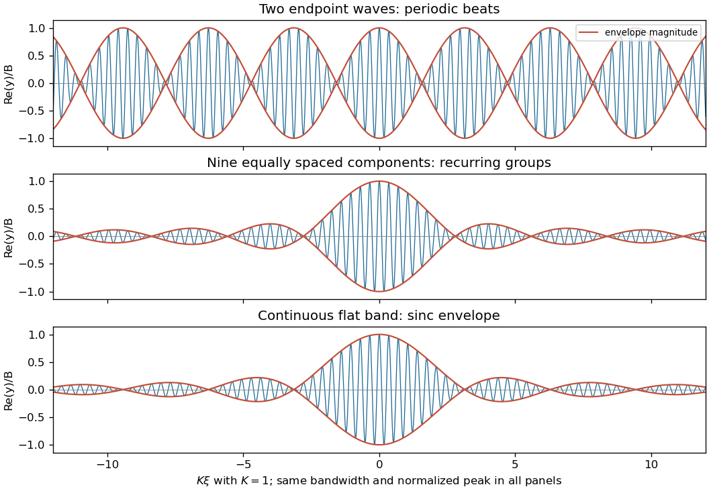

<h1 id="11/vi/solution">Solution</h1>

↑ **Parent:** [Vi](../vi.md)

The result depends on the component [amplitudes](../../../../wave-amplitude.md) and [wave phases](../../../../phase-waves.md); adding many [frequencies](../../../../frequency.md) does not by itself guarantee one localized [wave packet](../../../../wave-packet.md). For a definite sketch, take many equally spaced [wavenumbers](../../../../wavenumber.md) $k_j=k_0+j\Delta k$ in the same fixed band, with equal, aligned [complex amplitudes](../../../../complex-amplitude.md) $B/N$. Linearize the [dispersion relation](../../../../dispersion-relation-split.md) as $\omega(k_j)\simeq\omega_c+v_g(k_j-k_0)$, where $\omega_c=k_0^2/m$. Then with $\xi=x-v_gt$ the [wave envelope](../../../../envelope-waves.md) is

$$
\frac BN\sum_{j=-(N-1)/2}^{(N-1)/2}e^{ij\Delta k\xi}
=\frac BN\frac{\sin(N\Delta k\xi/2)}{\sin(\Delta k\xi/2)}
$$

for odd $N$. This is a normalized [Dirichlet kernel](../../../../dirichlet-kernel.md): [constructive interference](../../../../constructive-interference.md) occurs near $\xi=0$, while most other positions undergo partial cancellation. At finite $N$ there are repeated groups separated by $2\pi/\Delta k$.

As $N$ grows with the half-bandwidth $K$ fixed, $\Delta k$ decreases and the repetition spacing grows. The continuous flat-band limit is

$$
\boxed{y(x,t)\simeq Be^{i(k_0x-\omega_ct)}\frac{\sin(K\xi)}{K\xi},\qquad \xi=x-v_gt.}
$$

Thus a [sinc function](../../../../sinc-function.md) envelope has a central group between its first zeros at $\xi=\pm\pi/K$, smaller side lobes and rapidly oscillating crests. At fixed bandwidth the limiting central width is $2\pi/K$; it does not shrink indefinitely just because more components are added. Smoother spectral weights can reduce the side lobes, and random [wave phases](../../../../phase-waves.md) would produce a different shape.

**[Figure 4](#11/vi/image-equal-phase-waves-in-a-fixed-band-a-two-tone-beat-train-finite-groups-and-the-continuous-sinc-envelope). Equal-phase waves in a fixed band: a two-tone beat train, finite groups, and the continuous sinc envelope**.

For the exact quadratic [dispersion relation](../../../../dispersion-relation-split.md),

$$
y(x,t)=\frac{B}{2K}e^{i(k_0x-\omega_ct)}\int_{-K}^K e^{i[q(x-v_gt)-q^2t/m]}\,dq.
$$

The additional quadratic [wave phase](../../../../phase-waves.md) makes the [wave packet](../../../../wave-packet.md) spread and change shape. The translating [sinc function](../../../../sinc-function.md) approximation is valid while $|t|K^2/|m|\ll1$; the preceding figure is the exact $t=0$ comparison, where that approximation introduces no error.

## ↑ Ancestors (12)

1. [Vi](../vi.md)
2. [11](../../11.md)
3. [2021](../../../2021-split.md)
4. [Past exam of the mathematical methods II course of the University of Oxford](../../../split.md)
5. [Mathematical methods II course of the University of Oxford](../../../../mathematical-methods-ii-course-of-the-university-of-oxford.md)
6. [Year 1 of the physics course of the University of Oxford](../../../../year-1-of-the-physics-course-of-the-university-of-oxford.md)
7. [Physics course of the University of Oxford](../../../../physics-course-of-the-university-of-oxford.md)
8. [Undergraduate course of the University of Oxford](../../../../undergraduate-course-of-the-university-of-oxford.md)
9. [Course of the University of Oxford](../../../../course-of-the-university-of-oxford.md)
10. [University of Oxford](../../../../university-of-oxford-split.md)
11. [List of universities](../../../../list-of-universities.md)
12. [Codex Wiki](../../../../split.md)
