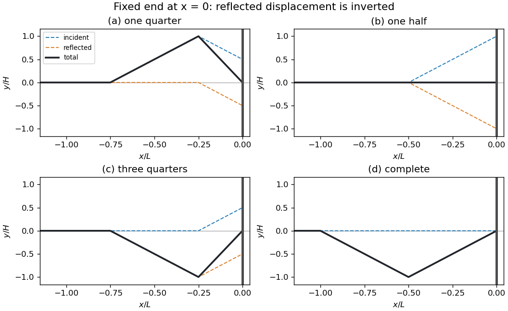

<h1 id="7/iv/d/solution">Solution</h1>

↑ **Parent:** [D](../d.md)

At $\tau=1$, the incident [pulse](../../../../../pulse.md) has left the physical half-line, so only the inverted reflected [pulse](../../../../../pulse.md) remains. Its straight segments pass through

$$
\boxed{(u,y/H)=(-1,0),\ (-1/2,-1),\ (0,0).}
$$

It subsequently travels toward decreasing $x$ at the original [wave speed](../../../../../wave-speed.md) $c$, with unchanged width $L$ and peak [amplitude](../../../../../wave-amplitude.md) magnitude $H$.

**[Figure 1](#7/iv/d/image-total-displacement-during-reflection-of-a-symmetric-triangular-pulse-at-a-fixed-end). Total displacement during reflection of a symmetric triangular pulse at a fixed end**.

## ↑ Ancestors (13)

1. [D](../d.md)
2. [Iv](../../iv.md)
3. [7](../../../7.md)
4. [2021](../../../../2021-split.md)
5. [Past exam of the mathematical methods II course of the University of Oxford](../../../../split.md)
6. [Mathematical methods II course of the University of Oxford](../../../../../mathematical-methods-ii-course-of-the-university-of-oxford.md)
7. [Year 1 of the physics course of the University of Oxford](../../../../../year-1-of-the-physics-course-of-the-university-of-oxford.md)
8. [Physics course of the University of Oxford](../../../../../physics-course-of-the-university-of-oxford.md)
9. [Undergraduate course of the University of Oxford](../../../../../undergraduate-course-of-the-university-of-oxford.md)
10. [Course of the University of Oxford](../../../../../course-of-the-university-of-oxford.md)
11. [University of Oxford](../../../../../university-of-oxford-split.md)
12. [List of universities](../../../../../list-of-universities.md)
13. [Codex Wiki](../../../../../split.md)
