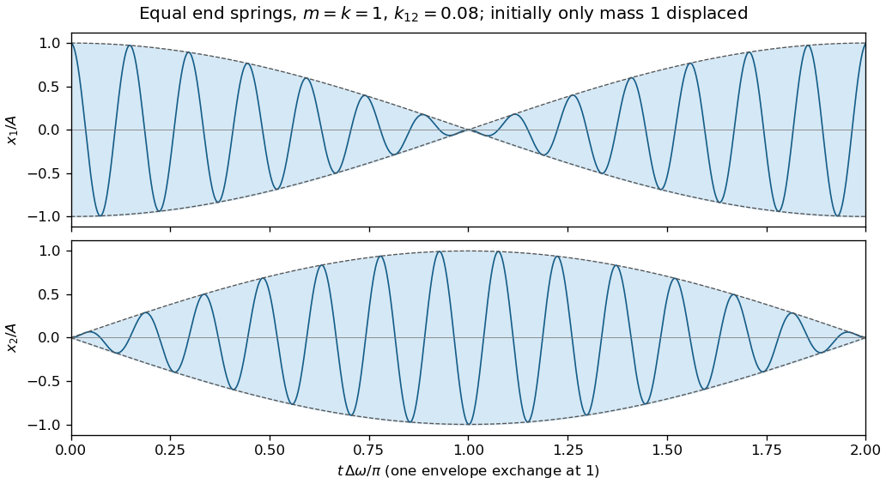

<h1 id="8/solution">Solution</h1>

↑ **Parent:** [8](../8.md)

A [normal mode](../../../normal-mode.md) of a stable undamped linear [coupled oscillator](../../../coupled-oscillator.md) has a single [angular frequency](../../../angular-frequency.md) and a fixed ratio of component [displacements](../../../displacement.md). All components share a sinusoidal time factor, with relative [oscillation phases](../../../phase-waves.md) of zero or $\pi$ for real [mode shapes](../../../mode-shape.md). A general free motion is a [superposition](../../../superposition-principle.md) of the [normal modes](../../../normal-mode.md). For this system the symmetric stiffness [matrix](../../../matrix.md) gives real [eigenvalues](../../../eigenvalue.md) and orthogonal [eigenvectors](../../../eigenvector.md); positive [spring constants](../../../spring-constant.md) make the squared [angular frequencies](../../../angular-frequency.md) positive.

Write $m=m_1=m_2>0$ and $\kappa=k_{12}$. Assume ideal massless linear springs, negligible [damping](../../../damping.md) and positive $k_1,k_2,\kappa$. By [Hooke's law](../../../hooke-s-law.md) and [Newton's second law](../../../newton-s-second-law.md),

$$
\boxed{m\ddot x_1=-(k_1+\kappa)x_1+\kappa x_2,\qquad
m\ddot x_2=\kappa x_1-(k_2+\kappa)x_2.}
$$

The coupling spring extends by $x_2-x_1$, giving equal and opposite coupling [forces](../../../force-split.md).

For a [normal mode](../../../normal-mode.md), take $\mathbf x=\operatorname{Re}(\mathbf a e^{i\omega t})$. Nonzero [eigenvectors](../../../eigenvector.md) require

$$
\det\begin{pmatrix}k_1+\kappa-m\omega^2&-\kappa\\-\kappa&k_2+\kappa-m\omega^2\end{pmatrix}=0.
$$

Solving this [quadratic equation](../../../quadratic-equation.md) in $m\omega^2$ gives

$$
\boxed{\omega_\pm^2=\frac{k_1+k_2+2\kappa\ \pm\sqrt{(k_1-k_2)^2+4\kappa^2}}{2m}.}
$$

A corresponding [mode shape](../../../mode-shape.md) has ratio

$$
\frac{a_2}{a_1}=\frac{k_1+\kappa-m\omega_\pm^2}{\kappa},
$$

and the general real solution is $\mathbf x=C_-\mathbf a_-\cos(\omega_-t+\phi_-)+C_+\mathbf a_+\cos(\omega_+t+\phi_+)$. The arbitrary [amplitudes](../../../wave-amplitude.md) and [oscillation phases](../../../phase-waves.md) account for four independent initial data.

**Weak coupling alone does not guarantee large beats.** A useful representative sketch assumes nearly equal uncoupled [angular frequencies](../../../angular-frequency.md). In the resonant case $k_1=k_2=k$ with $\kappa\ll k$, the [mode shapes](../../../mode-shape.md) are $(1,1)$ and $(1,-1)$, and

$$
\omega_-^2=k/m,\qquad \omega_+^2=(k+2\kappa)/m.
$$

For $x_1(0)=A$, $x_2(0)=\dot x_1(0)=\dot x_2(0)=0$, both [normal modes](../../../normal-mode.md) have equal coefficients. With $\bar\omega=(\omega_++\omega_-)/2$ and $\Delta\omega=\omega_+-\omega_-$,

$$
\boxed{x_1=A\cos(\bar\omega t)\cos(\Delta\omega t/2),\qquad
x_2=A\sin(\bar\omega t)\sin(\Delta\omega t/2).}
$$

These rapid [oscillations](../../../oscillation.md) have slowly varying complementary [wave envelopes](../../../envelope-waves.md). The initial [displacement](../../../displacement.md) shifts almost entirely to the other mass at $t=\pi/\Delta\omega$, and returns after $2\pi/\Delta\omega$. Arbitrary initial data give a different [superposition](../../../superposition-principle.md); if $|k_1-k_2|\gg\kappa$, the [normal modes](../../../normal-mode.md) are localized mainly on individual masses, and strong exchange is suppressed.

**[Figure 2](#8/image-representative-weakly-coupled-resonant-motion-rapid-displacements-inside-slowly-exchanging-envelopes). Representative weakly coupled resonant motion: rapid displacements inside slowly exchanging envelopes**.

Holding one mass fixed leaves the coupling spring attached and stretched by the other mass. Therefore the two constrained [angular frequencies](../../../angular-frequency.md) are

$$
\boxed{\omega_1=\sqrt{(k_1+\kappa)/m},\qquad \omega_2=\sqrt{(k_2+\kappa)/m}.}
$$

These differ from the [angular frequencies](../../../angular-frequency.md) obtained by physically removing the coupling spring. Ordinary [frequencies](../../../frequency.md) in hertz are each corresponding $\omega/(2\pi)$.

Finally, for $k_1>k_2$ and $\kappa>0$, put $D=\sqrt{(k_1-k_2)^2+4\kappa^2}>k_1-k_2$. Then

$$
\omega_-^2-\omega_2^2=\frac{k_1-k_2-D}{2m}<0,\qquad
\omega_+^2-\omega_1^2=\frac{D-(k_1-k_2)}{2m}>0.
$$

Since $\omega_1>\omega_2$, taking positive square roots proves

$$
\boxed{\omega_-<\omega_2<\omega_1<\omega_+.}
$$

At $\kappa=0$, the outer inequalities become equalities.

## ↑ Ancestors (11)

1. [8](../8.md)
2. [2021](../../2021-split.md)
3. [Past exam of the mathematical methods II course of the University of Oxford](../../split.md)
4. [Mathematical methods II course of the University of Oxford](../../../mathematical-methods-ii-course-of-the-university-of-oxford.md)
5. [Year 1 of the physics course of the University of Oxford](../../../year-1-of-the-physics-course-of-the-university-of-oxford.md)
6. [Physics course of the University of Oxford](../../../physics-course-of-the-university-of-oxford.md)
7. [Undergraduate course of the University of Oxford](../../../undergraduate-course-of-the-university-of-oxford.md)
8. [Course of the University of Oxford](../../../course-of-the-university-of-oxford.md)
9. [University of Oxford](../../../university-of-oxford-split.md)
10. [List of universities](../../../list-of-universities.md)
11. [Codex Wiki](../../../split.md)
