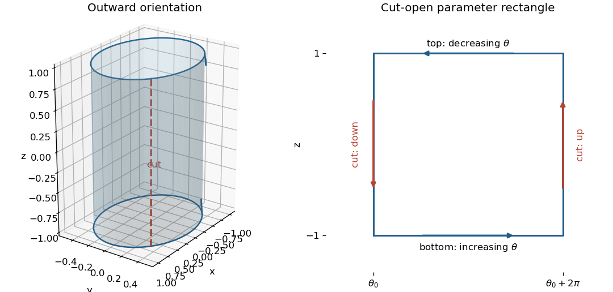

<h1 id="9/iii/solution">Solution</h1>

↑ **Parent:** [Iii](../iii.md)

Choose the outward [normal vector](../../../../normal-vector.md) on the side of the [elliptic cylinder](../../../../elliptic-cylinder.md). Parametrize it by

$$
\mathbf r(\theta,z)=(\cos\theta,\tfrac12\sin\theta,z),\qquad
-1\le z\le1.
$$

Since $\mathbf r_\theta\times\mathbf r_z=(\tfrac12\cos\theta,\sin\theta,0)$ points outward, the parameter rectangle has its bottom edge traversed with increasing $\theta$, its right cut edge with increasing $z$, its top edge with decreasing $\theta$, and its left cut edge with decreasing $z$. After identification, the two cut edges are the same physical [curve](../../../../curve.md) with opposite directions. Their [line integrals](../../../../line-integral.md) cancel for a single-valued [vector field](../../../../vector-field.md). Viewed from above, the bottom rim is counterclockwise and the top rim clockwise.

**[Figure 3](#9/iii/image-an-elliptic-cylindrical-side-cut-open-into-a-parameter-rectangle-with-compatible-outward-boundary-directions). An elliptic cylindrical side cut open into a parameter rectangle, with compatible outward boundary directions**.

To apply [Stokes theorem](../../../../stokes-theorem.md) to a [flux](../../../../flux.md) rather than a [curl](../../../../curl.md) integral, first find a [vector potential](../../../../vector-potential.md):

$$
\mathbf A=(0,0,xyz^2),\qquad
\nabla\times\mathbf A=(xz^2,-yz^2,0)=\mathbf F.
$$

This [vector potential](../../../../vector-potential.md) is smooth everywhere. On either horizontal rim, $d\mathbf r$ is horizontal whereas $\mathbf A$ is vertical, giving $\mathbf A\cdot d\mathbf r=0$. For a cut at $\theta_0=\pi/4$, $xy=1/4$, so the upward cut contribution is $\int_{-1}^1z^2/4\,dz=1/6$ and the downward one is $-1/6$. Consequently

$$
\boxed{\iint_S\mathbf F\cdot d\mathbf S
=\oint_{\partial S}\mathbf A\cdot d\mathbf r=0.}
$$

A direct check uses the [oriented surface element](../../../../oriented-surface-element.md) above: $\mathbf F\cdot(\mathbf r_\theta\times\mathbf r_z)=\tfrac12 z^2\cos2\theta$, whose [integral](../../../../integral-split.md) over a full turn vanishes. Reversing the chosen [orientation](../../../../orientation-of-a-simplex.md) still gives zero.

## ↑ Ancestors (12)

1. [Iii](../iii.md)
2. [9](../../9.md)
3. [2021](../../../2021-split.md)
4. [Past exam of the mathematical methods II course of the University of Oxford](../../../split.md)
5. [Mathematical methods II course of the University of Oxford](../../../../mathematical-methods-ii-course-of-the-university-of-oxford.md)
6. [Year 1 of the physics course of the University of Oxford](../../../../year-1-of-the-physics-course-of-the-university-of-oxford.md)
7. [Physics course of the University of Oxford](../../../../physics-course-of-the-university-of-oxford.md)
8. [Undergraduate course of the University of Oxford](../../../../undergraduate-course-of-the-university-of-oxford.md)
9. [Course of the University of Oxford](../../../../course-of-the-university-of-oxford.md)
10. [University of Oxford](../../../../university-of-oxford-split.md)
11. [List of universities](../../../../list-of-universities.md)
12. [Codex Wiki](../../../../split.md)
