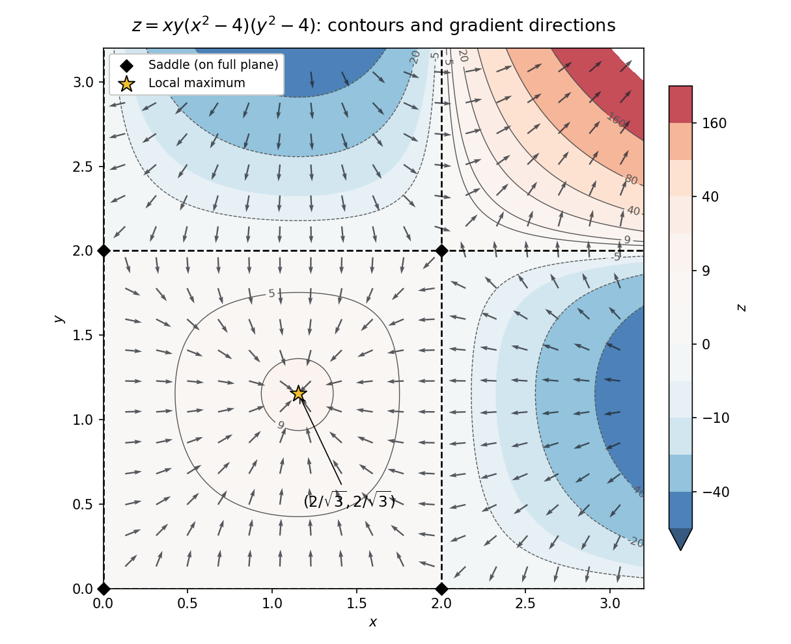
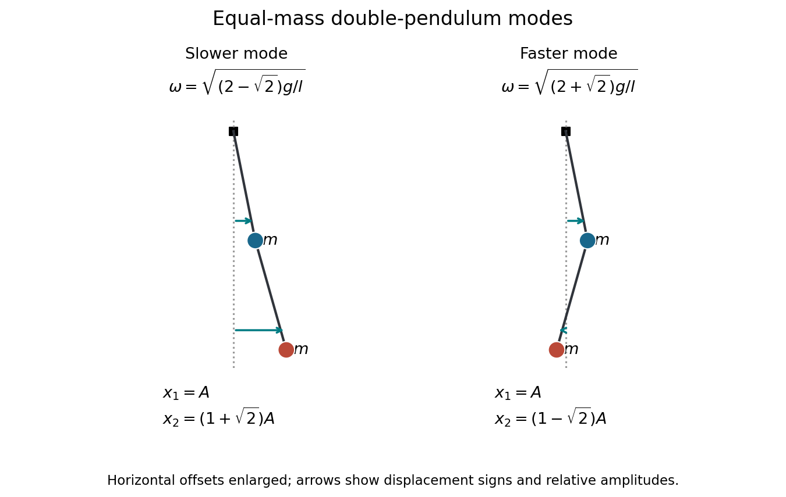

# 2022

↑ **Parent:** [Past exam of the mathematical methods II course of the University of Oxford](../past-exam-of-the-mathematical-methods-ii-course-of-the-university-of-oxford.md)

Source paper: [https://www.whatdotheyknow.com/request/physics_preliminary_past_papers/response/2680788/attach/3/2018%202021%20Physics%20prelims.zip?cookie_passthrough=1](https://www.whatdotheyknow.com/request/physics_preliminary_past_papers/response/2680788/attach/3/2018%202021%20Physics%20prelims.zip?cookie_passthrough=1)

The question numbering follows the original paper. The domain and orientation assumptions are stated where needed; question 11 distinguishes the supplied equations from the unequal-mass pendulum described in its diagram.

**Table of contents**

- [1](#1)
  - [i](#1/i)
    - [Solution](#1/i/solution)
  - [ii](#1/ii)
    - [Solution](#1/ii/solution)
- [2](#2)
  - [Solution](#2/solution)
- [3](#3)
  - [Solution](#3/solution)
- [4](#4)
  - [Solution](#4/solution)
- [5](#5)
  - [Solution](#5/solution)
- [6](#6)
  - [Solution](#6/solution)
- [7](#7)
  - [Solution](#7/solution)
- [8](#8)
  - [Solution](#8/solution)
- [9](#9)
  - [a](#9/a)
    - [Solution](#9/a/solution)
  - [b](#9/b)
    - [i](#9/b/i)
      - [Solution](#9/b/i/solution)
    - [ii](#9/b/ii)
      - [Solution](#9/b/ii/solution)
- [10](#10)
  - [a](#10/a)
    - [Solution](#10/a/solution)
  - [b](#10/b)
    - [Solution](#10/b/solution)
- [11](#11)
  - [a](#11/a)
    - [Solution](#11/a/solution)
  - [b](#11/b)
    - [Solution](#11/b/solution)
  - [c](#11/c)
    - [Solution](#11/c/solution)
  - [d](#11/d)
    - [Solution](#11/d/solution)
- [12](#12)
  - [a](#12/a)
    - [Solution](#12/a/solution)
  - [b](#12/b)
    - [Solution](#12/b/solution)
  - [c](#12/c)
    - [Solution](#12/c/solution)
  - [d](#12/d)
    - [Solution](#12/d/solution)
  - [e](#12/e)
    - [Solution](#12/e/solution)

## 1

↑ **Parent:** [2022](2022.md)

<h3 id="1/i">i</h3>

↑ **Parent:** [1](#1)

<h4 id="1/i/solution">Solution</h4>

↑ **Parent:** [I](#1/i)

The real [logarithm](../calculus.md#logarithm) restricts the approach to $x\to0^+$. The [Taylor expansion](../calculus.md#taylor-expansion) $\sin x-x=-x^3/6+O(x^5)$ gives

$$
\frac1x+\frac{\ln x}{\sin x-x}
=\frac{-6\ln x}{x^3}\bigl(1+O(x^2)\bigr)+\frac1x.
$$

The positive first term dominates, since $x^2/|\ln x|\to0$. Thus the requested extended [limit](../calculus.md#limit-of-a-function) is $\boxed{+\infty}$. There is no two-sided real [limit](../calculus.md#limit-of-a-function) across zero because the real [logarithm](../calculus.md#logarithm) is undefined for $x<0$.

<h3 id="1/ii">ii</h3>

↑ **Parent:** [1](#1)

<h4 id="1/ii/solution">Solution</h4>

↑ **Parent:** [Ii](#1/ii)

For $x>2$, write

$$
\frac1x+\frac{\ln x}{\sin x-x}
=\frac{1-\ln x/(1-\sin x/x)}x.
$$

Since $|\sin x|\le1$, the denominator factor tends to one, and $\ln x/x\to0$. Therefore the [limit](../calculus.md#limit-of-a-function) is $\boxed{0}$. The function is eventually negative, so it approaches zero from below. Oscillation of $\sin x$ does not obstruct this [limit](../calculus.md#limit-of-a-function), because it is bounded while $x$ grows.

## 2

↑ **Parent:** [2022](2022.md)

<h3 id="2/solution">Solution</h3>

↑ **Parent:** [2](#2)

Use [logarithmic differentiation](../calculus.md#logarithmic-differentiation) on the positive function: $\ln f=x^{-1}\ln(x^2+2)$. The [product rule](../calculus.md#product-rule) and [chain rule](../calculus.md#chain-rule) give

$$
\boxed{f'(x)=(x^2+2)^{1/x}\left[\frac{2}{x^2+2}-\frac{\ln(x^2+2)}{x^2}\right],\qquad x\ne0.}
$$

The positive base permits this real definition on both components of the indicated domain. There is no need to treat a variable exponent as a constant.

## 3

↑ **Parent:** [2022](2022.md)

<h3 id="3/solution">Solution</h3>

↑ **Parent:** [3](#3)

For an [exact differential](../differential-form.md#exact-differential) $P\,dx+Q\,dy$, equality of mixed [partial derivatives](../multivariable-calculus.md#partial-derivative) requires $P_y=Q_x$. The matching pair is $P=f_1$, $Q=f_3$, since

$$
\partial_yf_1=\frac{\cos y}{x}-e^x\sin2y=\partial_xf_3.
$$

The other pairings do not give the same [partial derivatives](../multivariable-calculus.md#partial-derivative) on an open region. Integrating $f_1$ with respect to $x$ gives $\ln x\sin y+e^x\cos^2y+C(y)$. Its $y$ derivative agrees with $f_3$ precisely when $C'(y)=0$. Hence

$$
\boxed{f(x,y)=\ln x\sin y+e^x\cos^2y+C,\qquad x>0.}
$$

This also proves existence, rather than relying only on the necessary mixed-[partial derivative](../multivariable-calculus.md#partial-derivative) test.

## 4

↑ **Parent:** [2022](2022.md)

<h3 id="4/solution">Solution</h3>

↑ **Parent:** [4](#4)

Put $h=x-1/\sqrt2$ and $k=y-1/(2\sqrt2)$. At the expansion point the exponent is one and the [gradient](../multivariable-calculus.md#gradient) is $(\sqrt2e,\sqrt2e)$. The first-order [multivariable Taylor expansion](../calculus.md#multivariable-taylor-expansion) is

$$
\boxed{f=e+\sqrt2e(h+k)+O(h^2+k^2).}
$$

The [directional error of a first-order Taylor approximation](../calculus.md#directional-error-of-a-first-order-taylor-approximation) is determined by the omitted terms, not just the equal first [partial derivatives](../multivariable-calculus.md#partial-derivative). The [Hessian matrix](../multivariable-calculus.md#hessian-matrix) at the expansion point is $e\begin{pmatrix}4&2\\2&2\end{pmatrix}$, so

$$
f-e-\sqrt2e(h+k)=e(2h^2+2hk+k^2)+O\bigl((h^2+k^2)^{3/2}\bigr).
$$

For equal small steps along the coordinate axes, the leading error is $2eh^2$ along $x$ and $ek^2$ along $y$. **The error grows faster along the $x$ axis**, although the first-order change in the function is equal along the two axes.

## 5

↑ **Parent:** [2022](2022.md)

<h3 id="5/solution">Solution</h3>

↑ **Parent:** [5](#5)

Choose the normal pointing away from the origin, equivalently the outward normal of the first-octant tetrahedron. Parametrize the face by $\mathbf r=(x,y,2-x/2-y/2)$ on $D=\{x,y\ge0:x+y\le4\}$. Its oriented area element is

$$
\mathbf r_x\times\mathbf r_y\,dx\,dy=(1/2,1/2,1)\,dx\,dy.
$$

Thus the [surface integral](../multivariable-calculus.md#surface-integral) is

$$
\iint_D\left(-\frac x2+\frac y2+2-\frac x2-\frac y2\right)dx\,dy
=\int_0^4(2-x)(4-x)\,dx
=\boxed{\frac{16}{3}}.
$$

The [divergence theorem](../multivariable-calculus.md#divergence-theorem) checks this result: $\nabla\cdot\mathbf F=1$, the tetrahedron's [volume](../geometry-and-topology.md#volume) is $4\cdot4\cdot2/6=16/3$, and each coordinate-plane face has zero [flux](../mathematical-physics.md#flux). The opposite orientation gives $-16/3$; a signed [flux](../mathematical-physics.md#flux) requires an orientation.

## 6

↑ **Parent:** [2022](2022.md)

<h3 id="6/solution">Solution</h3>

↑ **Parent:** [6](#6)

The triangular support can be written $0\le x\le\pi/2$, $\pi/2-x\le y\le\pi/2$. The density is nonnegative there, and the [normalization of a probability distribution](../probability-distribution.md#normalization-of-a-probability-distribution) requires

$$
1=A\int_0^{\pi/2}\sin x(1-\cos x)\,dx=\frac A2.
$$

Hence $\boxed{A=2}$. Multiplying the [joint probability density](../continuous-probability-distribution.md#joint-probability-density) by the required function cancels $\sin x$ on the interior. Its [expectation](../expected-value.md) is

$$
\boxed{\mathbb E\left[\frac1{\sin X}\right]=2\int_0^{\pi/2}(1-\cos x)\,dx=\pi-2.}
$$

The singularity at $x=0$ lies at a support vertex of zero probability; the displayed [integral](../integral.md) establishes integrability. Assigning any value to the random function at that single vertex does not change the [expectation](../expected-value.md).

## 7

↑ **Parent:** [2022](2022.md)

<h3 id="7/solution">Solution</h3>

↑ **Parent:** [7](#7)

The two planes bound $z-1\le y\le1-z$, and the elliptical cross-section has $-1\le z\le1$. Under $x=2r\cos\theta$, $z=r\sin\theta$, the absolute [Jacobian determinant](../multivariable-calculus.md#jacobian-determinant) for $(x,z)$ is $2r$. Therefore

$$
V=\int_0^{2\pi}\int_0^1\int_{r\sin\theta-1}^{1-r\sin\theta}2r\,dy\,dr\,d\theta
=\int_0^{2\pi}\int_0^1 4r(1-r\sin\theta)\,dr\,d\theta
=\boxed{4\pi}.
$$

As a check, the cross-sectional [ellipse](../euclidean-geometry.md#ellipse) has area $2\pi$, while the part of the thickness proportional to $z$ integrates to zero by reflection. The mean thickness is therefore two.

## 8

↑ **Parent:** [2022](2022.md)

<h3 id="8/solution">Solution</h3>

↑ **Parent:** [8](#8)

For positive [wavenumber](../wave-equation.md#wavenumber), the condition gives $\omega=Ck^{-n/2}$ on the positive-[frequency](../wave.md#frequency) branch. The [group velocity](../dispersion-relation.md#group-velocity) and [phase velocity](../dispersion-relation.md#phase-velocity) are consequently related by

$$
v_g=\frac{d\omega}{dk}=-\frac n2\frac\omega k=-\frac n2v_p.
$$

The required positive ratio $v_g/v_p=2$ gives $\boxed{n=-4}$. Isotropy makes these [velocities](../classical-mechanics.md#velocity) parallel to the wave vector when this coefficient is positive. Identifying [group velocity](../dispersion-relation.md#group-velocity) with [energy](../energy.md) transport assumes the usual lossless narrowband [wave packet](../dispersion-relation.md#wave-packet) regime.

## 9

↑ **Parent:** [2022](2022.md)

<h3 id="9/a">a</h3>

↑ **Parent:** [9](#9)

<h4 id="9/a/solution">Solution</h4>

↑ **Parent:** [A](#9/a)

Since $\mathbf a$ is constant, direct differentiation gives $(\mathbf r\cdot\nabla)\mathbf a=0$, $(\mathbf a\cdot\nabla)\mathbf r=\mathbf a$, $\nabla\cdot\mathbf r=3$ and $\nabla\cdot\mathbf a=0$. The stated right-hand side is therefore $2\mathbf a$. Independently, [index notation](../multilinear-algebra.md#index-notation) gives

$$
[\nabla\times(\mathbf a\times\mathbf r)]_i
=\epsilon_{ijk}\epsilon_{klm}\partial_j(a_lx_m)=2a_i.
$$

Thus $\boxed{\nabla\times(\mathbf a\times\mathbf r)=2\mathbf a}$. A [conservative vector field](../multivariable-calculus.md#conservative-vector-field) has zero [curl](../multivariable-calculus.md#curl), so the field is **not conservative unless $\mathbf a=0$**. For a closed planar circuit, its [circulation](../vorticity.md#circulation-physics) is $2\mathbf a\cdot\mathbf A$ by [Stokes theorem](../multivariable-calculus.md#stokes-theorem); the zero-vector exception is conservative with a constant potential.

<h3 id="9/b">b</h3>

↑ **Parent:** [9](#9)

<h4 id="9/b/i">i</h4>

↑ **Parent:** [B](#9/b)

<h5 id="9/b/i/solution">Solution</h5>

↑ **Parent:** [I](#9/b/i)

For a sufficiently smooth vector field on an oriented surface $S$ with compatible boundary orientation, [Stokes theorem](../multivariable-calculus.md#stokes-theorem) states

$$
\oint_{\partial S}\mathbf F\cdot d\mathbf r=\iint_S(\nabla\times\mathbf F)\cdot\mathbf n\,dS.
$$

Apply it to $\mathbf F=(P,Q,0)$ in the plane. The closed [line integral](../multivariable-calculus.md#line-integral) is the area [integral](../integral.md) of $Q_x-P_y$. Thus $P_y=Q_x$ makes it vanish whenever a spanning surface lies within the smooth domain. In a simply connected domain this implies [path independence](../multivariable-calculus.md#path-independence): join one path from $A$ to $B$ to the reverse of another, and their difference is a zero closed [line integral](../multivariable-calculus.md#line-integral).

The domain qualification is essential. On the punctured plane, $P=-y/(x^2+y^2)$, $Q=x/(x^2+y^2)$ satisfy $P_y=Q_x$, but the [line integral](../multivariable-calculus.md#line-integral) around the unit circle is $2\pi$. A disk spanning that circle passes through the singularity. Hence the printed implication requires an appropriate domain assumption; zero [curl](../multivariable-calculus.md#curl) alone is not a global [path independence](../multivariable-calculus.md#path-independence) theorem.

<h4 id="9/b/ii">ii</h4>

↑ **Parent:** [B](#9/b)

<h5 id="9/b/ii/solution">Solution</h5>

↑ **Parent:** [Ii](#9/b/ii)

Let $F'=f$ and $G'=g$ on the relevant intervals. The [chain rule](../calculus.md#chain-rule) gives

$$
d\{F(xy)+G(y/x)\}
=\left[yf(xy)-\frac y{x^2}g(y/x)\right]dx
+\left[xf(xy)+\frac1xg(y/x)\right]dy.
$$

Thus the one-form is explicitly an [exact differential](../differential-form.md#exact-differential). Fixing its potential to vanish at $(1,1)$ determines it uniquely on the connected domain:

$$
\boxed{\phi(x,y)=\int_1^{xy}f(s)\,ds+\int_1^{y/x}g(t)\,dt.}
$$

Continuity of $f,g$ on the integration ranges suffices. For arbitrary smooth data defined throughout $x>0$, that half-plane also supplies the simply connected domain in the previous argument.

For the specialization $f(s)=s^{-2}$, the potential based at $(1,1)$ is defined in the positive quadrant; it cannot be continued through $xy=0$ using this formula. Taking $a,b>0$ keeps both endpoints in that component. Their ratios $y/x$ are both $b/a$, so the $G$ term cancels and

$$
\boxed{\phi(ab,b^2)-\phi(a,b)=\int_{ab}^{ab^3}s^{-2}\,ds
=\frac{b^2-1}{ab^3}.}
$$

No condition on $g$ beyond existence on the traversed ratios enters this difference.

## 10

↑ **Parent:** [2022](2022.md)

<h3 id="10/a">a</h3>

↑ **Parent:** [10](#10)

<h4 id="10/a/solution">Solution</h4>

↑ **Parent:** [A](#10/a)

Write $A(s)=s(s^2-4)$, so $z=A(x)A(y)$ and

$$
z_x=(3x^2-4)y(y^2-4),\qquad z_y=(3y^2-4)x(x^2-4).
$$

Solving these simultaneously gives **thirteen stationary points**: the nine grid points with $x,y\in\{-2,0,2\}$ and the four points $x,y\in\{-2/\sqrt3,2/\sqrt3\}$. There are no mixed extra cases, because $A$ and $A'$ have no common root.

At a grid point the [Hessian matrix](../multivariable-calculus.md#hessian-matrix) has zero diagonal and off-diagonal entry $A'(x)A'(y)\ne0$, so its [determinant](../multilinear-algebra.md#determinant) is negative: all nine are [saddle points](../analysis.md#saddle-point). At the other four points the [Hessian matrix](../multivariable-calculus.md#hessian-matrix) is $-16xy\,I$. Thus the equal-sign points are local maxima with value $256/27$, and the opposite-sign points are local minima with value $-256/27$.

In the requested nonnegative quadrant, the stationary points are the four boundary [saddle points](../analysis.md#saddle-point) $(0,0),(0,2),(2,0),(2,2)$ and the interior local maximum $(2/\sqrt3,2/\sqrt3)$. The zero contours are $x=0,2$ and $y=0,2$. The [gradient](../multivariable-calculus.md#gradient) is perpendicular to regular contours and points toward increasing $z$. A boundary point's classification above refers to the function on the whole plane; its behavior restricted to the quadrant can be one-sided. The interior local maximum is not a global maximum on the unbounded quadrant, since $z\to+\infty$ along $x=y\to\infty$.

**[Figure 1](#10/a/image-contours-zeros-stationary-points-and-gradient-directions-for-the-polynomial-surface-in-the-nonnegative-quadrant). Contours, zeros, stationary points and gradient directions for the polynomial surface in the nonnegative quadrant**.

<h3 id="10/b">b</h3>

↑ **Parent:** [10](#10)

<h4 id="10/b/solution">Solution</h4>

↑ **Parent:** [B](#10/b)

The [divergence](../multivariable-calculus.md#divergence) of $\mathbf F=\nabla z$ is the [Laplacian](../multivariable-calculus.md#laplacian)

$$
\nabla\cdot\mathbf F=6xy(x^2+y^2-8).
$$

Its area [integral](../integral.md) over the square is

$$
\int_0^2\int_0^2 6xy(x^2+y^2-8)\,dx\,dy
=6(8+8-32)=\boxed{-96}.
$$

For the boundary [flux](../mathematical-physics.md#flux), $\int_0^2A(s)\,ds=-4$. On $x=0$, $\mathbf F\cdot\mathbf n=4A(y)$, giving $-16$; on $x=2$ it is $8A(y)$, giving $-32$. The corresponding horizontal sides give $-16$ and $-32$. The total is again $-96$, verifying the [divergence theorem](../multivariable-calculus.md#divergence-theorem) with outward normals. With a counterclockwise boundary, this is the same orientation as $M\,dy-N\,dx$.

## 11

↑ **Parent:** [2022](2022.md)

<h3 id="11/a">a</h3>

↑ **Parent:** [11](#11)

<h4 id="11/a/solution">Solution</h4>

↑ **Parent:** [A](#11/a)

First solve the supplied equations as a linear system, with $\omega_0^2=g/l$ and $\alpha>0$. A [normal mode](../wave-equation.md#normal-mode) $\mathbf x=\mathbf a e^{i\omega t}$ obeys

$$
\frac{\omega^2}{\omega_0^2}\mathbf a=D\mathbf a,\qquad
D=\begin{pmatrix}1+2\alpha&-\alpha\\-\alpha&\alpha\end{pmatrix}.
$$

Its [characteristic polynomial](../linear-operator-theory.md#characteristic-polynomial) is $\lambda^2-(1+3\alpha)\lambda+\alpha(1+\alpha)$. Hence

$$
\boxed{\omega_\pm^2=\frac g{2l}\left[1+3\alpha\pm\sqrt{1+2\alpha+5\alpha^2}\right].}
$$

Both are positive, since the [trace](../linear-algebra.md#matrix-trace) and [determinant](../multilinear-algebra.md#determinant) of $D$ are positive.

There is a physical discrepancy in the source. The [horizontal-coordinate mass matrix of an unequal-mass double pendulum](../lagrangian-mechanics.md#horizontal-coordinate-mass-matrix-of-an-unequal-mass-double-pendulum) follows from the stated horizontal [displacements](../classical-mechanics.md#displacement), which give

$$
T_2=\frac m2\dot x_1^2+\frac{\alpha m}{2}\dot x_2^2,\qquad
V_2=\frac{mg}{2l}\left[x_1^2+\alpha x_1^2+\alpha(x_2-x_1)^2\right].
$$

The [Euler-Lagrange equations](../analysis.md#euler-lagrange-equation) reproduce the supplied upper equation, but give $\ddot x_2=-(g/l)(x_2-x_1)$, without its extra $\alpha$. The true [normal modes of a double pendulum](../lagrangian-mechanics.md#normal-modes-of-a-double-pendulum) consequently have $\omega_\pm^2=(g/l)[1+\alpha\pm\sqrt{\alpha(1+\alpha)}]$. The boxed answer and the remaining parts below concern the explicitly supplied linear system. The two models agree at $\alpha=1$, but not for a general mass ratio.

<h3 id="11/b">b</h3>

↑ **Parent:** [11](#11)

<h4 id="11/b/solution">Solution</h4>

↑ **Parent:** [B](#11/b)

At $\alpha=1$, the supplied and physical systems agree. Their squared [angular frequencies](../lagrangian-mechanics.md#angular-frequency) are $(g/l)(2\pm\sqrt2)$. The upper row gives $a_2/a_1=3-\lambda$, so

$$
\boxed{\frac{a_2}{a_1}=1+\sqrt2\ \text{for the slower mode},\qquad
\frac{a_2}{a_1}=1-\sqrt2\ \text{for the faster mode}.}
$$

In the slower [normal mode](../wave-equation.md#normal-mode), both masses move horizontally in phase and the lower has the larger [amplitude](../wave.md#wave-amplitude). In the faster [normal mode](../wave-equation.md#normal-mode), the lower mass moves in the opposite direction, with magnitude $(\sqrt2-1)|a_1|$. These are horizontal [displacement](../classical-mechanics.md#displacement) ratios. The rod angles instead satisfy $\theta_2/\theta_1=\pm\sqrt2$, because $x_1=l\theta_1$, $x_2=l(\theta_1+\theta_2)$; confusing these ratios changes the sketch.

**[Figure 2](#11/b/image-equal-mass-normal-mode-snapshots-with-horizontal-displacements-enlarged-for-readability-arrow-lengths-show-the-relative-displacement-amplitudes). Equal-mass normal-mode snapshots with horizontal displacements enlarged for readability; arrow lengths show the relative displacement amplitudes**.

<h3 id="11/c">c</h3>

↑ **Parent:** [11](#11)

<h4 id="11/c/solution">Solution</h4>

↑ **Parent:** [C](#11/c)

For the supplied system, the small-$\alpha$ [Taylor expansion](../calculus.md#taylor-expansion) gives $\sqrt{1+2\alpha+5\alpha^2}=1+\alpha+O(\alpha^2)$, hence $\omega_-^2=\alpha g/l+O(\alpha^2g/l)$. Setting $\omega_-=(1/4)\sqrt{g/l}$ at this order yields

$$
\boxed{\alpha\simeq\frac1{16}.}
$$

This is an approximation in the squared [frequency](../wave.md#frequency). The exact positive solution of $\lambda_-=1/16$ is $\alpha=(\sqrt{229}-13)/32\simeq0.06665$, showing the size of the neglected correction. The physical unequal-mass [double pendulum](../lagrangian-mechanics.md#double-pendulum) has a different small-mass limit, so the source's requested tuning does not follow for that model.

<h3 id="11/d">d</h3>

↑ **Parent:** [11](#11)

<h4 id="11/d/solution">Solution</h4>

↑ **Parent:** [D](#11/d)

For the supplied equations, $\lambda_+\to1$ and $a_2/a_1=\alpha/(\alpha-\lambda_+)\sim-\alpha$. Thus the higher-[frequency](../wave.md#frequency) [normal mode](../wave-equation.md#normal-mode) becomes an upper-mass [oscillation](../wave.md#oscillation) at $\sqrt{g/l}$ with a vanishing, opposite-sign lower horizontal [displacement](../classical-mechanics.md#displacement). At $\alpha=0$ the supplied lower equation is $\ddot x_2=0$ and its other mode has zero [frequency](../wave.md#frequency).

This limiting picture belongs to the given matrix. For the physical unequal-mass [double pendulum](../lagrangian-mechanics.md#double-pendulum), both [normal mode](../wave-equation.md#normal-mode) [angular frequencies](../lagrangian-mechanics.md#angular-frequency) tend to $\sqrt{g/l}$ as the lower mass tends to zero; at exactly zero mass its independent equation needs a limiting test-body interpretation. The source's extra $\alpha$ changes precisely this conclusion.

## 12

↑ **Parent:** [2022](2022.md)

<h3 id="12/a">a</h3>

↑ **Parent:** [12](#12)

<h4 id="12/a/solution">Solution</h4>

↑ **Parent:** [A](#12/a)

Use [separation of variables](../partial-differential-equation.md#separation-of-variables), $y=X(x)T(t)$. A nontrivial separated solution satisfies $X''/X=T''/(c^2T)=-k^2$. Fixed endpoints force $X(0)=X(L)=0$, so $X=\sin(n\pi x/L)$, $n=1,2,\ldots$. Therefore

$$
\boxed{\omega_n=\frac{n\pi c}{L},\qquad f_n=\frac{nc}{2L}.}
$$

Here $c>0$ is the wave [speed](../classical-mechanics.md#speed). Zero or negative $k^2$ gives no nonzero fixed-end spatial solution. Each time coefficient is a [simple harmonic oscillator](../classical-mechanics.md#simple-harmonic-motion).

<h3 id="12/b">b</h3>

↑ **Parent:** [12](#12)

<h4 id="12/b/solution">Solution</h4>

↑ **Parent:** [B](#12/b)

Expand the initial [velocity](../classical-mechanics.md#velocity) in the [Fourier sine basis](../fourier-series.md#fourier-sine-basis), $V(x)=\sum_{n\ge1}V_n\sin(n\pi x/L)$, where $V_n=(2/L)\int_0^LV(x)\sin(n\pi x/L)\,dx$. Zero initial [displacement](../classical-mechanics.md#displacement) removes the cosine-in-time coefficients. Thus

$$
\boxed{y(x,t)=\sum_{n\ge1}\frac{V_n}{\omega_n}\sin\frac{n\pi x}{L}\sin(\omega_nt).}
$$

The [trigonometric identity](../geometry-and-topology.md#trigonometric-identity) $2\sin a\sin b=\cos(a-b)-\cos(a+b)$ rewrites each summand as

$$
\frac{V_n}{2\omega_n}\left[\cos\left(\frac{n\pi x}{L}-\omega_nt\right)-\cos\left(\frac{n\pi x}{L}+\omega_nt\right)\right].
$$

It is therefore a superposition of [travelling waves](../analysis.md#travelling-wave) of [speeds](../classical-mechanics.md#speed) $+c$ and $-c$, whose interference enforces the fixed endpoints. For general square-integrable initial [velocity](../classical-mechanics.md#velocity), the series is interpreted in the standard finite-energy sense.

<h3 id="12/c">c</h3>

↑ **Parent:** [12](#12)

<h4 id="12/c/solution">Solution</h4>

↑ **Parent:** [C](#12/c)

The product-to-sum identity gives $V_1=V_0$, $V_2=V_0/2$ and $V_3=2V_0/3$, with all other modal coefficients zero. If $\mu$ is the string's [linear mass density](../fluid-mechanics.md#linear-mass-density), the initial [potential energy](../energy.md#potential-energy) vanishes and [orthogonality](../inner-product.md#orthogonal-vectors) gives the [modal energy of a string](../wave-equation.md#modal-energy-of-a-string)

$$
E_n=\frac\mu2\int_0^LV_n^2\sin^2\frac{n\pi x}{L}\,dx=\frac{\mu L}{4}V_n^2.
$$

Consequently $\boxed{E_1:E_2:E_3=36:9:16}$ for $V_0\ne0$. **The fundamental mode carries the most energy**, with fraction $36/61$. Comparing displacement coefficients without their [frequency](../wave.md#frequency) factors would give the wrong energy test.

<h3 id="12/d">d</h3>

↑ **Parent:** [12](#12)

<h4 id="12/d/solution">Solution</h4>

↑ **Parent:** [D](#12/d)

Substitute the three nonzero initial-[velocity](../classical-mechanics.md#velocity) coefficients into the general [Fourier sine series](../fourier-series.md#fourier-sine-series), with $\omega_1=\pi c/L$:

$$
\boxed{y(x,t)=\frac{V_0}{\omega_1}\left[
\sin\frac{\pi x}{L}\sin\omega_1t+
\frac14\sin\frac{2\pi x}{L}\sin2\omega_1t+
\frac29\sin\frac{3\pi x}{L}\sin3\omega_1t\right].}
$$

Every term satisfies the [wave equation](../wave-equation.md) and the endpoint conditions. Differentiating in time at zero recovers the three coefficients $V_0,V_0/2,2V_0/3$, providing a direct initial-data check.

<h3 id="12/e">e</h3>

↑ **Parent:** [12](#12)

<h4 id="12/e/solution">Solution</h4>

↑ **Parent:** [E](#12/e)

Assume $V_0\ne0$. [Linear independence](../vector-space.md#linear-independence) of the [Fourier sine basis](../fourier-series.md#fourier-sine-basis) makes a flat string equivalent to vanishing of all three temporal coefficients. The fundamental requires $\sin(\omega_1t)=0$, which automatically zeros the other two. Thus the earliest positive return is

$$
\boxed{t_{\rm flat}=\frac{\pi}{\omega_1}=\frac Lc.}
$$

The [velocity](../classical-mechanics.md#velocity) need not have returned to its initial value at that time; full recurrence of the displacement-and-velocity data occurs at $2L/c$.

A nonzero pure fundamental profile would require $\sin2\omega_1t=\sin3\omega_1t=0$. The common zeros have $\omega_1t$ an integer multiple of $\pi$, so the fundamental vanishes too. A pure second or third harmonic would already require the fundamental to vanish, again making the whole string flat. **The string never has a nonzero pure sine profile.** If $V_0=0$, it remains identically zero and there is no earliest positive isolated return.

## ↑ Ancestors (9)

1. [Past exam of the mathematical methods II course of the University of Oxford](../past-exam-of-the-mathematical-methods-ii-course-of-the-university-of-oxford.md)
2. [Mathematical methods II course of the University of Oxford](../university-of-oxford.md#mathematical-methods-ii-course-of-the-university-of-oxford)
3. [Year 1 of the physics course of the University of Oxford](../university-of-oxford.md#year-1-of-the-physics-course-of-the-university-of-oxford)
4. [Physics course of the University of Oxford](../university-of-oxford.md#physics-course-of-the-university-of-oxford)
5. [Undergraduate course of the University of Oxford](../university-of-oxford.md#undergraduate-course-of-the-university-of-oxford)
6. [Course of the University of Oxford](../university-of-oxford.md#course-of-the-university-of-oxford)
7. [University of Oxford](../university-of-oxford.md)
8. [List of universities](../README.md#list-of-universities)
9. [Codex Wiki](../README.md)
