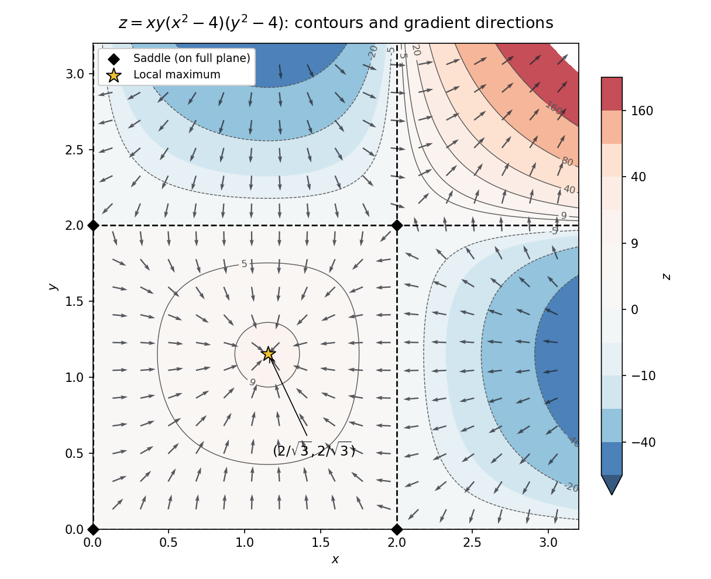

<h1 id="10/a/solution">Solution</h1>

↑ **Parent:** [A](../a.md)

Write $A(s)=s(s^2-4)$, so $z=A(x)A(y)$ and

$$
z_x=(3x^2-4)y(y^2-4),\qquad z_y=(3y^2-4)x(x^2-4).
$$

Solving these simultaneously gives **thirteen stationary points**: the nine grid points with $x,y\in\{-2,0,2\}$ and the four points $x,y\in\{-2/\sqrt3,2/\sqrt3\}$. There are no mixed extra cases, because $A$ and $A'$ have no common root.

At a grid point the [Hessian matrix](../../../../hessian-matrix.md) has zero diagonal and off-diagonal entry $A'(x)A'(y)\ne0$, so its [determinant](../../../../determinant.md) is negative: all nine are [saddle points](../../../../saddle-point.md). At the other four points the [Hessian matrix](../../../../hessian-matrix.md) is $-16xy\,I$. Thus the equal-sign points are local maxima with value $256/27$, and the opposite-sign points are local minima with value $-256/27$.

In the requested nonnegative quadrant, the stationary points are the four boundary [saddle points](../../../../saddle-point.md) $(0,0),(0,2),(2,0),(2,2)$ and the interior local maximum $(2/\sqrt3,2/\sqrt3)$. The zero contours are $x=0,2$ and $y=0,2$. The [gradient](../../../../gradient.md) is perpendicular to regular contours and points toward increasing $z$. A boundary point's classification above refers to the function on the whole plane; its behavior restricted to the quadrant can be one-sided. The interior local maximum is not a global maximum on the unbounded quadrant, since $z\to+\infty$ along $x=y\to\infty$.

**[Figure 1](#10/a/image-contours-zeros-stationary-points-and-gradient-directions-for-the-polynomial-surface-in-the-nonnegative-quadrant). Contours, zeros, stationary points and gradient directions for the polynomial surface in the nonnegative quadrant**.

## ↑ Ancestors (12)

1. [A](../a.md)
2. [10](../../10.md)
3. [2022](../../../2022-split.md)
4. [Past exam of the mathematical methods II course of the University of Oxford](../../../split.md)
5. [Mathematical methods II course of the University of Oxford](../../../../mathematical-methods-ii-course-of-the-university-of-oxford.md)
6. [Year 1 of the physics course of the University of Oxford](../../../../year-1-of-the-physics-course-of-the-university-of-oxford.md)
7. [Physics course of the University of Oxford](../../../../physics-course-of-the-university-of-oxford.md)
8. [Undergraduate course of the University of Oxford](../../../../undergraduate-course-of-the-university-of-oxford.md)
9. [Course of the University of Oxford](../../../../course-of-the-university-of-oxford.md)
10. [University of Oxford](../../../../university-of-oxford-split.md)
11. [List of universities](../../../../list-of-universities.md)
12. [Codex Wiki](../../../../split.md)
