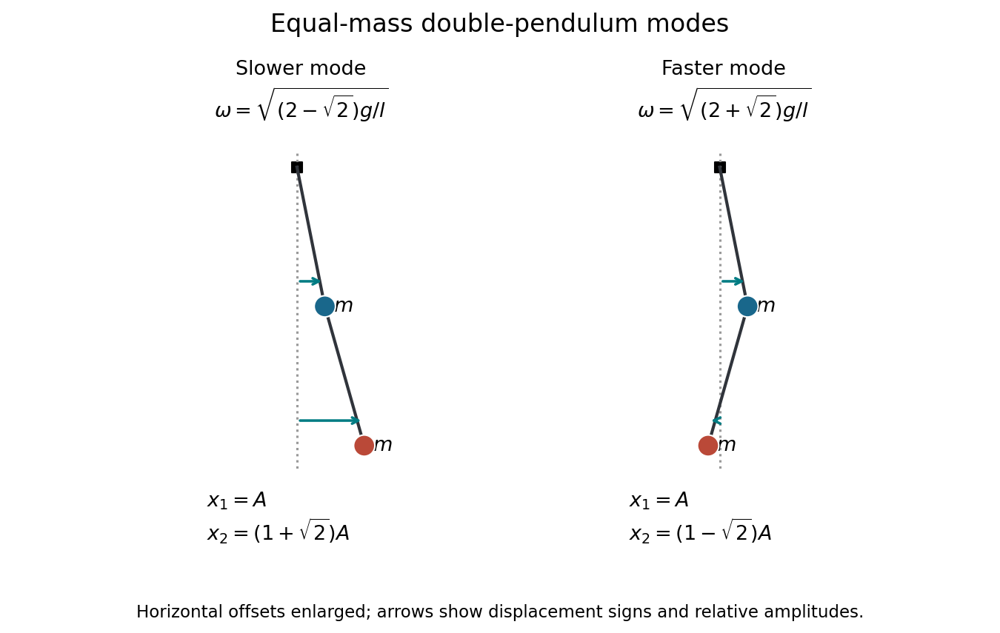

<h1 id="11/b/solution">Solution</h1>

↑ **Parent:** [B](../b.md)

At $\alpha=1$, the supplied and physical systems agree. Their squared [angular frequencies](../../../../angular-frequency.md) are $(g/l)(2\pm\sqrt2)$. The upper row gives $a_2/a_1=3-\lambda$, so

$$
\boxed{\frac{a_2}{a_1}=1+\sqrt2\ \text{for the slower mode},\qquad
\frac{a_2}{a_1}=1-\sqrt2\ \text{for the faster mode}.}
$$

In the slower [normal mode](../../../../normal-mode.md), both masses move horizontally in phase and the lower has the larger [amplitude](../../../../wave-amplitude.md). In the faster [normal mode](../../../../normal-mode.md), the lower mass moves in the opposite direction, with magnitude $(\sqrt2-1)|a_1|$. These are horizontal [displacement](../../../../displacement.md) ratios. The rod angles instead satisfy $\theta_2/\theta_1=\pm\sqrt2$, because $x_1=l\theta_1$, $x_2=l(\theta_1+\theta_2)$; confusing these ratios changes the sketch.

**[Figure 2](#11/b/image-equal-mass-normal-mode-snapshots-with-horizontal-displacements-enlarged-for-readability-arrow-lengths-show-the-relative-displacement-amplitudes). Equal-mass normal-mode snapshots with horizontal displacements enlarged for readability; arrow lengths show the relative displacement amplitudes**.

## ↑ Ancestors (12)

1. [B](../b.md)
2. [11](../../11.md)
3. [2022](../../../2022-split.md)
4. [Past exam of the mathematical methods II course of the University of Oxford](../../../split.md)
5. [Mathematical methods II course of the University of Oxford](../../../../mathematical-methods-ii-course-of-the-university-of-oxford.md)
6. [Year 1 of the physics course of the University of Oxford](../../../../year-1-of-the-physics-course-of-the-university-of-oxford.md)
7. [Physics course of the University of Oxford](../../../../physics-course-of-the-university-of-oxford.md)
8. [Undergraduate course of the University of Oxford](../../../../undergraduate-course-of-the-university-of-oxford.md)
9. [Course of the University of Oxford](../../../../course-of-the-university-of-oxford.md)
10. [University of Oxford](../../../../university-of-oxford-split.md)
11. [List of universities](../../../../list-of-universities.md)
12. [Codex Wiki](../../../../split.md)
