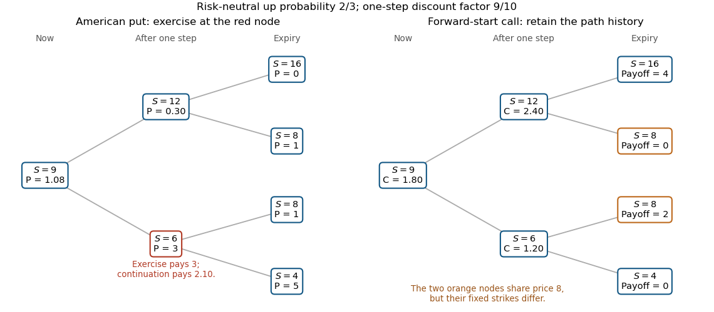

# 2015

↑ **Parent:** [Past exam of the mathematical models of financial derivatives course of the University of Oxford](../past-exam-of-the-mathematical-models-of-financial-derivatives-course-of-the-university-of-oxford.md)

Source: [released examination PDF, bundle pages 96–99](https://www.whatdotheyknow.com/request/oxford_physics_past_papers_2/response/2340696/attach/3/Physics%20Papers%202014.pdf?cookie_passthrough=1#page=96).

Solutions to all three questions and every optional part. The barrier formulas apply only while the contract is alive. In the above-strike barrier case, the terminal strike must be capped at the barrier before using reflection.

**Table of contents**

- [1](#1)
  - [a](#1/a)
    - [Solution](#1/a/solution)
  - [b](#1/b)
    - [Solution](#1/b/solution)
  - [c](#1/c)
    - [Solution](#1/c/solution)
  - [d](#1/d)
    - [Solution](#1/d/solution)
  - [e](#1/e)
    - [Solution](#1/e/solution)
- [2](#2)
  - [a](#2/a)
    - [Solution](#2/a/solution)
  - [b](#2/b)
    - [Solution](#2/b/solution)
  - [c](#2/c)
    - [Solution](#2/c/solution)
  - [d](#2/d)
    - [Solution](#2/d/solution)
- [3](#3)
  - [a](#3/a)
    - [i](#3/a/i)
      - [Solution](#3/a/i/solution)
    - [ii](#3/a/ii)
      - [Solution](#3/a/ii/solution)
  - [b](#3/b)
    - [i](#3/b/i)
      - [Solution](#3/b/i/solution)
    - [ii](#3/b/ii)
      - [Solution](#3/b/ii/solution)
    - [iii](#3/b/iii)
      - [Solution](#3/b/iii/solution)
    - [iv](#3/b/iv)
      - [Solution](#3/b/iv/solution)

## 1

↑ **Parent:** [2015](2015.md)

<h3 id="1/a">a</h3>

↑ **Parent:** [1](#1)

<h4 id="1/a/solution">Solution</h4>

↑ **Parent:** [A](#1/a)

Write $R=e^r$, $u=4/3$ and $d=2/3$. Since both moves have positive physical [probability](../probability-theory.md#probability), the [binomial options pricing model](../mathematical-finance.md#binomial-options-pricing-model) is free of [arbitrage](../mathematical-finance.md#arbitrage) exactly when

$$
\boxed{\frac23<e^r<\frac43.}
$$

If $R\leq d$, borrowing the share price and buying one share gives terminal gain $S_t(u-R)$ or $S_t(d-R)$, both nonnegative and at least one positive. If $R\geq u$, shorting one share and investing its proceeds gives the opposite comparison, with gain $S_t(R-u)$ or $S_t(R-d)$. Equality at either endpoint still permits [arbitrage](../mathematical-finance.md#arbitrage) because the other outcome has positive [probability](../probability-theory.md#probability).

Conversely, strict inequalities give a [risk-neutral probability](../mathematical-finance.md#risk-neutral-probability) $q=(R-d)/(u-d)\in(0,1)$, for which the discounted share is a [martingale](../martingale.md). Any zero-cost [self-financing portfolio](../mathematical-finance.md#self-financing-portfolio) with nonnegative terminal value has zero discounted [expectation](../expected-value.md) under this equivalent positive-probability law and hence cannot have a strictly positive payoff in either state. Applying this argument conditionally at each node proves [no-arbitrage](../mathematical-finance.md#no-arbitrage) over the tree.

<h3 id="1/b">b</h3>

↑ **Parent:** [1](#1)

<h4 id="1/b/solution">Solution</h4>

↑ **Parent:** [B](#1/b)

A [replicating strategy](../fundamental-theorem-of-asset-pricing.md#replicating-strategy) holds $\Delta$ shares and a current cash amount $b$ in the [bank account](../mathematical-finance.md#bank-account). Matching the two next values gives

$$
\Delta S^u_{t+1}+Rb=V^u_{t+1},\qquad
\Delta S^d_{t+1}+Rb=V^d_{t+1}.
$$

Solving this [linear system](../linear-algebra.md#system-of-linear-equations),

$$
\Delta=\frac{V^u_{t+1}-V^d_{t+1}}{S^u_{t+1}-S^d_{t+1}},\qquad
b=\frac{S^u_{t+1}V^d_{t+1}-S^d_{t+1}V^u_{t+1}}{R(S^u_{t+1}-S^d_{t+1})}.
$$

By [no-arbitrage](../mathematical-finance.md#no-arbitrage), the claim costs $V_t=\Delta S_t+b$. Collecting the coefficients of its two future values yields

$$
\boxed{V_t=R^{-1}\bigl[qV^u_{t+1}+(1-q)V^d_{t+1}\bigr],\qquad
q=\frac{RS_t-S^d_{t+1}}{S^u_{t+1}-S^d_{t+1}}.}
$$

The physical [probability](../probability-theory.md#probability) $p$ does not appear: replication fixes the price of this [contingent claim](../fundamental-theorem-of-asset-pricing.md#contingent-claim) from traded prices.

<h3 id="1/c">c</h3>

↑ **Parent:** [1](#1)

<h4 id="1/c/solution">Solution</h4>

↑ **Parent:** [C](#1/c)

The [risk-neutral probability](../mathematical-finance.md#risk-neutral-probability) obeys $R=qu+(1-q)d$. Thus

$$
R=\frac23\frac43+\frac13\frac23=\frac{10}{9},
\qquad R^{-1}=\frac9{10}.
$$

Substitution into the [risk-neutral pricing](../mathematical-finance.md#risk-neutral-pricing) recursion gives

$$
\boxed{V_t=\frac9{10}\left(\frac23V^u_{t+1}+\frac13V^d_{t+1}\right)
=\frac3{10}\left(2V^u_{t+1}+V^d_{t+1}\right).}
$$

<h3 id="1/d">d</h3>

↑ **Parent:** [1](#1)

<h4 id="1/d/solution">Solution</h4>

↑ **Parent:** [D](#1/d)

Using the [risk-neutral probability](../mathematical-finance.md#risk-neutral-probability) $q=2/3$ from part [c](#1/c), the [stock](../mathematical-finance.md#stock) tree has values $9$ initially, $12,6$ after one step, and $16,8,4$ after two. The [American put option](../fundamental-theorem-of-asset-pricing.md#american-put-option) has terminal [financial payoffs](../fundamental-theorem-of-asset-pricing.md#contingent-claim-payoff) $0,1,5$. Work backwards, comparing the immediate [exercise payoff](../fundamental-theorem-of-asset-pricing.md#exercise-payoff) with its discounted continuation value.

At $S_1=12$, continuation is $(3/10)(2\cdot0+1)=3/10$, exceeding the zero exercise payoff. At $S_1=6$, continuation is $(3/10)(2\cdot1+5)=21/10$, while exercise pays three. Therefore **exercise at the down node $S_1=6$ and continue at $S_1=12$**. The initial exercise payoff is zero and the continuation value is

$$
\boxed{P_0=\frac3{10}\left(2\cdot\frac3{10}+3\right)=\frac{27}{25}=1.08.}
$$

The [Snell envelope](../martingale.md#snell-envelope) gives this backwards maximum recursion. For comparison, restricting exercise to expiry would give $81/100$, so early exercise genuinely adds value.

<h3 id="1/e">e</h3>

↑ **Parent:** [1](#1)

<h4 id="1/e/solution">Solution</h4>

↑ **Parent:** [E](#1/e)

For the [forward-start call option](../fundamental-theorem-of-asset-pricing.md#forward-start-call-option), the strike is fixed by the intermediate [stock](../mathematical-finance.md#stock) price. The four path payoffs are

$$
\begin{array}{c|c|c|c}
\text{path}&S_1&S_2&(S_2-S_1)^+\\\hline
uu&12&16&4\\
ud&12&8&0\\
du&6&8&2\\
dd&6&4&0
\end{array}
$$

The same final price eight has different payoffs on the two middle paths, so one must retain the history at expiry. At time one, [risk-neutral pricing](../mathematical-finance.md#risk-neutral-pricing) gives $C_1^u=(3/10)(2\cdot4)=12/5$ and $C_1^d=(3/10)(2\cdot2)=6/5$. Thus

$$
\boxed{C_0=\frac3{10}\left(2\cdot\frac{12}{5}+\frac65\right)=\frac95=1.8.}
$$

Equivalently, its value at the strike-fixing date is $S_1/5$ by homogeneity, so the [martingale](../martingale.md) property of discounted [stock](../mathematical-finance.md#stock) prices gives the initial value $S_0/5$.

**[Figure 1](#1/e/image-two-step-american-put-exercise-and-forward-start-call-payoffs). Two-step American-put exercise and forward-start call payoffs**. The American put is exercised at the down node after one step. The forward-start call has different payoffs on the two paths ending at stock price eight, because their strikes were fixed at different intermediate prices.

## 2

↑ **Parent:** [2015](2015.md)

<h3 id="2/a">a</h3>

↑ **Parent:** [2](#2)

<h4 id="2/a/solution">Solution</h4>

↑ **Parent:** [A](#2/a)

Let $\tau=T-t$. The [product rule](../calculus.md#product-rule) and [Itô's formula](../stochastic-calculus.md#ito-s-lemma) give

$$
\begin{aligned}
d\bigl(e^{r(T-t)}V(S_t,t)\bigr)
&=e^{r\tau}\left[V_t+\frac12\sigma^2S_t^2V_{SS}+rS_tV_S-rV\right]dt
+e^{r\tau}\sigma S_tV_S\,dW_t\\
&=e^{r\tau}\sigma S_tV_S\,dW_t,
\end{aligned}
$$

where the [Black-Scholes equation](../mathematical-finance.md#black-scholes-equation) cancels the drift. Under the usual pricing growth and integrability conditions this [local martingale](../martingale.md#local-martingale) is a [martingale](../martingale.md). Its terminal value is $f(S_T)$, since the exponential factor becomes one at $T$. Taking a [conditional expectation](../measure-theory.md#conditional-expectation) gives

$$
e^{r(T-t)}V(S_t,t)=\mathbb E[f(S_T)\mid\mathcal F_t],\qquad
\boxed{V(S,t)=e^{-r(T-t)}\mathbb E[f(S_T)\mid S_t=S].}
$$

The dynamics already use the [risk-neutral measure](../mathematical-finance.md#risk-neutral-measure). This is the [Feynman-Kac formula](../stochastic-calculus.md#feynman-kac-formula) for the given pricing problem; a differential equation alone, without the relevant growth condition, would not justify upgrading a local martingale or uniqueness.

<h3 id="2/b">b</h3>

↑ **Parent:** [2](#2)

<h4 id="2/b/solution">Solution</h4>

↑ **Parent:** [B](#2/b)

Apply [Itô's formula](../stochastic-calculus.md#ito-s-lemma) to the [logarithm](../calculus.md#logarithm) of the positive [geometric Brownian motion](../stochastic-calculus.md#geometric-brownian-motion). The quadratic-variation correction gives

$$
d\log S_t=(r-\sigma^2/2)dt+\sigma dW_t.
$$

Integrating yields

$$
\boxed{S_T=S_t\exp\!\left[(r-\sigma^2/2)(T-t)+\sigma(W_T-W_t)\right].}
$$

The increment is a [Gaussian random variable](../probability-distribution.md#gaussian-random-variable) with [variance](../variance.md) $T-t$, independent of current information. Writing it as $W_\tau$ means a fresh future [Brownian motion](../brownian-motion.md) $\widetilde W_v=W_{t+v}-W_t$, evaluated at $\tau$; it need not equal the original process at time $T-t$.

<h3 id="2/c">c</h3>

↑ **Parent:** [2](#2)

<h4 id="2/c/solution">Solution</h4>

↑ **Parent:** [C](#2/c)

Take the terminal [financial payoff](../fundamental-theorem-of-asset-pricing.md#contingent-claim-payoff) $f(S)=S$. The function $V(S,t)=S$ satisfies the [Black-Scholes equation](../mathematical-finance.md#black-scholes-equation): its time derivative and second stock derivative vanish, while $rSV_S-rV=rS-rS=0$. It also has the correct terminal value. Part [a](#2/a) therefore gives

$$
S_t=e^{-r(T-t)}\mathbb E[S_T\mid\mathcal F_t],
\qquad
\boxed{\mathbb E[e^{-rT}S_T\mid\mathcal F_t]=e^{-rt}S_t.}
$$

Thus the discounted [stock](../mathematical-finance.md#stock) is a [martingale](../martingale.md). The explicit [lognormal distribution](../probability-distribution.md#log-normal-distribution) in part [b](#2/b) supplies the necessary finite [expectation](../expected-value.md), so here this is a true martingale identity.

<h3 id="2/d">d</h3>

↑ **Parent:** [2](#2)

<h4 id="2/d/solution">Solution</h4>

↑ **Parent:** [D](#2/d)

Under the [risk-neutral measure](../mathematical-finance.md#risk-neutral-measure), set $a=\sigma\sqrt\tau$ and $m=\log(S/K)+(r-\sigma^2/2)\tau$. Then $\log(S_T/K)=m+aZ$ with $Z$ a [standard normal random variable](../probability-distribution.md#standard-normal-random-variable), and $d_-=m/a$. The [log-call option](../fundamental-theorem-of-asset-pricing.md#log-call-option) is the discounted [Gaussian positive-part expectation](../probability-distribution.md#gaussian-positive-part-expectation):

$$
\begin{aligned}
V(S,t)&=e^{-r\tau}\int_{-d_-}^{\infty}(m+az)\phi(z)\,dz\\
&=e^{-r\tau}\bigl[m\Phi(d_-)+a\phi(d_-)\bigr],
\end{aligned}
$$

since $\phi'(z)=-z\phi(z)$. Therefore

$$
\boxed{V(S,t)=e^{-r\tau}\sigma\sqrt\tau
\left[d_-\operatorname N(d_-)+\frac{e^{-d_-^2/2}}{\sqrt{2\pi}}\right].}
$$

Here $\phi$ and $\Phi=\operatorname N$ are the [standard normal density](../probability-distribution.md#standard-normal-density) and [standard normal distribution function](../probability-distribution.md#standard-normal-distribution-function). At expiry the continuous terminal [limit](../calculus.md#limit-of-a-function) is $(\log(S/K))^+$.

## 3

↑ **Parent:** [2015](2015.md)

<h3 id="3/a">a</h3>

↑ **Parent:** [3](#3)

<h4 id="3/a/i">i</h4>

↑ **Parent:** [A](#3/a)

<h5 id="3/a/i/solution">Solution</h5>

↑ **Parent:** [I](#3/a/i)

Let $a=\sigma\sqrt\tau$, so $d_+=d_-+a$. Squaring gives

$$
d_+^2-d_-^2=2ad_-+a^2=2\log(S/K)+2r\tau.
$$

Exponentiation proves

$$
\boxed{Se^{-d_+^2/2}=Ke^{-r\tau}e^{-d_-^2/2}.}
$$

At fixed $S,t,T$, only $\log(S/K)$ depends on $K$, so the [partial derivatives](../multivariable-calculus.md#partial-derivative) are

$$
\boxed{\frac{\partial d_+}{\partial K}=\frac{\partial d_-}{\partial K}
=-\frac1{K\sigma\sqrt\tau}.}
$$

<h4 id="3/a/ii">ii</h4>

↑ **Parent:** [A](#3/a)

<h5 id="3/a/ii/solution">Solution</h5>

↑ **Parent:** [Ii](#3/a/ii)

Differentiate the [Black-Scholes formula](../mathematical-finance.md#black-scholes-formula) for the [European put option](../fundamental-theorem-of-asset-pricing.md#european-put-option) with respect to its strike. The [chain rule](../calculus.md#chain-rule) gives

$$
\frac{\partial P}{\partial K}
=e^{-r\tau}\Phi(-d_-)
-Ke^{-r\tau}\phi(d_-)\frac{\partial d_-}{\partial K}
+S\phi(d_+)\frac{\partial d_+}{\partial K}.
$$

The final two terms cancel by both identities in part [i](#3/a/i). Hence the [put-price strike derivative](../fundamental-theorem-of-asset-pricing.md#put-price-strike-derivative) is

$$
\boxed{\frac{\partial P}{\partial K}=e^{-r\tau}\operatorname N(-d_-).}
$$

<h3 id="3/b">b</h3>

↑ **Parent:** [3](#3)

<h4 id="3/b/i">i</h4>

↑ **Parent:** [B](#3/b)

<h5 id="3/b/i/solution">Solution</h5>

↑ **Parent:** [I](#3/b/i)

For a terminal price distinct from $K$, differentiating the put's [financial payoff](../fundamental-theorem-of-asset-pricing.md#contingent-claim-payoff) gives $\partial_K(K-S_T)^+=\mathbf1_{\{S_T<K\}}$. The difference quotients are bounded by one, and the continuous [lognormal distribution](../probability-distribution.md#log-normal-distribution) has zero [probability](../probability-theory.md#probability) at the strike. The [dominated convergence theorem](../measure-theory.md#dominated-convergence-theorem) therefore permits differentiation inside its discounted [expectation](../expected-value.md). The [put-price strike derivative](../fundamental-theorem-of-asset-pricing.md#put-price-strike-derivative) is exactly the price of the [digital put option](../fundamental-theorem-of-asset-pricing.md#digital-put-option):

$$
\boxed{P_d(S,t)=\frac{\partial P}{\partial K}=e^{-r\tau}\operatorname N(-d_-).}
$$

Equivalently, [risk-neutral pricing](../mathematical-finance.md#risk-neutral-pricing) discounts the [probability](../probability-theory.md#probability) $\mathbb Q(S_T<K\mid S_t=S)=\Phi(-d_-)$.

<h4 id="3/b/ii">ii</h4>

↑ **Parent:** [B](#3/b)

<h5 id="3/b/ii/solution">Solution</h5>

↑ **Parent:** [Ii](#3/b/ii)

While the [up-and-out digital put](../fundamental-theorem-of-asset-pricing.md#up-and-out-digital-put) is alive, its pricing domain is $0<S<B$, $t<T$. Its [Black-Scholes equation](../mathematical-finance.md#black-scholes-equation), terminal [financial payoff](../fundamental-theorem-of-asset-pricing.md#contingent-claim-payoff), and absorbing [boundary condition](../differential-equation.md#boundary-condition) are

$$
\boxed{\begin{aligned}
H_t+\tfrac12\sigma^2S^2H_{SS}+rSH_S-rH&=0,&0<S<B,\ t<T,\\
H(S,T)&=\mathbf1_{\{S<K\}},&0<S<B,\\
H(B,t)&=0,&t\leq T.
\end{aligned}}
$$

For completeness, the natural limiting condition is $\lim_{S\downarrow0}H(S,t)=e^{-r(T-t)}$, with $0\leq H(S,t)\leq e^{-r(T-t)}$. A positive [geometric Brownian motion](../stochastic-calculus.md#geometric-brownian-motion) cannot hit zero in finite time, and from a very small starting value the survival and below-strike terminal events have probability tending to one. If the barrier has already been hit, its value is zero regardless of the current stock price.

For $K>B$, the terminal payoff tends to one from inside at $S=B$, while an already hit barrier pays zero. Thus there is a terminal-boundary corner discontinuity; the terminal condition is imposed only for $S<B$, not as a requirement of continuous extension at $(B,T)$.

<h4 id="3/b/iii">iii</h4>

↑ **Parent:** [B](#3/b)

<h5 id="3/b/iii/solution">Solution</h5>

↑ **Parent:** [Iii](#3/b/iii)

Let $D_K(S,t)=P_d(S,t)$ and $\gamma=1-2r/\sigma^2$. The [Black-Scholes reflection symmetry](../mathematical-finance.md#black-scholes-reflection-symmetry) gives another solution $(S/B)^\gamma D_K(B^2/S,t)$. Subtracting it enforces absorption:

$$
\boxed{H(S,t)=D_K(S,t)-(S/B)^\gamma D_K(B^2/S,t),\qquad0<S<B,\quad B>K.}
$$

At $S=B$ the terms agree. At expiry the reflected argument satisfies $B^2/S>B>K$, so its digital-put payoff vanishes; the first term supplies the required terminal payoff. These facts and the bounded pricing solution's uniqueness prove the formula. The [up-and-out digital put](../fundamental-theorem-of-asset-pricing.md#up-and-out-digital-put) price is zero once knocked out.

<h4 id="3/b/iv">iv</h4>

↑ **Parent:** [B](#3/b)

<h5 id="3/b/iv/solution">Solution</h5>

↑ **Parent:** [Iv](#3/b/iv)

If $0<B<K$, every surviving terminal price is already below the strike, so this is a [barrier digital put](../fundamental-theorem-of-asset-pricing.md#barrier-digital-put) paying one at expiry exactly when the upper barrier has been avoided. To use the [Black-Scholes reflection symmetry](../mathematical-finance.md#black-scholes-reflection-symmetry), cap the free digital-put strike at $B$, rather than continuing to use $K$:

$$
\boxed{H(S,t)=D_B(S,t)-(S/B)^\gamma D_B(B^2/S,t),\qquad0<S<B<K.}
$$

Indeed, $D_B$ has terminal payoff one throughout the alive region, while its reflected argument exceeds $B$ and hence has zero terminal payoff. The barrier values again cancel. Using $D_K$ in both terms would generally leave an unwanted reflected terminal payoff near the barrier.

Writing $b=r-\sigma^2/2$ makes the discounted survival [probability](../probability-theory.md#probability) explicit:

$$
\boxed{H(S,t)=e^{-r\tau}\left[
\Phi\!\left(\frac{\log(B/S)-b\tau}{\sigma\sqrt\tau}\right)
-(S/B)^\gamma\Phi\!\left(\frac{\log(S/B)-b\tau}{\sigma\sqrt\tau}\right)
\right].}
$$

The price is independent of $K$ in this case. Both cases combine by replacing the free strike with $\min(K,B)$ in the [up-and-out digital put](../fundamental-theorem-of-asset-pricing.md#up-and-out-digital-put) formula.

## ↑ Ancestors (9)

1. [Past exam of the mathematical models of financial derivatives course of the University of Oxford](../past-exam-of-the-mathematical-models-of-financial-derivatives-course-of-the-university-of-oxford.md)
2. [Mathematical models of financial derivatives course of the University of Oxford](../university-of-oxford.md#mathematical-models-of-financial-derivatives-course-of-the-university-of-oxford)
3. [Year 3 of the mathematics course of the University of Oxford](../university-of-oxford.md#year-3-of-the-mathematics-course-of-the-university-of-oxford)
4. [Mathematics course of the University of Oxford](../university-of-oxford.md#mathematics-course-of-the-university-of-oxford)
5. [Undergraduate course of the University of Oxford](../university-of-oxford.md#undergraduate-course-of-the-university-of-oxford)
6. [Course of the University of Oxford](../university-of-oxford.md#course-of-the-university-of-oxford)
7. [University of Oxford](../university-of-oxford.md)
8. [List of universities](../README.md#list-of-universities)
9. [Codex Wiki](../README.md)
