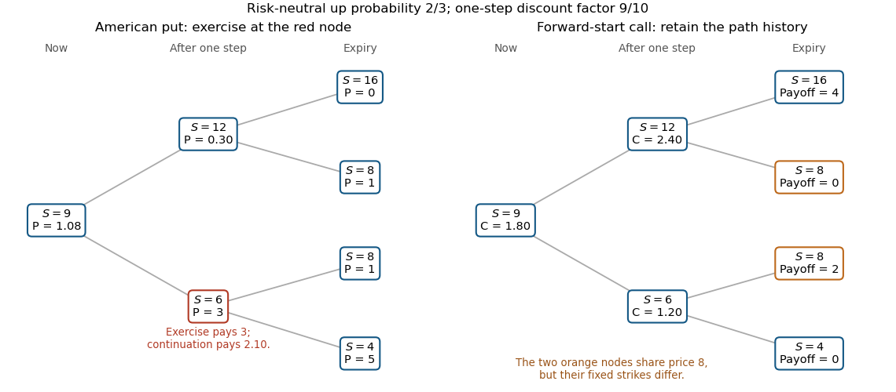

<h1 id="1/e/solution">Solution</h1>

↑ **Parent:** [E](../e.md)

For the [forward-start call option](../../../../forward-start-call-option.md), the strike is fixed by the intermediate [stock](../../../../stock.md) price. The four path payoffs are

$$
\begin{array}{c|c|c|c}
\text{path}&S_1&S_2&(S_2-S_1)^+\\\hline
uu&12&16&4\\
ud&12&8&0\\
du&6&8&2\\
dd&6&4&0
\end{array}
$$

The same final price eight has different payoffs on the two middle paths, so one must retain the history at expiry. At time one, [risk-neutral pricing](../../../../risk-neutral-pricing.md) gives $C_1^u=(3/10)(2\cdot4)=12/5$ and $C_1^d=(3/10)(2\cdot2)=6/5$. Thus

$$
\boxed{C_0=\frac3{10}\left(2\cdot\frac{12}{5}+\frac65\right)=\frac95=1.8.}
$$

Equivalently, its value at the strike-fixing date is $S_1/5$ by homogeneity, so the [martingale](../../../../martingale-split.md) property of discounted [stock](../../../../stock.md) prices gives the initial value $S_0/5$.

**[Figure 1](#1/e/image-two-step-american-put-exercise-and-forward-start-call-payoffs). Two-step American-put exercise and forward-start call payoffs**. The American put is exercised at the down node after one step. The forward-start call has different payoffs on the two paths ending at stock price eight, because their strikes were fixed at different intermediate prices.

## ↑ Ancestors (12)

1. [E](../e.md)
2. [1](../../1.md)
3. [2015](../../../2015-split.md)
4. [Past exam of the mathematical models of financial derivatives course of the University of Oxford](../../../split.md)
5. [Mathematical models of financial derivatives course of the University of Oxford](../../../../mathematical-models-of-financial-derivatives-course-of-the-university-of-oxford.md)
6. [Year 3 of the mathematics course of the University of Oxford](../../../../year-3-of-the-mathematics-course-of-the-university-of-oxford.md)
7. [Mathematics course of the University of Oxford](../../../../mathematics-course-of-the-university-of-oxford.md)
8. [Undergraduate course of the University of Oxford](../../../../undergraduate-course-of-the-university-of-oxford.md)
9. [Course of the University of Oxford](../../../../course-of-the-university-of-oxford.md)
10. [University of Oxford](../../../../university-of-oxford-split.md)
11. [List of universities](../../../../list-of-universities.md)
12. [Codex Wiki](../../../../split.md)
