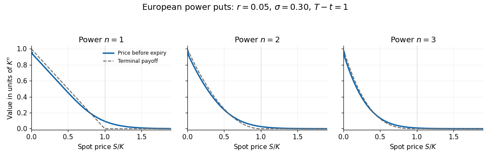

# 2023

↑ **Parent:** [Past exam of the mathematical models of financial derivatives course of the University of Oxford](../past-exam-of-the-mathematical-models-of-financial-derivatives-course-of-the-university-of-oxford.md)

Source: [released examination PDF, pages 252–255](https://www.whatdotheyknow.com/request/request_for_mathematics_examinat/response/3129786/attach/3/FOI%20202507%20740%20Data.pdf#page=252). Solutions follow the numbering of the 6 June 2023 paper. Throughout, volatility is positive and the stated [Black-Scholes model](../mathematical-finance.md#black-scholes-model) assumptions apply. The finite perpetual values in 2(b) additionally require $r>0$; the other interest-rate cases are explained below. Question 3's conditional expectation is evaluated under the measure stipulated there, with its financial interpretation qualified in 3(d).

**Table of contents**

- [1](#1)
  - [a](#1/a)
    - [Solution](#1/a/solution)
  - [b](#1/b)
    - [Solution](#1/b/solution)
  - [c](#1/c)
    - [Solution](#1/c/solution)
- [2](#2)
  - [a](#2/a)
    - [Solution](#2/a/solution)
  - [b](#2/b)
    - [i](#2/b/i)
      - [Solution](#2/b/i/solution)
    - [ii](#2/b/ii)
      - [Solution](#2/b/ii/solution)
    - [iii](#2/b/iii)
      - [Solution](#2/b/iii/solution)
- [3](#3)
  - [a](#3/a)
    - [Solution](#3/a/solution)
  - [b](#3/b)
    - [Solution](#3/b/solution)
  - [c](#3/c)
    - [Solution](#3/c/solution)
  - [d](#3/d)
    - [Solution](#3/d/solution)

## 1

↑ **Parent:** [2023](2023.md)

<h3 id="1/a">a</h3>

↑ **Parent:** [1](#1)

<h4 id="1/a/solution">Solution</h4>

↑ **Parent:** [A](#1/a)

Use a [self-financing portfolio](../mathematical-finance.md#self-financing-portfolio) which holds $\Delta=V_S$ shares and $V-SV_S$ in the [bank account](../mathematical-finance.md#bank-account), withdrawing the claim's cash flow $C\,dt$. A share's total gain includes the [continuous dividend yield](../mathematical-finance.md#continuous-dividend-yield), so its gain is $dS+DS\,dt$. Matching the claim's total gain gives

$$
dV+C\,dt=V_S(dS+DS\,dt)+r(V-SV_S)\,dt.
$$

By the [Itô formula](../stochastic-calculus.md#ito-s-lemma),

$$
dV=\left[V_t+(\mu-D)SV_S+\frac12\sigma^2S^2V_{SS}\right]dt+\sigma SV_S\,dW.
$$

The [delta hedge](../mathematical-finance.md#delta-hedge) cancels the [Brownian motion](../brownian-motion.md) term. Comparing the remaining drifts yields the [Black-Scholes equation with claim dividends](../mathematical-finance.md#black-scholes-equation-with-claim-dividends), with the stock's own dividend yield included:

$$
\boxed{V_t+\frac12\sigma^2S^2V_{SS}+(r-D)SV_S-rV=-C(S,t),\qquad V(S,T)=S}.
$$

This gain calculation accounts for rebalancing through the [self-financing portfolio](../mathematical-finance.md#self-financing-portfolio) condition. The physical expected-return parameter $\mu$ cancels, as required by [risk-neutral pricing](../mathematical-finance.md#risk-neutral-pricing).

<h3 id="1/b">b</h3>

↑ **Parent:** [1](#1)

<h4 id="1/b/solution">Solution</h4>

↑ **Parent:** [B](#1/b)

For [claim dividends proportional to the underlying stock](../mathematical-finance.md#claim-dividends-proportional-to-the-underlying-stock), put $V(S,t)=S\phi(t)$. Then $V_S=\phi$, $V_{SS}=0$ and $V_t=S\phi'$, so the [partial differential equation](../partial-differential-equation.md) reduces to the [linear ordinary differential equation](../linear-ordinary-differential-equation.md)

$$
\phi'-D\phi=-f(t),\qquad\phi(T)=1.
$$

The [integrating factor](../linear-ordinary-differential-equation.md#integrating-factor) $e^{-Dt}$ gives $(e^{-Dt}\phi)'=-e^{-Dt}f(t)$. Integrating backwards from the terminal value,

$$
\boxed{V(S,t)=S\left[e^{-D(T-t)}+\int_t^T e^{-D(u-t)}f(u)\,du\right]}.
$$

The formula assumes the displayed [integral](../integral.md) is finite. Under the [risk-neutral measure](../mathematical-finance.md#risk-neutral-measure), $\mathbb E_t[S_u]=S e^{(r-D)(u-t)}$. Discounting each cash payment at its own payment time gives the same result:

$$
V=\mathbb E_t\!\left[e^{-r(T-t)}S_T+\int_t^T e^{-r(u-t)}f(u)S_u\,du\right].
$$

The [interest rate](../mathematical-finance.md#interest-rate) disappears because every payment is proportional to the [stock](../mathematical-finance.md#stock) price.

<h3 id="1/c">c</h3>

↑ **Parent:** [1](#1)

<h4 id="1/c/solution">Solution</h4>

↑ **Parent:** [C](#1/c)

Setting $f=0$ in [b](#1/b) gives

$$
\boxed{V(S,t)=S e^{-D(T-t)}}.
$$

This is a [prepaid forward contract](../fundamental-theorem-of-asset-pricing.md#prepaid-forward-contract): the holder pays now and receives one share at $T$, with no interim dividend payments. Buying $e^{-D(T-t)}$ shares now and reinvesting their [continuous dividend yield](../mathematical-finance.md#continuous-dividend-yield) grows the shareholding to one at expiry. Thus the displayed initial cost replicates the terminal delivery. When $D=0$, holding one share already does so and $V=S$.

## 2

↑ **Parent:** [2023](2023.md)

<h3 id="2/a">a</h3>

↑ **Parent:** [2](#2)

<h4 id="2/a/solution">Solution</h4>

↑ **Parent:** [A](#2/a)

For the non-dividend-paying [stock](../mathematical-finance.md#stock), a [self-financing portfolio](../mathematical-finance.md#self-financing-portfolio) replicating a smooth [European option](../fundamental-theorem-of-asset-pricing.md#european-contingent-claim) has $\Delta=V_S$ shares and $V-SV_S$ in the [bank account](../mathematical-finance.md#bank-account). Its gain satisfies

$$
dV=V_S\,dS+r(V-SV_S)\,dt.
$$

The [Itô formula](../stochastic-calculus.md#ito-s-lemma) gives $dV=(V_t+\mu SV_S+\sigma^2S^2V_{SS}/2)dt+\sigma SV_SdW$. Matching its diffusion and drift with the portfolio gains cancels $\mu$, yielding

$$
\boxed{V_t+\frac12\sigma^2S^2V_{SS}+rSV_S-rV=0}.
$$

The [financial payoff](../fundamental-theorem-of-asset-pricing.md#contingent-claim-payoff) supplies the terminal value. This is the [Black-Scholes equation](../mathematical-finance.md#black-scholes-equation); the associated [risk-neutral measure](../mathematical-finance.md#risk-neutral-measure) replaces the physical stock drift by $r$.

<h3 id="2/b">b</h3>

↑ **Parent:** [2](#2)

<h4 id="2/b/i">i</h4>

↑ **Parent:** [B](#2/b)

<h5 id="2/b/i/solution">Solution</h5>

↑ **Parent:** [I](#2/b/i)

Write $\tau=T-t>0$ and $g_n(s)=(K-s)_+^n$. The [European power put formula](../fundamental-theorem-of-asset-pricing.md#european-power-put-formula) is

$$
P_n(S,t)=e^{-r\tau}\mathbb E\!\left[(K-SY)_+^n\right],\qquad Y=e^{(r-\sigma^2/2)\tau+\sigma\sqrt\tau Z},\quad Z\sim N(0,1).
$$

Here $Y>0$ has a [lognormal distribution](../probability-distribution.md#log-normal-distribution). Since $g_n$ is decreasing and is a [convex function](../real-analysis.md#convex-function), its discounted [expected value](../expected-value.md) is also decreasing and convex as a function of $S$. For $S>0$ it is smooth and strictly positive: the [normal distribution](../probability-distribution.md#normal-distribution) assigns positive probability to $SY<K$ whatever the current positive spot price. Its endpoints are

$$
\boxed{P_n(0,t)=K^n e^{-r\tau},\qquad \lim_{S\to\infty}P_n(S,t)=0}.
$$

The [dominated convergence theorem](../measure-theory.md#dominated-convergence-theorem) justifies the second [limit](../calculus.md#limit-of-a-function), because $0\leq(K-SY)_+^n\leq K^n$. For a quantitative sketch, the [binomial theorem](../binomial-coefficient.md#binomial-theorem) and [truncated lognormal moment](../probability-distribution.md#truncated-lognormal-moment) give

$$
P_n(S,t)=e^{-r\tau}\sum_{j=0}^n(-1)^j\binom nj K^{n-j}S^j e^{jr\tau+j(j-1)\sigma^2\tau/2}\Phi(-d_j),\qquad d_j=\frac{\log(S/K)+[r+(j-\tfrac12)\sigma^2]\tau}{\sigma\sqrt\tau},
$$

where $\Phi$ is the [standard normal distribution function](../probability-distribution.md#standard-normal-distribution-function). This [finite sum](../arithmetic.md#finite-sum) is useful for drawing the curve; its positive [expectation](../expected-value.md) form makes its qualitative shape clearer.

**[Figure 1](#2/b/i/image-european-power-put-prices-before-expiry-for-powers-one-two-and-three). European power-put prices before expiry for powers one, two and three**.

The solid curves use $K=1$, $r=0.05$, $\sigma=0.30$ and $\tau=1$; the dashed curves show their terminal [financial payoffs](../fundamental-theorem-of-asset-pricing.md#contingent-claim-payoff) for comparison. Each price remains positive at $S=K$ and tends smoothly towards zero beyond it. At small $S$, discounting gives a price below the undiscounted [financial payoff](../fundamental-theorem-of-asset-pricing.md#contingent-claim-payoff); European exercise is permitted only at expiry.

<h4 id="2/b/ii">ii</h4>

↑ **Parent:** [B](#2/b)

<h5 id="2/b/ii/solution">Solution</h5>

↑ **Parent:** [Ii](#2/b/ii)

Assume $r>0$, put $b=S^\star\in(0,K)$ and let $\tau_b=\inf\{u\geq0:S_u\leq b\}$. In the continuation region $S>b$, the time-independent [Black-Scholes equation](../mathematical-finance.md#black-scholes-equation) is a [Cauchy-Euler equation](../linear-ordinary-differential-equation.md#cauchy-euler-equation). Substituting $V=S^m$ gives

$$
\frac12\sigma^2m(m-1)+rm-r=(m-1)\left(\frac12\sigma^2m+r\right)=0.
$$

Set $\gamma=2r/\sigma^2>0$. The two powers are $S$ and $S^{-\gamma}$. The [boundary condition](../differential-equation.md#boundary-condition) $V(S)\to0$ as $S\to\infty$ removes the growing solution; value matching at $b$ sets the coefficient. Hence the fixed-trigger value is

$$
\boxed{V_b(S)=(K-b)^n(S/b)^{-\gamma},\qquad S>b}.
$$

For $0\leq S\leq b$ the policy exercises immediately, giving $V_b(S)=(K-S)^n$. The quoted continuation expression alone does not apply below the exercise boundary. Equivalently, the [discounted boundary-hitting representation](../stochastic-calculus.md#discounted-boundary-hitting-representation) gives $\mathbb E_S[e^{-r\tau_b};\tau_b<\infty]=(S/b)^{-\gamma}$, which multiplies the exercise [financial payoff](../fundamental-theorem-of-asset-pricing.md#contingent-claim-payoff).

<h4 id="2/b/iii">iii</h4>

↑ **Parent:** [B](#2/b)

<h5 id="2/b/iii/solution">Solution</h5>

↑ **Parent:** [Iii](#2/b/iii)

For $S>b$, maximize the coefficient $H(b)=b^\gamma(K-b)^n$ of $S^{-\gamma}$. Its logarithmic [derivative](../calculus.md#derivative) is

$$
\frac{H'(b)}{H(b)}=\frac\gamma b-\frac n{K-b}.
$$

It changes sign once, at $b=\gamma K/(\gamma+n)$. The [perpetual power put option](../fundamental-theorem-of-asset-pricing.md#perpetual-power-put-option) therefore has candidate value

$$
\boxed{b=\frac{2rK}{2r+n\sigma^2},\qquad V_n(S)=\begin{cases}(K-S)^n,&0\leq S\leq b,\\(K-b)^n(S/b)^{-2r/\sigma^2},&S>b.\end{cases}}
$$

The same boundary follows from [smooth fit](../martingale.md#smooth-pasting), $-\gamma(K-b)^n/b=-n(K-b)^{n-1}$. To establish optimality among all [stopping times](../martingale.md#stopping-time), rather than only fixed barriers, we verify the candidate. Let $\mathcal L=rS\partial_S+\sigma^2S^2\partial_{SS}/2$ be the [infinitesimal generator](../stochastic-process.md#infinitesimal-generator-stochastic-processes). The maximum property of $H$ gives $V_n\geq g_n$ everywhere, and $(\mathcal L-r)V_n=0$ for $S>b$. For $S\leq b$, set $y=S/(K-S)\leq\gamma/n$. Then

$$
\frac{(\mathcal L-r)g_n}{g_n}=\frac12\sigma^2\big[n(n-1)y^2-\gamma ny-\gamma\big]\leq-r(1+y)<0.
$$

Thus the discounted candidate is a nonnegative [supermartingale](../martingale.md#supermartingale). The [smooth fit](../martingale.md#smooth-pasting) removes the derivative-jump [local time of a semimartingale](../stochastic-calculus.md#local-time-of-a-semimartingale) term in the [Itô formula](../stochastic-calculus.md#ito-s-lemma). The [optional stopping theorem](../martingale.md#optional-sampling-theorem-for-a-supermartingale) and localization bound every exercise policy's discounted [expected value](../expected-value.md) by $V_n$. Immediate exercise attains it below $b$; the first hitting time of $b$ attains it above $b$. The terminal remainder vanishes since $0\leq e^{-ru}V_n(S_u)\leq K^n e^{-ru}\to0$. This proves the displayed value.

For $n=1$ it reduces to the ordinary [perpetual put option](../fundamental-theorem-of-asset-pricing.md#perpetual-put-option). Larger $n$ lowers the optimal trigger, because the more strongly curved [financial payoff](../fundamental-theorem-of-asset-pricing.md#contingent-claim-payoff) makes further downward moves more valuable. If $r=0$, under the [risk-neutral measure](../mathematical-finance.md#risk-neutral-measure) the stock tends to zero [almost surely](../convergence-of-random-variables.md#almost-sure-convergence), so the supremum is $K^n$, approached as the exercise time tends to infinity and not attained at a finite time when $S>0$. If $r<0$, the values at deterministic exercise times grow without bound; the perpetual value is infinite. These cases do not admit the positive-rate formula above.

## 3

↑ **Parent:** [2023](2023.md)

<h3 id="3/a">a</h3>

↑ **Parent:** [3](#3)

<h4 id="3/a/solution">Solution</h4>

↑ **Parent:** [A](#3/a)

For $x_t=\log S_t$, the [Itô formula](../stochastic-calculus.md#ito-s-lemma) uses $(\log S)'=1/S$ and $(\log S)''=-1/S^2$. Consequently

$$
dx_t=\frac{dS_t}{S_t}-\frac12\frac{d\langle S\rangle_t}{S_t^2}=\left[\alpha(\mu-x_t)-\frac12\sigma^2\right]dt+\sigma\,dZ_t.
$$

The [quadratic variation](../stochastic-calculus.md#quadratic-variation) term shifts the mean level. Thus the [log-mean-reverting price](../mathematical-finance.md#log-mean-reverting-price) has logarithm following the [Ornstein-Uhlenbeck process](../gaussian-process.md#ornstein-uhlenbeck-process)

$$
\boxed{dx_t=\alpha(\widetilde\mu-x_t)dt+\sigma\,dZ_t,\qquad \widetilde\mu=\mu-\frac{\sigma^2}{2\alpha}}.
$$

It is the logarithm, rather than the price itself, which reverts linearly to a constant mean level.

<h3 id="3/b">b</h3>

↑ **Parent:** [3](#3)

<h4 id="3/b/solution">Solution</h4>

↑ **Parent:** [B](#3/b)

Apply the [Itô product rule](../stochastic-calculus.md#ito-product-rule) with deterministic [integrating factor](../linear-ordinary-differential-equation.md#integrating-factor) $e^{\alpha u}$:

$$
d(e^{\alpha u}x_u)=\alpha\widetilde\mu e^{\alpha u}du+\sigma e^{\alpha u}dZ_u.
$$

Integrate from $t$ to $T$ and multiply by $e^{-\alpha T}$ to obtain

$$
\boxed{x_T=x_t e^{-\alpha(T-t)}+\widetilde\mu(1-e^{-\alpha(T-t)})+\sigma e^{-\alpha T}\int_t^T e^{\alpha u}\,dZ_u}.
$$

This is the explicit solution behind the [Ornstein-Uhlenbeck transition distribution](../gaussian-process.md#ornstein-uhlenbeck-transition-distribution).

<h3 id="3/c">c</h3>

↑ **Parent:** [3](#3)

<h4 id="3/c/solution">Solution</h4>

↑ **Parent:** [C](#3/c)

Write $\tau=T-t$ and $a=e^{-\alpha\tau}$. The [stochastic integral](../stochastic-calculus.md#stochastic-integral) in [b](#3/b) has a deterministic integrand, so it is a [Gaussian random variable](../probability-distribution.md#gaussian-random-variable) independent of the information available at $t$. Its [variance](../variance.md), by the [Itô isometry](../stochastic-calculus.md#ito-isometry), is

$$
v=\sigma^2 e^{-2\alpha T}\int_t^T e^{2\alpha u}du=\frac{\sigma^2}{2\alpha}(1-a^2).
$$

Thus $x_T$ conditionally has a [normal distribution](../probability-distribution.md#normal-distribution) with [expected value](../expected-value.md) $m=ax_t+(1-a)\widetilde\mu$ and [variance](../variance.md) $v$. The [moment-generating function of a normal distribution](../probability-distribution.md#moment-generating-function-of-a-normal-distribution) gives $\mathbb E_t[e^{x_T}]=e^{m+v/2}$, so the [conditional mean of a log-mean-reverting price](../mathematical-finance.md#conditional-mean-of-a-log-mean-reverting-price) is

$$
\boxed{F(t,T)=\exp\!\left[e^{-\alpha(T-t)}\log S_t+\widetilde\mu(1-e^{-\alpha(T-t)})+\frac{\sigma^2}{4\alpha}(1-e^{-2\alpha(T-t)})\right]}.
$$

The correction $v/2$ is essential: exponentiating the conditional mean of the logarithm alone would omit the dispersion of the [lognormal distribution](../probability-distribution.md#log-normal-distribution).

<h3 id="3/d">d</h3>

↑ **Parent:** [3](#3)

<h4 id="3/d/solution">Solution</h4>

↑ **Parent:** [D](#3/d)

Keep the maturity $T$ fixed and write $F(t,T)=\exp L(t,x_t)$, where

$$
L(t,x)=ax+(1-a)\widetilde\mu+\frac{\sigma^2}{4\alpha}(1-a^2),\qquad a=e^{-\alpha(T-t)}.
$$

As calendar time increases, $\partial_ta=\alpha a$, so $L_x=a$, $L_{xx}=0$ and $L_t=\alpha a(x-\widetilde\mu)-\sigma^2a^2/2$. Applying the [Itô formula](../stochastic-calculus.md#ito-s-lemma) to $L$ and then to its exponential gives

$$
dL=-\frac12\sigma^2a^2dt+\sigma a\,dZ_t,\qquad \boxed{\frac{dF(t,T)}{F(t,T)}=\sigma e^{-\alpha(T-t)}\,dZ_t}.
$$

The [Itô formula](../stochastic-calculus.md#ito-s-lemma)'s exponential correction cancels the displayed drift of $L$. The zero drift also follows from the [tower property of conditional expectation](../measure-theory.md#law-of-total-expectation): for $t\leq u\leq T$, $\mathbb E_t[F(u,T)]=\mathbb E_t[S_T]=F(t,T)$. In particular $F(T,T)=S_T$, while the quote's instantaneous [spot volatility](../mathematical-finance.md#spot-volatility) approaches $\sigma$ as expiry approaches.

This is a [martingale](../martingale.md) under the same measure used in the stipulated [conditional expectation](../measure-theory.md#conditional-expectation). To interpret it as [futures pricing](../fundamental-theorem-of-asset-pricing.md#futures-pricing), that measure must be a suitable pricing measure. For a non-dividend-paying traded [stock](../mathematical-finance.md#stock) at a deterministic [interest rate](../mathematical-finance.md#interest-rate), the absence of [arbitrage](../mathematical-finance.md#arbitrage) instead gives a [forward contract](../fundamental-theorem-of-asset-pricing.md#forward-contract) delivery price $S_t e^{r(T-t)}$. A physical-measure expectation under the given mean-reverting drift is not automatically that price; the question's expectation convention is sufficient for the calculation above, but not for this additional identification.

## ↑ Ancestors (9)

1. [Past exam of the mathematical models of financial derivatives course of the University of Oxford](../past-exam-of-the-mathematical-models-of-financial-derivatives-course-of-the-university-of-oxford.md)
2. [Mathematical models of financial derivatives course of the University of Oxford](../university-of-oxford.md#mathematical-models-of-financial-derivatives-course-of-the-university-of-oxford)
3. [Year 3 of the mathematics course of the University of Oxford](../university-of-oxford.md#year-3-of-the-mathematics-course-of-the-university-of-oxford)
4. [Mathematics course of the University of Oxford](../university-of-oxford.md#mathematics-course-of-the-university-of-oxford)
5. [Undergraduate course of the University of Oxford](../university-of-oxford.md#undergraduate-course-of-the-university-of-oxford)
6. [Course of the University of Oxford](../university-of-oxford.md#course-of-the-university-of-oxford)
7. [University of Oxford](../university-of-oxford.md)
8. [List of universities](../README.md#list-of-universities)
9. [Codex Wiki](../README.md)
