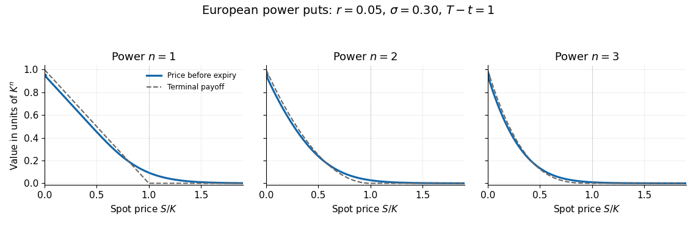

<h1 id="2/b/i/solution">Solution</h1>

↑ **Parent:** [I](../i.md)

Write $\tau=T-t>0$ and $g_n(s)=(K-s)_+^n$. The [European power put formula](../../../../../european-power-put-formula.md) is

$$
P_n(S,t)=e^{-r\tau}\mathbb E\!\left[(K-SY)_+^n\right],\qquad Y=e^{(r-\sigma^2/2)\tau+\sigma\sqrt\tau Z},\quad Z\sim N(0,1).
$$

Here $Y>0$ has a [lognormal distribution](../../../../../log-normal-distribution.md). Since $g_n$ is decreasing and is a [convex function](../../../../../convex-function.md), its discounted [expected value](../../../../../expected-value-split.md) is also decreasing and convex as a function of $S$. For $S>0$ it is smooth and strictly positive: the [normal distribution](../../../../../normal-distribution.md) assigns positive probability to $SY<K$ whatever the current positive spot price. Its endpoints are

$$
\boxed{P_n(0,t)=K^n e^{-r\tau},\qquad \lim_{S\to\infty}P_n(S,t)=0}.
$$

The [dominated convergence theorem](../../../../../dominated-convergence-theorem.md) justifies the second [limit](../../../../../limit-of-a-function.md), because $0\leq(K-SY)_+^n\leq K^n$. For a quantitative sketch, the [binomial theorem](../../../../../binomial-theorem.md) and [truncated lognormal moment](../../../../../truncated-lognormal-moment.md) give

$$
P_n(S,t)=e^{-r\tau}\sum_{j=0}^n(-1)^j\binom nj K^{n-j}S^j e^{jr\tau+j(j-1)\sigma^2\tau/2}\Phi(-d_j),\qquad d_j=\frac{\log(S/K)+[r+(j-\tfrac12)\sigma^2]\tau}{\sigma\sqrt\tau},
$$

where $\Phi$ is the [standard normal distribution function](../../../../../standard-normal-distribution-function.md). This [finite sum](../../../../../finite-sum.md) is useful for drawing the curve; its positive [expectation](../../../../../expected-value-split.md) form makes its qualitative shape clearer.

**[Figure 1](#2/b/i/image-european-power-put-prices-before-expiry-for-powers-one-two-and-three). European power-put prices before expiry for powers one, two and three**.

The solid curves use $K=1$, $r=0.05$, $\sigma=0.30$ and $\tau=1$; the dashed curves show their terminal [financial payoffs](../../../../../contingent-claim-payoff.md) for comparison. Each price remains positive at $S=K$ and tends smoothly towards zero beyond it. At small $S$, discounting gives a price below the undiscounted [financial payoff](../../../../../contingent-claim-payoff.md); European exercise is permitted only at expiry.

## ↑ Ancestors (13)

1. [I](../i.md)
2. [B](../../b.md)
3. [2](../../../2.md)
4. [2023](../../../../2023-split.md)
5. [Past exam of the mathematical models of financial derivatives course of the University of Oxford](../../../../split.md)
6. [Mathematical models of financial derivatives course of the University of Oxford](../../../../../mathematical-models-of-financial-derivatives-course-of-the-university-of-oxford.md)
7. [Year 3 of the mathematics course of the University of Oxford](../../../../../year-3-of-the-mathematics-course-of-the-university-of-oxford.md)
8. [Mathematics course of the University of Oxford](../../../../../mathematics-course-of-the-university-of-oxford.md)
9. [Undergraduate course of the University of Oxford](../../../../../undergraduate-course-of-the-university-of-oxford.md)
10. [Course of the University of Oxford](../../../../../course-of-the-university-of-oxford.md)
11. [University of Oxford](../../../../../university-of-oxford-split.md)
12. [List of universities](../../../../../list-of-universities.md)
13. [Codex Wiki](../../../../../split.md)
