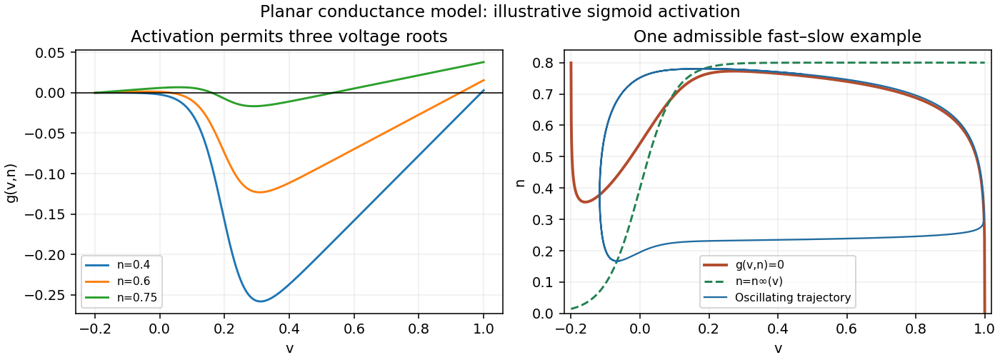

<h1 id="1/b/i/solution">Solution</h1>

↑ **Parent:** [I](../i.md)

Write $M(v)=m^3(v)$. In the physically relevant strip $-v_K<v<1$, $0<n<H$, the zero-current [nullcline](../../../../../nullcline.md) satisfies

$$
\boxed{\frac{n^4}{H-n}=\frac{(1-v)M(v)}{\gamma_K(v+v_K)}.}
$$

The left side increases strictly from zero to infinity, so there is exactly one [nullcline](../../../../../nullcline.md) height $n=N(v)$ for each interior [voltage](../../../../../voltage.md). If $M$ is positive at the endpoints, its curve joins $(-v_K,H)$ to $(1,0)$; when low-[voltage](../../../../../voltage.md) activation is idealized as exactly zero, the limiting left branch can lie on $v=-v_K$.

The signs of the derivatives explain its folds:

$$
g_n=4\gamma_K(v+v_K)n^3+(1-v)M(v)>0,
$$

$$
g_v=\gamma_Kn^4+(H-n)M(v)-(1-v)(H-n)M'(v),\qquad N'(v)=-g_v/g_n.
$$

At low [voltage](../../../../../voltage.md), [potassium](../../../../../potassium.md)'s approximately linear contribution dominates and $g_v>0$. During rapid [sodium](../../../../../sodium.md) activation the last negative term can dominate, giving $g_v<0$. Once activation saturates, $M'$ becomes small and $g_v>0$ again. This [folded conductance-model nullcline](../../../../../folded-conductance-model-nullcline.md) has the familiar shape: the curve has **descending outer branches and an ascending middle branch** in the $(v,n)$ plane. Equivalently, an intermediate fixed $n$ can give three zeros of $g$ as [voltage](../../../../../voltage.md) rises, with positive, negative and positive $g_v$ at those crossings.

The rapid-activation description permits this folded shape; exact fold positions depend on $M,\gamma_K,H,v_K$. The figure supplies an explicit admissible sigmoid example. Its right panel shows $g=0$ as well as the recovery [nullcline](../../../../../nullcline.md) and an oscillating trajectory.

**[Figure 1](#1/b/i/image-activation-dependent-voltage-roots-and-a-planar-conductance-model-relaxation-oscillation). Activation-dependent voltage roots and a planar conductance-model relaxation oscillation**.

## ↑ Ancestors (13)

1. [I](../i.md)
2. [B](../../b.md)
3. [1](../../../1.md)
4. [2011](../../../../2011-split.md)
5. [Past exam of the mathematical physiology course of the University of Oxford](../../../../split.md)
6. [Mathematical physiology course of the University of Oxford](../../../../../mathematical-physiology-course-of-the-university-of-oxford.md)
7. [Year 4 of the mathematics course of the University of Oxford](../../../../../year-4-of-the-mathematics-course-of-the-university-of-oxford.md)
8. [Mathematics course of the University of Oxford](../../../../../mathematics-course-of-the-university-of-oxford.md)
9. [Undergraduate course of the University of Oxford](../../../../../undergraduate-course-of-the-university-of-oxford.md)
10. [Course of the University of Oxford](../../../../../course-of-the-university-of-oxford.md)
11. [University of Oxford](../../../../../university-of-oxford-split.md)
12. [List of universities](../../../../../list-of-universities.md)
13. [Codex Wiki](../../../../../split.md)
