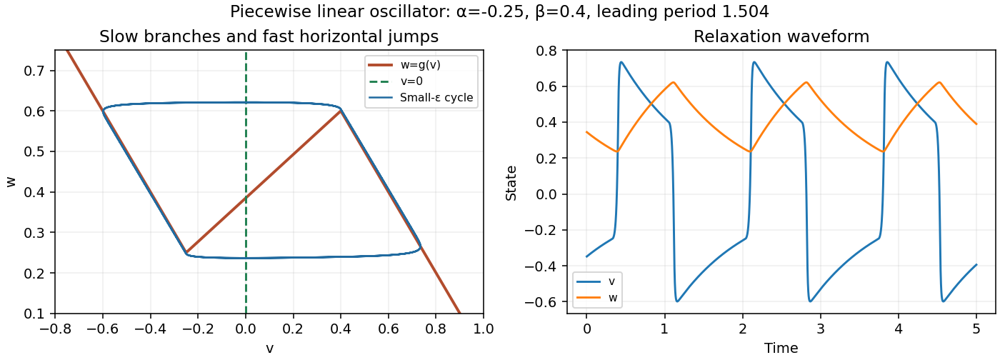

<h1 id="1/c/i/solution">Solution</h1>

↑ **Parent:** [I](../i.md)

The [nullclines](../../../../../nullcline.md) are $w=g(v)$ and $v=0$. The two outer pieces of $g$ have slope $-1$; the middle piece has positive slope

$$
\mu=\frac{1-\beta+\alpha}{\beta-\alpha}>0.
$$

The curve is continuous, with folds $(\alpha,-\alpha)$ and $(\beta,1-\beta)$. The unique equilibrium is $(0,-\alpha/(\beta-\alpha))$. Its [Jacobian matrix](../../../../../jacobian-matrix.md) has trace $\mu/\epsilon>0$ and determinant $1/\epsilon>0$, so it is unstable. The outer branches attract the fast [voltage](../../../../../voltage.md) motion.

Let $w_L=-\alpha$ and $w_R=1-\beta$. The hypothesis $\beta-\alpha<1$ gives $0<w_L<w_R<1$. The singular [relaxation oscillation](../../../../../relaxation-oscillation.md) follows this route:

- On the right branch $v=1-w>0$, $w$ slowly increases from $w_L$ to $w_R$.
- At $w=w_R$, the fast [voltage](../../../../../voltage.md) jumps from $v=\beta$ to $v=\beta-1<\alpha$.
- On the left branch $v=-w<0$, $w$ slowly decreases from $w_R$ to $w_L$.
- At $w=w_L$, [voltage](../../../../../voltage.md) jumps from $v=\alpha$ to $v=1+\alpha>\beta$.

The jumps are almost horizontal in the [phase plane](../../../../../phase-plane.md), because $w$ changes negligibly on the fast $O(\epsilon)$ time. Below $w=g(v)$, [voltage](../../../../../voltage.md) increases; above it, [voltage](../../../../../voltage.md) decreases; $w$ increases on the right of $v=0$ and decreases on the left. These signs provide a closed trapping region around the indicated route for sufficiently small positive $\epsilon$, with the unstable equilibrium excluded, giving a [periodic orbit](../../../../../periodic-orbit.md) by the planar return-map or [Poincaré-Bendixson theorem](../../../../../poincare-bendixson-theorem.md) argument. The continuous piecewise linear field is locally Lipschitz, so solution uniqueness is available at the corners.

**[Figure 2](#1/c/i/image-nullclines-fast-jumps-and-slow-motion-of-the-piecewise-linear-relaxation-oscillator). Nullclines, fast jumps, and slow motion of the piecewise linear relaxation oscillator**.

## ↑ Ancestors (13)

1. [I](../i.md)
2. [C](../../c.md)
3. [1](../../../1.md)
4. [2011](../../../../2011-split.md)
5. [Past exam of the mathematical physiology course of the University of Oxford](../../../../split.md)
6. [Mathematical physiology course of the University of Oxford](../../../../../mathematical-physiology-course-of-the-university-of-oxford.md)
7. [Year 4 of the mathematics course of the University of Oxford](../../../../../year-4-of-the-mathematics-course-of-the-university-of-oxford.md)
8. [Mathematics course of the University of Oxford](../../../../../mathematics-course-of-the-university-of-oxford.md)
9. [Undergraduate course of the University of Oxford](../../../../../undergraduate-course-of-the-university-of-oxford.md)
10. [Course of the University of Oxford](../../../../../course-of-the-university-of-oxford.md)
11. [University of Oxford](../../../../../university-of-oxford-split.md)
12. [List of universities](../../../../../list-of-universities.md)
13. [Codex Wiki](../../../../../split.md)
