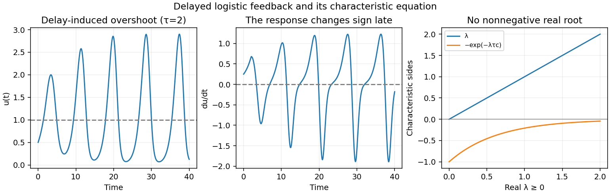

<h1 id="3/b/solution">Solution</h1>

↑ **Parent:** [B](../b.md)

A positive solution stays positive, since

$$
u(t)=u(0)\exp\left(\int_0^t[1-u(s-\tau)]\,ds\right).
$$

Therefore the sign of $\dot u$ is exactly the sign of $1-u(t-\tau)$. Initially the given history below one makes $\dot u>0$. If $u$ crosses one upwards at time $t_0$, it continues growing until $t_0+\tau$, because the feedback still sees earlier values below one. It reaches a maximum when the delayed value crosses one. Similarly, after a downward crossing at $t_1$, it continues decreasing until $t_1+\tau$ and reaches a minimum then.

This delayed reversal makes overshoots and undershoots possible. In a derivative sketch, positive lobes persist until one delay after upward crossings, followed by negative lobes persisting until one delay after downward crossings. Sustained oscillation depends on the delay; a short delay can instead give convergence to one. The example shown has $\tau=2>\pi/2$ and a history identically $1/2$.

**[Figure 3](#3/b/image-overshoot-delayed-derivative-sign-changes-and-the-absence-of-a-nonnegative-real-characteristic-root). Overshoot, delayed derivative sign changes, and the absence of a nonnegative real characteristic root**.

## ↑ Ancestors (12)

1. [B](../b.md)
2. [3](../../3.md)
3. [2011](../../../2011-split.md)
4. [Past exam of the mathematical physiology course of the University of Oxford](../../../split.md)
5. [Mathematical physiology course of the University of Oxford](../../../../mathematical-physiology-course-of-the-university-of-oxford.md)
6. [Year 4 of the mathematics course of the University of Oxford](../../../../year-4-of-the-mathematics-course-of-the-university-of-oxford.md)
7. [Mathematics course of the University of Oxford](../../../../mathematics-course-of-the-university-of-oxford.md)
8. [Undergraduate course of the University of Oxford](../../../../undergraduate-course-of-the-university-of-oxford.md)
9. [Course of the University of Oxford](../../../../course-of-the-university-of-oxford.md)
10. [University of Oxford](../../../../university-of-oxford-split.md)
11. [List of universities](../../../../list-of-universities.md)
12. [Codex Wiki](../../../../split.md)
