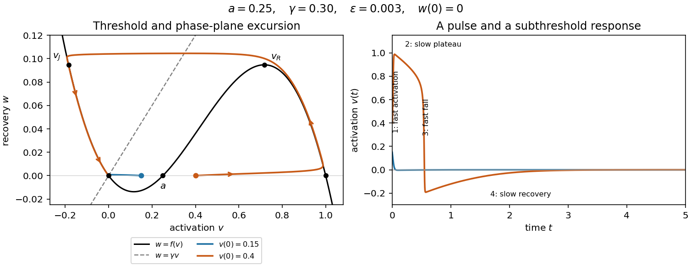
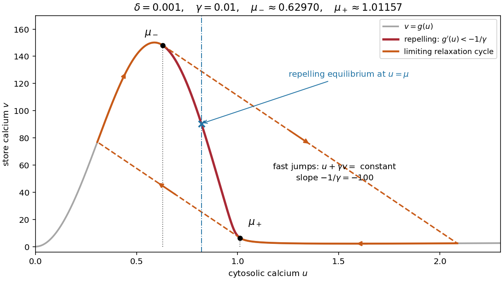

# 2023

↑ **Parent:** [Past exam of the mathematical physiology course of the University of Oxford](../past-exam-of-the-mathematical-physiology-course-of-the-university-of-oxford.md)

Solutions to all three questions of the [mathematical physiology course of the University of Oxford](../university-of-oxford.md#mathematical-physiology-course-of-the-university-of-oxford) examination held on 31 May 2023. Original paper: [public examination PDF, inclusive bundle pages 321–324; paper pages 1–4](https://www.whatdotheyknow.com/request/request_for_mathematics_examinat/response/3129786/attach/3/FOI%20202507%20740%20Data.pdf#page=321). All eighteen lettered parts are covered, including the third question even though only the best two answers counted. Question 1(c) contains a printed exponent error; Question 2(f) requires a signed recovery cutoff. Both are explained where they arise.

**Table of contents**

- [1](#1)
  - [a](#1/a)
    - [Solution](#1/a/solution)
  - [b](#1/b)
    - [Solution](#1/b/solution)
  - [c](#1/c)
    - [Solution](#1/c/solution)
  - [d](#1/d)
    - [Solution](#1/d/solution)
  - [e](#1/e)
    - [Solution](#1/e/solution)
  - [f](#1/f)
    - [Solution](#1/f/solution)
- [2](#2)
  - [a](#2/a)
    - [Solution](#2/a/solution)
  - [b](#2/b)
    - [Solution](#2/b/solution)
  - [c](#2/c)
    - [Solution](#2/c/solution)
  - [d](#2/d)
    - [Solution](#2/d/solution)
  - [e](#2/e)
    - [Solution](#2/e/solution)
  - [f](#2/f)
    - [Solution](#2/f/solution)
- [3](#3)
  - [a](#3/a)
    - [Solution](#3/a/solution)
  - [b](#3/b)
    - [Solution](#3/b/solution)
  - [c](#3/c)
    - [Solution](#3/c/solution)
  - [d](#3/d)
    - [Solution](#3/d/solution)
  - [e](#3/e)
    - [Solution](#3/e/solution)
  - [f](#3/f)
    - [Solution](#3/f/solution)

## 1

↑ **Parent:** [2023](2023.md)

<h3 id="1/a">a</h3>

↑ **Parent:** [1](#1)

<h4 id="1/a/solution">Solution</h4>

↑ **Parent:** [A](#1/a)

Write $a=[\mathrm A]$, $b=[\mathrm B]$ and $c=[\mathrm C]$ for the three [concentrations](../mathematical-physics.md#concentration). The letters denote [chemical species](../mathematical-biology.md#chemical-species); the forward arrow represents association of one [molecule](../molecule.md) of each reactant into one complex, and the reverse arrow represents dissociation. The positive constants $k_+$ and $k_-$ are the respective [reaction rate constants](../chemical-kinetics.md#rate-constant). For an elementary [chemical reaction](../chemical-reaction.md), the [law of mass action](../mathematical-biology.md#law-of-mass-action) gives forward and reverse [reaction rates](../chemical-kinetics.md#reaction-rate)

$$
R_+=k_+ab,\qquad R_-=k_-c.
$$

Every forward event removes one [molecule](../molecule.md) of each reactant and adds one complex; a reverse event reverses those changes. Thus the [reaction-rate equations](../mathematical-biology.md#rate-equation) are

$$
\boxed{\dot a=-k_+ab+k_-c,\qquad
\dot b=-k_+ab+k_-c,\qquad
\dot c=k_+ab-k_-c.}
$$

The units of $k_+$ are inverse [concentration](../mathematical-physics.md#concentration) per unit time, whereas $k_-$ has units of inverse time. Adding the equations gives the independent [conservation laws](../mathematical-physics.md#conservation-law)

$$
\boxed{a+c=a(0)+c(0),\qquad b+c=b(0)+c(0).}
$$

In particular $a-b$ is constant, but this is a consequence of those two [conservation laws](../mathematical-physics.md#conservation-law). The total $a+b+c$ need not be constant: association changes the number of separate [molecules](../molecule.md).

For the general [stoichiometry](../chemical-reaction.md#stoichiometry), take $p,q$ to be positive [integers](../integer.md). The net [reaction rate](../chemical-kinetics.md#reaction-rate) and [stoichiometric vector](../mathematical-biology.md#stoichiometric-vector) are

$$
R=k_+a^pb^q-k_-c,\qquad \boldsymbol\nu=(-p,-q,1)^{\mathsf T}.
$$

Consequently

$$
\boxed{\dot a=-pR,\qquad \dot b=-qR,\qquad \dot c=R.}
$$

The factors $p,q$ outside $R$ count [molecules](../molecule.md) consumed per event; the powers inside $R$ express the [law of mass action](../mathematical-biology.md#law-of-mass-action). The corresponding [conservation laws](../mathematical-physics.md#conservation-law) are $a+pc=\text{constant}$ and $b+qc=\text{constant}$. No [factorial](../combinatorics.md#factorial) is required in this deterministic convention for the [reaction rate constant](../chemical-kinetics.md#rate-constant).

<h3 id="1/b">b</h3>

↑ **Parent:** [1](#1)

<h4 id="1/b/solution">Solution</h4>

↑ **Parent:** [B](#1/b)

There are four reversible transitions of the [ion channel](../cell-membrane.md#ion-channel), each changing exactly one gate:

$$
\begin{aligned}
S_{00}&\mathrel{\mathop{\rightleftharpoons}^{\alpha}_{\beta}}S_{10},&
S_{01}&\mathrel{\mathop{\rightleftharpoons}^{\alpha}_{\beta}}S_{11},\\
S_{00}&\mathrel{\mathop{\rightleftharpoons}^{\gamma}_{\delta}}S_{01},&
S_{10}&\mathrel{\mathop{\rightleftharpoons}^{\gamma}_{\delta}}S_{11}.
\end{aligned}
$$

These are first-order [reaction-rate equations](../mathematical-biology.md#rate-equation): their [reaction rate constants](../chemical-kinetics.md#rate-constant) are per-gate transition rates. In the [continuous-time Markov chain](../continuous-time-markov-chain.md) interpretation, simultaneous changes of both gates have [probability](../probability-theory.md#probability) of order $(dt)^2$, so there is no direct diagonal transition in its [infinitesimal generator matrix](../continuous-time-markov-chain.md#transition-intensity-matrix).

<h3 id="1/c">c</h3>

↑ **Parent:** [1](#1)

<h4 id="1/c/solution">Solution</h4>

↑ **Parent:** [C](#1/c)

Normalize the total channel density to one. For [independent permissive gates in an ion channel](../membrane-potential.md#independent-permissive-gates-in-an-ion-channel), the [probability](../probability-theory.md#probability) that the $M$ gate is open is $m$, and the [probability](../probability-theory.md#probability) that the $H$ gate is open is $h$. The joint [probability](../probability-theory.md#probability) is the product of the appropriate open or closed [probabilities](../probability-theory.md#probability), giving

$$
\boxed{S_{ij}=m^i(1-m)^{1-i}h^j(1-h)^{1-j}.}
$$

In particular

$$
S_{00}=(1-m)(1-h),\quad S_{10}=m(1-h),\quad
S_{01}=(1-m)h,\quad S_{11}=mh.
$$

The original PDF really prints $j$, rather than $1-j$, on the final factor. That expression fails [normalization of a probability distribution](../probability-distribution.md#normalization-of-a-probability-distribution) and does not give the closed-$H$ [probability](../probability-theory.md#probability) at $j=0$; the displayed correction is necessary. If $S_{ij}$ are literal densities with conserved total density $N$, multiply each expression by $N$.

The product additionally assumes initially [independent events](../probability-theory.md#independent-events) and independent gate transitions. The transition scheme alone permits initially correlated gates and does not force this factorization at every time. The all-closed initial preparation used below satisfies the required product assumption.

<h3 id="1/d">d</h3>

↑ **Parent:** [1](#1)

<h4 id="1/d/solution">Solution</h4>

↑ **Parent:** [D](#1/d)

For each state, add its incoming [reaction rates](../chemical-kinetics.md#reaction-rate) and subtract its outgoing [reaction rates](../chemical-kinetics.md#reaction-rate). This gives the [master equation](../continuous-time-markov-chain.md#master-equation)

$$
\boxed{\begin{aligned}
\dot S_{00}&=-(\alpha+\gamma)S_{00}+\beta S_{10}+\delta S_{01},\\
\dot S_{10}&=\alpha S_{00}-(\beta+\gamma)S_{10}+\delta S_{11},\\
\dot S_{01}&=\gamma S_{00}-(\alpha+\delta)S_{01}+\beta S_{11},\\
\dot S_{11}&=\gamma S_{10}+\alpha S_{01}-(\beta+\delta)S_{11}.
\end{aligned}}
$$

Summing gives $\sum_{i,j}\dot S_{ij}=0$, verifying the [conservation law](../mathematical-physics.md#conservation-law) for total channel density. Nonnegative initial densities stay nonnegative because every loss term vanishes when its own density reaches zero.

<h3 id="1/e">e</h3>

↑ **Parent:** [1](#1)

<h4 id="1/e/solution">Solution</h4>

↑ **Parent:** [E](#1/e)

With total density one, the open [probabilities](../probability-theory.md#probability) for the individual gates are $m=S_{10}+S_{11}$ and $h=S_{01}+S_{11}$. Adding the relevant [master equations](../continuous-time-markov-chain.md#master-equation) cancels transitions of the other gate:

$$
\boxed{\dot m=\alpha(S_{00}+S_{01})-\beta(S_{10}+S_{11})
=\alpha(1-m)-\beta m,}
$$

$$
\boxed{\dot h=\gamma(S_{00}+S_{10})-\delta(S_{01}+S_{11})
=\gamma(1-h)-\delta h.}
$$

These marginal [ordinary differential equations](../differential-equation.md#ordinary-differential-equation) hold even for correlated initial gates. Their product gives $S_{11}$ when the independence assumption in part (c) holds. Solving the [first-order linear differential equations](../linear-ordinary-differential-equation.md#first-order-linear-differential-equation) from the all-closed initial state gives

$$
m(t)=\frac{\alpha}{\alpha+\beta}\bigl(1-e^{-(\alpha+\beta)t}\bigr),\qquad
h(t)=\frac{\gamma}{\gamma+\delta}\bigl(1-e^{-(\gamma+\delta)t}\bigr).
$$

Put $\lambda=\alpha+\beta=\gamma+\delta>0$. Then

$$
S_{11}(t)=S_{11,\infty}(1-e^{-\lambda t})^2,\qquad
S_{11,\infty}=\frac{\alpha\gamma}{\lambda^2}.
$$

For positive opening rates this increases strictly from zero, so its half-[equilibrium](../dynamical-systems.md#equilibrium-point-of-a-dynamical-system) time is uniquely determined by $(1-e^{-\lambda t})^2=1/2$:

$$
\boxed{t_{1/2}=\frac{-\log(1-2^{-1/2})}{\lambda}
=\frac{\log(2+\sqrt2)}{\lambda}.}
$$

If an opening rate is zero, the all-open [equilibrium](../dynamical-systems.md#equilibrium-point-of-a-dynamical-system) density is zero and a nontrivial half-rise time is undefined.

<h3 id="1/f">f</h3>

↑ **Parent:** [1](#1)

<h4 id="1/f/solution">Solution</h4>

↑ **Parent:** [F](#1/f)

The two identical $M$ gates are independent [Bernoulli random variables](../discrete-probability-distribution.md#bernoulli-distribution), so their open count has a [binomial distribution](../discrete-probability-distribution.md#binomial-distribution). Multiplying by the independent $H$ factor gives the normalized channel densities

$$
\boxed{S_{ij}=\binom2i m^i(1-m)^{2-i}h^j(1-h)^{1-j}.}
$$

Explicitly,

$$
\begin{aligned}
S_{00}&=(1-m)^2(1-h),&S_{01}&=(1-m)^2h,\\
S_{10}&=2m(1-m)(1-h),&S_{11}&=2m(1-m)h,\\
S_{20}&=m^2(1-h),&S_{21}&=m^2h.
\end{aligned}
$$

The [binomial coefficient](../binomial-coefficient.md) $\binom21=2$ counts which of the two distinguishable $M$ gates is open. At open count $i$, the total $M$-opening rate is $(2-i)\alpha$ and the total closing rate is $i\beta$. Dividing the [expected value](../expected-value.md) of that count by two therefore recovers the same single-gate [ordinary differential equation](../differential-equation.md#ordinary-differential-equation):

$$
\boxed{\dot m=\alpha(1-m)-\beta m,\qquad
\dot h=\gamma(1-h)-\delta h.}
$$

For the specified [initial conditions](../differential-equation.md#initial-condition) and common rate sum $\lambda$, the all-open fraction is

$$
S_{21}(t)=\frac{\alpha^2\gamma}{\lambda^3}(1-e^{-\lambda t})^3.
$$

Thus, assuming positive opening rates,

$$
\boxed{t_{1/2}=\frac{-\log(1-2^{-1/3})}{\lambda}.}
$$

Three gates take longer to reach half their final all-open fraction than two gates: all three activation factors must build up simultaneously.

## 2

↑ **Parent:** [2023](2023.md)

<h3 id="2/a">a</h3>

↑ **Parent:** [2](#2)

<h4 id="2/a/solution">Solution</h4>

↑ **Parent:** [A](#2/a)

In the [Hodgkin-Huxley model](../neuroscience.md#hodgkin-huxley-model), $V$ is the intracellular-minus-extracellular [membrane potential](../membrane-potential.md), $C_m$ is the [membrane capacitance](../neuroscience.md#membrane-capacitance) per unit area, and $I_{\mathrm{app}}$ is the applied inward [electric current](../electric-charge.md#electric-current) per unit area. A [space clamp](../neuroscience.md#space-clamp) makes $V$ spatially uniform, leaving temporal [ordinary differential equations](../differential-equation.md#ordinary-differential-equation). With outward ionic [electric current](../electric-charge.md#electric-current) positive, the [capacitance](../electromagnetism.md#capacitance) balance is $C_m\dot V=I_{\mathrm{app}}-I_i$.

The variables $m,n,h$ lie between zero and one. They describe [sodium](../chemical-substance.md#sodium) activation, [potassium](../chemical-substance.md#potassium) activation and availability against [sodium](../chemical-substance.md#sodium) inactivation, respectively. Thus larger $h$ means less inactivation. Their voltage-dependent limiting values are $m_\infty,n_\infty,h_\infty$, and $\tau_m,\tau_n,\tau_h$ are their positive relaxation [time constants](../analysis.md#time-constant).

Each ionic term has the [Ohm's law](../electric-charge.md#ohm-s-law) form conductance times driving potential. The [sodium](../chemical-substance.md#sodium) term has instantaneous [electrical conductance](../electric-charge.md#electrical-conductance) $g_{\mathrm{Na}}m^3h$, the [potassium](../chemical-substance.md#potassium) term has instantaneous [electrical conductance](../electric-charge.md#electrical-conductance) $g_{\mathrm K}n^4$, and the leak term has constant [electrical conductance](../electric-charge.md#electrical-conductance) $g_{\mathrm L}$. Here the $g$ constants are maximal [electrical conductances](../electric-charge.md#electrical-conductance) per area, and $V_{\mathrm{Na}},V_{\mathrm K},V_{\mathrm L}$ are the corresponding [reversal potentials](../membrane-potential.md#reversal-potential). The factors $m^3h$ and $n^4$ arise from [independent permissive gates in an ion channel](../membrane-potential.md#independent-permissive-gates-in-an-ion-channel). A conducting channel carries zero net ionic [electric current](../electric-charge.md#electric-current) at its [reversal potential](../membrane-potential.md#reversal-potential).

<h3 id="2/b">b</h3>

↑ **Parent:** [2](#2)

<h4 id="2/b/solution">Solution</h4>

↑ **Parent:** [B](#2/b)

Use the three standard reduction assumptions: $m$ relaxes much faster than $V,n,h$ and can be replaced by $m_\infty(V)$; the two slower gates have the same [time constant](../analysis.md#time-constant), $\tau_n(V)=\tau_h(V)=\tau(V)$; and their limiting open fractions have a voltage-independent sum, $n_\infty(V)+h_\infty(V)=K$. The constant-sum assumption is essential: equality of two [time constants](../analysis.md#time-constant) by itself does not preserve a moving voltage-dependent sum.

For $q=n+h$, addition of the two gate [ordinary differential equations](../differential-equation.md#ordinary-differential-equation) gives

$$
\tau(V)\dot q=K-q.
$$

The specified initial condition is $q(0)=K$. Uniqueness for this [first-order linear differential equation](../linear-ordinary-differential-equation.md#first-order-linear-differential-equation) gives $q(t)=K$, hence $h=K-n$ for all time. The remaining two [ordinary differential equations](../differential-equation.md#ordinary-differential-equation) are

$$
\boxed{\begin{aligned}
C_m\dot V={}&I_{\mathrm{app}}
-g_{\mathrm{Na}}m_\infty(V)^3(K-n)(V-V_{\mathrm{Na}})
-g_{\mathrm K}n^4(V-V_{\mathrm K})-g_{\mathrm L}(V-V_{\mathrm L}),\\
\tau(V)\dot n={}&n_\infty(V)-n.
\end{aligned}}
$$

These assumptions give a [planar reduction of the Hodgkin-Huxley model](../neuroscience.md#planar-reduction-of-the-hodgkin-huxley-model). The [FitzHugh-Nagumo model](../mathematical-biology.md#fitzhugh-nagumo-model) keeps its fast activation and slow [recovery variable](../mathematical-biology.md#recovery-variable) geometry, approximating the voltage response by a [cubic polynomial](../polynomial.md#cubic-polynomial) and the recovery response by a [linear function](../vector-space.md#linear-function) after [nondimensionalization](../mathematical-physics.md#nondimensionalization). The [polynomial](../polynomial.md) equations in part (c) are a further model simplification; they are not an exact algebraic consequence of arbitrary original gate functions.

<h3 id="2/c">c</h3>

↑ **Parent:** [2](#2)

<h4 id="2/c/solution">Solution</h4>

↑ **Parent:** [C](#2/c)

Assume $\varepsilon>0$. At an [equilibrium](../dynamical-systems.md#equilibrium-point-of-a-dynamical-system), $w=\gamma v=f(v)$, so

$$
v\bigl[(a-v)(v-1)-\gamma\bigr]=0.
$$

The nonzero roots are

$$
v_\pm=\frac{1+a\pm\sqrt{(1-a)^2-4\gamma}}2,\qquad w_\pm=\gamma v_\pm.
$$

Consequently, with $\gamma_c=(1-a)^2/4$, there are three distinct [equilibria](../dynamical-systems.md#equilibrium-point-of-a-dynamical-system) for $0<\gamma<\gamma_c$, two distinct [equilibria](../dynamical-systems.md#equilibrium-point-of-a-dynamical-system) for $\gamma=\gamma_c$, and only the origin for $\gamma>\gamma_c$. At equality the two nonzero [equilibria](../dynamical-systems.md#equilibrium-point-of-a-dynamical-system) coincide; for $0<\gamma<\gamma_c$ they both have $a<v<1$. Geometrically, $\gamma_c$ is the maximum of the concave quadratic $(a-v)(v-1)$.

Since $f'(0)=-a$, the [Jacobian matrix](../multivariable-calculus.md#jacobian-matrix) at the origin is

$$
J_0=\begin{pmatrix}-a/\varepsilon&-1/\varepsilon\\\gamma&-1\end{pmatrix},\qquad
\operatorname{tr}J_0=-\frac a\varepsilon-1<0,\qquad
\det J_0=\frac{a+\gamma}{\varepsilon}>0.
$$

Thus the origin is always [asymptotically stable](../dynamical-systems.md#asymptotic-stability). Its [eigenvalues](../linear-operator-theory.md#eigenvalue) are

$$
\lambda_\pm=\frac{-(a+\varepsilon)\pm\sqrt{(a-\varepsilon)^2-4\varepsilon\gamma}}{2\varepsilon}.
$$

Writing $\gamma_N=(a-\varepsilon)^2/(4\varepsilon)$, the origin is a [stable node](../dynamical-systems.md#stable-node) for $0<\gamma<\gamma_N$ and a [stable focus](../dynamical-systems.md#stable-spiral) for $\gamma>\gamma_N$. At $\gamma=\gamma_N>0$ it is a [degenerate node](../dynamical-systems.md#degenerate-node): the repeated negative [eigenvalue](../linear-operator-theory.md#eigenvalue) has only one independent [eigenvector](../linear-operator-theory.md#eigenvector), since the nonzero off-diagonal entry prevents $J_0$ being a scalar matrix. If $a=\varepsilon$, then $\gamma_N=0$ and every permitted $\gamma>0$ gives a [stable focus](../dynamical-systems.md#stable-spiral). This change from node to focus does not change [stability](../numerical-analysis.md#stability-of-a-numerical-method) and is not a [Hopf bifurcation](../bifurcation-theory.md#hopf-bifurcation).

<h3 id="2/d">d</h3>

↑ **Parent:** [2](#2)

<h4 id="2/d/solution">Solution</h4>

↑ **Parent:** [D](#2/d)

Take $\gamma>\gamma_c$ and let $\varepsilon\to0^+$ with the other parameters fixed. The [nullclines](../dynamical-systems.md#nullcline) are the [cubic polynomial](../polynomial.md#cubic-polynomial) graph $w=f(v)$ and the line $w=\gamma v$. In the [phase plane](../dynamical-systems.md#phase-plane), $v$ increases below the [cubic polynomial](../polynomial.md#cubic-polynomial) graph and decreases above it; $w$ increases below the line and decreases above it. The fast [ordinary differential equation](../differential-equation.md#ordinary-differential-equation), in time $s=t/\varepsilon$, freezes $w$ and gives $dv/ds=f(v)-w$.

At $w=0$, the fast roots are $0,a,1$. Their [linear stability](../dynamical-systems.md#linear-stability) follows from $f'(0)=-a<0$, $f'(a)=a(1-a)>0$ and $f'(1)=a-1<0$. Thus a fixed $0<v^*<a$ falls towards the resting branch, whereas a fixed $a<v^*<1$ rises towards $v=1$. If $v^*>1$, the first fast segment instead settles down towards $1$, followed by the same recovery excursion. The threshold $a$ is the leading [singular perturbation](../singular-perturbation.md) threshold; finite-$\varepsilon$ corrections matter for initial values approaching $a$ with $\varepsilon$.

Let

$$
d=\sqrt{1-a+a^2},\qquad
v_L=\frac{1+a-d}{3},\qquad v_R=\frac{1+a+d}{3}.
$$

These are the roots of $f'(v)=0$. The outer branches $v<v_L$ and $v>v_R$ of the [critical manifold](../singular-perturbation.md#critical-manifold) are attracting under fast motion; the middle branch is repelling. The full excursion has four stages.

- **Fast activation:** nearly horizontal movement towards $(1,0)$, on the $t=O(\varepsilon)$ [time scale](../mathematical-physics.md#time-scale), apart from the usual matching tails.
- **First slow phase:** motion along $w=f(v)$ from $v=1$ down to $v=v_R$. Here $w$ rises and $v$ slowly falls, because $\dot w=\gamma v-f(v)>0$ on the positive outer branch. This takes order-one time for fixed $\gamma$.
- **Fast repolarization:** near the right [fold point of a critical manifold](../singular-perturbation.md#fold-point-of-a-critical-manifold), the attracting branch ends. With $w_R=f(v_R)$ nearly constant, $v$ drops to the negative root $v_J$ of $f(v_J)=w_R$. The jump takes the fast [time scale](../mathematical-physics.md#time-scale); a thin neighborhood of the fold has an intermediate [fold delay](../singular-perturbation.md#fold-delay).
- **Second slow phase:** motion along the negative attracting branch from $v_J$ towards $0$ from below, while $w$ falls towards zero. This is the refractory recovery and has order-one duration to a fixed small cutoff; exact return to the [equilibrium](../dynamical-systems.md#equilibrium-point-of-a-dynamical-system) takes infinite time.

For this [cubic polynomial](../polynomial.md#cubic-polynomial), the landing point is explicit. Since $f(v)-f(v_R)=-(v-v_R)^2(v-v_J)$, comparison of the quadratic [coefficients](../vector-space.md#coefficient) gives

$$
\boxed{v_J=1+a-2v_R=\frac{1+a-2\sqrt{1-a+a^2}}3<0.}
$$

Thus a graph of $v(t)$ has a rapid rise, a slowly falling elevated plateau, a rapid fall through zero to a negative undershoot, and a slow approach back to zero. The figure shows both the [phase plane](../dynamical-systems.md#phase-plane) and a computed time trace. The smaller initial perturbation stays near the resting branch and produces no elevated plateau.

**[Figure 1](#2/d/image-excitation-threshold-and-the-four-stages-of-a-fitzhugh-nagumo-pulse). Excitation threshold and the four stages of a FitzHugh-Nagumo pulse**.

The four-stage description concerns the [singular limit](../singular-perturbation.md#singular-limit). Close to a simple [fold point of a critical manifold](../singular-perturbation.md#fold-point-of-a-critical-manifold), balancing the local quadratic activation term with the slow drift gives $\Delta v=O(\varepsilon^{1/3})$ and $\Delta t=O(\varepsilon^{2/3})$ for fixed parameters. These layers shrink compared with the slow phases and do not alter the leading time integrals below.

<h3 id="2/e">e</h3>

↑ **Parent:** [2](#2)

<h4 id="2/e/solution">Solution</h4>

↑ **Parent:** [E](#2/e)

On an attracting branch of the [critical manifold](../singular-perturbation.md#critical-manifold), $w=f(v)$ to leading order. The [chain rule](../calculus.md#chain-rule) therefore gives

$$
f'(v)\dot v=\dot w=\gamma v-f(v),\qquad
dt=\frac{f'(v)}{\gamma v-f(v)}\,dv.
$$

The initial fast segment ends at $v=1$, and the first slow phase ends at the right [fold point of a critical manifold](../singular-perturbation.md#fold-point-of-a-critical-manifold), $v_R$. Hence

$$
\boxed{T_1=\int_1^{v_R}g(v)\,dv,\qquad
g(v)=\frac{-3v^2+2(1+a)v-a}{\gamma v-v(a-v)(v-1)},\qquad
v_1=1,\quad v_2=v_R.}
$$

On this interval $f'(v)<0$ and $\gamma v-f(v)>0$. The [integrand](../integral.md#integrand) is negative, but the upper limit is smaller than the lower limit, so $T_1>0$. The numerator tends to zero at the fold while the denominator remains positive; the leading [integral](../integral.md) is finite. Fast segments and the [fold delay](../singular-perturbation.md#fold-delay) give vanishing corrections as $\varepsilon\to0^+$.

<h3 id="2/f">f</h3>

↑ **Parent:** [2](#2)

<h4 id="2/f/solution">Solution</h4>

↑ **Parent:** [F](#2/f)

The requested second phase is the second slow recovery phase, beginning after the downward fast jump. Its starting point is $v_3=v_J<0$, fixed by $f(v_J)=f(v_R)$, with the negative root chosen. Along it the same [chain rule](../calculus.md#chain-rule) gives

$$
\boxed{h(v)=\frac{f'(v)}{\gamma v-f(v)}
=\frac{-3v^2+2(1+a)v-a}{v[\gamma+a-(1+a)v+v^2]}.}
$$

The approach is to zero from below. Thus, if the printed cutoff $\beta$ is a signed value, it must satisfy $v_J<\beta<0$ and $v_4=\beta$. If $\beta$ denotes a small positive magnitude, the endpoint is instead $v_4=-\beta$. To express both conventions unambiguously, put $b=|\beta|>0$ and write

$$
\boxed{T_2=\int_{v_J}^{-b}h(v)\,dv.}
$$

There is no positive small endpoint on this leading slow branch. A positive cutoff would require a different event or finite-$\varepsilon$ oscillatory recovery.

For bounded negative $v$ and $\gamma\gg1$,

$$
h(v)=\frac1\gamma\left[-3v+2(1+a)-\frac av\right]
+O\!\left(\frac{1+|v|^{-1}}{\gamma^2}\right).
$$

[Integration](../integral.md) therefore gives the useful more detailed approximation

$$
T_2=\frac1\gamma\left[
\frac32v_J^2-2(1+a)v_J+a\log\frac{|v_J|}{b}
-2(1+a)b-\frac32b^2\right]
+O\!\left(\frac{1+\log(1/b)}{\gamma^2}\right).
$$

Taking also $b\ll1$, the leading logarithm is

$$
\boxed{T_2\sim\frac a\gamma\log\frac1b.}
$$

Indeed near zero, $f(v)=-av+O(v^2)$ and the slow equation is $\dot v=-(\gamma+a)v/a+O(v^2)$, so at fixed $\gamma$ the exact leading logarithmic coefficient is $a/(\gamma+a)$. Its large-$\gamma$ limit is $a/\gamma$, agreeing with the [integral](../integral.md).

The order of approximation matters: first take the [singular limit](../singular-perturbation.md#singular-limit) at fixed $\gamma$, then the large-$\gamma$ and small-cutoff limits. For simultaneous limits, a sufficient separation near rest is $\varepsilon\gamma\ll a^2$. Otherwise the fast and recovery [time scales](../mathematical-physics.md#time-scale) merge, and these slow-branch formulas need not describe the late-time motion.

## 3

↑ **Parent:** [2023](2023.md)

<h3 id="3/a">a</h3>

↑ **Parent:** [3](#3)

<h4 id="3/a/solution">Solution</h4>

↑ **Parent:** [A](#3/a)

In this [two-pool calcium model](../signal-transduction.md#two-pool-calcium-model), $c$ is the cytosolic [calcium ion](../chemical-substance.md#calcium-ion) [concentration](../mathematical-physics.md#concentration), and $c_s$ measures [calcium](../chemical-substance.md#calcium) in an intracellular store, such as the [endoplasmic reticulum](../biological-cell.md#endoplasmic-reticulum). The variables in these balances are expressed using compatible effective volumes, so internal transfers enter their two equations with equal and opposite signs. If actual compartment [concentrations](../mathematical-physics.md#concentration) use different reference volumes, the corresponding volume ratio must first be included in their balances.

The [flux](../mathematical-physics.md#flux) $J_+$ pumps [calcium](../chemical-substance.md#calcium) from the [cytosol](../biological-cell.md#cytosol) into the store, $J_-$ releases it back, and $k_sc_s$ is passive store leakage back to the [cytosol](../biological-cell.md#cytosol). The external input $r$ supplies cytosolic [calcium](../chemical-substance.md#calcium), while $kc$ exports it from the [biological cell](../biological-cell.md). Thus $k,k_s$ have units of inverse time and all five [fluxes](../mathematical-physics.md#flux) have units of [concentration](../mathematical-physics.md#concentration) per time. Their directions can be sketched as

$$
\text{exterior}\ \xrightarrow{\ r\ }\ \text{cytosol }c
\ \xrightarrow{\ J_+\ }\ \text{store }c_s,\qquad
\text{store }c_s\ \xrightarrow{\ J_-+k_sc_s\ }\ \text{cytosol }c
\ \xrightarrow{\ kc\ }\ \text{exterior}.
$$

Adding the two [ordinary differential equations](../differential-equation.md#ordinary-differential-equation) verifies the total [calcium](../chemical-substance.md#calcium) balance

$$
\boxed{\frac{d}{dt}(c+c_s)=r-kc.}
$$

Internal uptake, release and leakage redistribute [calcium](../chemical-substance.md#calcium); only the exchanges across the [cell membrane](../cell-membrane.md) change this total. In particular any [equilibrium](../dynamical-systems.md#equilibrium-point-of-a-dynamical-system) must have $c=r/k$ when $k>0$.

<h3 id="3/b">b</h3>

↑ **Parent:** [3](#3)

<h4 id="3/b/solution">Solution</h4>

↑ **Parent:** [B](#3/b)

Choose positive reference [concentrations](../mathematical-physics.md#concentration) $C,C_s$ and a reference [flux](../mathematical-physics.md#flux) $J_0$, and define

$$
u=\frac cC,\qquad v=\frac{c_s}{C_s},\qquad
\tau=kt,\qquad j_\pm=\frac{J_\pm}{J_0}.
$$

Overdots now mean [derivatives](../calculus.md#derivative) with respect to the dimensionless time $\tau$. The store balance becomes

$$
\frac{kC_s}{J_0}\dot v=j_+-j_--\frac{k_sC_s}{J_0}v.
$$

The total balance becomes $\dot u+(C_s/C)\dot v=r/(kC)-u$. Therefore

$$
\boxed{\mu=\frac r{kC},\qquad
\gamma=\frac{C_s}{C},\qquad
\varepsilon=\frac{kC_s}{J_0},\qquad
\delta=\frac{k_sC_s}{J_0},}
$$

and

$$
\boxed{\dot u=\mu-u-\gamma\dot v,\qquad
\varepsilon\dot v=j_+-j_--\delta v.}
$$

The reference quantities are scale choices, not additional kinetic variables; typically the response functions supply natural saturation [concentrations](../mathematical-physics.md#concentration) and a maximal uptake [flux](../mathematical-physics.md#flux). The identity $\delta/\varepsilon=k_s/k$ checks the [nondimensionalization](../mathematical-physics.md#nondimensionalization). A small $\varepsilon$ means store exchange is fast compared with external cytosolic removal.

<h3 id="3/c">c</h3>

↑ **Parent:** [3](#3)

<h4 id="3/c/solution">Solution</h4>

↑ **Parent:** [C](#3/c)

At any [equilibrium](../dynamical-systems.md#equilibrium-point-of-a-dynamical-system), the first balance gives $u=\mu$ and the second gives $f(\mu,v)=0$. For every fixed $u>0$,

$$
f(u,0)=\frac{u^2}{1+u^2}>0,\qquad
\lim_{v\to\infty}f(u,v)=-\infty,
$$

and

$$
\boxed{f_v(u,v)=-\frac{u^4}{1+u^4}\frac{2v}{(1+v^2)^2}-\delta<0
\quad(v\ge0).}
$$

The [intermediate value theorem](../calculus.md#intermediate-value-theorem) and strict [monotonicity](../calculus.md#monotonic-function) give precisely one positive root $v=g(u)$ for each $u>0$. Since $f_v\ne0$, the [implicit function theorem](../multivariable-calculus.md#implicit-function-theorem) makes this a smooth [nullcline](../dynamical-systems.md#nullcline). For every $\mu>0$, therefore,

$$
\boxed{(u_*,v_*)=(\mu,g(\mu))}
$$

is the unique positive [equilibrium](../dynamical-systems.md#equilibrium-point-of-a-dynamical-system). Graphically, draw the vertical line $u=\mu$ through the given graph: it meets the graph once, even on its steep descending section. This vertical line is the condition for simultaneous stationarity; the full $u$ [nullcline](../dynamical-systems.md#nullcline) at finite $\varepsilon$ is actually $f(u,v)=(\varepsilon/\gamma)(\mu-u)$.

<h3 id="3/d">d</h3>

↑ **Parent:** [3](#3)

<h4 id="3/d/solution">Solution</h4>

↑ **Parent:** [D](#3/d)

Eliminate $\dot v$ from the first equation before [linearization](../algebra.md#linearization):

$$
\dot u=\mu-u-\frac\gamma\varepsilon f(u,v),\qquad
\dot v=\frac1\varepsilon f(u,v).
$$

All partial [derivatives](../calculus.md#derivative) below are evaluated at $(\mu,g(\mu))$. The [Jacobian matrix](../multivariable-calculus.md#jacobian-matrix) is

$$
J=\begin{pmatrix}
-1-\gamma f_u/\varepsilon&-\gamma f_v/\varepsilon\\
f_u/\varepsilon&f_v/\varepsilon
\end{pmatrix}.
$$

Its [trace](../linear-algebra.md#matrix-trace) and [determinant](../multilinear-algebra.md#determinant) are

$$
\operatorname{tr}J=-1+\frac{f_v-\gamma f_u}{\varepsilon},\qquad
\det J=-\frac{f_v}{\varepsilon}>0.
$$

By [linear stability of a planar equilibrium](../dynamical-systems.md#linear-stability-of-a-planar-equilibrium), a positive [trace](../linear-algebra.md#matrix-trace) makes both real [eigenvalues](../linear-operator-theory.md#eigenvalue) positive or gives a complex pair with positive real part. The [equilibrium](../dynamical-systems.md#equilibrium-point-of-a-dynamical-system) is consequently unstable precisely when

$$
\boxed{\varepsilon-f_v<-\gamma f_u.}
$$

A negative [trace](../linear-algebra.md#matrix-trace) gives [asymptotic stability](../dynamical-systems.md#asymptotic-stability); equality leaves a purely imaginary pair and requires a separate nonlinear [bifurcation](../bifurcation-theory.md#bifurcation) calculation. In particular, the unique positive [equilibrium](../dynamical-systems.md#equilibrium-point-of-a-dynamical-system) is never a [saddle equilibrium](../dynamical-systems.md#saddle-equilibrium).

<h3 id="3/e">e</h3>

↑ **Parent:** [3](#3)

<h4 id="3/e/solution">Solution</h4>

↑ **Parent:** [E](#3/e)

Differentiate the identity $f(u,g(u))=0$ using the [chain rule](../calculus.md#chain-rule):

$$
f_u+f_vg'(u)=0,\qquad f_u=-f_vg'(u).
$$

Substitution into the [trace](../linear-algebra.md#matrix-trace) gives

$$
\operatorname{tr}J=-1+\frac{f_v}{\varepsilon}\bigl(1+\gamma g'(\mu)\bigr).
$$

Because $f_v<0$, the exact instability condition is

$$
\boxed{1+\gamma g'(\mu)<\frac\varepsilon{f_v},\qquad
g'(\mu)<-\frac1\gamma+\frac{\varepsilon}{\gamma f_v}.}
$$

For fixed $\delta>0$ and fixed [equilibrium](../dynamical-systems.md#equilibrium-point-of-a-dynamical-system) location, the correction tends to zero with $\varepsilon$. To leading order this is

$$
\boxed{g'(\mu)<-1/\gamma.}
$$

Thus instability requires the descending [nullcline](../dynamical-systems.md#nullcline) to be steeper than a line of slope $-1/\gamma$. The sign of the finite-$\varepsilon$ correction makes the exact unstable interval slightly smaller. Since $\delta=0.001$ can make $|f_v|$ small, the approximation quantitatively requires $\varepsilon/|f_v|\ll1$ at the point in question; merely comparing $\varepsilon$ with one can be insufficient.

<h3 id="3/f">f</h3>

↑ **Parent:** [3](#3)

<h4 id="3/f/solution">Solution</h4>

↑ **Parent:** [F](#3/f)

On the descending part of the graph, mark the two tangency points where

$$
\boxed{g'(\mu_-)=-1/\gamma=g'(\mu_+),\qquad \mu_-<\mu_+.}
$$

Choose the crossings that enclose the portion with $g'(u)<-1/\gamma$. For fixed $\mu$ strictly between these values and sufficiently small $\varepsilon$, the unique [equilibrium](../dynamical-systems.md#equilibrium-point-of-a-dynamical-system) is a [repelling equilibrium](../dynamical-systems.md#source-equilibrium) by part (e). The endpoints here are leading [singular limit](../singular-perturbation.md#singular-limit) values; at finite $\varepsilon$ the boundaries instead solve $f_v-\gamma f_u=\varepsilon$ and approach these tangencies when the crossings are nondegenerate.

There is a necessary qualification: such an interval exists only when $\gamma$ is large enough that the descending graph actually attains slopes below $-1/\gamma$. If $M=\max_{u>0}[-g'(u)]$, one needs $\gamma M>1$. The supplied graph has a very steep descending section, but an arbitrarily small positive $\gamma$ need not satisfy this condition. For $\delta=0.001$, numerical evaluation gives $M\simeq511.49$, so the leading threshold is $\gamma\simeq0.0019551$. A graph alone does not remove this parameter restriction.

The fast motion is especially informative. In fast time $s=\tau/\varepsilon$,

$$
\frac{du}{ds}=\varepsilon(\mu-u)-\gamma f(u,v),\qquad
\frac{dv}{ds}=f(u,v).
$$

At leading order $z=u+\gamma v$ is constant, so fast paths are straight lines with slope $dv/du=-1/\gamma$. Along such a line, the fast [eigenvalue](../linear-operator-theory.md#eigenvalue) at the [nullcline](../dynamical-systems.md#nullcline) is

$$
f_v-\gamma f_u=f_v\bigl(1+\gamma g'(u)\bigr).
$$

It is negative on the two outer attracting segments and positive on the intervening repelling segment. The tangencies defining $\mu_\pm$ are consequently the [fold points of a critical manifold](../singular-perturbation.md#fold-point-of-a-critical-manifold) when it is expressed in the coordinates $(z,v)$. They are not generally the maximum and minimum of $g$ itself.

For $\mu_-<\mu<\mu_+$, slow motion on an attracting segment follows

$$
\boxed{(1+\gamma g'(u))\dot u=\mu-u.}
$$

On the left attracting segment $u<\mu_-$ this moves towards increasing $u$; on the right attracting segment $u>\mu_+$ it moves towards decreasing $u$. Each segment ends at a tangency and is followed by a fast jump along a line of slope $-1/\gamma$ to the other attracting segment. This constructs the limiting [relaxation oscillation](../dynamical-systems.md#relaxation-oscillation). The figure uses $\gamma=0.01$, for which $\mu_-\simeq0.62970$ and $\mu_+\simeq1.01157$; the marked endpoints change with $\gamma$.

**[Figure 2](#3/f/image-calcium-nullcline-slope-tangencies-and-the-limiting-relaxation-cycle). Calcium nullcline, slope tangencies and the limiting relaxation cycle**.

To justify existence of a [periodic orbit](../dynamical-systems.md#periodic-orbit) of the full planar system, rather than just draw a formal cycle, first establish a compact [trapping region](../dynamical-systems.md#trapping-region). The positive quadrant is forward invariant: at $u=0$, $\dot u=\mu+\gamma\delta v/\varepsilon>0$, and at $v=0$, $\dot v=u^2/[\varepsilon(1+u^2)]\ge0$. Moreover

$$
\dot v\le\frac{1-\delta v}{\varepsilon}.
$$

Choose $V>1/\delta$ above the initial store value. Since $f(u,v)\ge-1-\delta V$ when $0\le v\le V$,

$$
\dot u\le\mu-u+\frac\gamma\varepsilon(1+\delta V).
$$

Thus the rectangle $0\le u\le U$, $0\le v\le V$ is a [positively invariant set](../dynamical-systems.md#positively-invariant-set) if $U>\mu+\gamma(1+\delta V)/\varepsilon$ and the initial point lies inside it. Every forward solution is bounded. There are no [equilibria](../dynamical-systems.md#equilibrium-point-of-a-dynamical-system) on its axes for $\mu>0$, and its sole interior [equilibrium](../dynamical-systems.md#equilibrium-point-of-a-dynamical-system) is a [hyperbolic equilibrium point](../dynamical-systems.md#hyperbolic-equilibrium-point) with both [eigenvalues](../linear-operator-theory.md#eigenvalue) having positive real parts in the strict unstable range. A sufficiently small neighborhood of this [repelling equilibrium](../dynamical-systems.md#source-equilibrium) has outward flow; deleting it leaves a compact [trapping region](../dynamical-systems.md#trapping-region) with no [equilibria](../dynamical-systems.md#equilibrium-point-of-a-dynamical-system). The [Poincaré-Bendixson theorem](../dynamical-systems.md#poincare-bendixson-theorem) then supplies a [periodic orbit](../dynamical-systems.md#periodic-orbit).

Hence **[periodic solutions](../differential-equation.md#periodic-solution) exist throughout the strict unstable interval**, interpreted with the finite-$\varepsilon$ correction above. This argument establishes existence, without asserting uniqueness, the criticality of possible endpoint [Hopf bifurcations](../bifurcation-theory.md#hopf-bifurcation), or absence of coexisting [periodic orbits](../dynamical-systems.md#periodic-orbit) outside the interval.

## ↑ Ancestors (9)

1. [Past exam of the mathematical physiology course of the University of Oxford](../past-exam-of-the-mathematical-physiology-course-of-the-university-of-oxford.md)
2. [Mathematical physiology course of the University of Oxford](../university-of-oxford.md#mathematical-physiology-course-of-the-university-of-oxford)
3. [Year 4 of the mathematics course of the University of Oxford](../university-of-oxford.md#year-4-of-the-mathematics-course-of-the-university-of-oxford)
4. [Mathematics course of the University of Oxford](../university-of-oxford.md#mathematics-course-of-the-university-of-oxford)
5. [Undergraduate course of the University of Oxford](../university-of-oxford.md#undergraduate-course-of-the-university-of-oxford)
6. [Course of the University of Oxford](../university-of-oxford.md#course-of-the-university-of-oxford)
7. [University of Oxford](../university-of-oxford.md)
8. [List of universities](../README.md#list-of-universities)
9. [Codex Wiki](../README.md)
