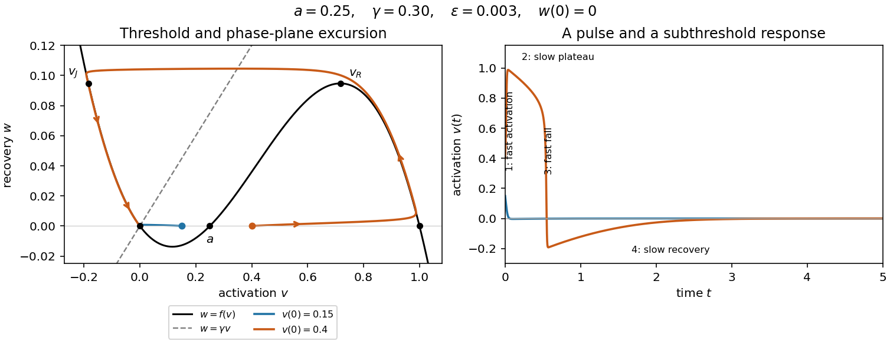

<h1 id="2/d/solution">Solution</h1>

↑ **Parent:** [D](../d.md)

Take $\gamma>\gamma_c$ and let $\varepsilon\to0^+$ with the other parameters fixed. The [nullclines](../../../../nullcline.md) are the [cubic polynomial](../../../../cubic-polynomial.md) graph $w=f(v)$ and the line $w=\gamma v$. In the [phase plane](../../../../phase-plane.md), $v$ increases below the [cubic polynomial](../../../../cubic-polynomial.md) graph and decreases above it; $w$ increases below the line and decreases above it. The fast [ordinary differential equation](../../../../ordinary-differential-equation.md), in time $s=t/\varepsilon$, freezes $w$ and gives $dv/ds=f(v)-w$.

At $w=0$, the fast roots are $0,a,1$. Their [linear stability](../../../../linear-stability.md) follows from $f'(0)=-a<0$, $f'(a)=a(1-a)>0$ and $f'(1)=a-1<0$. Thus a fixed $0<v^*<a$ falls towards the resting branch, whereas a fixed $a<v^*<1$ rises towards $v=1$. If $v^*>1$, the first fast segment instead settles down towards $1$, followed by the same recovery excursion. The threshold $a$ is the leading [singular perturbation](../../../../singular-perturbation-split.md) threshold; finite-$\varepsilon$ corrections matter for initial values approaching $a$ with $\varepsilon$.

Let

$$
d=\sqrt{1-a+a^2},\qquad
v_L=\frac{1+a-d}{3},\qquad v_R=\frac{1+a+d}{3}.
$$

These are the roots of $f'(v)=0$. The outer branches $v<v_L$ and $v>v_R$ of the [critical manifold](../../../../critical-manifold.md) are attracting under fast motion; the middle branch is repelling. The full excursion has four stages.

- **Fast activation:** nearly horizontal movement towards $(1,0)$, on the $t=O(\varepsilon)$ [time scale](../../../../time-scale.md), apart from the usual matching tails.
- **First slow phase:** motion along $w=f(v)$ from $v=1$ down to $v=v_R$. Here $w$ rises and $v$ slowly falls, because $\dot w=\gamma v-f(v)>0$ on the positive outer branch. This takes order-one time for fixed $\gamma$.
- **Fast repolarization:** near the right [fold point of a critical manifold](../../../../fold-point-of-a-critical-manifold.md), the attracting branch ends. With $w_R=f(v_R)$ nearly constant, $v$ drops to the negative root $v_J$ of $f(v_J)=w_R$. The jump takes the fast [time scale](../../../../time-scale.md); a thin neighborhood of the fold has an intermediate [fold delay](../../../../fold-delay.md).
- **Second slow phase:** motion along the negative attracting branch from $v_J$ towards $0$ from below, while $w$ falls towards zero. This is the refractory recovery and has order-one duration to a fixed small cutoff; exact return to the [equilibrium](../../../../equilibrium-point-of-a-dynamical-system.md) takes infinite time.

For this [cubic polynomial](../../../../cubic-polynomial.md), the landing point is explicit. Since $f(v)-f(v_R)=-(v-v_R)^2(v-v_J)$, comparison of the quadratic [coefficients](../../../../coefficient.md) gives

$$
\boxed{v_J=1+a-2v_R=\frac{1+a-2\sqrt{1-a+a^2}}3<0.}
$$

Thus a graph of $v(t)$ has a rapid rise, a slowly falling elevated plateau, a rapid fall through zero to a negative undershoot, and a slow approach back to zero. The figure shows both the [phase plane](../../../../phase-plane.md) and a computed time trace. The smaller initial perturbation stays near the resting branch and produces no elevated plateau.

**[Figure 1](#2/d/image-excitation-threshold-and-the-four-stages-of-a-fitzhugh-nagumo-pulse). Excitation threshold and the four stages of a FitzHugh-Nagumo pulse**.

The four-stage description concerns the [singular limit](../../../../singular-limit.md). Close to a simple [fold point of a critical manifold](../../../../fold-point-of-a-critical-manifold.md), balancing the local quadratic activation term with the slow drift gives $\Delta v=O(\varepsilon^{1/3})$ and $\Delta t=O(\varepsilon^{2/3})$ for fixed parameters. These layers shrink compared with the slow phases and do not alter the leading time integrals below.

## ↑ Ancestors (12)

1. [D](../d.md)
2. [2](../../2.md)
3. [2023](../../../2023-split.md)
4. [Past exam of the mathematical physiology course of the University of Oxford](../../../split.md)
5. [Mathematical physiology course of the University of Oxford](../../../../mathematical-physiology-course-of-the-university-of-oxford.md)
6. [Year 4 of the mathematics course of the University of Oxford](../../../../year-4-of-the-mathematics-course-of-the-university-of-oxford.md)
7. [Mathematics course of the University of Oxford](../../../../mathematics-course-of-the-university-of-oxford.md)
8. [Undergraduate course of the University of Oxford](../../../../undergraduate-course-of-the-university-of-oxford.md)
9. [Course of the University of Oxford](../../../../course-of-the-university-of-oxford.md)
10. [University of Oxford](../../../../university-of-oxford-split.md)
11. [List of universities](../../../../list-of-universities.md)
12. [Codex Wiki](../../../../split.md)
