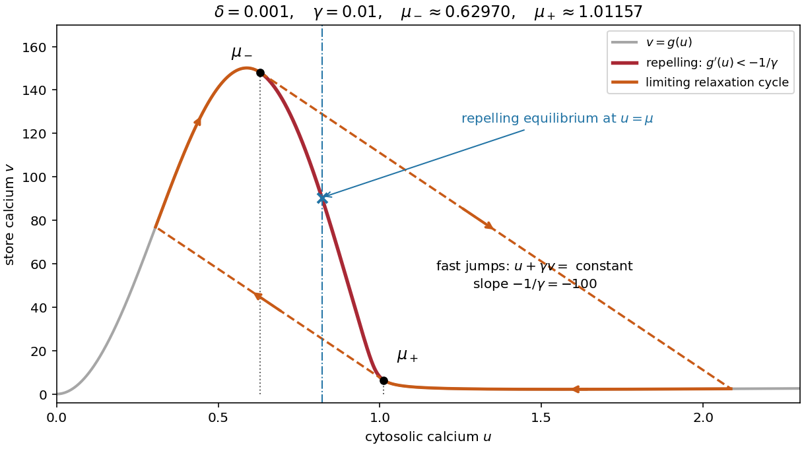

<h1 id="3/f/solution">Solution</h1>

↑ **Parent:** [F](../f.md)

On the descending part of the graph, mark the two tangency points where

$$
\boxed{g'(\mu_-)=-1/\gamma=g'(\mu_+),\qquad \mu_-<\mu_+.}
$$

Choose the crossings that enclose the portion with $g'(u)<-1/\gamma$. For fixed $\mu$ strictly between these values and sufficiently small $\varepsilon$, the unique [equilibrium](../../../../equilibrium-point-of-a-dynamical-system.md) is a [repelling equilibrium](../../../../source-equilibrium.md) by part (e). The endpoints here are leading [singular limit](../../../../singular-limit.md) values; at finite $\varepsilon$ the boundaries instead solve $f_v-\gamma f_u=\varepsilon$ and approach these tangencies when the crossings are nondegenerate.

There is a necessary qualification: such an interval exists only when $\gamma$ is large enough that the descending graph actually attains slopes below $-1/\gamma$. If $M=\max_{u>0}[-g'(u)]$, one needs $\gamma M>1$. The supplied graph has a very steep descending section, but an arbitrarily small positive $\gamma$ need not satisfy this condition. For $\delta=0.001$, numerical evaluation gives $M\simeq511.49$, so the leading threshold is $\gamma\simeq0.0019551$. A graph alone does not remove this parameter restriction.

The fast motion is especially informative. In fast time $s=\tau/\varepsilon$,

$$
\frac{du}{ds}=\varepsilon(\mu-u)-\gamma f(u,v),\qquad
\frac{dv}{ds}=f(u,v).
$$

At leading order $z=u+\gamma v$ is constant, so fast paths are straight lines with slope $dv/du=-1/\gamma$. Along such a line, the fast [eigenvalue](../../../../eigenvalue.md) at the [nullcline](../../../../nullcline.md) is

$$
f_v-\gamma f_u=f_v\bigl(1+\gamma g'(u)\bigr).
$$

It is negative on the two outer attracting segments and positive on the intervening repelling segment. The tangencies defining $\mu_\pm$ are consequently the [fold points of a critical manifold](../../../../fold-point-of-a-critical-manifold.md) when it is expressed in the coordinates $(z,v)$. They are not generally the maximum and minimum of $g$ itself.

For $\mu_-<\mu<\mu_+$, slow motion on an attracting segment follows

$$
\boxed{(1+\gamma g'(u))\dot u=\mu-u.}
$$

On the left attracting segment $u<\mu_-$ this moves towards increasing $u$; on the right attracting segment $u>\mu_+$ it moves towards decreasing $u$. Each segment ends at a tangency and is followed by a fast jump along a line of slope $-1/\gamma$ to the other attracting segment. This constructs the limiting [relaxation oscillation](../../../../relaxation-oscillation.md). The figure uses $\gamma=0.01$, for which $\mu_-\simeq0.62970$ and $\mu_+\simeq1.01157$; the marked endpoints change with $\gamma$.

**[Figure 2](#3/f/image-calcium-nullcline-slope-tangencies-and-the-limiting-relaxation-cycle). Calcium nullcline, slope tangencies and the limiting relaxation cycle**.

To justify existence of a [periodic orbit](../../../../periodic-orbit.md) of the full planar system, rather than just draw a formal cycle, first establish a compact [trapping region](../../../../trapping-region.md). The positive quadrant is forward invariant: at $u=0$, $\dot u=\mu+\gamma\delta v/\varepsilon>0$, and at $v=0$, $\dot v=u^2/[\varepsilon(1+u^2)]\ge0$. Moreover

$$
\dot v\le\frac{1-\delta v}{\varepsilon}.
$$

Choose $V>1/\delta$ above the initial store value. Since $f(u,v)\ge-1-\delta V$ when $0\le v\le V$,

$$
\dot u\le\mu-u+\frac\gamma\varepsilon(1+\delta V).
$$

Thus the rectangle $0\le u\le U$, $0\le v\le V$ is a [positively invariant set](../../../../positively-invariant-set.md) if $U>\mu+\gamma(1+\delta V)/\varepsilon$ and the initial point lies inside it. Every forward solution is bounded. There are no [equilibria](../../../../equilibrium-point-of-a-dynamical-system.md) on its axes for $\mu>0$, and its sole interior [equilibrium](../../../../equilibrium-point-of-a-dynamical-system.md) is a [hyperbolic equilibrium point](../../../../hyperbolic-equilibrium-point.md) with both [eigenvalues](../../../../eigenvalue.md) having positive real parts in the strict unstable range. A sufficiently small neighborhood of this [repelling equilibrium](../../../../source-equilibrium.md) has outward flow; deleting it leaves a compact [trapping region](../../../../trapping-region.md) with no [equilibria](../../../../equilibrium-point-of-a-dynamical-system.md). The [Poincaré-Bendixson theorem](../../../../poincare-bendixson-theorem.md) then supplies a [periodic orbit](../../../../periodic-orbit.md).

Hence **[periodic solutions](../../../../periodic-solution.md) exist throughout the strict unstable interval**, interpreted with the finite-$\varepsilon$ correction above. This argument establishes existence, without asserting uniqueness, the criticality of possible endpoint [Hopf bifurcations](../../../../hopf-bifurcation.md), or absence of coexisting [periodic orbits](../../../../periodic-orbit.md) outside the interval.

## ↑ Ancestors (12)

1. [F](../f.md)
2. [3](../../3.md)
3. [2023](../../../2023-split.md)
4. [Past exam of the mathematical physiology course of the University of Oxford](../../../split.md)
5. [Mathematical physiology course of the University of Oxford](../../../../mathematical-physiology-course-of-the-university-of-oxford.md)
6. [Year 4 of the mathematics course of the University of Oxford](../../../../year-4-of-the-mathematics-course-of-the-university-of-oxford.md)
7. [Mathematics course of the University of Oxford](../../../../mathematics-course-of-the-university-of-oxford.md)
8. [Undergraduate course of the University of Oxford](../../../../undergraduate-course-of-the-university-of-oxford.md)
9. [Course of the University of Oxford](../../../../course-of-the-university-of-oxford.md)
10. [University of Oxford](../../../../university-of-oxford-split.md)
11. [List of universities](../../../../list-of-universities.md)
12. [Codex Wiki](../../../../split.md)
