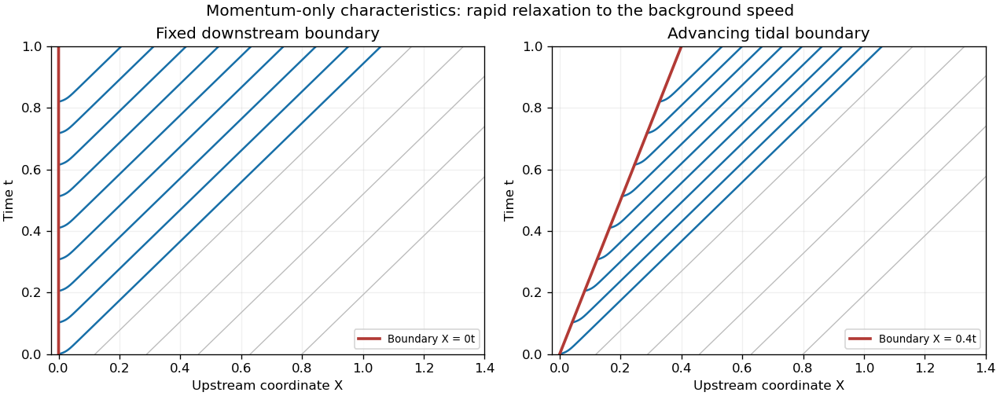

<h1 id="a/2/solution">Solution</h1>

↑ **Parent:** [2](../2.md)

The first [Saint-Venant equation](../../../../saint-venant-equation.md) conserves water volume. The second balances material acceleration against downslope gravity, bed friction and the free-surface pressure gradient. With length scale $L$, depth scale $H$, slope $S$ and velocity scale $U$, the conventional gravity-friction scaling has $\varepsilon=H/(SL)$ and [Froude number](../../../../froude-number.md) $F=U/\sqrt{gH}$. The pressure-gradient/downslope-gravity ratio is $\varepsilon$, and the inertia/downslope-gravity ratio is $\varepsilon F^2$.

The uniform steady solution obeys $u^2=h$ and $hu=Q$, hence $\boxed{u_0=Q^{1/3},\ h_0=Q^{2/3}}$. In the [constant-flux river momentum relaxation](../../../../constant-flux-river-momentum-relaxation.md) reduction, substitute $h=Q/u$ and $X=1-s$. Since $u_s=-u_X$ and $h_s=Qu_X/u^2$, the resulting [quasilinear partial differential equation](../../../../quasilinear-partial-differential-equation.md) is

$$
\boxed{u_t+c(u)u_X=\frac{1-u^3/Q}{\varepsilon F^2},\qquad c(u)=\frac{Q}{F^2u^2}-u.}
$$

A downstream boundary at $X=0$ supplies data into $X>0$ precisely when $c(u_1)>0$, equivalent to $\boxed{u_1<Q^{1/3}/F^{2/3}}$. Although water flows out there, the relevant [characteristic curves](../../../../characteristic-curve.md) carry information upstream in this subcritical regime.

Along a [characteristic curve](../../../../characteristic-curve.md), $dX/dt=c(u)$ and $du/dt=(1-u^3/Q)/(\varepsilon F^2)$. Positive $u$ relaxes toward $u_0$; near $u_0$, its displacement decays at rate $3/(\varepsilon F^2u_0)$. Boundary-generated deviations therefore become small after a time of order $\varepsilon$ and, while the characteristic speed stays bounded away from zero, within a distance of order $\varepsilon$. The outer state is the initial uniform solution. A jump between initial and boundary values at their corner can produce a weak solution or a thin initial adjustment; a globally smooth corner solution requires compatible data.

For the moving boundary put $Y=X-vt$. The characteristic speed relative to it is $c(u)-v$, while the outer speed is

$$
\boxed{v_b=c(u_0)=Q^{1/3}(F^{-2}-1).}
$$

For the intended tidal slowing $0<u_1\leq u_0$, $c$ is decreasing in $u$ and hence $c(u)\geq v_b$ throughout the relaxation. Thus $v<v_b$ leaves an incoming family and an attached thin [boundary layer](../../../../boundary-layer.md). The diagram shows numerical characteristics of this scalar reduction, with a slower boundary velocity. When $v>v_b$, the tidal boundary overtakes the unperturbed characteristic family; an attached smooth relaxation layer is no longer appropriate, and a [tidal bore](../../../../tidal-bore.md) or [shock wave](../../../../shock-wave.md) can arise in a fuller river model.

**[Figure 1](#a/2/image-characteristics-leaving-a-slowly-advancing-tidal-boundary). Characteristics leaving a slowly advancing tidal boundary**. Original calculation for the scalar momentum reduction, with $Q=1$, $F=0.7$, $\varepsilon=0.04$, $u_1=0.65$ and $v=0.4<v_b$. Curves approach the background characteristic speed after a short relaxation; this is not an exact solution of the full mass-and-momentum system.

There are two qualifications to the printed reduction. First, without the physical slowing assumption, $v<v_b$ alone need not make the boundary incoming: for $u_1>u_0$, also require $v<c(u_1)$. Second, imposing $hu=Q$ exactly everywhere in the original continuity equation gives $h_t=0$, and consequently $u_t=0$. The time-dependent characteristics above solve the requested momentum-only approximation, rather than the complete [Saint-Venant equation](../../../../saint-venant-equation.md) system with an exactly constant flux.

## ↑ Ancestors (12)

1. [2](../2.md)
2. [A](../../a.md)
3. [2007](../../../2007-split.md)
4. [Past exam of the mathematics and the environment and mathematical physiology course of the University of Oxford](../../../split.md)
5. [Mathematics and the environment and mathematical physiology course of the University of Oxford](../../../../mathematics-and-the-environment-and-mathematical-physiology-course-of-the-university-of-oxford.md)
6. [Year 4 of the mathematics course of the University of Oxford](../../../../year-4-of-the-mathematics-course-of-the-university-of-oxford.md)
7. [Mathematics course of the University of Oxford](../../../../mathematics-course-of-the-university-of-oxford.md)
8. [Undergraduate course of the University of Oxford](../../../../undergraduate-course-of-the-university-of-oxford.md)
9. [Course of the University of Oxford](../../../../course-of-the-university-of-oxford.md)
10. [University of Oxford](../../../../university-of-oxford-split.md)
11. [List of universities](../../../../list-of-universities.md)
12. [Codex Wiki](../../../../split.md)
