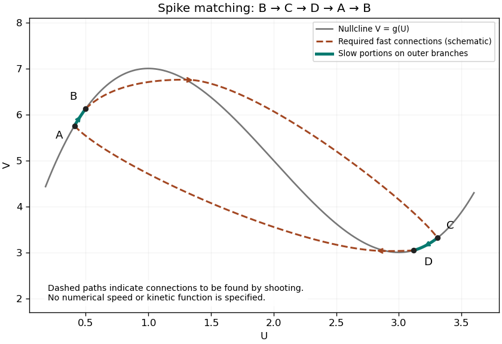

<h1 id="b/6/solution">Solution</h1>

↑ **Parent:** [6](../6.md)

For the [travelling wave](../../../../travelling-wave.md) coordinate $\xi=x+st$, the [chain rule](../../../../chain-rule.md) gives

$$
\boxed{s(U'+\gamma V')=\mu-U+\varepsilon U'',\qquad\varepsilon sV'=f(U,V).}
$$

[Fast-slow matching for a calcium pulse](../../../../fast-slow-matching-for-a-calcium-pulse.md) joins two fast transitions, $B\to C$ and $D\to A$, joined by slow portions $C\to D$ and $A\to B$. Write the [nullcline](../../../../nullcline.md) as $V=g(U)$. The resting point has $U_B=\mu$, $V_B=g(\mu)$ in the leading matched description.

Put $\xi=\varepsilon X$. Multiplying the first equation by $\varepsilon$ gives $U_{XX}=s(U_X+\gamma V_X)+\varepsilon(U-\mu)$. At leading order, integrate and use $U_X\to0$, $(U,V)\to(U_B,V_B)$ at the start of the front. Together with the second equation this gives

$$
\boxed{U_X=s[U-U_B+\gamma(V-V_B)],\qquad sV_X=f(U,V).}
$$

The fast equilibria are intersections of $V=g(U)$ and $V=V_B-(U-U_B)/\gamma$. As the slope $-1/\gamma$ changes, there may be one or three simple intersections, with two distinct intersections at a tangency. At a simple point of the nullcline, $f_U=-f_Vg'$, and the sign convention above/below it gives $f_V<0$. The [Jacobian matrix](../../../../jacobian-matrix.md) of the fast system has

$$
\det J=f_V-\gamma f_U=f_V(1+\gamma g'),\qquad\operatorname{tr}J=s+f_V/s.
$$

For the usual three-intersection configuration, the two outer points have $1+\gamma g'>0$, hence negative determinant and one positive and one negative [eigenvalue](../../../../eigenvalue.md): they are [saddle points](../../../../saddle-point.md). The middle point has positive determinant; it is linearly stable if $s^2<-f_V$ and unstable if $s^2>-f_V$. Zero trace is a possible oscillatory stability threshold, with a nonlinear classification requiring further information about $f$.

To select the front speed, follow the appropriate branch of the [unstable manifold](../../../../unstable-manifold.md) of $B$ and vary $s$ until it meets the [stable manifold](../../../../stable-manifold.md) of $C$. This is a [shooting method](../../../../shooting-method.md) for a [heteroclinic orbit](../../../../heteroclinic-orbit.md). Follow the high-$U$ slow branch from $C$ to $D$; the falling front obeys the same fast equations with the integration constant anchored at $D$. Choose $D$ so that its descending saddle connection reaches a low-$U$ point $A$ at that same speed. The remaining slow branch returns toward the resting point, completing the matched spike. The construction requires the indicated connections; a nullcline sketch alone does not specify their numerical speed or prove their existence for every possible kinetic function $f$.

**[Figure 2](#b/6/image-fast-and-slow-portions-of-the-calcium-wave-phase-plane-construction). Fast and slow portions of the calcium-wave phase-plane construction**. A qualitative original sketch: the rising nullcline branches carry the slow return and recovery, while dashed paths indicate the saddle connections that a shooting calculation must find. The paths illustrate the matching construction and are not a numerical solution for a specified kinetic function.

On the slow portions, $f(U,V)=0$ at leading order, so $V=g(U)$ and $V'=g'(U)U'$. Neglecting the small diffusion term yields

$$
\boxed{s(1+\gamma g'(U))U'=\mu-U.}
$$

On the outer rising branches the coefficient on the left is positive. Recovery from $C$ toward $D$ requires decreasing $U$, hence $\mu<U_D$; the low branch from $A$ back toward rest requires increasing $U$, hence $U_A<\mu$. Therefore $\boxed{U_A<\mu<U_D}$. These inequalities distinguish the recovery branches from a trajectory that would move away from the required matching points.

## ↑ Ancestors (12)

1. [6](../6.md)
2. [B](../../b.md)
3. [2007](../../../2007-split.md)
4. [Past exam of the mathematics and the environment and mathematical physiology course of the University of Oxford](../../../split.md)
5. [Mathematics and the environment and mathematical physiology course of the University of Oxford](../../../../mathematics-and-the-environment-and-mathematical-physiology-course-of-the-university-of-oxford.md)
6. [Year 4 of the mathematics course of the University of Oxford](../../../../year-4-of-the-mathematics-course-of-the-university-of-oxford.md)
7. [Mathematics course of the University of Oxford](../../../../mathematics-course-of-the-university-of-oxford.md)
8. [Undergraduate course of the University of Oxford](../../../../undergraduate-course-of-the-university-of-oxford.md)
9. [Course of the University of Oxford](../../../../course-of-the-university-of-oxford.md)
10. [University of Oxford](../../../../university-of-oxford-split.md)
11. [List of universities](../../../../list-of-universities.md)
12. [Codex Wiki](../../../../split.md)
