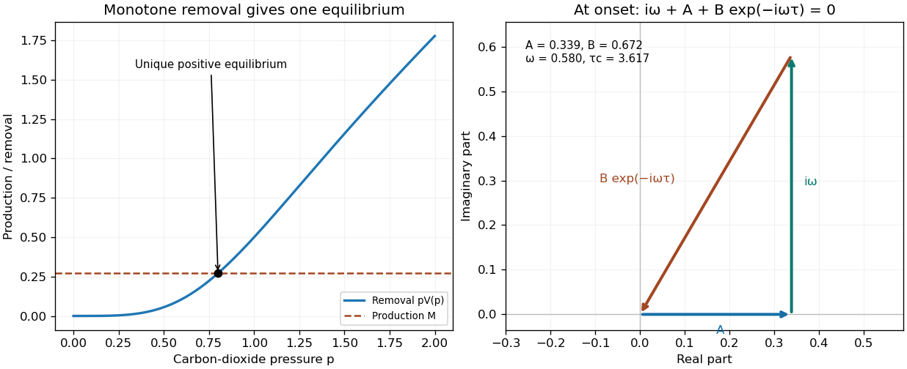

<h1 id="b/8/solution">Solution</h1>

↑ **Parent:** [8](../8.md)

In this [delayed carbon-dioxide ventilation feedback](../../../../delayed-carbon-dioxide-ventilation-feedback.md) model, $p$ is a representative carbon-dioxide partial pressure, $K$ an effective storage capacitance, $M>0$ metabolic production, and $pV$ removal by [pulmonary ventilation](../../../../pulmonary-ventilation.md). The delay represents transport and sensing between the gas-exchange compartment and the ventilatory response. The [Hill equation](../../../../hill-equation.md) response rises sigmoidally with pressure, reaches half its maximum $\alpha$ at $p=\theta$, and saturates at $\alpha$; $n>1$ permits a steep threshold-like response.

For positive parameters, $pV(p)$ increases strictly from zero to infinity because its derivative is $V+pV'>0$. Its graph therefore intersects the horizontal line $M$ exactly once: $\boxed{M=p^*V(p^*),\quad p^*>0}$. The figure shows this argument and the first imaginary-root crossing.

**[Figure 3](#b/8/image-a-unique-respiratory-equilibrium-can-become-unstable-through-delayed-feedback). A unique respiratory equilibrium can become unstable through delayed feedback**. Illustrative dimensionless Hill response with $\alpha=1$, $\theta=1$, $n=3$, $K=1$ and equilibrium $p^*=0.8$. The second panel separates the instantaneous-damping and delayed-gain vectors at the first imaginary root.

For a small perturbation $z=p-p^*$, [linearization](../../../../linearization.md) gives

$$
\dot z=-Az(t)-Bz(t-\tau),\qquad A=V(p^*)/K,\quad B=p^*V'(p^*)/K.
$$

The [sigmoidal delayed ventilation threshold](../../../../sigmoidal-delayed-ventilation-threshold.md) follows from the [characteristic equation of a delay differential equation](../../../../characteristic-equation-of-a-delay-differential-equation.md), $\lambda+A+Be^{-\lambda\tau}=0$. At an imaginary root $\lambda=i\omega$, separate real and imaginary parts:

$$
A+B\cos(\omega\tau)=0,\qquad\omega-B\sin(\omega\tau)=0.
$$

For $B>A>0$, the first positive crossing has

$$
\boxed{\omega_c=\sqrt{B^2-A^2},\qquad\tau_c=\frac{\arccos(-A/B)}{\sqrt{B^2-A^2}}.}
$$

At zero delay the scalar equation is stable. No root can cross the imaginary axis before this first crossing, and zero itself is not a root. To check the crossing direction, implicit differentiation gives

$$
\lambda'=-\frac{\lambda(\lambda+A)}{1+\tau(\lambda+A)},\qquad
\boxed{\operatorname{Re}\lambda'(\tau_c)=\frac{\omega_c^2}{(1+A\tau_c)^2+\omega_c^2\tau_c^2}>0.}
$$

All subsequent imaginary crossings have the same direction. Thus the equilibrium is linearly stable below $\tau_c$ and unstable above it. This establishes the oscillatory linear threshold; the full nonlinear [Hopf bifurcation](../../../../hopf-bifurcation.md) additionally requires the usual nondegeneracy conditions. If $B\leq A$, no finite imaginary-root crossing occurs and the equilibrium is stable for every finite delay. For the stated response, $B/A=n\theta^n/(\theta^n+(p^*)^n)$, showing explicitly when the gain can exceed instantaneous damping.

If $A\ll B$, then $\omega_c\approx B$ and $\omega_c\tau_c\approx\pi/2$. Consequently the small-amplitude period near onset is $\boxed{2\pi/\omega_c\approx4\tau_c}$. The comparison is to the critical delay near the first instability, rather than an arbitrary delay far beyond onset. A longer circulatory transit time can move the physiological system across this delayed-feedback threshold, providing a mechanism for periodic breathing associated with impaired cardiac output.

## ↑ Ancestors (12)

1. [8](../8.md)
2. [B](../../b.md)
3. [2007](../../../2007-split.md)
4. [Past exam of the mathematics and the environment and mathematical physiology course of the University of Oxford](../../../split.md)
5. [Mathematics and the environment and mathematical physiology course of the University of Oxford](../../../../mathematics-and-the-environment-and-mathematical-physiology-course-of-the-university-of-oxford.md)
6. [Year 4 of the mathematics course of the University of Oxford](../../../../year-4-of-the-mathematics-course-of-the-university-of-oxford.md)
7. [Mathematics course of the University of Oxford](../../../../mathematics-course-of-the-university-of-oxford.md)
8. [Undergraduate course of the University of Oxford](../../../../undergraduate-course-of-the-university-of-oxford.md)
9. [Course of the University of Oxford](../../../../course-of-the-university-of-oxford.md)
10. [University of Oxford](../../../../university-of-oxford-split.md)
11. [List of universities](../../../../list-of-universities.md)
12. [Codex Wiki](../../../../split.md)
