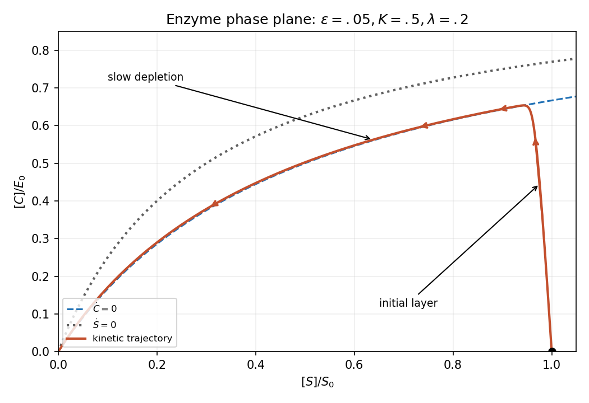
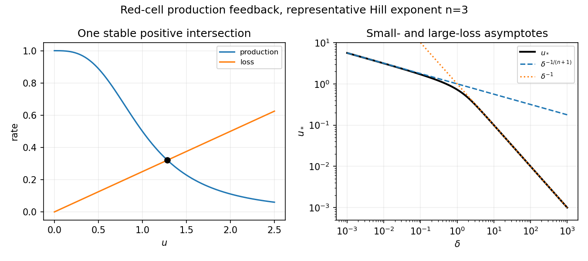
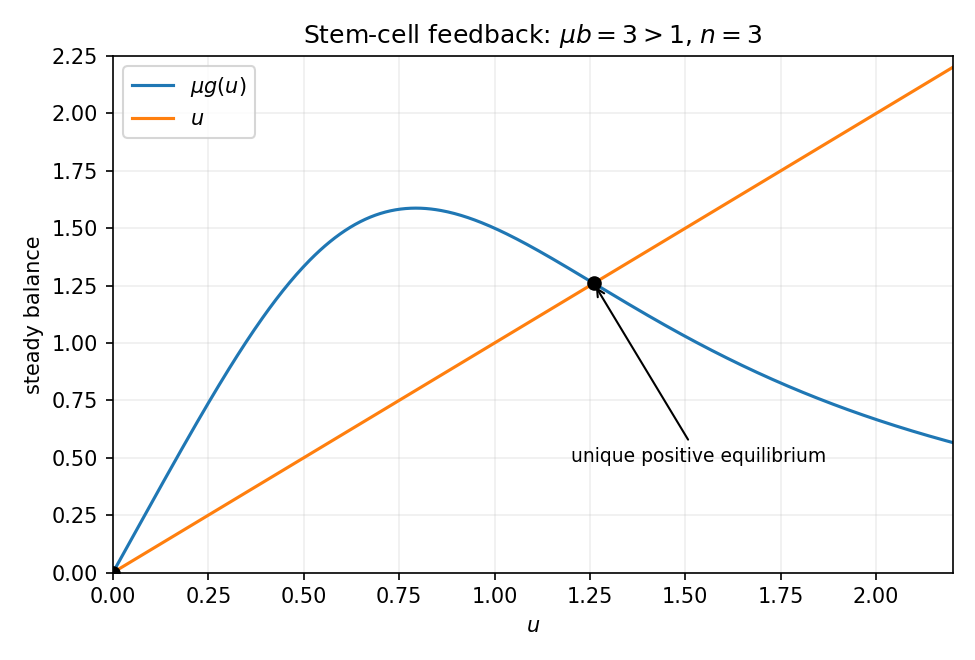

# 2008

↑ **Parent:** [Past exam of the mathematics and the environment and mathematical physiology course of the University of Oxford](../past-exam-of-the-mathematics-and-the-environment-and-mathematical-physiology-course-of-the-university-of-oxford.md)

Original solutions to the paper released at [the source request](https://www.whatdotheyknow.com/request/maths_past_papers_3). The complete editable transcription is retained in the private examination archive.

**Table of contents**

- [A](#a)
  - [1](#a/1)
    - [Solution](#a/1/solution)
  - [2](#a/2)
    - [i](#a/2/i)
      - [Solution](#a/2/i/solution)
    - [ii](#a/2/ii)
      - [Solution](#a/2/ii/solution)
    - [iii](#a/2/iii)
      - [Solution](#a/2/iii/solution)
    - [iv](#a/2/iv)
      - [Solution](#a/2/iv/solution)
    - [v](#a/2/v)
      - [Solution](#a/2/v/solution)
  - [3](#a/3)
    - [i](#a/3/i)
      - [Solution](#a/3/i/solution)
    - [ii](#a/3/ii)
      - [Solution](#a/3/ii/solution)
    - [iii](#a/3/iii)
      - [Solution](#a/3/iii/solution)
    - [iv](#a/3/iv)
      - [Solution](#a/3/iv/solution)
  - [4](#a/4)
    - [Solution](#a/4/solution)
- [B](#b)
  - [5](#b/5)
    - [i](#b/5/i)
      - [Solution](#b/5/i/solution)
    - [ii](#b/5/ii)
      - [Solution](#b/5/ii/solution)
    - [iii](#b/5/iii)
      - [Solution](#b/5/iii/solution)
    - [iv](#b/5/iv)
      - [Solution](#b/5/iv/solution)
    - [v](#b/5/v)
      - [Solution](#b/5/v/solution)
    - [vi](#b/5/vi)
      - [Solution](#b/5/vi/solution)
  - [6](#b/6)
    - [a](#b/6/a)
      - [i](#b/6/a/i)
      - [ii](#b/6/a/ii)
    - [b](#b/6/b)
    - [c](#b/6/c)
      - [i](#b/6/c/i)
      - [ii](#b/6/c/ii)
      - [iii](#b/6/c/iii)
      - [iv](#b/6/c/iv)
  - [7](#b/7)
    - [Solution](#b/7/solution)
  - [8](#b/8)
    - [Solution](#b/8/solution)

## A

↑ **Parent:** [2008](2008.md)

<h3 id="a/1">1</h3>

↑ **Parent:** [A](#a)

<h4 id="a/1/solution">Solution</h4>

↑ **Parent:** [1](#a/1)

The left side is atmospheric heat storage per unit surface area. Incoming solar flux $Q$ is averaged over the spherical surface by the factor $1/4$; [albedo](../geophysics.md#albedo) $a$ reflects a fraction of it. The outgoing term is a reduced Stefan-Boltzmann flux, with effective emissivity $\gamma$ representing atmospheric greenhouse trapping. [Ice-albedo feedback](../geophysics.md#ice-albedo-feedback) usually makes $a$ decrease as [temperature](../temperature.md) rises through an [ice](../chemical-substance.md#ice)-melting range; greater carbon-dioxide [pressure](../pressure.md) increases infrared opacity and therefore decreases this effective $\gamma$. The simple estimates below hold [albedo](../geophysics.md#albedo) fixed.

[Radiative equilibrium](../heat.md#radiative-equilibrium) gives

$$
\boxed{\gamma_0=\frac{(1-a)Q}{4\sigma T_0^4}\simeq0.5978.}
$$

Differentiating $\gamma T^4=\text{constant}$ gives $\Delta\gamma\simeq-4\gamma_0\Delta T/T_0\simeq-0.02474$. A doubling from $36$ Pa changes [pressure](../pressure.md) by $36$ Pa, hence

$$
\boxed{\gamma_1\simeq\frac{4\gamma_0\cdot3}{290\cdot36}=6.87\times10^{-4}\ {\rm Pa}^{-1}.}
$$

Reference [weathering](../planetary-science.md#weathering) balance requires $A_LW_0=v_0$, so $\boxed{W_0=2.0\times10^{-3}\ {\rm kg\,m^{-2}\,yr^{-1}}}$.

For the requested approximate system, take $(T_0,p_0)$ as the reference radiative/[weathering](../planetary-science.md#weathering) [equilibrium](../dynamical-systems.md#equilibrium-point-of-a-dynamical-system), set $\theta=(T-T_0)/\Delta T_c$, $P=p/p_0$, and $\hat t=t/t_{\rm CO_2}$, where

$$
\boxed{t_{\rm CO_2}=\frac{M_{\rm CO_2}Ap_0}{M_agv_0},\quad
 t_T=\frac{\rho_ac_pd}{4\sigma\gamma_0T_0^3},\quad
\epsilon=\frac{t_T}{t_{\rm CO_2}},\quad
\Gamma=\frac{\gamma_1p_0T_0}{4\gamma_0\Delta T_c}.}
$$

Linearize the radiative loss, retaining terms linear in $T-T_0$ and $p-p_0$. Its two terms are $4\sigma\gamma_0T_0^3(T-T_0)$ and $-\sigma\gamma_1T_0^4(p-p_0)$. The carbon balance scales exactly with $v=v_{\rm CO_2}/v_0$. Therefore

$$
\boxed{\epsilon\theta_{\hat t}=-\theta+\Gamma(P-1),\qquad P_{\hat t}=v-P^\mu e^\theta.}
$$

Numerically $\boxed{t_{\rm CO_2}\simeq7.41\times10^3\ {\rm yr},\quad t_T\simeq0.0958\ {\rm yr},\quad\epsilon\simeq1.29\times10^{-5},\quad\Gamma\simeq0.1795}$. The time conversion uses seconds for the radiative constants and years for the supplied carbon production.

Because $\epsilon\ll1$, [temperature](../temperature.md) rapidly approaches $\theta=\Gamma(P-1)$, while carbon changes slowly. A sustained $v\simeq40$ has [equilibrium](../dynamical-systems.md#equilibrium-point-of-a-dynamical-system) determined by

$$
\mu\log P_*+\Gamma(P_*-1)=\log40.
$$

Its left side is [strictly increasing](../calculus.md#strictly-increasing-function) on positive [pressure](../pressure.md), giving $\boxed{P_*\simeq16.83,\quad\Delta T_{\rm eventual}=\Delta T_c\Gamma(P_*-1)\simeq36.9\ {\rm K}}$ within this extrapolated toy model. Counting volcanic production as well gives $v=41$ and $37.2$ K instead. An inventory estimate for the rise is $t_{\rm CO_2}(P_*-1)/(v-1)\simeq3.0\times10^3$ years. [Linearization](../algebra.md#linearization) near the final [equilibrium](../dynamical-systems.md#equilibrium-point-of-a-dynamical-system) gives the [e-folding time](../differential-equation.md#exponential-relaxation-time)

$$
\boxed{t_{\rm relax}=\frac{t_{\rm CO_2}}{v(\Gamma+\mu/P_*)}\simeq9.4\times10^2\ {\rm yr}.}
$$

Thus the carbon/[weathering](../planetary-science.md#weathering) response is millennial, despite the short [thermal adjustment](../exoplanet.md#radiative-relaxation-time-in-a-planetary-atmosphere) time.

There are two numerical-reference inconsistencies in the printed setup. The requested expansion treats $(T_0,p_0)$ as its reference [equilibrium](../dynamical-systems.md#equilibrium-point-of-a-dynamical-system) although earlier labels pair $T_0$ with present-day $36$ Pa rather than $p_0=28$ Pa. Also, the calibrated $\Gamma=0.1795$ gives $13^{0.3}e^{13\Gamma}\simeq22.3$, not the stated hint. That hint instead corresponds to $\Gamma\simeq3/13$, obtained by calibrating a doubling of $28$ Pa. Such a convention gives a [pressure](../pressure.md) around $13$–$14$ and a similar rough warming of several tens of kelvin. The displayed results above consistently use the stated $36$ Pa doubling calibration and explicitly declared reference-model approximation. A large extrapolation of a linearized radiative law is a property of this exercise, not a quantitative climate projection.

This is a [weathering feedback with fast thermal adjustment](../geophysics.md#weathering-feedback-with-fast-thermal-adjustment).

<h3 id="a/2">2</h3>

↑ **Parent:** [A](#a)

<h4 id="a/2/i">i</h4>

↑ **Parent:** [2](#a/2)

<h5 id="a/2/i/solution">Solution</h5>

↑ **Parent:** [I](#a/2/i)

Here $s$ is downstream distance, $A$ the wetted cross-sectional area, $u$ the section-averaged downstream [velocity](../classical-mechanics.md#velocity), and $M$ the lateral water input per channel length and time. Thus $A_t$ is local water storage and $(Au)_s$ the divergence of discharge. Their balance is [mass conservation](../continuum-mechanics.md#mass-conservation).

The momentum terms $u_t$ and $uu_s$ are local and advective acceleration. The bed slope $S$ gives the downstream gravitational acceleration $gS$. [Bed shear stress](../continuum-mechanics.md#wall-shear-stress) $\tau$ acting over wetted perimeter $l$ produces resisting force per unit mass $\tau l/(\rho A)$; the [hydraulic radius](../fluid-mechanics.md#hydraulic-radius) is $R=A/l$. Finally $-g\overline h_s$ is the hydrostatic free-surface [pressure](../pressure.md)-gradient term in the chosen bed-following description. The Saint-Venant approximation depth-averages the flow, assumes a long shallow geometry and [hydrostatic pressure](../fluid-mechanics.md#hydrostatic-pressure), and closes the boundary shear through a [roughness](../neuroscience.md#surface-roughness) law.

<h4 id="a/2/ii">ii</h4>

↑ **Parent:** [2](#a/2)

<h5 id="a/2/ii/solution">Solution</h5>

↑ **Parent:** [Ii](#a/2/ii)

Manning's uniform-flow law implies the friction slope $S_f=n^2u^2/R^{4/3}$ for positive downstream flow. In a wide rectangular section $A\simeq wh$ and $R\simeq h$, so $\tau l/(\rho A)=g n^2u^2/h^{4/3}$.

Scale distance with $L$, depth with $h_0$, [velocity](../classical-mechanics.md#velocity) with $u_0=h_0^{2/3}S^{1/2}/n$, and time with $L/u_0$. Divide momentum by $gS$ to obtain

$$
\boxed{\epsilon=\frac{h_0}{SL},\qquad F=\frac{u_0}{\sqrt{gh_0}},\qquad E=\frac{LM}{wh_0u_0},}
$$

$$
\boxed{h_t+(hu)_s=E,\qquad\epsilon F^2(u_t+uu_s)=1-u^2/h^{4/3}-\epsilon h_s.}
$$

The factor $\epsilon$ compares depth change over $L$ with the mean bed drop $SL$, rather than with $L$ alone. Its [product](../arithmetic.md#product-of-numbers) with $F^2$ measures inertial acceleration relative to bed-slope forcing.

<h4 id="a/2/iii">iii</h4>

↑ **Parent:** [2](#a/2)

<h5 id="a/2/iii/solution">Solution</h5>

↑ **Parent:** [Iii](#a/2/iii)

For the supplied hillslope values,

$$
\boxed{u_0=\frac{0.01^{2/3}\sqrt{0.01}}{0.04}\simeq0.116\ {\rm m\,s^{-1}},\quad\epsilon=0.01,\quad F\simeq0.367,\quad\epsilon F^2\simeq1.35\times10^{-3}.}
$$

The [Froude number](../reduced-gravity.md#froude-number) is below one, but it is not extremely small numerically; the much smaller [products](../arithmetic.md#product-of-numbers) actually multiplying inertia and the depth-gradient term justify their leading neglect. Positive flow then satisfies $u=h^{2/3}$ and

$$
\boxed{h_t+(h^{5/3})_s=E.}
$$

In overland flow the source is net [rainfall](../geophysics.md#rainfall) input after [infiltration](../porous-media-flow.md#soil-infiltration) into soil, with [evaporation](../critical-phenomenon.md#evaporation) or other local losses included when important. Lateral inflow can also contribute. Negative net input must be limited by water availability once the surface dries.

<h4 id="a/2/iv">iv</h4>

↑ **Parent:** [2](#a/2)

<h5 id="a/2/iv/solution">Solution</h5>

↑ **Parent:** [Iv](#a/2/iv)

Let $H(t)=\int_0^tE(r)\,dr$. For positive [rainfall](../geophysics.md#rainfall) excess it is [strictly increasing](../calculus.md#strictly-increasing-function). The [characteristic equations](../linear-ordinary-differential-equation.md#characteristic-equation-of-a-constant-coefficient-differential-equation) are

$$
\frac{dh}{dt}=E(t),\qquad\frac{ds}{dt}=\frac53h^{2/3}.
$$

A [characteristic](../algebra.md#characteristic-of-a-field) starting on the initial line at position $s_0\geq0$ has $h=H(t)$ and $s=s_0+S_0(t)$, where $S_0(t)=\frac53\int_0^tH(r)^{2/3}\,dr$. It supplies the downstream region $s\geq S_0(t)$.

A [characteristic](../algebra.md#characteristic-of-a-field) emitted at the upstream boundary at time $\tau$ has

$$
\boxed{h=H(t)-H(\tau),\qquad s=\frac53\int_\tau^t[H(r)-H(\tau)]^{2/3}\,dr.}
$$

For fixed $t$, this position decreases strictly from $S_0(t)$ to zero as $\tau$ increases from zero to $t$. Thus it uniquely determines $\tau=\tau(s,t)$ in the remaining region. The complete solution is

$$
\boxed{h(s,t)=\begin{cases}H(t)-H(\tau(s,t)),&0\leq s\leq S_0(t),\\H(t),&s\geq S_0(t).\end{cases}}
$$

The formulas agree at the separator, satisfy both zero data and cannot form a [characteristic](../algebra.md#characteristic-of-a-field) crossing while $E>0$. At the upstream endpoint $\tau=t$, height is zero.

<h4 id="a/2/v">v</h4>

↑ **Parent:** [2](#a/2)

<h5 id="a/2/v/solution">Solution</h5>

↑ **Parent:** [V](#a/2/v)

The physically meaningful extension requires $h\geq0$: negative net input removes water where wet and cannot keep removing nonexistent surface water where dry. Keeping the algebraic source $E(t)<0$ unchanged in a dry zone would instead produce negative depths, so the drying-front description implicitly includes this availability condition.

Use the same $H(t)$, increasing until $t^*$ and decreasing afterwards. While $H(t)>0$, there is one earlier wetting time $\tau_d(t)\in[0,t^*]$ such that $H(\tau_d(t))=H(t)$. The boundary-emitted [characteristic](../algebra.md#characteristic-of-a-field) with this label has just exhausted its water. Its position is the [drying front](../partial-differential-equation.md#drying-front):

$$
\boxed{s_d(t)=\frac53\int_{\tau_d(t)}^t[H(r)-H(t)]^{2/3}\,dr.}
$$

The integrand is nonnegative because $H(r)\geq H(t)$ between these two equal-height times. At $t=t^*$ the interval collapses and $s_d=0$; as net input becomes negative the front moves downstream. Differentiating gives $s_d'=-(10/9)E(t)\int_{\tau_d(t)}^t[H(r)-H(t)]^{-1/3}\,dr>0$, where endpoint singularities are integrable away from the turning-time limit.

The wet solution ahead of the front still follows unexhausted [characteristics](../algebra.md#characteristic-of-a-field). With $S_0(t)=\frac53\int_0^tH(r)^{2/3}\,dr$,

$$
\boxed{h(s,t)=\begin{cases}0,&0\leq s\leq s_d(t),\\H(t)-H(\tau(s,t)),&s_d(t)<s<S_0(t),\\H(t),&s\geq S_0(t),\end{cases}}
$$

where $0\leq\tau<\tau_d(t)$ is determined by the same [characteristic](../algebra.md#characteristic-of-a-field)-position [integral](../integral.md) as in (iv). If cumulative loss reaches $H(t)=0$, all remaining initial-line water has also vanished and the surface is dry thereafter while $E<0$. If the total later loss is smaller, the formula applies for all later times with $H(t)>0$. This is the [drying front in a rainfall-driven Manning kinematic wave](../transport-equation.md#drying-front-in-a-rainfall-driven-manning-kinematic-wave).

<h3 id="a/3">3</h3>

↑ **Parent:** [A](#a)

<h4 id="a/3/i">i</h4>

↑ **Parent:** [3](#a/3)

<h5 id="a/3/i/solution">Solution</h5>

↑ **Parent:** [I](#a/3/i)

The depth $h$ is free-surface height $\eta$ minus bed elevation $s$. The first differential equation conserves water volume. Momentum balances local and advective acceleration against the free-surface [pressure](../pressure.md) gradient, mean gravitational bed-slope forcing and the quadratic drag $fu^2/h$.

The [concentration](../mathematical-physics.md#concentration) $c$ is suspended [sediment](../planetary-science.md#sediment) mass per water volume. Multiplication of its material rate by depth gives the [sediment](../planetary-science.md#sediment) change per bed area. Settling at speed $v_s$ removes mass at rate $v_sc$, while [entrainment](../fluid-mechanics.md#fluid-entrainment) supplies $v_sE(u)$; increasing [equilibrium](../dynamical-systems.md#equilibrium-point-of-a-dynamical-system) [concentration](../mathematical-physics.md#concentration) $E(u)$ represents stronger erosive capacity at greater speed. The same exchange changes the bed mass per area, whose solid volume fraction is $1-\phi$ and grain density is $\rho_s$. Hence net suspended gain equals $-\rho_s(1-\phi)s_t$: erosion lowers the bed and deposition raises it.

One derives these balances by depth integration with [hydrostatic pressure](../fluid-mechanics.md#hydrostatic-pressure) and a sectionally averaged [velocity](../classical-mechanics.md#velocity), followed by closures for drag and [sediment](../planetary-science.md#sediment) [entrainment](../fluid-mechanics.md#fluid-entrainment)/settling. The model neglects additional bedload transport and uses the dilute-suspension approximation to keep the water-volume balance independent of [sediment](../planetary-science.md#sediment) volume.

<h4 id="a/3/ii">ii</h4>

↑ **Parent:** [3](#a/3)

<h5 id="a/3/ii/solution">Solution</h5>

↑ **Parent:** [Ii](#a/3/ii)

Choose reference depth $h_0$, [velocity](../classical-mechanics.md#velocity) $u_0=\sqrt{gSh_0/f}$ and [concentration](../mathematical-physics.md#concentration) $c_0=E(u_0)$. Set the adaptation length $L=h_0u_0/v_s$ and the slow bed-evolution time $t_b=\rho_s(1-\phi)h_0/(v_sc_0)$. Scale both bed and surface elevation with $h_0$. Then

$$
\boxed{\epsilon=\frac{L}{u_0t_b}=\frac{c_0}{\rho_s(1-\phi)},\qquad F^2=\frac{u_0^2}{gh_0},\qquad\delta=\frac{SL}{h_0},\qquad E^*(u)=\frac{E(u_0u)}{c_0}.}
$$

These choices balance [sediment](../planetary-science.md#sediment) advection with settling, bed mass change with exchange, and reference drag with downslope gravity. Direct substitution gives

$$
h=\eta-s,\quad\epsilon h_t+(hu)_x=0,\quad
F^2(\epsilon u_t+uu_x)=-\eta_x+\delta(1-u^2/h),
$$

$$
\boxed{h(\epsilon c_t+uc_x)=E^*(u)-c=-s_t.}
$$

Here $E^*(1)=1$ by construction. The small parameter $\epsilon$ is the suspended solid mass relative to bed solid mass at the chosen scales, explaining the separation between fast fluid motion and slow morphology.

<h4 id="a/3/iii">iii</h4>

↑ **Parent:** [3](#a/3)

<h5 id="a/3/iii/solution">Solution</h5>

↑ **Parent:** [Iii](#a/3/iii)

The reduced mass equation gives $hu=1$ after normalizing the reference discharge. The reduced momentum equation integrates to $\eta+F^2u^2/2=1+F^2/2$ with the reference free-surface level one. Since $h=1/u$,

$$
\boxed{s=1-\frac1u+\frac{F^2}{2}(1-u^2).}
$$

Also $hu=1$ reduces the [concentration](../mathematical-physics.md#concentration) equation to

$$
\boxed{c_x=E^*(u)-c=-s_t.}
$$

With $E^*(1)=1$, a steady uniform reference state is $\boxed{u=h=c=\eta=1,\qquad s=0}$. The integration constants above specify this reference normalization; a different imposed discharge or head changes them.

<h4 id="a/3/iv">iv</h4>

↑ **Parent:** [3](#a/3)

<h5 id="a/3/iv/solution">Solution</h5>

↑ **Parent:** [Iv](#a/3/iv)

Write $u=1+\widetilde u$, $c=1+\widetilde c$ and let $a_E=E^{*\prime}(1)>0$. To first order $\widetilde s=(1-F^2)\widetilde u$, and the other balances give $\widetilde c_x=a_E\widetilde u-\widetilde c=-\widetilde s_t$. Seek modes $e^{\sigma t+ikx}$. Then

$$
\widetilde c=\frac{a_E}{1+ik}\widetilde u,\qquad
\boxed{\sigma=\frac{a_E}{F^2-1}\frac{ik}{1+ik}=\frac{a_E}{F^2-1}\frac{k^2+ik}{1+k^2}.}
$$

Thus every nonzero [wavenumber](../wave-equation.md#wavenumber) grows when $F>1$, while it decays when $F<1$. The zero mode is neutral in this reduced model. The exceptional $F=1$ limit makes the algebraic depth-bed relation degenerate and requires neglected effects. If the [entrainment](../fluid-mechanics.md#fluid-entrainment) [derivative](../calculus.md#derivative) vanishes at the reference state, this first-order instability calculation is itself degenerate.

For $F>1$, the [growth rate](../dispersion-relation.md#growth-rate) tends to the finite positive limit $a_E/(F^2-1)$ as $|k|\to\infty$. It does not diverge with [wavenumber](../wave-equation.md#wavenumber), although this reduced theory selects no finite fastest scale and should not be extrapolated beyond its long-wave regime. The [phase speed](../dispersion-relation.md#phase-speed) is

$$
\boxed{c_{\rm phase}=-\operatorname{Im}\sigma/k=-\frac{a_E}{(F^2-1)(1+k^2)}<0.}
$$

The unstable bedforms migrate upstream against the water flow and represent [antidunes](../fluid-mechanics.md#antidune) arising from coupled erosion, deposition and supercritical free-surface flow. This is the [relaxation-controlled antidune instability](../fluid-mechanics.md#relaxation-controlled-antidune-instability).

<h3 id="a/4">4</h3>

↑ **Parent:** [A](#a)

<h4 id="a/4/solution">Solution</h4>

↑ **Parent:** [4](#a/4)

[Glacier sliding](../geophysics.md#basal-sliding) is motion of the [ice](../chemical-substance.md#ice) base relative to its bed, distinct from internal [ice](../chemical-substance.md#ice) deformation. Near a melting bed, basal water, [pressure](../pressure.md)-melting/refreezing around obstacles and [creep](../engineering.md#creep-deformation) past bed [roughness](../neuroscience.md#surface-roughness) can permit motion; a cold frozen bed can suppress it. A simple sliding law is increasing in basal traction, for example $u_b\propto\tau_b^m$ on the positive-traction branch, with resistance also affected in richer models by [roughness](../neuroscience.md#surface-roughness) and [basal water pressure](../geophysics.md#basal-water-pressure).

Slow [ice](../chemical-substance.md#ice) motion has negligible inertial acceleration. In a long shallow [glacier](../geophysics.md#glacier), leading vertical stress is hydrostatic and longitudinal stress gradients are neglected relative to transverse shear gradients. Resolving gravity downslope and normally yields the two stated balances. This approximates a two-dimensional slab/valley centreline; lateral drag, rapidly varying geometry and strong longitudinal-stress regions need additional terms.

With a stress-[free surface](../fluid-mechanics.md#free-surface),

$$
\boxed{p=\rho g\cos\alpha(h-z),\qquad\tau=\rho g\sin\alpha[1-\cot\alpha\,h_x](h-z).}
$$

Put $K=\rho g\sin\alpha$ and $D=1-\cot\alpha h_x$, assuming positive driving shear for the stated power law. Integrating from the bed gives

$$
\boxed{u(z)=u_b+\frac{A(KD)^n}{n+1}[h^{n+1}-(h-z)^{n+1}],\quad
q=hu_b+\frac{A(KD)^n h^{n+2}}{n+2}.}
$$

The surface speed is $u_s=u_b+A(KD)^nh^{n+1}/(n+1)$. [Mass conservation](../continuum-mechanics.md#mass-conservation), with $a$ measured as [ice](../chemical-substance.md#ice)-equivalent thickness [accumulation](../geophysics.md#ice-accumulation), is $\boxed{h_t+q_x=a}$.

Choose $h=H\hat h$, $x=l\hat x$, $u_b=U\hat u_b$ and $t=(l/U)\hat t$, with $U=(KH/R)^m$. Scale [accumulation](../geophysics.md#ice-accumulation) with $HU/l$. The [dimensionless](../physics.md#dimensionless-quantity) basal law and parameters are

$$
\boxed{u_b=h^m(1-\mu h_x)^m,\qquad\mu=\frac{H\cot\alpha}{l},\qquad\delta=\frac{A K^nH^{n+1}}U=A R^mK^{n-m}H^{n+1-m}.}
$$

The resulting flux is exactly $hu_b+\delta(1-\mu h_x)^nh^{n+2}/(n+2)$.

When internal deformation is small and slope corrections are uniformly small, $u_b\simeq h^m$ and

$$
\boxed{h_t+(h^{m+1})_x=a.}
$$

For a steady [accumulation](../geophysics.md#ice-accumulation) profile and prescribed upstream flux $q_{\rm in}$, $\boxed{h_*(x)=[q_{\rm in}+\int_0^xa(\xi)\,d\xi]^{1/(m+1)}}$. For constant $a$ and zero upstream flux this is $(ax)^{1/(m+1)}$ on the region of positive flux.

A small thickness disturbance $\zeta$ satisfies $\zeta_t+[c(x)\zeta]_x=0$ with $c=(m+1)h_*^m$. Hence it travels down-[glacier](../geophysics.md#glacier) along $dx/dt=c>0$, with amplitude changing as $d\zeta/dt=-c'\zeta$. Since surface speed is $u_s\simeq u_b=h_*^m$ in this sliding-dominated limit,

$$
\boxed{c=(m+1)u_s.}
$$

The thickness wave therefore outruns individual [ice](../chemical-substance.md#ice) particles. This is the [sliding-dominated glacier kinematic wave](../geophysics.md#sliding-dominated-glacier-kinematic-wave).

## B

↑ **Parent:** [2008](2008.md)

<h3 id="b/5">5</h3>

↑ **Parent:** [B](#b)

<h4 id="b/5/i">i</h4>

↑ **Parent:** [5](#b/5)

<h5 id="b/5/i/solution">Solution</h5>

↑ **Parent:** [I](#b/5/i)

For an assay begun by mixing free [enzyme](../enzyme.md) and [substrate](../enzyme.md#substrate-biochemistry), take $\boxed{[S](0)=S_0>0,\ [E](0)=E_0>0,\ [C](0)=[P](0)=0}$. The complex has not yet formed and no [product](../arithmetic.md#product-of-numbers) has been made. The later small-[enzyme](../enzyme.md) limit assumes $E_0\ll S_0$. Other preincubation protocols could require nonzero initial complex, but these [initial conditions](../differential-equation.md#initial-condition) are the ones used by the stated [inner solution](../singular-perturbation.md#inner-expansion).

<h4 id="b/5/ii">ii</h4>

↑ **Parent:** [5](#b/5)

<h5 id="b/5/ii/solution">Solution</h5>

↑ **Parent:** [Ii](#b/5/ii)

[Mass action](../mathematical-biology.md#law-of-mass-action) gives

$$
\dot S=-k_1SE+k_{-1}C,\quad\dot E=-k_1SE+(k_{-1}+k_2)C,\quad
\dot C=k_1SE-(k_{-1}+k_2)C,\quad\dot P=k_2C.
$$

Thus $E+C=E_0$ and $S+C+P=S_0$ are conserved. Eliminating free [enzyme](../enzyme.md) yields the stated two-equation system.

With $s=S/S_0$, $c=C/E_0$ and $\tau=t/T$, substitution gives

$$
\boxed{\alpha=k_1E_0T,\quad\beta=\frac{k_{-1}E_0T}{S_0},\quad\gamma=k_1S_0T,\quad\delta=(k_{-1}+k_2)T.}
$$

The [dimensionless](../physics.md#dimensionless-quantity) initial data are $\boxed{s(0)=1,\quad c(0)=0}$. The parameter named $\delta$ here is an [enzyme](../enzyme.md) kinetic coefficient and is unrelated to the loss parameter used in the later blood-cell question.

<h4 id="b/5/iii">iii</h4>

↑ **Parent:** [5](#b/5)

<h5 id="b/5/iii/solution">Solution</h5>

↑ **Parent:** [Iii](#b/5/iii)

Set $T_f=(k_1S_0)^{-1}$, $\epsilon=E_0/S_0$, $K=(k_{-1}+k_2)/(k_1S_0)$ and $\lambda=k_2/(k_1S_0)$. On fast time $\tau_f=t/T_f$,

$$
s_{\tau_f}=\epsilon[-s+(s+K-\lambda)c],\qquad c_{\tau_f}=s-(s+K)c.
$$

For $\tau_f=O(1)$, leading [substrate](../enzyme.md#substrate-biochemistry) remains $s=1$. The initial complex buildup therefore solves $c'=1-(1+K)c$, $c(0)=0$, giving

$$
\boxed{s\simeq1,\qquad c\simeq\frac{1-e^{-(1+K)\tau_f}}{1+K}.}
$$

Time belongs inside the exponential. Its placement outside the exponential bracket in the printed expression is a typographical error; the derived form satisfies both the kinetic equation and zero initial complex [concentration](../mathematical-physics.md#concentration).

<h4 id="b/5/iv">iv</h4>

↑ **Parent:** [5](#b/5)

<h5 id="b/5/iv/solution">Solution</h5>

↑ **Parent:** [Iv](#b/5/iv)

Use the longer scale $T_s=(k_1E_0)^{-1}=T_f/\epsilon$ and $\tau_s=t/T_s=\epsilon\tau_f$. The equations become

$$
s_{\tau_s}=-s+(s+K-\lambda)c,\qquad\epsilon c_{\tau_s}=s-(s+K)c.
$$

At leading order the fast complex variable has equilibrated to the quasi-steady manifold. Therefore

$$
\boxed{c\simeq\frac{s}{s+K},\qquad\frac{ds}{d\tau_s}\simeq-\frac{\lambda s}{s+K}.}
$$

Matching from the [initial layer](../singular-perturbation.md#initial-layer) gives $s(0)=1$ for this outer problem; its implicit solution is $\boxed{s+K\log s=1-\lambda\tau_s}$. The dimensional [substrate](../enzyme.md#substrate-biochemistry) loss is the Michaelis-Menten rate with maximum rate $k_2E_0$ and [Michaelis constant](../mathematical-biology.md#michaelis-constant) $(k_{-1}+k_2)/k_1$.

<h4 id="b/5/v">v</h4>

↑ **Parent:** [5](#b/5)

<h5 id="b/5/v/solution">Solution</h5>

↑ **Parent:** [V](#b/5/v)

The fast scale resolves the rapid complex buildup that is compressed into a thin [initial layer](../singular-perturbation.md#initial-layer) on the [substrate](../enzyme.md#substrate-biochemistry)-depletion scale. The outer scale follows depletion over a much longer time and cannot satisfy $c(0)=0$ by itself.

In the overlap $1\ll\tau_f\ll\epsilon^{-1}$, the [inner solution](../singular-perturbation.md#inner-expansion) tends to $(s,c)=(1,1/(1+K))$. The [outer solution](../singular-perturbation.md#outer-expansion) as $\tau_s\downarrow0$ has the same limit. Subtracting this common part produces a leading [composite approximation](../singular-perturbation.md#additive-composite-expansion),

$$
\boxed{s_{\rm comp}=s_{\rm out}(\tau_s),\quad
c_{\rm comp}=\frac{s_{\rm out}(\tau_s)}{s_{\rm out}(\tau_s)+K}-\frac{e^{-(1+K)\tau_s/\epsilon}}{1+K}.}
$$

It satisfies the leading initial values and tends to the outer quasi-steady solution after the [initial layer](../singular-perturbation.md#initial-layer). Corrections of order $\epsilon$ describe the small [substrate](../enzyme.md#substrate-biochemistry) loss during complex buildup.

<h4 id="b/5/vi">vi</h4>

↑ **Parent:** [5](#b/5)

<h5 id="b/5/vi/solution">Solution</h5>

↑ **Parent:** [Vi](#b/5/vi)

In physical [concentration](../mathematical-physics.md#concentration) coordinates, the two [nullclines](../dynamical-systems.md#nullcline) are

$$
\boxed{\dot C=0:\ C=\frac{E_0S}{S+K_M},\quad K_M=\frac{k_{-1}+k_2}{k_1};\qquad
\dot S=0:\ C=\frac{E_0S}{S+K_S},\quad K_S=\frac{k_{-1}}{k_1}.}
$$

Since $K_S<K_M$, the [substrate](../enzyme.md#substrate-biochemistry) [nullcline](../dynamical-systems.md#nullcline) lies above the complex [nullcline](../dynamical-systems.md#nullcline) for $S>0$. Starting at $(S_0,0)$, the complex rises and [substrate](../enzyme.md#substrate-biochemistry) falls; with $E_0/S_0\ll1$, this fast segment is nearly vertical when the axes use their respective [concentration](../mathematical-physics.md#concentration) scales. The [trajectory](../classical-mechanics.md#trajectory) then follows the complex quasi-steady manifold toward the origin. On its slow descending portion it is slightly above the complex [nullcline](../dynamical-systems.md#nullcline) so that $\dot C<0$; the leading outer curve itself sets that [derivative](../calculus.md#derivative) to zero only at zeroth order.

**[Figure 1](#b/5/vi/image-enzyme-kinetics-in-scaled-concentration-coordinates-rapid-complex-buildup-followed-by-slow-substrate-depletion). Enzyme kinetics in scaled concentration coordinates: rapid complex buildup followed by slow substrate depletion**.

<h3 id="b/6">6</h3>

↑ **Parent:** [B](#b)

The official Oxford course archive advertises [an answer for this entire question](https://courses.maths.ox.ac.uk/course/view.php?id=4047). Its introductory ask and all seven leaves are covered externally and are not re-solved here.

<h4 id="b/6/a">a</h4>

↑ **Parent:** [6](#b/6)

<h5 id="b/6/a/i">i</h5>

↑ **Parent:** [A](#b/6/a)

<h5 id="b/6/a/ii">ii</h5>

↑ **Parent:** [A](#b/6/a)

<h4 id="b/6/b">b</h4>

↑ **Parent:** [6](#b/6)

<h4 id="b/6/c">c</h4>

↑ **Parent:** [6](#b/6)

<h5 id="b/6/c/i">i</h5>

↑ **Parent:** [C](#b/6/c)

<h5 id="b/6/c/ii">ii</h5>

↑ **Parent:** [C](#b/6/c)

<h5 id="b/6/c/iii">iii</h5>

↑ **Parent:** [C](#b/6/c)

<h5 id="b/6/c/iv">iv</h5>

↑ **Parent:** [C](#b/6/c)

<h3 id="b/7">7</h3>

↑ **Parent:** [B](#b)

<h4 id="b/7/solution">Solution</h4>

↑ **Parent:** [7](#b/7)

The decreasing production term represents [negative feedback](../signal-transduction.md#negative-feedback): low red-cell abundance stimulates production, whereas high abundance suppresses it. The linear loss term models removal at constant per-cell rate. Set

$$
\boxed{u=E/\theta,\quad\tau=F_0t/\theta,\quad\delta=\gamma\theta/F_0.}
$$

Then $u'=f(u)-\delta u$, with $f(u)=1/(1+u^n)$. On the physical half-line $u\geq0$, $f$ decreases from one to zero while $\delta u$ increases from zero to infinity. Their unique intersection $u_*>0$ is the [steady state](../dynamical-systems.md#steady-state). Its linear [derivative](../calculus.md#derivative) is $f'(u_*)-\delta<0$, so it is asymptotically stable.

For small $\delta$, the intersection lies at large $u$, where $f\sim u^{-n}$; for large $\delta$ it lies at small $u$, where $f\sim1$. Hence

$$
\boxed{u_*\sim\delta^{-1/(n+1)}\quad(\delta\downarrow0),\qquad u_*\sim\delta^{-1}\quad(\delta\to\infty).}
$$

Implicit differentiation of $f(u_*)=\delta u_*$ gives $du_*/d\delta=u_*/[f'(u_*)-\delta]<0$. The plot joins these two decreasing asymptotic regimes.

**[Figure 2](#b/7/image-negative-production-feedback-gives-one-stable-red-cell-equilibrium-and-two-limiting-concentration-scalings). Negative production feedback gives one stable red-cell equilibrium and two limiting concentration scalings**.

The delay $t_0$ represents the time between feedback sensing and the appearance of newly produced mature cells. In [dimensionless](../physics.md#dimensionless-quantity) time it is $d=F_0t_0/\theta$, so the equation becomes

$$
\boxed{u'(\tau)=\frac1{1+u(\tau-d)^n}-\delta u(\tau).}
$$

It requires a nonnegative initial history on $[-d,0]$, not just one initial value. Its constant [equilibrium](../dynamical-systems.md#equilibrium-point-of-a-dynamical-system) is unchanged. Put $a=-f'(u_*)=nu_*^{n-1}/(1+u_*^n)^2>0$. A small perturbation obeys $v'=-\delta v-av(\tau-d)$, whose [characteristic equation](../linear-ordinary-differential-equation.md#characteristic-equation-of-a-constant-coefficient-differential-equation) is

$$
\boxed{\sigma+\delta+ae^{-\sigma d}=0.}
$$

There is no real root with $\sigma\geq0$, because all three terms would have positive sum; zero is never a root either. Starting from the stable zero-delay case, loss of [linear stability](../dynamical-systems.md#linear-stability) can therefore occur only when a [complex conjugate](../complex-analysis.md#complex-conjugate) pair crosses the imaginary axis at a nonzero frequency, the linear signature of a [Hopf bifurcation](../bifurcation-theory.md#hopf-bifurcation).

For completeness, substituting $\sigma=i\omega$ gives $\delta+a\cos(\omega d)=0$ and $\omega=a\sin(\omega d)$. Such a crossing requires $a>\delta$, with

$$
\boxed{\omega=\sqrt{a^2-\delta^2},\qquad d_c=\frac{\arccos(-\delta/a)}{\sqrt{a^2-\delta^2}}.}
$$

The first crossing is transversal: $\operatorname{Re}(d\sigma/dd)=\omega^2/[(1+\delta d)^2+\omega^2d^2]>0$. If $a\leq\delta$, the magnitude relation rules out roots in the closed right half-[plane](../geometry-and-topology.md#plane) for every delay. A nondegenerate nonlinear Hopf conclusion additionally uses the usual bifurcation hypotheses. This is [delayed negative feedback in red-cell production](../physiology.md#delayed-negative-feedback-in-red-cell-production).

<h3 id="b/8">8</h3>

↑ **Parent:** [B](#b)

<h4 id="b/8/solution">Solution</h4>

↑ **Parent:** [8](#b/8)

Resting cells enter [proliferation](../biological-cell.md#cell-proliferation) at rate $\beta(N)N$. A proliferating cell takes a fixed cycle time $\tau$ to divide and survives that cycle with probability $e^{-\gamma\tau}$ under a constant death hazard $\gamma$. Thus exit from the proliferating compartment at time $t$ is $e^{-\gamma\tau}\beta(N(t-\tau))N(t-\tau)$, and it returns twice as many daughter cells to the resting population. Resting-cell loss at rate $\delta N$ is separate.

More explicitly, the number currently in the proliferating stage is

$$
P(t)=\int_{t-\tau}^te^{-\gamma(t-s)}\beta(N(s))N(s)\,ds,
$$

for a consistent initial history. Differentiation gives the stated $P$ equation. Counting resting-cell entry, loss and daughter-cell return gives its $N$ equation. [Negative feedback](../signal-transduction.md#negative-feedback) in $\beta(N)$ suppresses recruitment when the resting population is high; its Hill exponent gives a steep response around the [concentration](../mathematical-physics.md#concentration) scale $\theta$.

Set $\boxed{u=N/\theta,\quad\hat t=t/\tau,\quad u_1=u(\hat t-1)}$ and define

$$
\boxed{b=\beta_0\tau,\qquad\epsilon=\delta\tau,\qquad\mu=\frac{2e^{-\gamma\tau}-1}{\delta\tau},\qquad g(u)=\frac{bu}{1+u^n}.}
$$

Then $1+\epsilon\mu=2e^{-\gamma\tau}$, so the resting-cell equation becomes exactly

$$
\boxed{u'=g(u_1)-g(u)+\epsilon[\mu g(u_1)-u].}
$$

The nonzero [steady state](../dynamical-systems.md#steady-state) solves $u=\mu g(u)$, or $1=\mu b/(1+u^n)$ for positive $u$. The latter right side decreases strictly from $\mu b$ to zero. Thus when $\mu b>1$ there is exactly one positive [equilibrium](../dynamical-systems.md#equilibrium-point-of-a-dynamical-system),

$$
\boxed{u_*=(\mu b-1)^{1/n}.}
$$

Zero is also an [equilibrium](../dynamical-systems.md#equilibrium-point-of-a-dynamical-system); negative populations are outside the biological domain. The same result is visible by intersecting the line $u$ with the hump-shaped $\mu g(u)$.

**[Figure 3](#b/8/image-resting-cell-recruitment-feedback-has-one-positive-equilibrium-when-the-small-population-reproduction-factor-exceeds-one). Resting-cell recruitment feedback has one positive equilibrium when the small-population reproduction factor exceeds one**.

Put $d_g=g'(u_*)=b[1+(1-n)u_*^n]/(1+u_*^n)^2$. [Linearization](../algebra.md#linearization) and a mode $e^{\sigma\hat t}$ give

$$
\sigma=-(d_g+\epsilon)+(1+\epsilon\mu)d_ge^{-\sigma}=\boxed{-\alpha-\gamma_{\rm ch}e^{-\sigma}},
$$

$$
\boxed{\alpha=d_g+\epsilon,\qquad\gamma_{\rm ch}=-(1+\epsilon\mu)d_g.}
$$

Here $\gamma_{\rm ch}$ is the coefficient called $\gamma$ in the source's [characteristic equation](../linear-ordinary-differential-equation.md#characteristic-equation-of-a-constant-coefficient-differential-equation); it is not the proliferating-cell death hazard. Any [characteristic root](../differential-equation.md#characteristic-root-of-a-constant-coefficient-differential-equation) with positive real part makes the [equilibrium](../dynamical-systems.md#equilibrium-point-of-a-dynamical-system) linearly unstable. A nonzero imaginary crossing satisfies $\alpha+\gamma_{\rm ch}\cos\omega=0$ and $\omega-\gamma_{\rm ch}\sin\omega=0$; these are its Hopf conditions, subject to nondegeneracy.

On slow time $T=\epsilon\hat t$, the unit delay becomes $u_1=u(T-\epsilon)=u-\epsilon u_T+O(\epsilon^2)$. Taylor expansion gives $g(u_1)-g(u)=-\epsilon g'(u)u_T+O(\epsilon^2)$. Dividing the equation by $\epsilon$ therefore yields

$$
\boxed{\frac{du}{dT}\simeq\frac{\mu g(u)-u}{1+g'(u)}.}
$$

This approximation requires slow smooth variation and a denominator bounded away from zero; a vanishing denominator marks failure of this slow reduction. On the fast time $\hat t=O(1)$, omit only the explicit order-$\epsilon$ terms, retaining the finite delay:

$$
\boxed{\frac{du}{d\hat t}\simeq g(u(\hat t-1))-g(u(\hat t)).}
$$

Replacing the delayed argument by the present value on that fast scale would incorrectly erase the dynamics. These are the [slow and fast limits of a delayed stem-cell model](../biological-cell.md#slow-and-fast-limits-of-a-delayed-stem-cell-model).

## ↑ Ancestors (9)

1. [Past exam of the mathematics and the environment and mathematical physiology course of the University of Oxford](../past-exam-of-the-mathematics-and-the-environment-and-mathematical-physiology-course-of-the-university-of-oxford.md)
2. [Mathematics and the environment and mathematical physiology course of the University of Oxford](../university-of-oxford.md#mathematics-and-the-environment-and-mathematical-physiology-course-of-the-university-of-oxford)
3. [Year 4 of the mathematics course of the University of Oxford](../university-of-oxford.md#year-4-of-the-mathematics-course-of-the-university-of-oxford)
4. [Mathematics course of the University of Oxford](../university-of-oxford.md#mathematics-course-of-the-university-of-oxford)
5. [Undergraduate course of the University of Oxford](../university-of-oxford.md#undergraduate-course-of-the-university-of-oxford)
6. [Course of the University of Oxford](../university-of-oxford.md#course-of-the-university-of-oxford)
7. [University of Oxford](../university-of-oxford.md)
8. [List of universities](../README.md#list-of-universities)
9. [Codex Wiki](../README.md)
