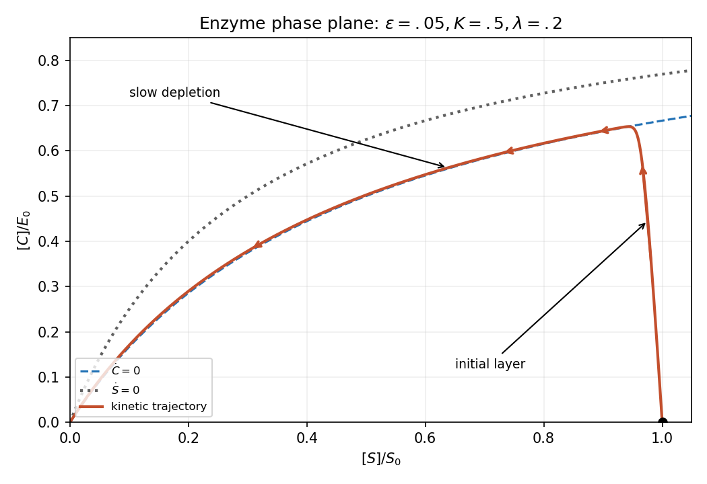

<h1 id="b/5/vi/solution">Solution</h1>

↑ **Parent:** [Vi](../vi.md)

In physical [concentration](../../../../../concentration.md) coordinates, the two [nullclines](../../../../../nullcline.md) are

$$
\boxed{\dot C=0:\ C=\frac{E_0S}{S+K_M},\quad K_M=\frac{k_{-1}+k_2}{k_1};\qquad
\dot S=0:\ C=\frac{E_0S}{S+K_S},\quad K_S=\frac{k_{-1}}{k_1}.}
$$

Since $K_S<K_M$, the [substrate](../../../../../substrate-biochemistry.md) [nullcline](../../../../../nullcline.md) lies above the complex [nullcline](../../../../../nullcline.md) for $S>0$. Starting at $(S_0,0)$, the complex rises and [substrate](../../../../../substrate-biochemistry.md) falls; with $E_0/S_0\ll1$, this fast segment is nearly vertical when the axes use their respective [concentration](../../../../../concentration.md) scales. The [trajectory](../../../../../trajectory.md) then follows the complex quasi-steady manifold toward the origin. On its slow descending portion it is slightly above the complex [nullcline](../../../../../nullcline.md) so that $\dot C<0$; the leading outer curve itself sets that [derivative](../../../../../derivative.md) to zero only at zeroth order.

**[Figure 1](#b/5/vi/image-enzyme-kinetics-in-scaled-concentration-coordinates-rapid-complex-buildup-followed-by-slow-substrate-depletion). Enzyme kinetics in scaled concentration coordinates: rapid complex buildup followed by slow substrate depletion**.

## ↑ Ancestors (13)

1. [Vi](../vi.md)
2. [5](../../5.md)
3. [B](../../../b.md)
4. [2008](../../../../2008-split.md)
5. [Past exam of the mathematics and the environment and mathematical physiology course of the University of Oxford](../../../../split.md)
6. [Mathematics and the environment and mathematical physiology course of the University of Oxford](../../../../../mathematics-and-the-environment-and-mathematical-physiology-course-of-the-university-of-oxford.md)
7. [Year 4 of the mathematics course of the University of Oxford](../../../../../year-4-of-the-mathematics-course-of-the-university-of-oxford.md)
8. [Mathematics course of the University of Oxford](../../../../../mathematics-course-of-the-university-of-oxford.md)
9. [Undergraduate course of the University of Oxford](../../../../../undergraduate-course-of-the-university-of-oxford.md)
10. [Course of the University of Oxford](../../../../../course-of-the-university-of-oxford.md)
11. [University of Oxford](../../../../../university-of-oxford-split.md)
12. [List of universities](../../../../../list-of-universities.md)
13. [Codex Wiki](../../../../../split.md)
