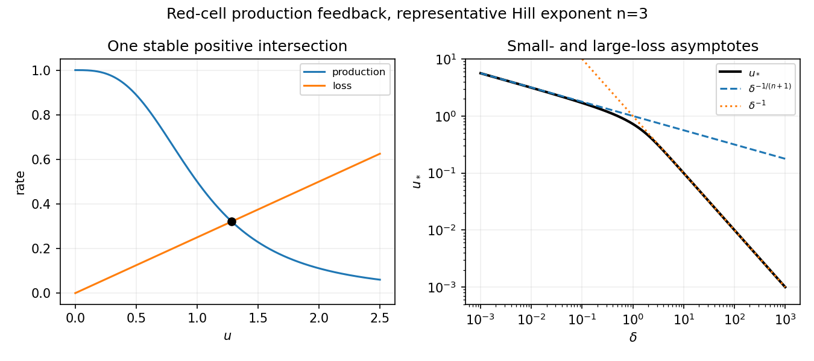

<h1 id="b/7/solution">Solution</h1>

↑ **Parent:** [7](../7.md)

The decreasing production term represents [negative feedback](../../../../negative-feedback.md): low red-cell abundance stimulates production, whereas high abundance suppresses it. The linear loss term models removal at constant per-cell rate. Set

$$
\boxed{u=E/\theta,\quad\tau=F_0t/\theta,\quad\delta=\gamma\theta/F_0.}
$$

Then $u'=f(u)-\delta u$, with $f(u)=1/(1+u^n)$. On the physical half-line $u\geq0$, $f$ decreases from one to zero while $\delta u$ increases from zero to infinity. Their unique intersection $u_*>0$ is the [steady state](../../../../steady-state.md). Its linear [derivative](../../../../derivative.md) is $f'(u_*)-\delta<0$, so it is asymptotically stable.

For small $\delta$, the intersection lies at large $u$, where $f\sim u^{-n}$; for large $\delta$ it lies at small $u$, where $f\sim1$. Hence

$$
\boxed{u_*\sim\delta^{-1/(n+1)}\quad(\delta\downarrow0),\qquad u_*\sim\delta^{-1}\quad(\delta\to\infty).}
$$

Implicit differentiation of $f(u_*)=\delta u_*$ gives $du_*/d\delta=u_*/[f'(u_*)-\delta]<0$. The plot joins these two decreasing asymptotic regimes.

**[Figure 2](#b/7/image-negative-production-feedback-gives-one-stable-red-cell-equilibrium-and-two-limiting-concentration-scalings). Negative production feedback gives one stable red-cell equilibrium and two limiting concentration scalings**.

The delay $t_0$ represents the time between feedback sensing and the appearance of newly produced mature cells. In [dimensionless](../../../../dimensionless-quantity.md) time it is $d=F_0t_0/\theta$, so the equation becomes

$$
\boxed{u'(\tau)=\frac1{1+u(\tau-d)^n}-\delta u(\tau).}
$$

It requires a nonnegative initial history on $[-d,0]$, not just one initial value. Its constant [equilibrium](../../../../equilibrium-point-of-a-dynamical-system.md) is unchanged. Put $a=-f'(u_*)=nu_*^{n-1}/(1+u_*^n)^2>0$. A small perturbation obeys $v'=-\delta v-av(\tau-d)$, whose [characteristic equation](../../../../characteristic-equation-of-a-constant-coefficient-differential-equation.md) is

$$
\boxed{\sigma+\delta+ae^{-\sigma d}=0.}
$$

There is no real root with $\sigma\geq0$, because all three terms would have positive sum; zero is never a root either. Starting from the stable zero-delay case, loss of [linear stability](../../../../linear-stability.md) can therefore occur only when a [complex conjugate](../../../../complex-conjugate.md) pair crosses the imaginary axis at a nonzero frequency, the linear signature of a [Hopf bifurcation](../../../../hopf-bifurcation.md).

For completeness, substituting $\sigma=i\omega$ gives $\delta+a\cos(\omega d)=0$ and $\omega=a\sin(\omega d)$. Such a crossing requires $a>\delta$, with

$$
\boxed{\omega=\sqrt{a^2-\delta^2},\qquad d_c=\frac{\arccos(-\delta/a)}{\sqrt{a^2-\delta^2}}.}
$$

The first crossing is transversal: $\operatorname{Re}(d\sigma/dd)=\omega^2/[(1+\delta d)^2+\omega^2d^2]>0$. If $a\leq\delta$, the magnitude relation rules out roots in the closed right half-[plane](../../../../plane.md) for every delay. A nondegenerate nonlinear Hopf conclusion additionally uses the usual bifurcation hypotheses. This is [delayed negative feedback in red-cell production](../../../../delayed-negative-feedback-in-red-cell-production.md).

## ↑ Ancestors (12)

1. [7](../7.md)
2. [B](../../b.md)
3. [2008](../../../2008-split.md)
4. [Past exam of the mathematics and the environment and mathematical physiology course of the University of Oxford](../../../split.md)
5. [Mathematics and the environment and mathematical physiology course of the University of Oxford](../../../../mathematics-and-the-environment-and-mathematical-physiology-course-of-the-university-of-oxford.md)
6. [Year 4 of the mathematics course of the University of Oxford](../../../../year-4-of-the-mathematics-course-of-the-university-of-oxford.md)
7. [Mathematics course of the University of Oxford](../../../../mathematics-course-of-the-university-of-oxford.md)
8. [Undergraduate course of the University of Oxford](../../../../undergraduate-course-of-the-university-of-oxford.md)
9. [Course of the University of Oxford](../../../../course-of-the-university-of-oxford.md)
10. [University of Oxford](../../../../university-of-oxford-split.md)
11. [List of universities](../../../../list-of-universities.md)
12. [Codex Wiki](../../../../split.md)
