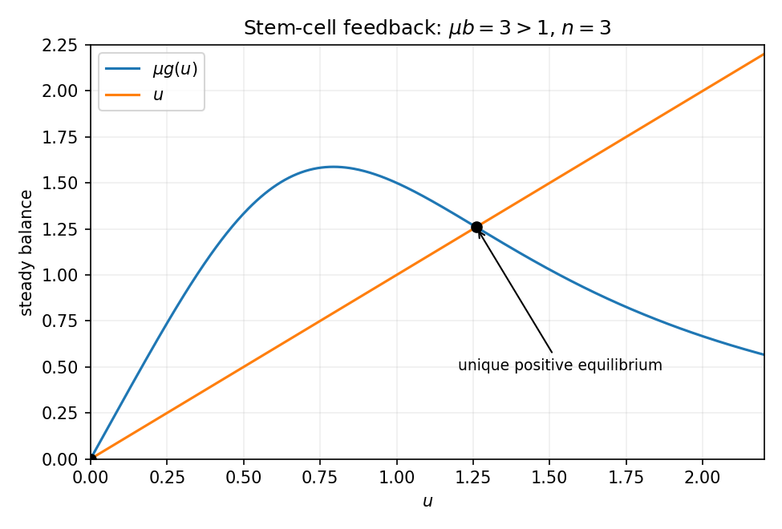

<h1 id="b/8/solution">Solution</h1>

↑ **Parent:** [8](../8.md)

Resting cells enter [proliferation](../../../../cell-proliferation.md) at rate $\beta(N)N$. A proliferating cell takes a fixed cycle time $\tau$ to divide and survives that cycle with probability $e^{-\gamma\tau}$ under a constant death hazard $\gamma$. Thus exit from the proliferating compartment at time $t$ is $e^{-\gamma\tau}\beta(N(t-\tau))N(t-\tau)$, and it returns twice as many daughter cells to the resting population. Resting-cell loss at rate $\delta N$ is separate.

More explicitly, the number currently in the proliferating stage is

$$
P(t)=\int_{t-\tau}^te^{-\gamma(t-s)}\beta(N(s))N(s)\,ds,
$$

for a consistent initial history. Differentiation gives the stated $P$ equation. Counting resting-cell entry, loss and daughter-cell return gives its $N$ equation. [Negative feedback](../../../../negative-feedback.md) in $\beta(N)$ suppresses recruitment when the resting population is high; its Hill exponent gives a steep response around the [concentration](../../../../concentration.md) scale $\theta$.

Set $\boxed{u=N/\theta,\quad\hat t=t/\tau,\quad u_1=u(\hat t-1)}$ and define

$$
\boxed{b=\beta_0\tau,\qquad\epsilon=\delta\tau,\qquad\mu=\frac{2e^{-\gamma\tau}-1}{\delta\tau},\qquad g(u)=\frac{bu}{1+u^n}.}
$$

Then $1+\epsilon\mu=2e^{-\gamma\tau}$, so the resting-cell equation becomes exactly

$$
\boxed{u'=g(u_1)-g(u)+\epsilon[\mu g(u_1)-u].}
$$

The nonzero [steady state](../../../../steady-state.md) solves $u=\mu g(u)$, or $1=\mu b/(1+u^n)$ for positive $u$. The latter right side decreases strictly from $\mu b$ to zero. Thus when $\mu b>1$ there is exactly one positive [equilibrium](../../../../equilibrium-point-of-a-dynamical-system.md),

$$
\boxed{u_*=(\mu b-1)^{1/n}.}
$$

Zero is also an [equilibrium](../../../../equilibrium-point-of-a-dynamical-system.md); negative populations are outside the biological domain. The same result is visible by intersecting the line $u$ with the hump-shaped $\mu g(u)$.

**[Figure 3](#b/8/image-resting-cell-recruitment-feedback-has-one-positive-equilibrium-when-the-small-population-reproduction-factor-exceeds-one). Resting-cell recruitment feedback has one positive equilibrium when the small-population reproduction factor exceeds one**.

Put $d_g=g'(u_*)=b[1+(1-n)u_*^n]/(1+u_*^n)^2$. [Linearization](../../../../linearization.md) and a mode $e^{\sigma\hat t}$ give

$$
\sigma=-(d_g+\epsilon)+(1+\epsilon\mu)d_ge^{-\sigma}=\boxed{-\alpha-\gamma_{\rm ch}e^{-\sigma}},
$$

$$
\boxed{\alpha=d_g+\epsilon,\qquad\gamma_{\rm ch}=-(1+\epsilon\mu)d_g.}
$$

Here $\gamma_{\rm ch}$ is the coefficient called $\gamma$ in the source's [characteristic equation](../../../../characteristic-equation-of-a-constant-coefficient-differential-equation.md); it is not the proliferating-cell death hazard. Any [characteristic root](../../../../characteristic-root-of-a-constant-coefficient-differential-equation.md) with positive real part makes the [equilibrium](../../../../equilibrium-point-of-a-dynamical-system.md) linearly unstable. A nonzero imaginary crossing satisfies $\alpha+\gamma_{\rm ch}\cos\omega=0$ and $\omega-\gamma_{\rm ch}\sin\omega=0$; these are its Hopf conditions, subject to nondegeneracy.

On slow time $T=\epsilon\hat t$, the unit delay becomes $u_1=u(T-\epsilon)=u-\epsilon u_T+O(\epsilon^2)$. Taylor expansion gives $g(u_1)-g(u)=-\epsilon g'(u)u_T+O(\epsilon^2)$. Dividing the equation by $\epsilon$ therefore yields

$$
\boxed{\frac{du}{dT}\simeq\frac{\mu g(u)-u}{1+g'(u)}.}
$$

This approximation requires slow smooth variation and a denominator bounded away from zero; a vanishing denominator marks failure of this slow reduction. On the fast time $\hat t=O(1)$, omit only the explicit order-$\epsilon$ terms, retaining the finite delay:

$$
\boxed{\frac{du}{d\hat t}\simeq g(u(\hat t-1))-g(u(\hat t)).}
$$

Replacing the delayed argument by the present value on that fast scale would incorrectly erase the dynamics. These are the [slow and fast limits of a delayed stem-cell model](../../../../slow-and-fast-limits-of-a-delayed-stem-cell-model.md).

## ↑ Ancestors (12)

1. [8](../8.md)
2. [B](../../b.md)
3. [2008](../../../2008-split.md)
4. [Past exam of the mathematics and the environment and mathematical physiology course of the University of Oxford](../../../split.md)
5. [Mathematics and the environment and mathematical physiology course of the University of Oxford](../../../../mathematics-and-the-environment-and-mathematical-physiology-course-of-the-university-of-oxford.md)
6. [Year 4 of the mathematics course of the University of Oxford](../../../../year-4-of-the-mathematics-course-of-the-university-of-oxford.md)
7. [Mathematics course of the University of Oxford](../../../../mathematics-course-of-the-university-of-oxford.md)
8. [Undergraduate course of the University of Oxford](../../../../undergraduate-course-of-the-university-of-oxford.md)
9. [Course of the University of Oxford](../../../../course-of-the-university-of-oxford.md)
10. [University of Oxford](../../../../university-of-oxford-split.md)
11. [List of universities](../../../../list-of-universities.md)
12. [Codex Wiki](../../../../split.md)
