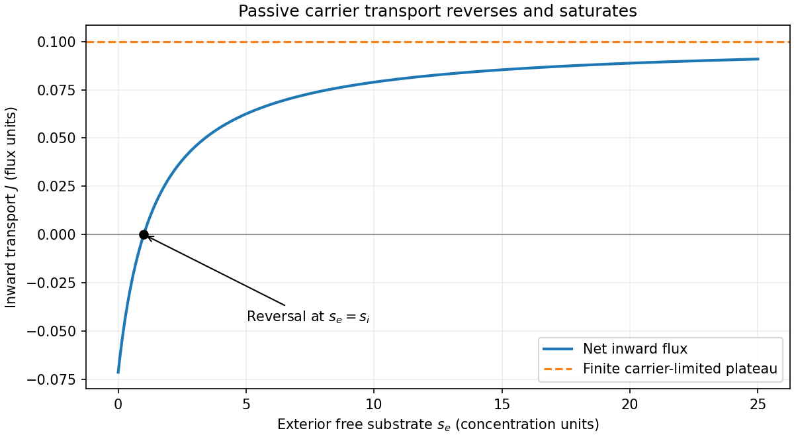
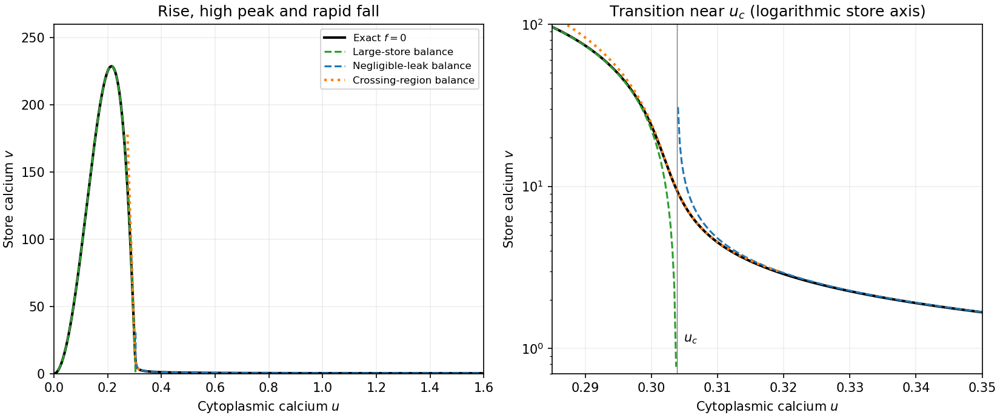
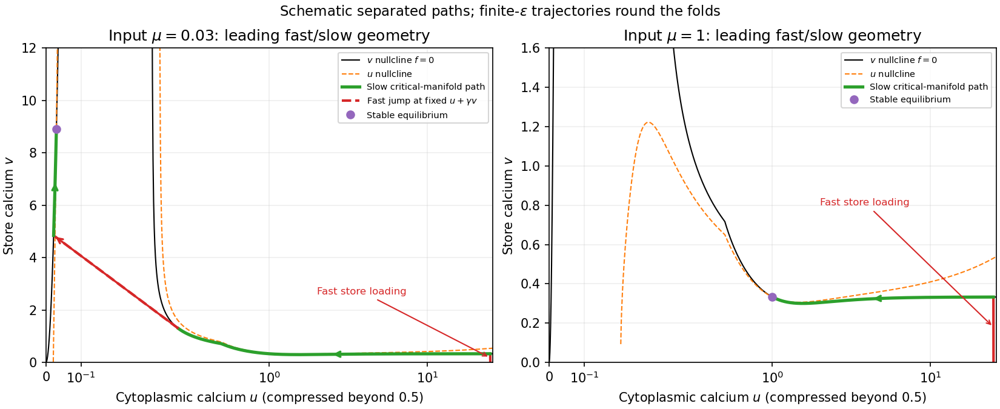
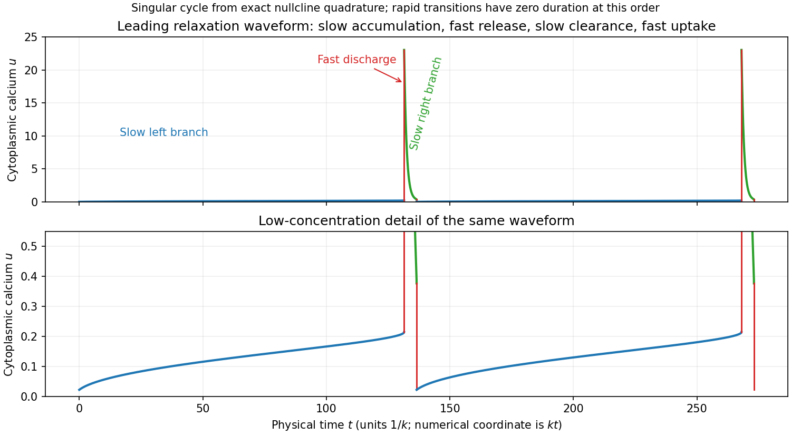
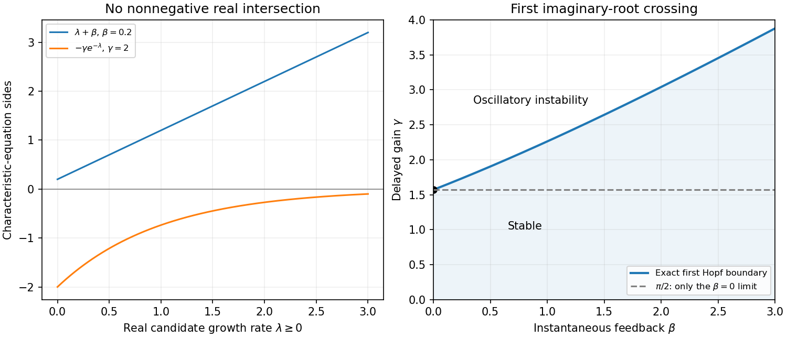

# 2009

↑ **Parent:** [Past exam of the mathematics and the environment and mathematical physiology course of the University of Oxford](../past-exam-of-the-mathematics-and-the-environment-and-mathematical-physiology-course-of-the-university-of-oxford.md)

This [University of Oxford](../university-of-oxford.md) Part C paper combines Mathematics and the Environment in section A with Mathematical Physiology in section B. [Source release](https://www.whatdotheyknow.com/request/maths_past_papers_3) The archive preserves the complete editable seven-page paper. Bounded searches of official sources found no advertised answers for this exact paper. The solutions distinguish linear and asymptotic conclusions from exact nonlinear claims, and identify the carrier-total typo and small-parameter respiratory approximations.

**Table of contents**

- [A](#a)
  - [1](#a/1)
    - [i](#a/1/i)
      - [Solution](#a/1/i/solution)
    - [ii](#a/1/ii)
      - [Solution](#a/1/ii/solution)
    - [iii](#a/1/iii)
      - [Solution](#a/1/iii/solution)
    - [iv](#a/1/iv)
      - [Solution](#a/1/iv/solution)
    - [v](#a/1/v)
      - [Solution](#a/1/v/solution)
    - [vi](#a/1/vi)
      - [Solution](#a/1/vi/solution)
  - [2](#a/2)
    - [i](#a/2/i)
      - [Solution](#a/2/i/solution)
    - [ii](#a/2/ii)
      - [Solution](#a/2/ii/solution)
    - [iii](#a/2/iii)
      - [Solution](#a/2/iii/solution)
    - [iv](#a/2/iv)
      - [Solution](#a/2/iv/solution)
  - [3](#a/3)
    - [i](#a/3/i)
      - [Solution](#a/3/i/solution)
    - [ii](#a/3/ii)
      - [Solution](#a/3/ii/solution)
    - [iii](#a/3/iii)
      - [Solution](#a/3/iii/solution)
- [B](#b)
  - [4](#b/4)
    - [a](#b/4/a)
      - [Solution](#b/4/a/solution)
    - [b](#b/4/b)
      - [Solution](#b/4/b/solution)
    - [c](#b/4/c)
      - [Solution](#b/4/c/solution)
    - [d](#b/4/d)
      - [i](#b/4/d/i)
        - [Solution](#b/4/d/i/solution)
      - [ii](#b/4/d/ii)
        - [Solution](#b/4/d/ii/solution)
      - [iii](#b/4/d/iii)
        - [Solution](#b/4/d/iii/solution)
      - [iv](#b/4/d/iv)
        - [Solution](#b/4/d/iv/solution)
  - [5](#b/5)
    - [a](#b/5/a)
      - [Solution](#b/5/a/solution)
    - [b](#b/5/b)
      - [Solution](#b/5/b/solution)
    - [c](#b/5/c)
      - [Solution](#b/5/c/solution)
    - [d](#b/5/d)
      - [Solution](#b/5/d/solution)
    - [e](#b/5/e)
      - [Solution](#b/5/e/solution)
  - [6](#b/6)
    - [a](#b/6/a)
      - [Solution](#b/6/a/solution)
    - [b](#b/6/b)
      - [Solution](#b/6/b/solution)
    - [c](#b/6/c)
      - [Solution](#b/6/c/solution)
    - [d](#b/6/d)
      - [i](#b/6/d/i)
        - [Solution](#b/6/d/i/solution)
      - [ii](#b/6/d/ii)
        - [Solution](#b/6/d/ii/solution)
      - [iii](#b/6/d/iii)
        - [Solution](#b/6/d/iii/solution)
      - [iv](#b/6/d/iv)
        - [Solution](#b/6/d/iv/solution)

## A

↑ **Parent:** [2009](2009.md)

<h3 id="a/1">1</h3>

↑ **Parent:** [A](#a)

<h4 id="a/1/i">i</h4>

↑ **Parent:** [1](#a/1)

<h5 id="a/1/i/solution">Solution</h5>

↑ **Parent:** [I](#a/1/i)

For [Röthlisberger channel drainage](../geophysics.md#rothlisberger-channel-drainage), $S$ is the water-filled cross-sectional [area](../differential-geometry.md#surface-area) of the subglacial channel, $Q$ its [volume](../geometry-and-topology.md#volume) discharge, $m$ the [mass](../classical-mechanics.md#mass) of [ice](../chemical-substance.md#ice) melted per unit channel [length](../physics.md#length) per unit [time](../classical-mechanics.md#time-in-physics), and $N=p_i-p_w$ the [effective pressure](../geophysics.md#effective-pressure-in-subglacial-drainage), namely [ice](../chemical-substance.md#ice) overburden [pressure](../pressure.md) minus [water](../chemical-substance.md#water) [pressure](../pressure.md). The first balance converts melt [mass](../classical-mechanics.md#mass) to [area](../differential-geometry.md#surface-area) growth through division by [ice](../chemical-substance.md#ice) [density](../fluid-mechanics.md#density) $\rho_i$, and subtracts [material creep](../engineering.md#creep-deformation) closure $KSN^3$. The cubic [pressure](../pressure.md) dependence comes from the adopted ice-flow law; $K$ includes its material and geometric factors.

The second relation balances the downslope hydraulic driving gradient $\rho_wg\sin\alpha$ against the adopted frictional [pressure](../pressure.md) loss. It is an instantaneous discharge-area law, giving $Q=(\sin\alpha/f)^{1/2}S^{4/3}$ for positive downstream flow. The final balance equates [latent heat](../thermodynamic-potential.md#latent-heat) $mL$ needed to melt the channel walls with the gravitational [power](../energy.md#power) dissipated per unit [length](../physics.md#length), $\rho_wg\sin\alpha\,Q$. It assumes that this dissipated [power](../energy.md#power) is available for melting rather than substantial sensible heating or other [energy](../energy.md) losses. The model thus couples **melt opening, pressure-driven [material creep](../engineering.md#creep-deformation) closure and hydraulic discharge**.

<h4 id="a/1/ii">ii</h4>

↑ **Parent:** [1](#a/1)

<h5 id="a/1/ii/solution">Solution</h5>

↑ **Parent:** [Ii](#a/1/ii)

With constant lake surface [area](../differential-geometry.md#surface-area), raising its level by $dh$ changes its [volume](../geometry-and-topology.md#volume) by $S_L\,dh$. The symbol $M_L$ in the proposed balance is an effective filling rate measured as lake-level rise per unit [time](../classical-mechanics.md#time-in-physics), so the [volume](../geometry-and-topology.md#volume) inflow is $S_LM_L$. [Volume](../geometry-and-topology.md#volume) conservation gives

$$
S_L\frac{dh}{dt}=S_LM_L-Q,\qquad\boxed{h_t=M_L-Q/S_L.}
$$

Thus the lake rises when its inflow exceeds channel discharge and falls in the opposite case. If an inflow were instead specified directly as a [volume](../geometry-and-topology.md#volume) rate $I_L$, its contribution would be $I_L/S_L$; keeping these units distinct is necessary for the interpretation of $M_L$.

<h4 id="a/1/iii">iii</h4>

↑ **Parent:** [1](#a/1)

<h5 id="a/1/iii/solution">Solution</h5>

↑ **Parent:** [Iii](#a/1/iii)

[Hydrostatic pressure](../fluid-mechanics.md#hydrostatic-pressure) at the entrance is $p_w=p_{\rm ref}+\rho_wgh$, with a constant reference [pressure](../pressure.md). Therefore $N=p_i-p_{\rm ref}-\rho_wgh$, and constant overburden [pressure](../pressure.md) gives

$$
\boxed{N_t=-\rho_wg\,h_t=-\rho_wg(M_L-Q/S_L).}
$$

A filling lake raises [water](../chemical-substance.md#water) [pressure](../pressure.md) and lowers [effective pressure](../geophysics.md#effective-pressure-in-subglacial-drainage), reducing [material creep](../engineering.md#creep-deformation) closure. A draining lake has the reverse effect. These signs supply the [pressure](../pressure.md) feedback in the coupled drainage model.

<h4 id="a/1/iv">iv</h4>

↑ **Parent:** [1](#a/1)

<h5 id="a/1/iv/solution">Solution</h5>

↑ **Parent:** [Iv](#a/1/iv)

Write dimensional variables as their scales [times](../classical-mechanics.md#time-in-physics) dimensionless variables, with positive scales $S_0,Q_0,m_0,N_0,t_0$. For compactness define

$$
a=\left(\frac{\sin\alpha}{f}\right)^{1/2},\qquad B=\frac{\rho_wg\sin\alpha}{L},\qquad D=\frac{\rho_iL}{S_L\sin\alpha}.
$$

A consistent explicit choice is

$$
S_0=\left(\frac{Ba}{\rho_iKD^3}\right)^{3/8},\quad Q_0=aS_0^{4/3},\quad m_0=BQ_0,\quad t_0=\frac{\rho_iS_0}{m_0},\quad N_0=DS_0.
$$

These identities give $t_0m_0/(\rho_iS_0)=1$, $Kt_0N_0^3=1$, $fQ_0^2/(\sin\alpha S_0^{8/3})=1$ and $\rho_wg\,t_0Q_0/(S_LN_0)=1$. Substitution therefore leaves the unit coefficients in all four balances, and the sole supply parameter is $\mu=M_LS_L/Q_0$. Expanding its scales yields

$$
\boxed{\mu=\frac{M_L\rho_i^2L^2\sqrt K\,f^{3/4}}{\sqrt{\rho_wgS_L}\,(\sin\alpha)^{11/4}}.}
$$

After dropping scale hats, eliminate the instantaneous quantities to obtain the useful two-dimensional system

$$
\boxed{S_t=S^{4/3}-SN^3,\qquad N_t=S^{4/3}-\mu,\qquad Q=m=S^{4/3}.}
$$

These scales assume a positive slope, positive [friction](../newtonian-mechanics.md#friction) coefficient and nonzero lake [area](../differential-geometry.md#surface-area); they nondimensionalize exactly the hydraulic law printed in the source.

<h4 id="a/1/v">v</h4>

↑ **Parent:** [1](#a/1)

<h5 id="a/1/v/solution">Solution</h5>

↑ **Parent:** [V](#a/1/v)

For $\mu>0$, the positive [equilibrium](../dynamical-systems.md#equilibrium-point-of-a-dynamical-system) is

$$
\boxed{Q_*=m_*=\mu,\qquad S_*=\mu^{3/4},\qquad N_*=\mu^{1/12}.}
$$

Set $S=S_*+\varepsilon S_1$ and $N=N_*+\varepsilon N_1$ and retain first-order terms. The linear system is

$$
\frac d{dt}\begin{pmatrix}S_1\\N_1\end{pmatrix}=
\begin{pmatrix}\mu^{1/4}/3&-3\mu^{11/12}\\4\mu^{1/4}/3&0\end{pmatrix}
\begin{pmatrix}S_1\\N_1\end{pmatrix}.
$$

Differentiating its first row and using the second gives

$$
\boxed{S_1''=\frac13\mu^{1/4}S_1'-4\mu^{7/6}S_1.}
$$

In particular the [trace](../linear-algebra.md#matrix-trace) is positive and [determinant](../multilinear-algebra.md#determinant) is $4\mu^{7/6}>0$. The steady drainage state is [linearly unstable](../dynamical-systems.md#linear-stability) for every positive supply, whether its instability is oscillatory or nonoscillatory.

<h4 id="a/1/vi">vi</h4>

↑ **Parent:** [1](#a/1)

<h5 id="a/1/vi/solution">Solution</h5>

↑ **Parent:** [Vi](#a/1/vi)

The [characteristic](../algebra.md#characteristic-of-a-field) roots satisfy

$$
\lambda^2-\frac13\mu^{1/4}\lambda+4\mu^{7/6}=0.
$$

They are a nonreal [conjugate pair](../complex-analysis.md#complex-conjugate) precisely when $\mu^{1/2}/9-16\mu^{7/6}<0$, or $\mu^{2/3}>1/144$. Therefore

$$
\boxed{\mu_c=144^{-3/2}=\frac1{1728}.}
$$

In [lake-coupled Röthlisberger drainage instability](../geophysics.md#lake-coupled-rothlisberger-drainage-instability), above this value the [real part](../complex-analysis.md#real-part) is $\mu^{1/4}/6>0$, so nonzero linear perturbations are sinusoidal [oscillations](../wave.md#oscillation) with an exponentially growing envelope. Their [angular frequency](../lagrangian-mechanics.md#angular-frequency) is $[4\mu^{7/6}-\mu^{1/2}/36]^{1/2}$.

Physically the feedback represents repeated lake filling and [pressure](../pressure.md) increase, channel enlargement by melting, rapid drainage, [pressure](../pressure.md) reduction and [material creep](../engineering.md#creep-deformation) closure. Large drainage events are glacial lake outburst floods, or jökulhlaups. **The unbounded [amplitude](../wave.md#wave-amplitude) is a conclusion of the linearized [equations](../algebra.md#equation)**, not a proof of infinite physical discharge or an indefinitely growing nonlinear solution. Once perturbations are comparable with the [equilibrium](../dynamical-systems.md#equilibrium-point-of-a-dynamical-system) scales, nonlinear dynamics and constraints such as lake depletion must be retained. At the threshold the two real roots coincide; below it the instability is nonoscillatory.

<h3 id="a/2">2</h3>

↑ **Parent:** [A](#a)

<h4 id="a/2/i">i</h4>

↑ **Parent:** [2](#a/2)

<h5 id="a/2/i/solution">Solution</h5>

↑ **Parent:** [I](#a/2/i)

The cross-sectional [area](../differential-geometry.md#surface-area) $A(s,t)$ multiplied by the mean downstream [speed](../classical-mechanics.md#speed) $u(s,t)$ is the [volume flux](../fluid-mechanics.md#volumetric-flow-rate) $Q=Au$. The term $A_t$ is local storage change per unit river [length](../physics.md#length), $(Au)_s$ is net downstream export per unit [length](../physics.md#length), and $M>0$ is lateral [volume](../geometry-and-topology.md#volume) input per unit [length](../physics.md#length) per unit [time](../classical-mechanics.md#time-in-physics), for example distributed tributary or runoff supply.

For a fixed reach $[s_1,s_2]$, [incompressibility](../fluid-mechanics.md#incompressible-flow) and constant [density](../fluid-mechanics.md#density) give

$$
\frac d{dt}\int_{s_1}^{s_2}A\,ds=Q(s_1,t)-Q(s_2,t)+\int_{s_1}^{s_2}M\,ds.
$$

Apply the [fundamental theorem of calculus](../calculus.md#fundamental-theorem-of-calculus) and localize the resulting [integral](../integral.md) identity to obtain $A_t+Q_s=M$. The [density](../fluid-mechanics.md#density) cancels because every term transports the same [water](../chemical-substance.md#water); no sediment source is included in this balance.

<h4 id="a/2/ii">ii</h4>

↑ **Parent:** [2](#a/2)

<h5 id="a/2/ii/solution">Solution</h5>

↑ **Parent:** [Ii](#a/2/ii)

To obtain a [power-law river kinematic wave](../transport-equation.md#power-law-river-kinematic-wave), let $P_b$ be the wetted perimeter and $I$ the small bed slope. A uniform-flow [force](../force.md) balance per unit river [length](../physics.md#length) is $\rho gAI=\tau_bP_b$. With a [Chézy friction law](../fluid-mechanics.md#chezy-friction-law) $\tau_b=\rho f u^2$, it gives $u=(gI/f)^{1/2}(A/P_b)^{1/2}$. Thus the [hydraulic radius](../fluid-mechanics.md#hydraulic-radius) determines the [power](../energy.md#power) of [area](../differential-geometry.md#surface-area).

For a channel family with $P_b=P_0A^q$, where $q<1$, we have $u=C A^{(1-q)/2}$, with $C=(gI/(fP_0))^{1/2}$. Set $m=(1-q)/2>0$ and $c=(m+1)C$. Then

$$
\boxed{Q=Au=\frac c{m+1}A^{m+1}.}
$$

For example a broad fixed-width rectangular channel has approximately constant wetted perimeter, giving $m=1/2$; a geometrically similar channel family has $P_b\propto A^{1/2}$, giving $m=1/4$. The exponent is therefore a geometry-dependent consequence of the [friction](../newtonian-mechanics.md#friction) balance, not a universal arbitrary value fixed by Chezy's law alone.

<h4 id="a/2/iii">iii</h4>

↑ **Parent:** [2](#a/2)

<h5 id="a/2/iii/solution">Solution</h5>

↑ **Parent:** [Iii](#a/2/iii)

At [equilibrium](../dynamical-systems.md#equilibrium-point-of-a-dynamical-system) $Q_s=M$, so $Q=Q_{\rm in}+Ms$ for an upstream boundary [flux](../mathematical-physics.md#flux) $Q_{\rm in}$. Hence

$$
\boxed{A_{\rm eq}(s)=\left[\frac{m+1}{c}(Q_{\rm in}+Ms)\right]^{1/(m+1)}.}
$$

Without a specified upstream condition this [integration](../integral.md) constant must be retained. On a region of positive [area](../differential-geometry.md#surface-area), the [characteristic](../algebra.md#characteristic-of-a-field) [speed](../classical-mechanics.md#speed) is $Q'(A)=cA^m>0$, increasing downstream along the [equilibrium](../dynamical-systems.md#equilibrium-point-of-a-dynamical-system). Small disturbances move downstream, spread in space as this [speed](../classical-mechanics.md#speed) increases, and decrease in [area](../differential-geometry.md#surface-area) [amplitude](../wave.md#wave-amplitude) in the manner derived next. They are transported away from a fixed location; the model has no [diffusion](../thermodynamics.md#diffusion) giving instantaneous smoothing. Finite-amplitude compressive disturbances can steepen into shocks because the [flux](../mathematical-physics.md#flux) is [convex](../real-analysis.md#convex-function), $Q''(A)=cmA^{m-1}>0$, so the small-disturbance picture is not a global no-shock assertion.

<h4 id="a/2/iv">iv</h4>

↑ **Parent:** [2](#a/2)

<h5 id="a/2/iv/solution">Solution</h5>

↑ **Parent:** [Iv](#a/2/iv)

[Taylor expansion](../calculus.md#taylor-expansion) gives $Q(A_{\rm eq}+a)=Q(A_{\rm eq})+cA_{\rm eq}^m a+O(a^2)$. Subtract the [equilibrium](../dynamical-systems.md#equilibrium-point-of-a-dynamical-system) [equation](../algebra.md#equation) and write $V(s)=cA_{\rm eq}^m(s)$ to obtain $a_t+(Va)_s=0$. Set $b=Va$. Since $V$ is [time](../classical-mechanics.md#time-in-physics) independent, $b_t+Vb_s=0$. The [travel coordinate for a conservative transport perturbation](../transport-equation.md#travel-coordinate-for-a-conservative-transport-perturbation) $\xi(s)=\int_0^sV(r)^{-1}\,dr$ transforms this into $b_t+b_\xi=0$, and therefore

$$
\boxed{a(s,t)=\frac{\phi(\xi(s)-t)}{cA_{\rm eq}^m(s)}.}
$$

The conserved quantity along a [characteristic](../algebra.md#characteristic-of-a-field) is the [flux](../mathematical-physics.md#flux) perturbation $Va$, explaining the diminishing [area](../differential-geometry.md#surface-area) [amplitude](../wave.md#wave-amplitude) as $V$ grows.

Differentiate the [equilibrium](../dynamical-systems.md#equilibrium-point-of-a-dynamical-system) relation to get $A_{\rm eq}'=M/(cA_{\rm eq}^m)=M/V$. Thus the arrival [time](../classical-mechanics.md#time-in-physics) is explicitly

$$
\boxed{t_l=\xi(l)=\frac{A_{\rm eq}(l)-A_{\rm eq}(0)}M
=\frac1M\left(\frac{m+1}{c}\right)^{1/(m+1)}\left[(Q_{\rm in}+Ml)^{1/(m+1)}-Q_{\rm in}^{1/(m+1)}\right].}
$$

For zero upstream [flux](../mathematical-physics.md#flux) the [integral](../integral.md) remains finite, giving the limiting formula with its second term zero. However $V(0)=0$ then makes the displayed [amplitude](../wave.md#wave-amplitude) formula singular at the head; a uniformly small arbitrary [area](../differential-geometry.md#surface-area) disturbance imposed exactly there is outside this [linearization](../dynamical-systems.md#linear-stability). A positive upstream [flux](../mathematical-physics.md#flux) avoids that degeneracy.

<h3 id="a/3">3</h3>

↑ **Parent:** [A](#a)

<h4 id="a/3/i">i</h4>

↑ **Parent:** [3](#a/3)

<h5 id="a/3/i/solution">Solution</h5>

↑ **Parent:** [I](#a/3/i)

Here $h$ is [water](../chemical-substance.md#water) depth, $u$ the depth-averaged downstream [speed](../classical-mechanics.md#speed), $s$ bed elevation relative to the reference slope, and $\eta=s+h$ free-surface elevation relative to that reference. The constants $\rho_w,\rho_s$ are [water](../chemical-substance.md#water) and grain densities, $S$ is the reference bed slope, $\tau$ bed [shear stress](../viscous-fluid-flow.md#shear-stress), $\phi$ bed [porosity](../porous-media-flow.md#porosity), $c$ [suspended sediment](../fluid-mechanics.md#suspended-sediment) [mass](../classical-mechanics.md#mass) [concentration](../mathematical-physics.md#concentration), $q_b$ bedload solid [volume flux](../fluid-mechanics.md#volumetric-flow-rate) per unit width, and $v_E,v_D$ erosion and deposition velocities. The settling [speed](../classical-mechanics.md#speed) is denoted by $v_s$ in the constitutive laws.

Depth [integration](../integral.md) of incompressible [water](../chemical-substance.md#water) conservation gives the depth-storage plus discharge-divergence balance. Depth-averaged [momentum](../momentum.md) has local and advective acceleration on the left, and [gravity](../physics.md#gravity) driven by the actual surface gradient together with bed drag on the right. [Hydrostatic pressure](../fluid-mechanics.md#hydrostatic-pressure) and a [shallow-water approximation](../mathematical-physics.md#shallow-water-approximation) underlie this [Saint-Venant](../mathematical-physics.md#shallow-water-equations) description.

[Suspended sediment](../fluid-mechanics.md#suspended-sediment) conservation first has the conservative form $(hc)_t+(huc)_x=\rho_s(v_E-v_D)$; the [water](../chemical-substance.md#water) balance reduces it to the material-derivative form printed in the source. Solid bed [volume](../geometry-and-topology.md#volume) per unit horizontal [area](../differential-geometry.md#surface-area) is $(1-\phi)s$. Its storage plus bedload divergence equals deposition minus erosion, giving the Exner bed balance. Adding the suspended and bed balances after converting bed [volume](../geometry-and-topology.md#volume) to grain [mass](../classical-mechanics.md#mass) cancels exchange terms: **erosion and deposition transfer sediment between the two reservoirs rather than create it**.

<h4 id="a/3/ii">ii</h4>

↑ **Parent:** [3](#a/3)

<h5 id="a/3/ii/solution">Solution</h5>

↑ **Parent:** [Ii](#a/3/ii)

Take an arbitrary reference depth $h_0>0$, and select $u_0=(gSh_0/f)^{1/2}$ so the uniform reference flow balances drag and slope. Work with positive downstream [velocity](../classical-mechanics.md#velocity), so $u_*=\sqrt f\,u$ in the dimensional constitutive laws. Introduce the erosion and bedload scales

$$
E_0=\frac{bf^{3/2}u_0^3}{v_s^2},\qquad q_{b0}=\frac{\rho_wKf^{3/2}u_0^3}{\Delta\rho g}.
$$

Matching erosion with deposition, suspended [advection](../fluid-mechanics.md#advection) with erosion, and bed storage with erosion gives respectively

$$
c_0=\frac{\rho_sbf^2u_0^4}{\gamma v_s^4},\qquad x_0=\frac{h_0c_0u_0}{\rho_sE_0}=\frac{h_0\sqrt f\,u_0^2}{\gamma v_s^2},\qquad t_0=\frac{(1-\phi)h_0}{E_0}.
$$

Use $h_0$ for the scales of $\eta$ and $s$ too, so $h=\eta-s$ survives unchanged. After dividing the balances by their matched scales, the parameters are

$$
\boxed{\epsilon=\frac{x_0}{u_0t_0}=\frac{c_0}{\rho_s(1-\phi)},\quad F=\frac{u_0}{\sqrt{gh_0}},\quad\delta=\frac{Sx_0}{h_0},\quad\beta=\frac{q_{b0}}{E_0x_0}=\frac{\rho_wK v_s^2}{\Delta\rho g b x_0}.}
$$

For example the [momentum](../momentum.md) balance divided by $gh_0/x_0$ has inertial prefactor $F^2$, surface-gradient term $-\eta_x$, and equal slope/drag prefactors $Sx_0/h_0=\delta$, because $fu_0^2=gSh_0$. The suspended balance has source $u^3-c/u$, and the bed balance has its negative with unit bed-time coefficient by the definition of $t_0$. These substitutions give the entire stated dimensionless system; $q_b=u^3$ is dimensionless bedload, with its dimensional scale already absorbed into $\beta$.

<h4 id="a/3/iii">iii</h4>

↑ **Parent:** [3](#a/3)

<h5 id="a/3/iii/solution">Solution</h5>

↑ **Parent:** [Iii](#a/3/iii)

For [quasistatic bed stability with suspended sediment](../fluid-mechanics.md#quasistatic-bed-stability-with-suspended-sediment), in the leading approximation, $(hu)_x=0$ and $\eta_x=0$. For spatially varying perturbations at fixed unit [water](../chemical-substance.md#water) [flux](../mathematical-physics.md#flux) and fixed surface level, write $u=1+U$, $h=1+H$, $c=1+C$, $s=s_*+S_1$. The constraints give $H=-U$ and $S_1=-H=U$. Linearizing the suspended and bed [equations](../algebra.md#equation) yields

$$
C_x=4U-C,\qquad U_t+3\beta U_x=-4U+C.
$$

For a [Fourier mode](../fourier-analysis.md#fourier-mode) $e^{\sigma t+i\kappa x}$, the first relation gives $C=4U/(1+i\kappa)$; substitution into the second gives

$$
\boxed{\sigma=-\frac{4\kappa^2}{1+\kappa^2}-i\kappa\left(3\beta+\frac4{1+\kappa^2}\right).}
$$

Thus every nonzero spatial [frequency](../wave.md#frequency) has negative growth rate, independently of $\beta$. The parameter changes propagation, not damping. The spatially uniform mode has $\sigma=0$ and is neutral, representing a change among uniform reference states compatible with the leading constraints. Hence **there is no growing linear mode in this approximation**; the claim is stability, not strict decay of every homogeneous perturbation. Restoring the small discarded terms or changing [boundary conditions](../differential-equation.md#boundary-condition) requires a separate calculation.

## B

↑ **Parent:** [2009](2009.md)

<h3 id="b/4">4</h3>

↑ **Parent:** [B](#b)

<h4 id="b/4/a">a</h4>

↑ **Parent:** [4](#b/4)

<h5 id="b/4/a/solution">Solution</h5>

↑ **Parent:** [A](#b/4/a)

In [alternating-access carrier transport](../cell-membrane.md#alternating-access-carrier-transport), the four reversible reaction pairs are $S_i+C_i\rightleftharpoons P_i$, $S_e+C_e\rightleftharpoons P_e$, $C_i\rightleftharpoons C_e$ and $P_i\rightleftharpoons P_e$. Binding and unbinding use $k_+,k_-$; both conformational pairs use $k$ in each direction. Define the net binding rates $B_i=k_+s_ic_i-k_-p_i$ and $B_e=k_+s_ec_e-k_-p_e$. [Mass action](../mathematical-biology.md#law-of-mass-action) and the change of each species in each reaction give

$$
\boxed{\begin{aligned}
\dot s_i&=-B_i,&\dot s_e&=-B_e,\\
\dot p_i&=B_i+k(p_e-p_i),&\dot p_e&=B_e+k(p_i-p_e),\\
\dot c_i&=-B_i+k(c_e-c_i),&\dot c_e&=-B_e+k(c_i-c_e).
\end{aligned}}
$$

For example binding consumes one free interior [substrate](../enzyme.md#substrate-biochemistry) and one free interior carrier, and produces one interior complex; loaded-carrier transformation then moves that bound [substrate](../enzyme.md#substrate-biochemistry) across the [membrane](../cell-membrane.md). A bare-carrier transformation alone does not transport [substrate](../enzyme.md#substrate-biochemistry). The [concentration](../mathematical-physics.md#concentration) convention implicitly uses compatible compartment-volume [normalization](../mathematics.md#normalization), as required for the stated unweighted [conservation laws](../mathematical-physics.md#conservation-law).

<h4 id="b/4/b">b</h4>

↑ **Parent:** [4](#b/4)

<h5 id="b/4/b/solution">Solution</h5>

↑ **Parent:** [B](#b/4/b)

Adding the two complex and two free-carrier [equations](../algebra.md#equation) cancels binding and conformational exchange, giving

$$
\boxed{p_i+p_e+c_i+c_e=c_0.}
$$

Each free or bound carrier contains one [carrier protein](../cell-membrane.md#carrier-protein), and the model neither synthesizes nor degrades it. Adding the two free-substrate and two bound-substrate [equations](../algebra.md#equation) likewise gives

$$
\boxed{s_i+s_e+p_i+p_e=s_0.}
$$

Binding stores [substrate](../enzyme.md#substrate-biochemistry) temporarily and loaded conformational exchange relocates it; neither changes total [substrate](../enzyme.md#substrate-biochemistry). The two invariants count distinct conserved chemical moieties. The constants $c_0$ and $s_0$ should not be interchanged: [protein](../protein.md) and [substrate](../enzyme.md#substrate-biochemistry) need not be present in equal amounts.

<h4 id="b/4/c">c</h4>

↑ **Parent:** [4](#b/4)

<h5 id="b/4/c/solution">Solution</h5>

↑ **Parent:** [C](#b/4/c)

Replace only the free-substrate [equations](../algebra.md#equation) by

$$
\boxed{\dot s_i=-B_i-J,\qquad\dot s_e=-B_e+J.}
$$

The other four [equations](../algebra.md#equation) remain as above. The carrier invariant remains unchanged because no [protein](../protein.md) is added or removed. The two external [substrate](../enzyme.md#substrate-biochemistry) terms cancel in the total-substrate balance, so the second invariant also remains unchanged. This cancellation describes a balanced source and sink, even though there is a nonzero throughput. A constant sink is physically meaningful only while [substrate](../enzyme.md#substrate-biochemistry) [concentrations](../mathematical-physics.md#concentration) remain nonnegative; it is not a state-dependent removal law valid after an interior reservoir is exhausted.

<h4 id="b/4/d">d</h4>

↑ **Parent:** [4](#b/4)

<h5 id="b/4/d/i">i</h5>

↑ **Parent:** [D](#b/4/d)

<h6 id="b/4/d/i/solution">Solution</h6>

↑ **Parent:** [I](#b/4/d/i)

At [steady state](../dynamical-systems.md#steady-state) the interior free-substrate balance gives $B_i=-J$. Substituting this into the interior free-carrier balance gives $0=J+k(c_e-c_i)$. Therefore

$$
\boxed{c_i=c_e+J/k.}
$$

For positive inward throughput there are more free carriers facing inward: release of transported [substrate](../enzyme.md#substrate-biochemistry) must be followed by outward return of empty carriers at net rate $k(c_i-c_e)=J$.

<h5 id="b/4/d/ii">ii</h5>

↑ **Parent:** [D](#b/4/d)

<h6 id="b/4/d/ii/solution">Solution</h6>

↑ **Parent:** [Ii](#b/4/d/ii)

The relation $B_i=-J$ means $k_-p_i=k_+s_ic_i+J$. Put $K=k_-/k_+$ and substitute the preceding expression for $c_i$:

$$
\boxed{p_i=\frac{s_ic_e}{K}+J\left(\frac1{k_-}+\frac{s_i}{Kk}\right).}
$$

The first term is the [equilibrium](../dynamical-systems.md#equilibrium-point-of-a-dynamical-system) binding contribution from the outward free-carrier pool; the additional terms account for the maintained current and the excess inward-facing free carriers. This is a steady throughput relation, not a detailed-balance assumption.

<h5 id="b/4/d/iii">iii</h5>

↑ **Parent:** [D](#b/4/d)

<h6 id="b/4/d/iii/solution">Solution</h6>

↑ **Parent:** [Iii](#b/4/d/iii)

The exterior free-substrate [equation](../algebra.md#equation) gives $B_e=J$ at [steady state](../dynamical-systems.md#steady-state). Thus $k_+s_ec_e-k_-p_e=J$, and

$$
\boxed{p_e=\frac{s_ec_e}{K}-\frac J{k_-}.}
$$

The sign of the current term is opposite to the interior relation because [substrate](../enzyme.md#substrate-biochemistry) is supplied to the exterior and removed from the interior. Nonnegative occupancies are selected by the complete steady transport solution and compatible [substrate](../enzyme.md#substrate-biochemistry) totals.

<h5 id="b/4/d/iv">iv</h5>

↑ **Parent:** [D](#b/4/d)

<h6 id="b/4/d/iv/solution">Solution</h6>

↑ **Parent:** [Iv](#b/4/d/iv)

The loaded-carrier balance gives $J=k(p_e-p_i)$. Substitute the preceding two complex [concentrations](../mathematical-physics.md#concentration) and collect the current terms:

$$
J\left(1+\frac{2k}{k_-}+\frac{s_i}{K}\right)=\frac kK(s_e-s_i)c_e,
\qquad\boxed{J=\frac{kk_+(s_e-s_i)c_e}{2k+k_-+k_+s_i}.}
$$

Next carrier conservation gives

$$
c_0=\frac{s_i+s_e+2K}{K}c_e+\frac Jk\left(1+\frac{s_i}K\right),
\qquad\boxed{c_e=\frac{c_0K-(J/k)(s_i+K)}{s_i+s_e+2K}.}
$$

Eliminate $c_e$ between these relations and set $K_d=k/k_+$. Simplification yields

$$
\boxed{J=\frac{K_dKk_+c_0}{2}\frac{s_e-s_i}{(s_i+K+K_d)(s_e+K+K_d)-K_d^2}.}
$$

Here $c_0$ must be the **total [carrier protein](../cell-membrane.md#carrier-protein)**, as in the conservation [equation](../algebra.md#equation). Calling it total [substrate](../enzyme.md#substrate-biochemistry) in the final line of the scan is a typographical inconsistency; total [substrate](../enzyme.md#substrate-biochemistry) is the different invariant $s_0$.

For [carrier-turnover saturation of passive transport](../cell-membrane.md#carrier-turnover-saturation-of-passive-transport) at fixed $s_i$, write $A=s_i+K+K_d$, $D=A(K+K_d)-K_d^2>0$ and $C=K_dKk_+c_0/2>0$. Then $J=C(s_e-s_i)/(As_e+D)$, so

$$
J'=\frac{C(D+As_i)}{(As_e+D)^2}>0,\qquad J''=-\frac{2AC(D+As_i)}{(As_e+D)^3}<0,
$$

$$
\boxed{J(s_i)=0,\qquad \lim_{s_e\to\infty}J=\frac{K_dKk_+c_0}{2(s_i+K+K_d)}.}
$$

The [flux](../mathematical-physics.md#flux) is outward when the [substrate](../enzyme.md#substrate-biochemistry) gradient is reversed and inward when $s_e>s_i$. Saturation occurs because there is a finite carrier population and finite binding-release/conformational turnover: arbitrarily abundant exterior [substrate](../enzyme.md#substrate-biochemistry) cannot make carriers cycle arbitrarily quickly. This is passive facilitated transport, so no maintained [flux](../mathematical-physics.md#flux) remains when the two free [concentrations](../mathematical-physics.md#concentration) agree. Varying $s_e$ at fixed $s_i$ compares reservoir-controlled steady states or systems with different total [substrate](../enzyme.md#substrate-biochemistry); it is not a trajectory preserving one fixed $s_0$.

**[Figure 1](#b/4/d/iv/image-carrier-mediated-transport-reversal-and-saturation-at-fixed-interior-concentration). Carrier-mediated transport: reversal and saturation at fixed interior concentration**.

<h3 id="b/5">5</h3>

↑ **Parent:** [B](#b)

<h4 id="b/5/a">a</h4>

↑ **Parent:** [5](#b/5)

<h5 id="b/5/a/solution">Solution</h5>

↑ **Parent:** [A](#b/5/a)

The cytoplasmic [concentration](../mathematical-physics.md#concentration) $c$ gains a constant influx $r$ from outside the cell and loses [calcium](../chemical-substance.md#calcium) through a first-order extrusion term $kc$. The pump [flux](../mathematical-physics.md#flux) $J_+$ moves [calcium](../chemical-substance.md#calcium) from [cytoplasm](../biological-cell.md#cytoplasm) into the [sarcoplasmic reticulum](../biological-cell.md#sarcoplasmic-reticulum), [saturating](../protein.md#hill-function) with cytoplasmic [concentration](../mathematical-physics.md#concentration) through a [Hill function](../protein.md#hill-function) with scale $K_1$, maximal rate $V_1$ and exponent $n$. The release [flux](../mathematical-physics.md#flux) $J_-$ returns stored [calcium](../chemical-substance.md#calcium) to the [cytoplasm](../biological-cell.md#cytoplasm). It requires both [calcium](../chemical-substance.md#calcium) in the store and calcium-dependent activation of release; its two [saturating](../protein.md#hill-function) factors have scales $K_2,K_3$ and exponents $m,p$. This represents [calcium-induced calcium release](../signal-transduction.md#calcium-induced-calcium-release). The leak $k_sc_s$ is passive return from the store.

Every internal transfer appears with opposite signs in the two balances, so $d(c+c_s)/dt=r-kc$ in the model's compatible [volume](../geometry-and-topology.md#volume) [normalization](../mathematics.md#normalization). Only influx and extrusion change the total. The nonlinear pump and activated release can redistribute this total rapidly and generate [oscillations](../wave.md#oscillation) even with constant external input.

<h4 id="b/5/b">b</h4>

↑ **Parent:** [5](#b/5)

<h5 id="b/5/b/solution">Solution</h5>

↑ **Parent:** [B](#b/5/b)

For the [three-region calcium nullcline](../signal-transduction.md#three-region-calcium-nullcline), define

$$
J(u)=\frac{\beta u^2}{1+u^2},\qquad K(u)=\frac{u^4}{1+u^4},\qquad f=J(u)-K(u)\frac{v^2}{1+v^2}-\delta v.
$$

For $u>0$, $f(u,0)>0$, $f\to-\infty$ as $v\to\infty$, and $f_v=-2K(u)v/(1+v^2)^2-\delta<0$. Thus there is **exactly one positive root $v=V(u)$ for every positive $u$**. The curve starts at the origin and initially satisfies $v\sim\beta u^2/\delta$.

For $0<\beta<1$, let $u_c>0$ solve $J(u_c)=K(u_c)$ and put $K_c=K(u_c)$, $J_c'=J'(u_c)$, $K_c'=K'(u_c)$. Explicitly, with $z_c=u_c^2$,

$$
z_c=\frac{-1+\sqrt{1+4\beta(1-\beta)}}{2(1-\beta)},\qquad J'(u)=\frac{2\beta u}{(1+u^2)^2},\quad K'(u)=\frac{4u^3}{(1+u^4)^2}.
$$

In particular $u_c\sim\sqrt\beta$ and $K_c'-J_c'>0$ for small $\beta$.

On the large-$v$ branch away from the crossing, replace $v^2/(1+v^2)$ by one. This gives $v\sim[J(u)-K(u)]/\delta$ where this is large and positive. Near $u_c$ retain the next term $1-v^{-2}$ and linearize $J-K$:

$$
0\simeq-(K_c'-J_c')(u-u_c)+K_c/v^2-\delta v,
\qquad\boxed{u-u_c\simeq\frac{K_c/v^2-\delta v}{K_c'-J_c'}.}
$$

Finally where the leak is negligible compared with the other terms, $v^2/(1+v^2)\simeq J(u)/K(u)$, so $v\simeq[J/(K-J)]^{1/2}$ on the side $J<K$. These are overlapping asymptotic descriptions with different validity ranges, not three exact disconnected curves. The curve rises to a large peak, falls sharply near $u_c$, then approaches a small finite level as $u\to\infty$. At leading small-$\delta$ order that last level is $[\beta/(1-\beta)]^{1/2}$.

**[Figure 2](#b/5/b/image-calcium-nullcline-and-its-three-asymptotic-regions-full-curve-and-transition-zoom). Calcium nullcline and its three asymptotic regions; full curve and transition zoom**.

<h4 id="b/5/c">c</h4>

↑ **Parent:** [5](#b/5)

<h5 id="b/5/c/solution">Solution</h5>

↑ **Parent:** [C](#b/5/c)

At every [equilibrium](../dynamical-systems.md#equilibrium-point-of-a-dynamical-system) the store balance gives $f=0$, and adding $\gamma$ [times](../classical-mechanics.md#time-in-physics) that balance to the cytoplasmic one gives $u=\mu$. The unique-root result therefore gives a single positive [equilibrium](../dynamical-systems.md#equilibrium-point-of-a-dynamical-system) $(\mu,V(\mu))$. Its [Jacobian](../multivariable-calculus.md#jacobian-matrix) is

$$
A=\begin{pmatrix}-1-\gamma f_u/\epsilon&-\gamma f_v/\epsilon\\f_u/\epsilon&f_v/\epsilon\end{pmatrix},\quad
\boxed{\det A=-f_v/\epsilon>0,\qquad\operatorname{tr}A=-1+(f_v-\gamma f_u)/\epsilon,}
$$

with [derivatives](../calculus.md#derivative) evaluated at that [equilibrium](../dynamical-systems.md#equilibrium-point-of-a-dynamical-system). At small $\mu$, $f_u>0$ and the [trace](../linear-algebra.md#matrix-trace) is negative; sufficiently large $\mu$ also has $f_u>0$, since $J'$ is of order $u^{-3}$ and $K'$ of order $u^{-5}$. Thus **both extreme regimes have a [linearly stable](../dynamical-systems.md#linear-stability) unique [equilibrium](../dynamical-systems.md#equilibrium-point-of-a-dynamical-system)**.

The fast variable is not $v$ alone. Using [total-calcium fast fibres](../signal-transduction.md#total-calcium-fast-fibres), introduce total scaled [calcium](../chemical-substance.md#calcium) $w=u+\gamma v$. Then $\dot w=\mu-u$, while on fast [time](../classical-mechanics.md#time-in-physics) $\sigma=\tau/\epsilon$ the leading [equations](../algebra.md#equation) give $du/d\sigma=-\gamma f$, $dv/d\sigma=f$ and $w$ constant. [Fast paths](../signal-transduction.md#total-calcium-fast-fibres) are therefore straight lines of slope $-1/\gamma$ in the $(u,v)$ plane. Attracting portions of the [critical manifold](../singular-perturbation.md#critical-manifold) satisfy $f_v-\gamma f_u<0$, rather than merely $f_v<0$. Along $v=V(u)$, slow motion obeys

$$
\boxed{\frac{du}{d\tau}=\frac{\mu-u}{1+\gamma V'(u)},\qquad V'=-f_u/f_v.}
$$

Starting with large $u$ and $v=0$, $f>0$ drives a rapid move upward and left, loading the store until the trajectory approaches the right attracting branch. For large $\mu$ in the right stable regime, slow motion on that branch carries it toward $u=\mu$; the direction reverses appropriately if the starting value lies below that [equilibrium](../dynamical-systems.md#equilibrium-point-of-a-dynamical-system). For sufficiently small $\mu$, slow motion travels left along the right branch until its fold, then a fast approximately constant-$w$ jump carries the trajectory to the left attracting branch. Subsequent slow motion reaches the small-$u$ [equilibrium](../dynamical-systems.md#equilibrium-point-of-a-dynamical-system). At a fold the slow approximation is singular, so the full [equations](../algebra.md#equation) resolve the transition. At very small $u$ an additional loss of time-scale separation is possible because the rates themselves vanish; the fast/slow drawing describes the separated portions, not a uniform estimate arbitrarily near the origin.

**[Figure 3](#b/5/c/image-calcium-phase-plane-leading-fast-jumps-and-slow-relaxation-for-small-and-large-input). Calcium phase plane: leading fast jumps and slow relaxation for small and large input**.

<h4 id="b/5/d">d</h4>

↑ **Parent:** [5](#b/5)

<h5 id="b/5/d/solution">Solution</h5>

↑ **Parent:** [D](#b/5/d)

For [Hopf thresholds in a two-pool calcium model](../signal-transduction.md#hopf-thresholds-in-a-two-pool-calcium-model), with the unique [equilibrium](../dynamical-systems.md#equilibrium-point-of-a-dynamical-system) parametrized by $u=\mu$, locate changes of stability by solving the two [equations](../algebra.md#equation)

$$
\boxed{f(\mu,v)=0,\qquad f_v(\mu,v)-\gamma f_u(\mu,v)=\epsilon.}
$$

If there are two simple roots $\mu_-<\mu_+$ with positive [trace](../linear-algebra.md#matrix-trace) between them, the [equilibrium](../dynamical-systems.md#equilibrium-point-of-a-dynamical-system) is a [repeller](../dynamical-systems.md#unstable-equilibrium) throughout that interval, since its [determinant](../multilinear-algebra.md#determinant) stays positive. At a nondegenerate crossing a [Hopf bifurcation](../bifurcation-theory.md#hopf-bifurcation) is possible, with linear [frequency](../wave.md#frequency) $[-f_v/\epsilon]^{1/2}$. A complete classification of criticality requires a nonlinear coefficient, not merely the [trace](../linear-algebra.md#matrix-trace) calculation. At leading singular order the thresholds approach the folds determined by $f=0$ and $f_v-\gamma f_u=0$, equivalently $V'=-1/\gamma$.

Periodic solutions are also supported globally in the positive quadrant. The axes point inward for positive input, $v'\le(\beta-\delta v)/\epsilon$ bounds $v$, and the $u$ [equation](../algebra.md#equation) then bounds $u$ by a linear restoring term plus a bounded source. A large rectangle can thus be chosen [forward invariant](../ergodic-theory.md#invariant-set-of-a-measure-preserving-transformation). For an initial point distinct from the [repelling](../dynamical-systems.md#unstable-equilibrium) unique [equilibrium](../dynamical-systems.md#equilibrium-point-of-a-dynamical-system), its [omega-limit set](../dynamical-systems.md#omega-limit-set) cannot contain that [equilibrium](../dynamical-systems.md#equilibrium-point-of-a-dynamical-system) or a boundary [equilibrium](../dynamical-systems.md#equilibrium-point-of-a-dynamical-system). The [Poincaré-Bendixson theorem](../dynamical-systems.md#poincare-bendixson-theorem) supplies a [periodic orbit](../dynamical-systems.md#periodic-orbit). In the strong separation regime it follows the two attracting branches and jumps between them, a [relaxation oscillation](../dynamical-systems.md#relaxation-oscillation).

The interval requires the [maximum](../set.md#maximum-of-a-subset-of-a-total-order) of $f_v-\gamma f_u$ along the [critical manifold](../singular-perturbation.md#critical-manifold) to exceed $\epsilon$; the listed scale hierarchy alone is not a substitute for that test for arbitrary remaining constants. As an explicit example, $\beta=0.1$, $\delta=10^{-5}$, $\epsilon=5\times10^{-4}$ and $\gamma=0.1$ give approximately $\mu_-=0.22618$ and $\mu_+=0.37350$. At $\mu=0.3$ the [trace](../linear-algebra.md#matrix-trace) is positive, whereas at $0.03$ and $1$ it is negative. The figures use this example and label their singular-limit portions accordingly.

<h4 id="b/5/e">e</h4>

↑ **Parent:** [5](#b/5)

<h5 id="b/5/e/solution">Solution</h5>

↑ **Parent:** [E](#b/5/e)

In a relaxation cycle, cytoplasmic [calcium](../chemical-substance.md#calcium) rises slowly on the left attracting branch while total [calcium](../chemical-substance.md#calcium) is accumulated, then rises rapidly during store discharge along a constant-$w$ [fast path](../signal-transduction.md#total-calcium-fast-fibres) to the right branch. It subsequently decreases on the right slow branch as extrusion dominates input, and finally drops rapidly during store uptake back to the left branch. The result is **a repeated pulse with slow sections joined by sharp transitions**, rather than a sinusoid except near a small-amplitude [Hopf bifurcation](../bifurcation-theory.md#hopf-bifurcation).

For explicit [time](../classical-mechanics.md#time-in-physics) labelling, the compatible scaling $u=c/K_1$, $v=c_s/K_2$ gives $\tau=kt$, $\gamma=K_2/K_1$, $\epsilon=kK_2/V_2$, $\mu=r/(kK_1)$, $\beta=V_1/V_2$ and $\delta=k_sK_2/V_2$. Hence an interval $\Delta\tau$ corresponds to physical duration $\Delta t=\Delta\tau/k$. Slow-branch [times](../classical-mechanics.md#time-in-physics) can be computed by integrating

$$
\Delta\tau=\int\frac{1+\gamma V'(u)}{\mu-u}\,du
$$

in the direction of motion; fast-jump durations are omitted at leading order. The plot uses that [quadrature](../wave.md#phase-quadrature), with vertical lines representing the limiting rapid transitions. Finite $\epsilon$ rounds those lines and changes the precise [amplitude](../wave.md#wave-amplitude) and [period](../mathematics.md#period-of-a-function), especially near folds.

**[Figure 4](#b/5/e/image-leading-relaxation-waveform-of-cytoplasmic-calcium-with-physical-time-measured-in-inverse-extrusion-rate-units). Leading relaxation waveform of cytoplasmic calcium, with physical time measured in inverse-extrusion-rate units**.

<h3 id="b/6">6</h3>

↑ **Parent:** [B](#b)

<h4 id="b/6/a">a</h4>

↑ **Parent:** [6](#b/6)

<h5 id="b/6/a/solution">Solution</h5>

↑ **Parent:** [A](#b/6/a)

In [delayed carbon-dioxide ventilation feedback](../physiology.md#delayed-carbon-dioxide-ventilation-feedback), $P$ is the effective [carbon-dioxide](../chemical-substance.md#carbon-dioxide) [partial pressure](../ideal-gas.md#partial-pressure) of the lumped body compartment. Its stored [carbon-dioxide](../chemical-substance.md#carbon-dioxide) amount is proportional to $P$, with effective capacitance $K$, so $K\,dP/dT$ is its accumulation rate. Metabolism produces [carbon dioxide](../chemical-substance.md#carbon-dioxide) at rate $M$. [Ventilation](../physiology.md#pulmonary-ventilation) removes it at a rate proportional to [partial pressure](../ideal-gas.md#partial-pressure) [times](../classical-mechanics.md#time-in-physics) [ventilation](../physiology.md#pulmonary-ventilation), $P\dot V$, with gas-conversion constants absorbed into the model coefficients. The [equation](../algebra.md#equation) is therefore a one-compartment [carbon-dioxide](../chemical-substance.md#carbon-dioxide) balance: **production minus respiratory removal equals accumulation**. It idealizes mixing and treats metabolic production as constant over the [time](../classical-mechanics.md#time-in-physics) scale of interest.

<h4 id="b/6/b">b</h4>

↑ **Parent:** [6](#b/6)

<h5 id="b/6/b/solution">Solution</h5>

↑ **Parent:** [B](#b/6/b)

Chemoreceptors respond to [carbon-dioxide](../chemical-substance.md#carbon-dioxide) levels, but feedback is delayed by blood transport to sensing sites, neural processing and the response of respiratory muscles. A fixed positive delay $\tau$ approximates their combined effect. The [ventilation](../physiology.md#pulmonary-ventilation) at the present instant therefore depends on the earlier [pressure](../pressure.md), $\dot V(t)=\mathcal V(P(t-\tau))$, not just on $P(t)$. This delayed [negative feedback](../signal-transduction.md#negative-feedback) can overcorrect after the [pressure](../pressure.md) has already changed, providing a mechanism for oscillatory breathing. The delay [equation](../algebra.md#equation) requires a [pressure](../pressure.md) history over an interval of [length](../physics.md#length) $\tau$, rather than a single initial value.

<h4 id="b/6/c">c</h4>

↑ **Parent:** [6](#b/6)

<h5 id="b/6/c/solution">Solution</h5>

↑ **Parent:** [C](#b/6/c)

The [positive-part](../function.md#positive-part-of-a-real-valued-function) law $\mathcal V(P)=G[P-P_0]_+$ is a threshold-linear approximation to the ventilatory response. Below the apnoeic threshold $P_0$, this model assigns zero [ventilation](../physiology.md#pulmonary-ventilation); above it, each [pressure](../pressure.md) increment produces a proportional [ventilation](../physiology.md#pulmonary-ventilation) increase, with gain $G>0$. Taking the [positive part](../function.md#positive-part-of-a-real-valued-function) ensures a nonnegative [ventilation](../physiology.md#pulmonary-ventilation) rate rather than the unphysical negative rate that unrestricted linear extrapolation would give. It is a local idealization of the response, not a claim that actual physiology lacks other respiratory drives or saturates nowhere. In the delayed model this response is evaluated at the delayed [pressure](../pressure.md).

<h4 id="b/6/d">d</h4>

↑ **Parent:** [6](#b/6)

<h5 id="b/6/d/i">i</h5>

↑ **Parent:** [D](#b/6/d)

<h6 id="b/6/d/i/solution">Solution</h6>

↑ **Parent:** [I](#b/6/d/i)

Distinguish physical [time](../classical-mechanics.md#time-in-physics) $t$ from scaled [time](../classical-mechanics.md#time-in-physics) $T=t/\tau$. Put

$$
P=P_0+P_s p,\qquad P_s=\frac M{GP_0},\qquad \dot V=\frac M{P_0}v,\qquad v(T)=[p(T-1)]_+.
$$

Then $K(P_s/\tau)p'=M-[P_0+P_sp](M/P_0)v$, giving

$$
\boxed{p'=\alpha[1-(1+\mu p)v],\quad\alpha=\frac{\tau GP_0}{K},\quad\mu=\frac M{GP_0^2},\quad p_1=p(T-1).}
$$

A [steady state](../dynamical-systems.md#steady-state) must be positive, since otherwise [ventilation](../physiology.md#pulmonary-ventilation) vanishes while production remains positive. It solves $\mu p_*^2+p_*-1=0$, so

$$
\boxed{p_*=\frac{2}{1+\sqrt{1+4\mu}}=1-\mu+2\mu^2+O(\mu^3).}
$$

The value $1/(1+\mu)=1-\mu+\mu^2+O(\mu^3)$ printed in the question agrees only through first order. Thus it is a small-$\mu$ approximation with error of order $\mu^2$, not an exact [equilibrium](../dynamical-systems.md#equilibrium-point-of-a-dynamical-system) for nonzero $\mu$. The other quadratic root is negative and inadmissible for this steady [ventilation](../physiology.md#pulmonary-ventilation) balance.

<h5 id="b/6/d/ii">ii</h5>

↑ **Parent:** [D](#b/6/d)

<h6 id="b/6/d/ii/solution">Solution</h6>

↑ **Parent:** [Ii](#b/6/d/ii)

Since the [steady state](../dynamical-systems.md#steady-state) is strictly positive, the [positive-part](../function.md#positive-part-of-a-real-valued-function) [function](../function.md) is differentiable in a neighbourhood of it. Write $p=p_*+q$. Retaining first-order terms gives

$$
q'(T)=-\alpha\mu p_*q(T)-\alpha(1+\mu p_*)q(T-1).
$$

Substitute the exponential mode $q=e^{\lambda T}$ to obtain

$$
\boxed{\lambda=-\beta-\gamma e^{-\lambda},\qquad\beta=\alpha\mu p_*,\quad\gamma=\alpha(1+\mu p_*)=\alpha/p_*.}
$$

Here the last equality uses the exact steady-state [equation](../algebra.md#equation). For small $\mu$, $\beta=\alpha\mu+O(\alpha\mu^2)$ and $\gamma=\alpha(1+\mu)+O(\alpha\mu^2)$. Linearizing at the exact root avoids carrying a spurious constant residual from the printed approximate [equilibrium](../dynamical-systems.md#equilibrium-point-of-a-dynamical-system).

<h5 id="b/6/d/iii">iii</h5>

↑ **Parent:** [D](#b/6/d)

<h6 id="b/6/d/iii/solution">Solution</h6>

↑ **Parent:** [Iii](#b/6/d/iii)

For real $\lambda\ge0$, draw $y=\lambda+\beta$ and $y=-\gamma e^{-\lambda}$. The first is nonnegative and increasing, while the second is negative and approaches zero from below. They cannot intersect on the nonnegative real axis. At zero the [characteristic](../algebra.md#characteristic-of-a-field) [function](../function.md) equals $\beta+\gamma>0$, so a stationary zero-root crossing is excluded as well.

Consequently a loss of stability from a stable regime cannot occur by a real [eigenvalue](../linear-operator-theory.md#eigenvalue) crossing through zero. It must involve a [conjugate pair](../complex-analysis.md#complex-conjugate) crossing the [imaginary axis](../complex-analysis.md#imaginary-axis) at nonzero [frequency](../wave.md#frequency), yielding **oscillatory instability**. This does not mean that every [characteristic](../algebra.md#characteristic-of-a-field) root is nonreal: negative real roots may exist and are harmless for stability. The graph and imaginary-axis conditions are shown together below.

**[Figure 5](#b/6/d/iii/image-respiratory-delay-feedback-no-growing-real-root-and-the-exact-first-oscillatory-threshold). Respiratory delay feedback: no growing real root and the exact first oscillatory threshold**.

<h5 id="b/6/d/iv">iv</h5>

↑ **Parent:** [D](#b/6/d)

<h6 id="b/6/d/iv/solution">Solution</h6>

↑ **Parent:** [Iv](#b/6/d/iv)

For the [first Hopf boundary of scalar delayed negative feedback](../differential-equation.md#first-hopf-boundary-of-scalar-delayed-negative-feedback), first, if a root has nonnegative [real part](../complex-analysis.md#real-part) then $|\lambda+\beta|=\gamma e^{-\operatorname{Re}\lambda}\le\gamma$. For $\beta\ge\gamma$ this is impossible, apart from the potential equality case $\lambda=0$, already excluded. Thus $\beta<\gamma$ is necessary for instability, although not sufficient by itself.

At an imaginary root $\lambda=i\omega$ with $\omega>0$, separate real and imaginary parts:

$$
\beta+\gamma\cos\omega=0,\qquad\omega=\gamma\sin\omega.
$$

The first crossing uses $\omega_c\in(\pi/2,\pi)$ for $\beta>0$, and satisfies

$$
\boxed{\beta=-\omega_c\cot\omega_c,\qquad\gamma_c=\frac{\omega_c}{\sin\omega_c}=\sqrt{\beta^2+\omega_c^2},\qquad\mathcal T_c=\frac{2\pi}{\omega_c}.}
$$

The [period](../mathematics.md#period-of-a-function) is in scaled [time](../classical-mechanics.md#time-in-physics); its physical value is $\tau\mathcal T_c$. Higher-frequency branches have larger critical gains. For fixed $\beta$, stability at zero delayed gain and absence of any earlier imaginary or zero-root crossing identify this lowest branch as the first stability boundary. Its crossing is transverse: implicit differentiation of $\lambda+\beta+\gamma e^{-\lambda}=0$ gives at the imaginary root

$$
\operatorname{Re}\frac{d\lambda}{d\gamma}=\frac{\beta(1+\beta)+\omega_c^2}{\gamma[(1+\beta)^2+\omega_c^2]}>0.
$$

For very small $\beta$, $\omega_c=\pi/2+2\beta/\pi+O(\beta^2)$, so $\mathcal T_c\to4$ and $\gamma_c=\pi/2+2\beta/\pi+O(\beta^2)$. Therefore **$\gamma_c=\pi/2$ is exact in the limit $\beta=0$ and is the leading approximation for small positive $\beta$**. At that limit $\lambda e^\lambda=-\gamma$ first has an imaginary pair at $\lambda=\pm i\pi/2$; subsequent pairs occur at $\pi/2+2n\pi$ and cannot be the first loss of stability. A nonlinear Hopf theorem, including its nondegeneracy conditions, is needed to turn the linear imaginary mode into a claim about a particular finite-amplitude periodic branch.

## ↑ Ancestors (9)

1. [Past exam of the mathematics and the environment and mathematical physiology course of the University of Oxford](../past-exam-of-the-mathematics-and-the-environment-and-mathematical-physiology-course-of-the-university-of-oxford.md)
2. [Mathematics and the environment and mathematical physiology course of the University of Oxford](../university-of-oxford.md#mathematics-and-the-environment-and-mathematical-physiology-course-of-the-university-of-oxford)
3. [Year 4 of the mathematics course of the University of Oxford](../university-of-oxford.md#year-4-of-the-mathematics-course-of-the-university-of-oxford)
4. [Mathematics course of the University of Oxford](../university-of-oxford.md#mathematics-course-of-the-university-of-oxford)
5. [Undergraduate course of the University of Oxford](../university-of-oxford.md#undergraduate-course-of-the-university-of-oxford)
6. [Course of the University of Oxford](../university-of-oxford.md#course-of-the-university-of-oxford)
7. [University of Oxford](../university-of-oxford.md)
8. [List of universities](../README.md#list-of-universities)
9. [Codex Wiki](../README.md)
