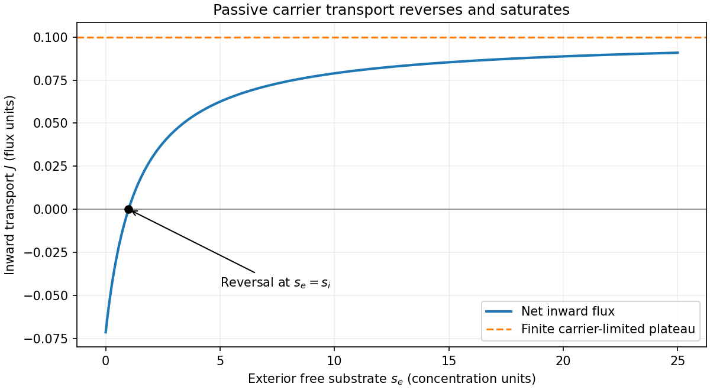

<h1 id="b/4/d/iv/solution">Solution</h1>

↑ **Parent:** [Iv](../iv.md)

The loaded-carrier balance gives $J=k(p_e-p_i)$. Substitute the preceding two complex [concentrations](../../../../../../concentration.md) and collect the current terms:

$$
J\left(1+\frac{2k}{k_-}+\frac{s_i}{K}\right)=\frac kK(s_e-s_i)c_e,
\qquad\boxed{J=\frac{kk_+(s_e-s_i)c_e}{2k+k_-+k_+s_i}.}
$$

Next carrier conservation gives

$$
c_0=\frac{s_i+s_e+2K}{K}c_e+\frac Jk\left(1+\frac{s_i}K\right),
\qquad\boxed{c_e=\frac{c_0K-(J/k)(s_i+K)}{s_i+s_e+2K}.}
$$

Eliminate $c_e$ between these relations and set $K_d=k/k_+$. Simplification yields

$$
\boxed{J=\frac{K_dKk_+c_0}{2}\frac{s_e-s_i}{(s_i+K+K_d)(s_e+K+K_d)-K_d^2}.}
$$

Here $c_0$ must be the **total [carrier protein](../../../../../../carrier-protein.md)**, as in the conservation [equation](../../../../../../equation.md). Calling it total [substrate](../../../../../../substrate-biochemistry.md) in the final line of the scan is a typographical inconsistency; total [substrate](../../../../../../substrate-biochemistry.md) is the different invariant $s_0$.

For [carrier-turnover saturation of passive transport](../../../../../../carrier-turnover-saturation-of-passive-transport.md) at fixed $s_i$, write $A=s_i+K+K_d$, $D=A(K+K_d)-K_d^2>0$ and $C=K_dKk_+c_0/2>0$. Then $J=C(s_e-s_i)/(As_e+D)$, so

$$
J'=\frac{C(D+As_i)}{(As_e+D)^2}>0,\qquad J''=-\frac{2AC(D+As_i)}{(As_e+D)^3}<0,
$$

$$
\boxed{J(s_i)=0,\qquad \lim_{s_e\to\infty}J=\frac{K_dKk_+c_0}{2(s_i+K+K_d)}.}
$$

The [flux](../../../../../../flux.md) is outward when the [substrate](../../../../../../substrate-biochemistry.md) gradient is reversed and inward when $s_e>s_i$. Saturation occurs because there is a finite carrier population and finite binding-release/conformational turnover: arbitrarily abundant exterior [substrate](../../../../../../substrate-biochemistry.md) cannot make carriers cycle arbitrarily quickly. This is passive facilitated transport, so no maintained [flux](../../../../../../flux.md) remains when the two free [concentrations](../../../../../../concentration.md) agree. Varying $s_e$ at fixed $s_i$ compares reservoir-controlled steady states or systems with different total [substrate](../../../../../../substrate-biochemistry.md); it is not a trajectory preserving one fixed $s_0$.

**[Figure 1](#b/4/d/iv/image-carrier-mediated-transport-reversal-and-saturation-at-fixed-interior-concentration). Carrier-mediated transport: reversal and saturation at fixed interior concentration**.

## ↑ Ancestors (14)

1. [Iv](../iv.md)
2. [D](../../d.md)
3. [4](../../../4.md)
4. [B](../../../../b.md)
5. [2009](../../../../../2009-split.md)
6. [Past exam of the mathematics and the environment and mathematical physiology course of the University of Oxford](../../../../../split.md)
7. [Mathematics and the environment and mathematical physiology course of the University of Oxford](../../../../../../mathematics-and-the-environment-and-mathematical-physiology-course-of-the-university-of-oxford.md)
8. [Year 4 of the mathematics course of the University of Oxford](../../../../../../year-4-of-the-mathematics-course-of-the-university-of-oxford.md)
9. [Mathematics course of the University of Oxford](../../../../../../mathematics-course-of-the-university-of-oxford.md)
10. [Undergraduate course of the University of Oxford](../../../../../../undergraduate-course-of-the-university-of-oxford.md)
11. [Course of the University of Oxford](../../../../../../course-of-the-university-of-oxford.md)
12. [University of Oxford](../../../../../../university-of-oxford-split.md)
13. [List of universities](../../../../../../list-of-universities.md)
14. [Codex Wiki](../../../../../../split.md)
