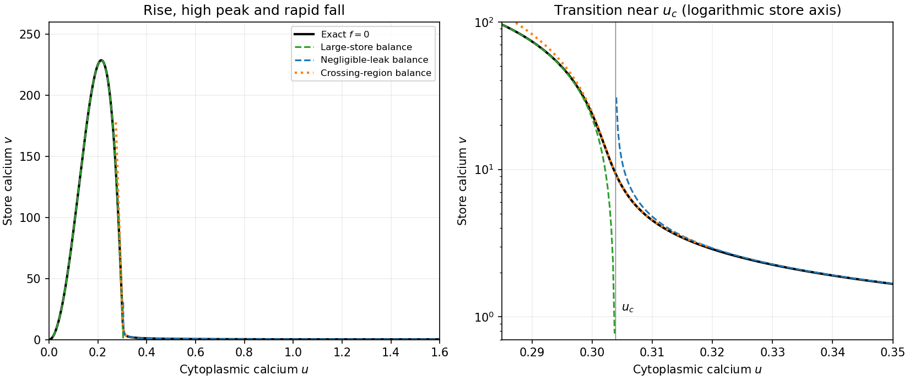

<h1 id="b/5/b/solution">Solution</h1>

↑ **Parent:** [B](../b.md)

For the [three-region calcium nullcline](../../../../../three-region-calcium-nullcline.md), define

$$
J(u)=\frac{\beta u^2}{1+u^2},\qquad K(u)=\frac{u^4}{1+u^4},\qquad f=J(u)-K(u)\frac{v^2}{1+v^2}-\delta v.
$$

For $u>0$, $f(u,0)>0$, $f\to-\infty$ as $v\to\infty$, and $f_v=-2K(u)v/(1+v^2)^2-\delta<0$. Thus there is **exactly one positive root $v=V(u)$ for every positive $u$**. The curve starts at the origin and initially satisfies $v\sim\beta u^2/\delta$.

For $0<\beta<1$, let $u_c>0$ solve $J(u_c)=K(u_c)$ and put $K_c=K(u_c)$, $J_c'=J'(u_c)$, $K_c'=K'(u_c)$. Explicitly, with $z_c=u_c^2$,

$$
z_c=\frac{-1+\sqrt{1+4\beta(1-\beta)}}{2(1-\beta)},\qquad J'(u)=\frac{2\beta u}{(1+u^2)^2},\quad K'(u)=\frac{4u^3}{(1+u^4)^2}.
$$

In particular $u_c\sim\sqrt\beta$ and $K_c'-J_c'>0$ for small $\beta$.

On the large-$v$ branch away from the crossing, replace $v^2/(1+v^2)$ by one. This gives $v\sim[J(u)-K(u)]/\delta$ where this is large and positive. Near $u_c$ retain the next term $1-v^{-2}$ and linearize $J-K$:

$$
0\simeq-(K_c'-J_c')(u-u_c)+K_c/v^2-\delta v,
\qquad\boxed{u-u_c\simeq\frac{K_c/v^2-\delta v}{K_c'-J_c'}.}
$$

Finally where the leak is negligible compared with the other terms, $v^2/(1+v^2)\simeq J(u)/K(u)$, so $v\simeq[J/(K-J)]^{1/2}$ on the side $J<K$. These are overlapping asymptotic descriptions with different validity ranges, not three exact disconnected curves. The curve rises to a large peak, falls sharply near $u_c$, then approaches a small finite level as $u\to\infty$. At leading small-$\delta$ order that last level is $[\beta/(1-\beta)]^{1/2}$.

**[Figure 2](#b/5/b/image-calcium-nullcline-and-its-three-asymptotic-regions-full-curve-and-transition-zoom). Calcium nullcline and its three asymptotic regions; full curve and transition zoom**.

## ↑ Ancestors (13)

1. [B](../b.md)
2. [5](../../5.md)
3. [B](../../../b.md)
4. [2009](../../../../2009-split.md)
5. [Past exam of the mathematics and the environment and mathematical physiology course of the University of Oxford](../../../../split.md)
6. [Mathematics and the environment and mathematical physiology course of the University of Oxford](../../../../../mathematics-and-the-environment-and-mathematical-physiology-course-of-the-university-of-oxford.md)
7. [Year 4 of the mathematics course of the University of Oxford](../../../../../year-4-of-the-mathematics-course-of-the-university-of-oxford.md)
8. [Mathematics course of the University of Oxford](../../../../../mathematics-course-of-the-university-of-oxford.md)
9. [Undergraduate course of the University of Oxford](../../../../../undergraduate-course-of-the-university-of-oxford.md)
10. [Course of the University of Oxford](../../../../../course-of-the-university-of-oxford.md)
11. [University of Oxford](../../../../../university-of-oxford-split.md)
12. [List of universities](../../../../../list-of-universities.md)
13. [Codex Wiki](../../../../../split.md)
