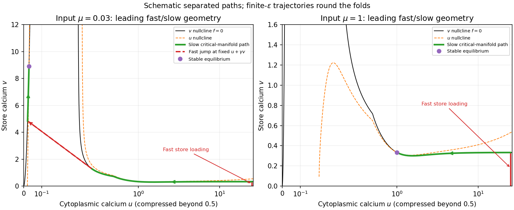

<h1 id="b/5/c/solution">Solution</h1>

↑ **Parent:** [C](../c.md)

At every [equilibrium](../../../../../equilibrium-point-of-a-dynamical-system.md) the store balance gives $f=0$, and adding $\gamma$ [times](../../../../../time-in-physics.md) that balance to the cytoplasmic one gives $u=\mu$. The unique-root result therefore gives a single positive [equilibrium](../../../../../equilibrium-point-of-a-dynamical-system.md) $(\mu,V(\mu))$. Its [Jacobian](../../../../../jacobian-matrix.md) is

$$
A=\begin{pmatrix}-1-\gamma f_u/\epsilon&-\gamma f_v/\epsilon\\f_u/\epsilon&f_v/\epsilon\end{pmatrix},\quad
\boxed{\det A=-f_v/\epsilon>0,\qquad\operatorname{tr}A=-1+(f_v-\gamma f_u)/\epsilon,}
$$

with [derivatives](../../../../../derivative.md) evaluated at that [equilibrium](../../../../../equilibrium-point-of-a-dynamical-system.md). At small $\mu$, $f_u>0$ and the [trace](../../../../../matrix-trace.md) is negative; sufficiently large $\mu$ also has $f_u>0$, since $J'$ is of order $u^{-3}$ and $K'$ of order $u^{-5}$. Thus **both extreme regimes have a [linearly stable](../../../../../linear-stability.md) unique [equilibrium](../../../../../equilibrium-point-of-a-dynamical-system.md)**.

The fast variable is not $v$ alone. Using [total-calcium fast fibres](../../../../../total-calcium-fast-fibres.md), introduce total scaled [calcium](../../../../../calcium.md) $w=u+\gamma v$. Then $\dot w=\mu-u$, while on fast [time](../../../../../time-in-physics.md) $\sigma=\tau/\epsilon$ the leading [equations](../../../../../equation.md) give $du/d\sigma=-\gamma f$, $dv/d\sigma=f$ and $w$ constant. [Fast paths](../../../../../total-calcium-fast-fibres.md) are therefore straight lines of slope $-1/\gamma$ in the $(u,v)$ plane. Attracting portions of the [critical manifold](../../../../../critical-manifold.md) satisfy $f_v-\gamma f_u<0$, rather than merely $f_v<0$. Along $v=V(u)$, slow motion obeys

$$
\boxed{\frac{du}{d\tau}=\frac{\mu-u}{1+\gamma V'(u)},\qquad V'=-f_u/f_v.}
$$

Starting with large $u$ and $v=0$, $f>0$ drives a rapid move upward and left, loading the store until the trajectory approaches the right attracting branch. For large $\mu$ in the right stable regime, slow motion on that branch carries it toward $u=\mu$; the direction reverses appropriately if the starting value lies below that [equilibrium](../../../../../equilibrium-point-of-a-dynamical-system.md). For sufficiently small $\mu$, slow motion travels left along the right branch until its fold, then a fast approximately constant-$w$ jump carries the trajectory to the left attracting branch. Subsequent slow motion reaches the small-$u$ [equilibrium](../../../../../equilibrium-point-of-a-dynamical-system.md). At a fold the slow approximation is singular, so the full [equations](../../../../../equation.md) resolve the transition. At very small $u$ an additional loss of time-scale separation is possible because the rates themselves vanish; the fast/slow drawing describes the separated portions, not a uniform estimate arbitrarily near the origin.

**[Figure 3](#b/5/c/image-calcium-phase-plane-leading-fast-jumps-and-slow-relaxation-for-small-and-large-input). Calcium phase plane: leading fast jumps and slow relaxation for small and large input**.

## ↑ Ancestors (13)

1. [C](../c.md)
2. [5](../../5.md)
3. [B](../../../b.md)
4. [2009](../../../../2009-split.md)
5. [Past exam of the mathematics and the environment and mathematical physiology course of the University of Oxford](../../../../split.md)
6. [Mathematics and the environment and mathematical physiology course of the University of Oxford](../../../../../mathematics-and-the-environment-and-mathematical-physiology-course-of-the-university-of-oxford.md)
7. [Year 4 of the mathematics course of the University of Oxford](../../../../../year-4-of-the-mathematics-course-of-the-university-of-oxford.md)
8. [Mathematics course of the University of Oxford](../../../../../mathematics-course-of-the-university-of-oxford.md)
9. [Undergraduate course of the University of Oxford](../../../../../undergraduate-course-of-the-university-of-oxford.md)
10. [Course of the University of Oxford](../../../../../course-of-the-university-of-oxford.md)
11. [University of Oxford](../../../../../university-of-oxford-split.md)
12. [List of universities](../../../../../list-of-universities.md)
13. [Codex Wiki](../../../../../split.md)
