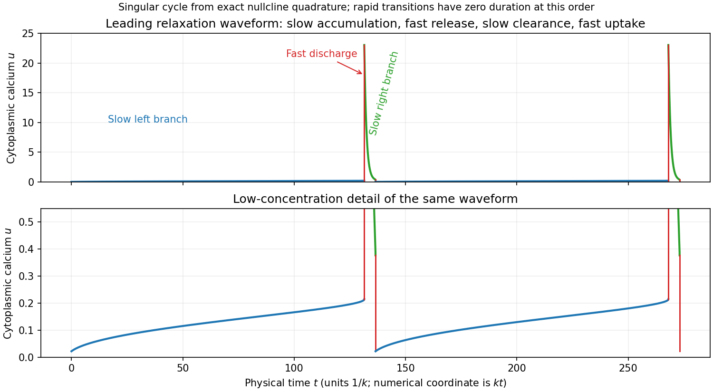

<h1 id="b/5/e/solution">Solution</h1>

↑ **Parent:** [E](../e.md)

In a relaxation cycle, cytoplasmic [calcium](../../../../../calcium.md) rises slowly on the left attracting branch while total [calcium](../../../../../calcium.md) is accumulated, then rises rapidly during store discharge along a constant-$w$ [fast path](../../../../../total-calcium-fast-fibres.md) to the right branch. It subsequently decreases on the right slow branch as extrusion dominates input, and finally drops rapidly during store uptake back to the left branch. The result is **a repeated pulse with slow sections joined by sharp transitions**, rather than a sinusoid except near a small-amplitude [Hopf bifurcation](../../../../../hopf-bifurcation.md).

For explicit [time](../../../../../time-in-physics.md) labelling, the compatible scaling $u=c/K_1$, $v=c_s/K_2$ gives $\tau=kt$, $\gamma=K_2/K_1$, $\epsilon=kK_2/V_2$, $\mu=r/(kK_1)$, $\beta=V_1/V_2$ and $\delta=k_sK_2/V_2$. Hence an interval $\Delta\tau$ corresponds to physical duration $\Delta t=\Delta\tau/k$. Slow-branch [times](../../../../../time-in-physics.md) can be computed by integrating

$$
\Delta\tau=\int\frac{1+\gamma V'(u)}{\mu-u}\,du
$$

in the direction of motion; fast-jump durations are omitted at leading order. The plot uses that [quadrature](../../../../../phase-quadrature.md), with vertical lines representing the limiting rapid transitions. Finite $\epsilon$ rounds those lines and changes the precise [amplitude](../../../../../wave-amplitude.md) and [period](../../../../../period-of-a-function.md), especially near folds.

**[Figure 4](#b/5/e/image-leading-relaxation-waveform-of-cytoplasmic-calcium-with-physical-time-measured-in-inverse-extrusion-rate-units). Leading relaxation waveform of cytoplasmic calcium, with physical time measured in inverse-extrusion-rate units**.

## ↑ Ancestors (13)

1. [E](../e.md)
2. [5](../../5.md)
3. [B](../../../b.md)
4. [2009](../../../../2009-split.md)
5. [Past exam of the mathematics and the environment and mathematical physiology course of the University of Oxford](../../../../split.md)
6. [Mathematics and the environment and mathematical physiology course of the University of Oxford](../../../../../mathematics-and-the-environment-and-mathematical-physiology-course-of-the-university-of-oxford.md)
7. [Year 4 of the mathematics course of the University of Oxford](../../../../../year-4-of-the-mathematics-course-of-the-university-of-oxford.md)
8. [Mathematics course of the University of Oxford](../../../../../mathematics-course-of-the-university-of-oxford.md)
9. [Undergraduate course of the University of Oxford](../../../../../undergraduate-course-of-the-university-of-oxford.md)
10. [Course of the University of Oxford](../../../../../course-of-the-university-of-oxford.md)
11. [University of Oxford](../../../../../university-of-oxford-split.md)
12. [List of universities](../../../../../list-of-universities.md)
13. [Codex Wiki](../../../../../split.md)
