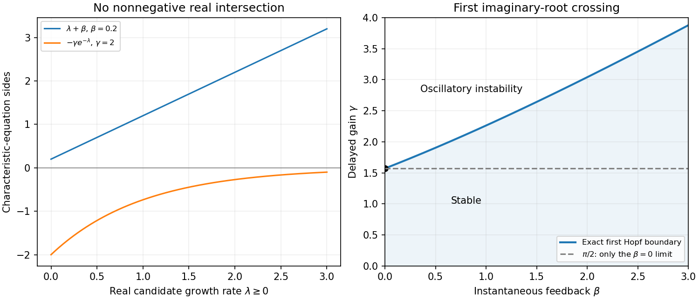

<h1 id="b/6/d/iii/solution">Solution</h1>

↑ **Parent:** [Iii](../iii.md)

For real $\lambda\ge0$, draw $y=\lambda+\beta$ and $y=-\gamma e^{-\lambda}$. The first is nonnegative and increasing, while the second is negative and approaches zero from below. They cannot intersect on the nonnegative real axis. At zero the [characteristic](../../../../../../characteristic-of-a-field.md) [function](../../../../../../function-split.md) equals $\beta+\gamma>0$, so a stationary zero-root crossing is excluded as well.

Consequently a loss of stability from a stable regime cannot occur by a real [eigenvalue](../../../../../../eigenvalue.md) crossing through zero. It must involve a [conjugate pair](../../../../../../complex-conjugate.md) crossing the [imaginary axis](../../../../../../imaginary-axis.md) at nonzero [frequency](../../../../../../frequency.md), yielding **oscillatory instability**. This does not mean that every [characteristic](../../../../../../characteristic-of-a-field.md) root is nonreal: negative real roots may exist and are harmless for stability. The graph and imaginary-axis conditions are shown together below.

**[Figure 5](#b/6/d/iii/image-respiratory-delay-feedback-no-growing-real-root-and-the-exact-first-oscillatory-threshold). Respiratory delay feedback: no growing real root and the exact first oscillatory threshold**.

## ↑ Ancestors (14)

1. [Iii](../iii.md)
2. [D](../../d.md)
3. [6](../../../6.md)
4. [B](../../../../b.md)
5. [2009](../../../../../2009-split.md)
6. [Past exam of the mathematics and the environment and mathematical physiology course of the University of Oxford](../../../../../split.md)
7. [Mathematics and the environment and mathematical physiology course of the University of Oxford](../../../../../../mathematics-and-the-environment-and-mathematical-physiology-course-of-the-university-of-oxford.md)
8. [Year 4 of the mathematics course of the University of Oxford](../../../../../../year-4-of-the-mathematics-course-of-the-university-of-oxford.md)
9. [Mathematics course of the University of Oxford](../../../../../../mathematics-course-of-the-university-of-oxford.md)
10. [Undergraduate course of the University of Oxford](../../../../../../undergraduate-course-of-the-university-of-oxford.md)
11. [Course of the University of Oxford](../../../../../../course-of-the-university-of-oxford.md)
12. [University of Oxford](../../../../../../university-of-oxford-split.md)
13. [List of universities](../../../../../../list-of-universities.md)
14. [Codex Wiki](../../../../../../split.md)
