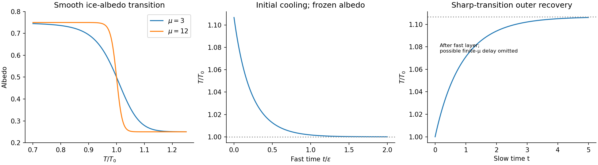
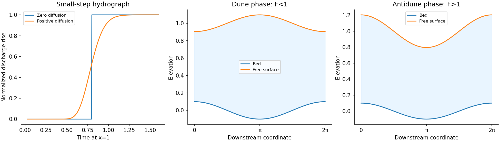
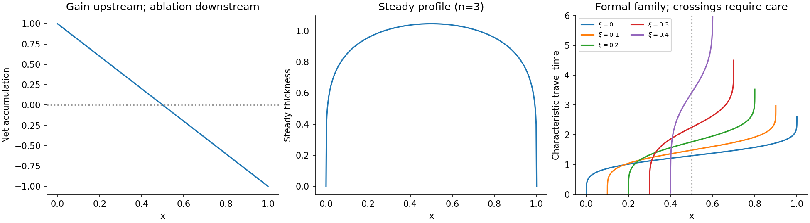
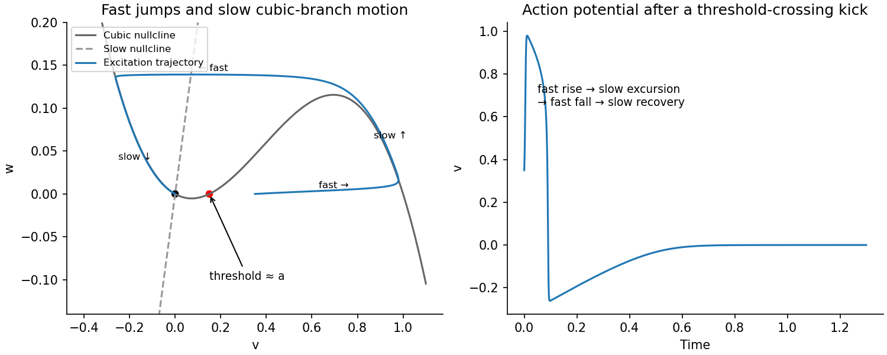
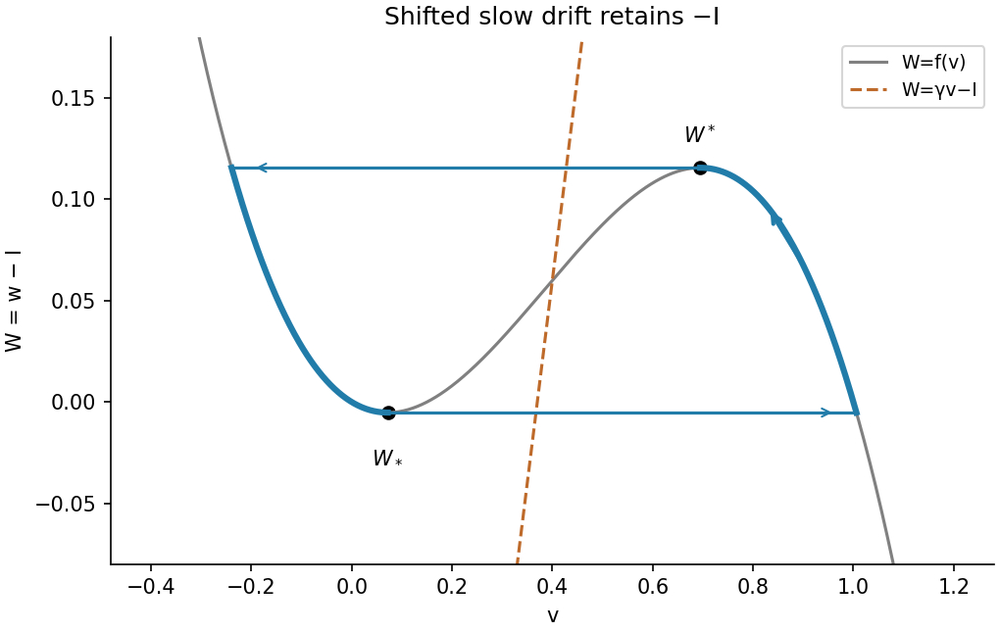
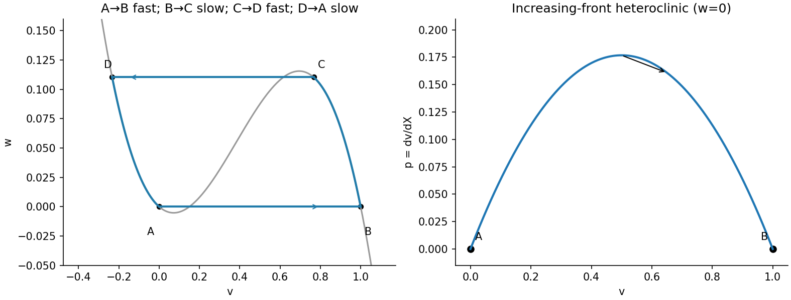

# 2010

↑ **Parent:** [Past exam of the mathematics and the environment and mathematical physiology course of the University of Oxford](../past-exam-of-the-mathematics-and-the-environment-and-mathematical-physiology-course-of-the-university-of-oxford.md)

This combined [University of Oxford](../university-of-oxford.md) Part C paper covers Mathematics and the Environment in section A and Mathematical Physiology in section B. The original archive transcription retains all seven printed pages and formal identifiers. [Source release](https://www.whatdotheyknow.com/request/maths_past_papers_3) Bounded official-source searches found no advertised answers for this exact paper. The solutions distinguish valid asymptotic conclusions from the printed claims that require additional assumptions.

**Table of contents**

- [A](#a)
  - [1](#a/1)
    - [i](#a/1/i)
      - [Solution](#a/1/i/solution)
    - [ii](#a/1/ii)
      - [Solution](#a/1/ii/solution)
    - [iii](#a/1/iii)
      - [Solution](#a/1/iii/solution)
    - [iv](#a/1/iv)
      - [Solution](#a/1/iv/solution)
  - [2](#a/2)
    - [i](#a/2/i)
      - [Solution](#a/2/i/solution)
    - [ii](#a/2/ii)
      - [Solution](#a/2/ii/solution)
    - [iii](#a/2/iii)
      - [Solution](#a/2/iii/solution)
    - [iv](#a/2/iv)
      - [Solution](#a/2/iv/solution)
    - [v](#a/2/v)
      - [Solution](#a/2/v/solution)
  - [3](#a/3)
    - [i](#a/3/i)
      - [Solution](#a/3/i/solution)
    - [ii](#a/3/ii)
      - [Solution](#a/3/ii/solution)
    - [iii](#a/3/iii)
      - [Solution](#a/3/iii/solution)
    - [iv](#a/3/iv)
      - [Solution](#a/3/iv/solution)
    - [v](#a/3/v)
      - [Solution](#a/3/v/solution)
- [B](#b)
  - [4](#b/4)
    - [a](#b/4/a)
      - [Solution](#b/4/a/solution)
    - [b](#b/4/b)
      - [Solution](#b/4/b/solution)
    - [c](#b/4/c)
      - [Solution](#b/4/c/solution)
    - [d](#b/4/d)
      - [Solution](#b/4/d/solution)
    - [e](#b/4/e)
      - [Solution](#b/4/e/solution)
    - [f](#b/4/f)
      - [Solution](#b/4/f/solution)
  - [5](#b/5)
    - [a](#b/5/a)
      - [Solution](#b/5/a/solution)
    - [b](#b/5/b)
      - [Solution](#b/5/b/solution)
    - [c](#b/5/c)
      - [i](#b/5/c/i)
        - [Solution](#b/5/c/i/solution)
      - [ii](#b/5/c/ii)
        - [Solution](#b/5/c/ii/solution)
      - [iii](#b/5/c/iii)
        - [Solution](#b/5/c/iii/solution)
  - [6](#b/6)
    - [a](#b/6/a)
      - [Solution](#b/6/a/solution)
    - [b](#b/6/b)
      - [Solution](#b/6/b/solution)
    - [c](#b/6/c)
      - [Solution](#b/6/c/solution)
    - [d](#b/6/d)
      - [Solution](#b/6/d/solution)

## A

↑ **Parent:** [2010](2010.md)

<h3 id="a/1">1</h3>

↑ **Parent:** [A](#a)

<h4 id="a/1/i">i</h4>

↑ **Parent:** [1](#a/1)

<h5 id="a/1/i/solution">Solution</h5>

↑ **Parent:** [I](#a/1/i)

The [heat capacity](../heat.md#heat-capacity) per unit horizontal [area](../differential-geometry.md#surface-area) is $C=\rho c_pd$: [mass density](../fluid-mechanics.md#density) times [specific heat capacity](../heat.md#specific-heat-capacity) times atmospheric depth. Thus $C\dot T$ is the rate of stored [thermal energy](../thermodynamics.md#thermal-energy) per unit [area](../differential-geometry.md#surface-area). The [solar constant](../geophysics.md#solar-constant) $Q$ is the incident [radiative flux](../astrophysics.md#radiative-flux) on a surface normal to sunlight; the ratio of the Earth's intercepting disk [area](../differential-geometry.md#surface-area) to its spherical [area](../differential-geometry.md#surface-area) is $1/4$. The absorbed fraction is $1-a$, where [albedo](../geophysics.md#albedo) $a$ is the reflected fraction. The outgoing [radiative flux](../astrophysics.md#radiative-flux) is $\sigma\gamma T^4$, a [Stefan–Boltzmann law](../heat.md#stefan-boltzmann-law) with effective radiation factor $\gamma$ incorporating the simplified [greenhouse effect](../exoplanet.md#greenhouse-effect). Every term therefore has units of [power](../energy.md#power) per [area](../differential-geometry.md#surface-area).

The [albedo](../geophysics.md#albedo) curve decreases smoothly, passes through $(T_0,1/2)$, and approaches $1/4$ at high [temperature](../temperature.md). At $T=0$ it is $(2+\tanh\mu)/4$, close to $3/4$ when $\mu$ is large. Its [derivative](../calculus.md#derivative) is

$$
a_0'(T)=-\frac{\mu T^3}{T_0^4}\operatorname{sech}^2\!\left[\mu(T^4/T_0^4-1)\right]\leq0.
$$

An ice-covered planet reflects more sunlight than exposed land or ocean. Warming removes reflective [ice](../chemical-substance.md#ice), lowers [albedo](../geophysics.md#albedo), and increases absorbed [radiative flux](../astrophysics.md#radiative-flux): this is [ice-albedo feedback](../geophysics.md#ice-albedo-feedback). The parameter $\mu$ controls the sharpness of this transition; the formula is an idealized global response, rather than a local melting law.

**[Figure 1](#a/1/i/image-temperature-dependent-albedo-and-the-separated-fast-cooling-and-slow-recovery). Temperature-dependent albedo and the separated fast cooling and slow recovery**.

<h4 id="a/1/ii">ii</h4>

↑ **Parent:** [1](#a/1)

<h5 id="a/1/ii/solution">Solution</h5>

↑ **Parent:** [Ii](#a/1/ii)

Set $x=T^4/T_0^4-1$. Since $\sigma\gamma T_0^4=Q/8$, the [steady state](../dynamical-systems.md#steady-state) [energy balance](../mathematical-physics.md#energy-balance) is $2(1-a_0)=1+x$. Substitution gives

$$
\boxed{\tanh(\mu x)=2x.}
$$

The two sides have slopes $\mu$ and $2$ at the origin. For $x>0$, $\tanh(\mu x)$ is strictly [concave](../real-analysis.md#concave-function), its initial slope is $\mu$, and it remains below $1$. Consequently no positive root exists for $\mu\leq2$, while for $\mu>2$ there is exactly one positive root $x_+\in(0,1/2)$. Oddness supplies the corresponding negative root. At $\mu=2$ the only root is still zero. Hence **multiple steady temperatures occur precisely when $\mu>\mu_c=2$**.

The largest root corresponds monotonically to the largest positive absolute [temperature](../temperature.md):

$$
\boxed{T_+=T_0(1+x_+)^{1/4},\qquad a_+=\frac{1-x_+}{2}.}
$$

For large $\mu$, the positive root tends to $1/2$, so $a_+\simeq1/4$ and $T_+/T_0\simeq(3/2)^{1/4}$. The negative branch has larger [albedo](../geophysics.md#albedo) and lower [temperature](../temperature.md).

<h4 id="a/1/iii">iii</h4>

↑ **Parent:** [1](#a/1)

<h5 id="a/1/iii/solution">Solution</h5>

↑ **Parent:** [Iii](#a/1/iii)

Use dimensional quantities $T_d,t_d$ and set $T_d=T_0T$, $t_d=t_0t$. Dividing the [energy balance](../mathematical-physics.md#energy-balance) by $\sigma\gamma T_0^4$ and the [albedo](../geophysics.md#albedo) equation by its time scale gives

$$
\boxed{\varepsilon T_t=2(1-a)-T^4,\quad a_t=a^*(T)-a,\quad a^*(T)=\frac{2-\tanh[\mu(T^4-1)]}{4},\quad \varepsilon=\frac{\rho c_pd}{t_0\sigma\gamma T_0^3}=\frac{8\rho c_pdT_0}{Qt_0}.}
$$

Thus $\varepsilon$ is the ratio of the atmospheric thermal response time to the much longer [albedo](../geophysics.md#albedo) response time. Converting kilometres to metres and years to seconds gives $C=10^7\ \mathrm{J\,m^{-2}K^{-1}}$, $T_0\simeq266.3\ \mathrm K$, $t_0\simeq3.156\times10^{10}\ \mathrm s$, and

$$
\boxed{\varepsilon\simeq4.93\times10^{-4}.}
$$

The thermal time is about half a year, compared with a millennium for [albedo](../geophysics.md#albedo) adjustment. This is a [singular perturbation](../singular-perturbation.md): setting $\varepsilon=0$ removes the independent [initial condition](../differential-equation.md#initial-condition) for [temperature](../temperature.md).

<h4 id="a/1/iv">iv</h4>

↑ **Parent:** [1](#a/1)

<h5 id="a/1/iv/solution">Solution</h5>

↑ **Parent:** [Iv](#a/1/iv)

Initially $a=1/2$ and $T=T_+/T_0>1$, so $\varepsilon T_t=1-T^4<0$. On the fast time $s=t/\varepsilon$, [albedo](../geophysics.md#albedo) changes by only $O(\varepsilon)$ and

$$
T_s=1-T^4,\qquad T(0)=T_+/T_0.
$$

Thus [temperature](../temperature.md) rapidly falls towards $1$. At the same time $a_t=a^*(T)-1/2<0$ while $T>1$, which seeds selection of the warm branch. Afterwards the approximate [slow manifold](../singular-perturbation.md#slow-manifold) is $T^4=2(1-a)$: decreasing [albedo](../geophysics.md#albedo) makes [temperature](../temperature.md) rise slowly back towards $T_+/T_0$. The preceding figure separates these two time scales; a single time axis would compress the initial fall into a nearly vertical segment.

In the sharp-transition regime, after selection of the warm branch $a^*(T)\simeq1/4$. Solving the linear [ordinary differential equation](../differential-equation.md#ordinary-differential-equation) with the leading matched value $a(0^+)=1/2$ gives

$$
\boxed{a(t)\simeq\frac14+\frac14e^{-t},\qquad T(t)\simeq\left(\frac{3-e^{-t}}2\right)^{1/4}.}
$$

These are [outer solutions](../singular-perturbation.md#outer-expansion): their initial [temperature](../temperature.md) is $1$, so the fast cooling layer is required to satisfy the actual initial [temperature](../temperature.md).

There is a useful qualification to the two-limit argument. For fixed finite $\mu>2$, put $x=1-2a$ on the [slow manifold](../singular-perturbation.md#slow-manifold). Then $x_t=-x+\tfrac12\tanh(\mu x)$, and $x=0$ is an unstable [equilibrium](../dynamical-systems.md#equilibrium-point-of-a-dynamical-system) with growth rate $\mu/2-1$. The small positive $O(\varepsilon)$ seed from the fast layer can therefore produce a delay of order $\log(1/\varepsilon)/(\mu/2-1)$. The simple exponential approximation assumes that the sharp [albedo](../geophysics.md#albedo) transition is sufficiently fast to make this delay negligible on the displayed slow scale. It is not a uniform approximation for every fixed $\mu>2$ as $\varepsilon\to0$.

<h3 id="a/2">2</h3>

↑ **Parent:** [A](#a)

<h4 id="a/2/i">i</h4>

↑ **Parent:** [2](#a/2)

<h5 id="a/2/i/solution">Solution</h5>

↑ **Parent:** [I](#a/2/i)

Assume constant [mass density](../fluid-mechanics.md#density), a prismatic channel, approximately uniform cross-sectional [velocity](../classical-mechanics.md#velocity) $u$, a [hydrostatic pressure](../fluid-mechanics.md#hydrostatic-pressure) distribution, small bed slope $S$, and no lateral inflow. Integrating [mass conservation](../continuum-mechanics.md#mass-conservation) over a slice of length $dx$ gives $\rho A_tdx=\rho Au|_x-\rho Au|_{x+dx}$, hence $A_t+(Au)_x=0$.

Let $I(A)=\int_A(H-z)\,dA$ be the hydrostatic first moment, where $H$ is the actual free-surface depth. The downstream [momentum](../momentum.md) balance is

$$
(Au)_t+(Au^2+gI)_x=gAS-\frac{\tau\ell}{\rho}.
$$

Using $A_t+(Au)_x=0$ reduces its left side to $A(u_t+uu_x)+gI_x$. For a fixed prismatic cross-section, $dI/dH=A$, so $I_x/A=H_x$. Therefore the exact depth-averaged result is

$$
\boxed{u_t+uu_x=gS-\frac{\tau}{\rho R}-gH_x,\qquad R=A/\ell.}
$$

Here [hydraulic radius](../fluid-mechanics.md#hydraulic-radius) converts perimeter [shear stress](../viscous-fluid-flow.md#shear-stress) into [force](../force.md) per unit fluid volume. The printed notation $\bar h$ yields the requested equation if it denotes this hydraulic [pressure](../pressure.md) head, whose [derivative](../calculus.md#derivative) equals $H_x$.

**The geometrical definition printed in the next part needs care.** [Triangular-channel hydrostatic pressure head](../fluid-mechanics.md#triangular-channel-hydrostatic-pressure-head) gives the factor explicitly. For the stated symmetric triangular notch, the actual depth is $H=(\ell/2)\sin\theta$, whereas its printed $\bar h=(\ell/4)\sin\theta$ is $H/2$. Indeed $A=H^2\cot\theta$ and $I=AH/3$, giving $I_x/A=H_x=2\bar h_x$. Thus the equation with precisely the printed geometrical $\bar h$ has [pressure](../pressure.md) term $-2g\bar h_x$. A first-principles derivation cannot remove that factor. The subsequent intended scaling can be carried out algebraically using the printed convention, as below, or with the [pressure](../pressure.md) scale doubled for the actual triangular channel.

<h4 id="a/2/ii">ii</h4>

↑ **Parent:** [2](#a/2)

<h5 id="a/2/ii/solution">Solution</h5>

↑ **Parent:** [Ii](#a/2/ii)

Write $R=k_R\sqrt A$, $\bar h=k_H\sqrt A$, where the given geometry gives

$$
k_R=\tfrac12\sqrt{\sin\theta\cos\theta},\qquad k_H=\tfrac12\sqrt{\tan\theta}.
$$

Take a [Chézy drag law](../fluid-mechanics.md#chezy-drag-law) $\tau=\rho c_du|u|$ and restrict to downstream flow $u>0$. Choose an [area](../differential-geometry.md#surface-area) scale $A_0$, length scale $L$, and speed scale $U_0$ satisfying

$$
U_0^2=\frac{gSk_R\sqrt{A_0}}{c_d},\qquad t_0=L/U_0.
$$

This makes gravitational driving and drag equal in the reference uniform [steady flow](../fluid-mechanics.md#steady-flow). Dividing the printed [momentum](../momentum.md) equation by $gS$ gives

$$
\boxed{\epsilon F(u_t+uu_x)=1-\frac{u^2}{\sqrt A}-\epsilon(\sqrt A)_x,\quad \epsilon=\frac{k_H\sqrt{A_0}}{SL},\quad F=\frac{U_0^2}{gk_H\sqrt{A_0}}.}
$$

[Mass conservation](../continuum-mechanics.md#mass-conservation) retains $A_t+(Au)_x=0$. In this notation $F$ is the square of the velocity-to-gravity-wave-speed ratio based on the chosen depth scale; authors sometimes instead denote its square root by [Froude number](../reduced-gravity.md#froude-number). If the actual triangular [pressure](../pressure.md) head from the preceding solution is used, replace $k_H$ by $2k_H$ in both parameter definitions. The displayed dimensionless form remains the same, with consistently redefined parameters.

<h4 id="a/2/iii">iii</h4>

↑ **Parent:** [2](#a/2)

<h5 id="a/2/iii/solution">Solution</h5>

↑ **Parent:** [Iii](#a/2/iii)

First neglect [inertia](../classical-mechanics.md#inertia) relative to the $O(\epsilon)$ [pressure](../pressure.md) correction, requiring $F\ll1$ for smooth fields on these scales. The positive [velocity](../classical-mechanics.md#velocity) is

$$
u=A^{1/4}\bigl[1-\epsilon(\sqrt A)_x\bigr]^{1/2}=A^{1/4}-\frac\epsilon4A^{-1/4}A_x+O(\epsilon^2).
$$

Multiplying by [area](../differential-geometry.md#surface-area) gives the [discharge](../fluid-mechanics.md#discharge) $Q=A^{5/4}-(\epsilon/4)A^{3/4}A_x+O(\epsilon^2)$. Hence

$$
\boxed{A_t+(A^{5/4})_x=\frac\epsilon4\bigl(A^{3/4}A_x\bigr)_x.}
$$

The leading equation is a nonlinear [kinematic wave](../transport-equation.md#kinematic-wave) equation. The [pressure](../pressure.md) correction has positive [diffusion coefficient](../brownian-motion.md#diffusion-coefficient) for $A>0$ and smooths steep gradients. Dropped terms are $O(\epsilon^2)$ and inertial terms $O(\epsilon F)$ on the assumed scales; sufficiently thin fronts require a separate balance rather than an unrestricted [Taylor expansion](../calculus.md#taylor-expansion).

<h4 id="a/2/iv">iv</h4>

↑ **Parent:** [2](#a/2)

<h5 id="a/2/iv/solution">Solution</h5>

↑ **Parent:** [Iv](#a/2/iv)

Let the original [area](../differential-geometry.md#surface-area) be $A_0>0$ and the increased upstream [area](../differential-geometry.md#surface-area) be $A_1>A_0$. At $\epsilon=0$, the [conservation law flux](../transport-equation.md#conservation-law-flux) $q(A)=A^{5/4}$ is strictly [convex](../real-analysis.md#convex-function). [Characteristics](../algebra.md#characteristic-of-a-field) behind the increase travel faster than those ahead, forming an admissible [shock wave](../transport-equation.md#shock-wave). [Rankine-Hugoniot conditions](../transport-equation.md#rankine-hugoniot-conditions) give its speed

$$
c_s=\frac{A_1^{5/4}-A_0^{5/4}}{A_1-A_0}.
$$

At $x=1$ the idealized [hydrograph](../fluid-mechanics.md#hydrograph) jumps from $Q_0=A_0^{5/4}$ to $Q_1=A_1^{5/4}$ at $t=1/c_s$. With positive $\epsilon$, the [diffusion](../thermodynamics.md#diffusion) term spreads the rise over a finite interval. The [hydrograph](../fluid-mechanics.md#hydrograph) is rounded, with an earlier small response and a later approach to the new [discharge](../fluid-mechanics.md#discharge), rather than an instantaneous jump.

The physical cause is the longitudinal [pressure gradient](../fluid-mechanics.md#pressure-gradient): a local increase in depth influences neighbouring sections and redistributes [water](../chemical-substance.md#water) before pure downstream transport would deliver a discontinuity. For a small increase, [linearization](../algebra.md#linearization) about $A_0$ has speed $c=\tfrac54A_0^{1/4}$ and [diffusivity](../brownian-motion.md#diffusion-coefficient) $D=\epsilon A_0^{3/4}/4$. The smooth curve in the figure is the exact half-line step response for this linearized [advection-diffusion equation](../diffusion-equation.md#advection-diffusion-equation); it illustrates the shape without claiming to solve a large nonlinear jump exactly.

**[Figure 2](#a/2/iv/image-sharp-and-diffused-downstream-hydrographs-with-subcritical-and-supercritical-bed-surface-phases). Sharp and diffused downstream hydrographs, with subcritical and supercritical bed-surface phases**.

<h4 id="a/2/v">v</h4>

↑ **Parent:** [2](#a/2)

<h5 id="a/2/v/solution">Solution</h5>

↑ **Parent:** [V](#a/2/v)

The [water](../chemical-substance.md#water) [mass conservation](../continuum-mechanics.md#mass-conservation) equation inherited from the earlier model is $\epsilon h_t+(hu)_x=0$. It is essential: without it the printed displayed equations are not closed. Take the slow bed branch $\epsilon=0$, and perturb the uniform state by $h=1+\hat h e^{\lambda t+ikx}$, $u=1+Ue^{\lambda t+ikx}$, $c=1+Ce^{\lambda t+ikx}$, $s=Se^{\lambda t+ikx}$ and $\eta=1+\hat\eta e^{\lambda t+ikx}$. For $k\ne0$, [mass conservation](../continuum-mechanics.md#mass-conservation) gives $\hat h=-U$ and $\hat\eta=S-U$.

Put $m=E^{*\prime}(1)+1$; the extra $1$ comes from linearizing $c/u$. The linearized [momentum](../momentum.md) and suspended-sediment equations are

$$
[3\delta+ik(F^2-1)]U=-ikS,\qquad (1+ik)C=mU,\qquad \lambda S=-mU+C.
$$

Eliminating $U,C$ gives the [dispersion relation](../dispersion-relation.md)

$$
\boxed{\lambda=-\frac{m k^2}{(1+ik)[3\delta+ik(F^2-1)]}.}
$$

Away from $F=1$, for fixed nonzero $k$ and negligible $\delta$,

$$
\operatorname{Re}\lambda=\frac{m k^2}{(F^2-1)(1+k^2)},\qquad \frac{\hat\eta}{S}=\frac{F^2}{F^2-1}.
$$

Thus growth requires $m/(F^2-1)>0$. For $F>1$, any $E^{*\prime}(1)>-1$ gives an unstable branch; for $F<1$ growth would require $E^{*\prime}(1)<-1$. A physically increasing erosion [function](../function.md) therefore gives the supercritical instability in this simplified model, rather than proving growth of ordinary subcritical dunes. Retaining drag gives

$$
\operatorname{Re}\lambda=\frac{m k^2[k^2(F^2-1)-3\delta]}{|(1+ik)[3\delta+ik(F^2-1)]|^2},
$$

which shows its stabilizing correction and the need to reconsider the limit near critical flow.

The negative bed-to-surface ratio for [subcritical flow](../reduced-gravity.md#subcritical-flow) means bed crests lie beneath surface troughs: the [dune](../fluid-mechanics.md#dune) phase relation. Its positive sign for [supercritical flow](../reduced-gravity.md#supercritical-flow) gives aligned crests: an [antidune](../fluid-mechanics.md#antidune). In the unstable supercritical case the imaginary part gives upstream migration, since $-\operatorname{Im}\lambda/k=-m/[(F^2-1)(1+k^2)]$. The figure shows these two phase relations. They identify the bedforms but do not by themselves establish growth. The qualitative limitation of the suspended-sediment mechanism is also discussed in the official [Mathematical Geoscience notes, pages 41–42](https://people.maths.ox.ac.uk/hewitt/publications/C5_11_notes.pdf).

<h3 id="a/3">3</h3>

↑ **Parent:** [A](#a)

<h4 id="a/3/i">i</h4>

↑ **Parent:** [3](#a/3)

<h5 id="a/3/i/solution">Solution</h5>

↑ **Parent:** [I](#a/3/i)

Resolve [gravity](../physics.md#gravity) into components $g\sin\alpha$ down the bed and $-g\cos\alpha$ normal to it. For slow [incompressible flow](../fluid-mechanics.md#incompressible-flow), [inertia](../classical-mechanics.md#inertia) is negligible and [Cauchy momentum equation](../continuum-mechanics.md#cauchy-momentum-equation) reduces to the divergence of the [stress tensor](../continuum-mechanics.md#cauchy-stress-tensor) plus the gravitational [force density](../force.md#force-density) being zero. Write the dominant shear component as $\tau=\sigma_{xz}$ and the leading normal stresses as $-p$.

The [shallow-ice approximation](../geophysics.md#shallow-ice-approximation) assumes a small thickness-to-length ratio. Vertical variation of the shear is retained in the along-bed equation, while longitudinal deviatoric-stress gradients and the shear contribution to the normal equation are higher order. The leading balances are consequently

$$
\boxed{-p_x+\tau_z+\rho g\sin\alpha=0,\qquad -p_z-\rho g\cos\alpha=0.}
$$

The second is a [hydrostatic pressure](../fluid-mechanics.md#hydrostatic-pressure) balance; the first balances gravitational driving and the surface-induced [pressure gradient](../fluid-mechanics.md#pressure-gradient) against vertical shear. This approximation requires shallow geometry and sufficiently slow flow, not a Newtonian [constitutive equation](../continuum-mechanics.md#constitutive-equation) for [ice](../chemical-substance.md#ice).

<h4 id="a/3/ii">ii</h4>

↑ **Parent:** [3](#a/3)

<h5 id="a/3/ii/solution">Solution</h5>

↑ **Parent:** [Ii](#a/3/ii)

Measure [pressure](../pressure.md) relative to atmospheric [pressure](../pressure.md). At leading order the stress-free upper surface gives $p(H)=0$, $\tau(H)=0$. Integrating the normal balance first yields

$$
p(x,z)=\rho g\cos\alpha[H(x,t)-z].
$$

At fixed $z$, $p_x=\rho g\cos\alpha H_x$. Therefore $\tau_z=\rho g(\cos\alpha H_x-\sin\alpha)$, independent of $z$. Integrating from $z$ to $H$ gives

$$
\boxed{\tau(x,z)=\rho g(\sin\alpha-\cos\alpha H_x)(H-z).}
$$

This is linear in $z$, is zero at the surface, and reaches its basal value at $z=0$. In particular the surface slope modifies the shear driving; a flat upper surface relative to the horizontal eliminates it in this approximation.

<h4 id="a/3/iii">iii</h4>

↑ **Parent:** [3](#a/3)

<h5 id="a/3/iii/solution">Solution</h5>

↑ **Parent:** [Iii](#a/3/iii)

Set $G=\rho g(\sin\alpha-\cos\alpha H_x)$. For downstream shear $G\geq0$, [Glen's flow law](../geophysics.md#glen-s-flow-law) and the [no-slip boundary condition](../viscous-fluid-flow.md#no-slip-boundary-condition) give

$$
u(x,z)=A G^n\int_0^z(H-z')^n\,dz'=\frac{AG^n}{n+1}[H^{n+1}-(H-z)^{n+1}].
$$

Here $A$ is the [ice](../chemical-substance.md#ice) rate factor, distinct from the cross-sectional [area](../differential-geometry.md#surface-area) in the river problem. Integrating this [velocity profile](../viscous-fluid-flow.md#velocity-profile) through the thickness gives the [volume flux](../fluid-mechanics.md#volumetric-flow-rate) per unit valley width:

$$
Q=\frac{AG^n}{n+1}\left[H^{n+2}-\frac{H^{n+2}}{n+2}\right]=\boxed{A(\rho g\sin\alpha)^n(1-\cot\alpha H_x)^n\frac{H^{n+2}}{n+2}.}
$$

The factor $H^{n+2}$ combines the depth-dependent [shear stress](../viscous-fluid-flow.md#shear-stress), integration to obtain [velocity](../classical-mechanics.md#velocity), and integration to obtain [flux](../mathematical-physics.md#flux). If reverse shear is admitted for noninteger $n$, the signed version of [Glen's flow law](../geophysics.md#glen-s-flow-law) is $u_z=A|\tau|^{n-1}\tau$; the displayed unsigned [power](../energy.md#power) presumes the downstream regime.

<h4 id="a/3/iv">iv</h4>

↑ **Parent:** [3](#a/3)

<h5 id="a/3/iv/solution">Solution</h5>

↑ **Parent:** [Iv](#a/3/iv)

A typical net [ice accumulation](../geophysics.md#ice-accumulation) curve decreases downstream: snow gain at high elevation, zero at the [equilibrium](../dynamical-systems.md#equilibrium-point-of-a-dynamical-system) line, and negative values in the [ice ablation](../geophysics.md#ice-ablation) zone. In a steady glacier with zero [volume flux](../fluid-mechanics.md#volumetric-flow-rate) at its head, $Q(x)=\int_0^xa(X)\,dX$. If its terminus also has zero [volume flux](../fluid-mechanics.md#volumetric-flow-rate), a natural glacier length $L$ is the positive root of $\int_0^La(X)\,dX=0$, with the integral positive between the endpoints. Such a root requires a suitable given accumulation profile; it is not guaranteed by [dimensional analysis](../mathematical-physics.md#dimensional-analysis) alone.

Let $a_0$ be a representative accumulation rate and $K=A(\rho g\sin\alpha)^n$. Choose

$$
H_*=\left(\frac{a_0L}{K}\right)^{1/(n+2)},\qquad Q_*=a_0L,\qquad t_*=H_*/a_0.
$$

Using $x=L\hat x$, $H=H_*\hat H$, $Q=Q_*\hat Q$, $t=t_*\hat t$, $a=a_0\hat a$, both terms in [mass conservation](../continuum-mechanics.md#mass-conservation) have scale $a_0$. The dimensionless [flux](../mathematical-physics.md#flux) is

$$
\hat Q=(1-\mu\hat H_{\hat x})^n\frac{\hat H^{n+2}}{n+2},\qquad\boxed{\mu=\frac{H_*\cot\alpha}{L}.}
$$

Dropping hats gives the required [partial differential equation](../partial-differential-equation.md). The parameter measures the surface-thickness slope correction relative to the bed slope. For the linear example $a=1-2x$, accumulation changes sign at $x=1/2$ and its integrated balance vanishes at $x=1$.

**[Figure 3](#a/3/iv/image-accumulation-the-steady-ice-profile-and-the-domain-of-formal-glacier-characteristics). Accumulation, the steady ice profile, and the domain of formal glacier characteristics**.

<h4 id="a/3/v">v</h4>

↑ **Parent:** [3](#a/3)

<h5 id="a/3/v/solution">Solution</h5>

↑ **Parent:** [V](#a/3/v)

Write $A(x)=x-x^2$, $q=1/(n+2)$ and $p=(n+1)/(n+2)$. Integrating the steady [mass conservation](../continuum-mechanics.md#mass-conservation) equation from the head gives

$$
\boxed{H_0(x)=[(n+2)A(x)]^q,\qquad0<x<1.}
$$

For the time-dependent first-order equation $H_t+H^{n+1}H_x=1-2x$, [method of characteristics](../transport-equation.md#method-of-characteristics) gives $\dot x=H^{n+1}$ and $\dot H=1-2x$. Consequently $d[H^{n+2}/(n+2)-A(x)]/dt=0$. On a [characteristic](../algebra.md#characteristic-of-a-field) starting at $(\xi,0)$ with zero thickness,

$$
H^{n+2}=(n+2)[A(x)-A(\xi)],\qquad t=\int_\xi^x\frac{dx'}{[(n+2)(A(x')-A(\xi))]^p}.
$$

On a [characteristic](../algebra.md#characteristic-of-a-field) emitted by the boundary $x=0$, the invariant is zero and $H=H_0(x)$. The travel time of the one emitted at time zero is

$$
\boxed{f(x)=(n+2)^{-p}\int_0^x[z(1-z)]^{-p}\,dz=(n+2)^{-p}B_x(q,q).}
$$

The [incomplete beta function](../complex-analysis.md#incomplete-beta-function) is finite at both endpoints because $0<p<1$ for the physical exponents $n>0$. Before [characteristic](../algebra.md#characteristic-of-a-field) crossings, the initial-data branch and boundary-data branch have the displayed forms in the source, with the appropriate emission time $t-f(x)$ for the latter.

[Glacier characteristic admissibility](../transport-equation.md#glacier-characteristic-admissibility) gives a substantive domain restriction. Factoring the invariant gives $A(x)-A(\xi)=(x-\xi)(1-x-\xi)$. A positive forward branch requires

$$
\boxed{0\leq\xi<x<1-\xi,\qquad0\leq\xi<1/2.}
$$

Equivalently it is the image of this parameter domain under $(\xi,x)\mapsto(x,t(\xi,x))$, restricted further to regions where that map is single-valued. [Characteristics](../algebra.md#characteristic-of-a-field) cannot start with positive thickness growth at $\xi>1/2$, where the prescribed initial rate $H_t=1-2\xi$ is negative. This is why **the printed piecewise expression is a formal [characteristic](../algebra.md#characteristic-of-a-field) construction, not a global nonnegative solution from a bare bed**. For example for $x>1/2$, putting $L_\xi=1-2\xi$ gives

$$
t(\xi,x)=(n+2)^{-p}L_\xi^{-n/(n+2)}B_{(x-\xi)/L_\xi}(q,q)\geq f(x).
$$

Both factors increase with $\xi$ there, so no positive initial-data branch exists at that $x$ for $0<t<f(x)$, contrary to a literal global reading of the first case. Compression can also make [characteristics](../algebra.md#characteristic-of-a-field) intersect; [entropy solutions](../transport-equation.md#entropy-solution) then require [shock waves](../transport-equation.md#shock-wave).

One can nevertheless give the exact zero-thickness endpoint locus of these formal [characteristics](../algebra.md#characteristic-of-a-field). Let $K=f(1)=(n+2)^{-p}B(q,q)$. At $x=1-\xi$ the change of variable $z=\xi+(1-2\xi)y$ gives

$$
t_{\rm end}(\xi)=K(1-2\xi)^{-n/(n+2)},\qquad\boxed{x_{\rm end}(t)=\frac12\left[1+\left(\frac Kt\right)^{(n+2)/n}\right],\quad t\geq K.}
$$

This is the formal snout locus inferred from the given [characteristic](../algebra.md#characteristic-of-a-field) family; it retreats from $1$ towards $1/2$. It is not justified as the physical terminus of an accumulating glacier formed from zero initial [ice](../chemical-substance.md#ice). In particular it says nothing about a positive advancing snout at $t<K$. A physical [free boundary problem](../partial-differential-equation.md#free-boundary-problem) must specify no ablation on a bare bed, maintain $H\geq0$, and select an [entropy solution](../transport-equation.md#entropy-solution) or retain the small slope regularization. Those additional conditions are absent from the printed first-order construction. Thus a unique global physical snout trajectory cannot be claimed from that construction alone. The steady endpoint remains $x=1$. The degenerate $n=0$ limit would instead have the same endpoint time $K$ for every initial [characteristic](../algebra.md#characteristic-of-a-field), so the inverted formula presumes $n>0$.

## B

↑ **Parent:** [2010](2010.md)

<h3 id="b/4">4</h3>

↑ **Parent:** [B](#b)

<h4 id="b/4/a">a</h4>

↑ **Parent:** [4](#b/4)

<h5 id="b/4/a/solution">Solution</h5>

↑ **Parent:** [A](#b/4/a)

Use $S,C_i,P$ for [concentrations](../mathematical-physics.md#concentration) and define net complex-formation rates $R_i=k_iC_{i-1}S-(k_{-i}+k_i^+)C_i$, with $R_{n+1}=0$. The [law of mass action](../mathematical-biology.md#law-of-mass-action) gives

$$
\boxed{\dot C_0=-R_1,\quad \dot C_i=R_i-R_{i+1}\ (1\leq i<n),\quad\dot C_n=R_n,}
$$

$$
\boxed{\dot S=-\sum_{i=1}^n(k_iC_{i-1}S-k_{-i}C_i)=-\sum_{i=1}^n(R_i+k_i^+C_i),\quad \dot P=\sum_{i=1}^nk_i^+C_i.}
$$

Each binding event removes one free [substrate](../enzyme.md#substrate-biochemistry) molecule; each unbinding returns one; each catalytic event releases one [reaction product](../chemical-reaction.md#product-chemistry) and reduces the number of occupied sites by one. Suitable initially unbound [enzyme](../enzyme.md) and [substrate](../enzyme.md#substrate-biochemistry) data are $S(0)=S_0$, $P(0)=0$, $C_0(0)=E_0$, $C_i(0)=0$ for $i\geq1$. All rates are nonnegative on the boundary of the nonnegative [concentration](../mathematical-physics.md#concentration) region in the direction required to preserve it. These equations also conserve $S+P+\sum_{i=1}^niC_i=S_0$, accounting for bound [substrate](../enzyme.md#substrate-biochemistry) as well as free [substrate](../enzyme.md#substrate-biochemistry).

<h4 id="b/4/b">b</h4>

↑ **Parent:** [4](#b/4)

<h5 id="b/4/b/solution">Solution</h5>

↑ **Parent:** [B](#b/4/b)

Adding the [ordinary differential equations](../differential-equation.md#ordinary-differential-equation) for all [enzyme](../enzyme.md) states makes the net rates telescope:

$$
\frac{d}{dt}\sum_{i=0}^nC_i=-R_1+(R_1-R_2)+\cdots+(R_{n-1}-R_n)+R_n=0.
$$

With initially unbound [enzyme](../enzyme.md), this sum is $E_0$ for all time. Hence

$$
\boxed{C_0=E_0-\sum_{j=1}^nC_j.}
$$

This is [enzyme conservation](../mathematical-biology.md#enzyme-conservation), not conservation of each complex individually. The reaction changes site occupancy and makes [reaction product](../chemical-reaction.md#product-chemistry), but no event creates or destroys an [enzyme](../enzyme.md) molecule.

<h4 id="b/4/c">c</h4>

↑ **Parent:** [4](#b/4)

<h5 id="b/4/c/solution">Solution</h5>

↑ **Parent:** [C](#b/4/c)

Besides the stated scales, set $P=S_0p$, $\epsilon=E_0/S_0$, $\alpha_i=k_i/k_1$, $\beta_i=(k_{-i}+k_i^+)/(k_1S_0)$, and $\kappa_i=k_i^+/(k_1S_0)$. Then $r_i=\alpha_ic_{i-1}s-\beta_ic_i$, and direct substitution, remembering $d/dt=k_1E_0d/d\tau$, gives

$$
\boxed{\epsilon c_{0,\tau}=-r_1,\quad\epsilon c_{i,\tau}=r_i-r_{i+1}\ (1\leq i<n),\quad\epsilon c_{n,\tau}=r_n,}
$$

$$
\boxed{s_\tau=-\sum_{i=1}^n(r_i+\kappa_ic_i),\qquad p_\tau=\sum_{i=1}^n\kappa_ic_i,\qquad\sum_{i=0}^nc_i=1.}
$$

The exact initial values are $s(0)=1$, $p(0)=0$, $c_0(0)=1$, $c_i(0)=0$ for $1\leq i\leq n$. The enzyme-state equations carry the small parameter because the [enzyme](../enzyme.md) [concentration](../mathematical-physics.md#concentration) scale is small relative to the initial [substrate](../enzyme.md#substrate-biochemistry) [concentration](../mathematical-physics.md#concentration); the [substrate](../enzyme.md#substrate-biochemistry) evolves on the chosen slower depletion time scale.

<h4 id="b/4/d">d</h4>

↑ **Parent:** [4](#b/4)

<h5 id="b/4/d/solution">Solution</h5>

↑ **Parent:** [D](#b/4/d)

For an [outer solution](../singular-perturbation.md#outer-expansion) with bounded derivatives as $\epsilon\to0$, the final complex equation gives $r_n=0$. Working backwards in $0=r_i-r_{i+1}$ then gives every $r_i=0$, including $r_1$; setting only their sum to zero would not suffice. This is the [quasi-steady-state approximation](../mathematical-biology.md#quasi-steady-state-approximation), valid after the initial complex-formation layer with the relevant dimensionless rate parameters held fixed.

The recurrence is $C_i=SC_{i-1}/K_i$, where $K_i=(k_{-i}+k_i^+)/k_i$. Thus $C_j=\phi_jS^jC_0$, $\phi_j=\prod_{i=1}^jK_i^{-1}$. Substitution into [enzyme conservation](../mathematical-biology.md#enzyme-conservation) yields

$$
C_0=\frac{E_0}{1+\sum_{j=1}^n\phi_jS^j},\qquad C_j=\frac{E_0\phi_jS^j}{1+\sum_{\ell=1}^n\phi_\ell S^\ell}.
$$

Each state $j$ produces [reaction product](../chemical-reaction.md#product-chemistry) at rate $k_j^+C_j$, so

$$
\boxed{\rho=E_0\frac{\sum_{j=1}^nk_j^+\phi_jS^j}{1+\sum_{j=1}^n\phi_jS^j}.}
$$

The source's uppercase $N$ in the index range is read as the number $n$ of binding sites. This approximation preserves the total [enzyme](../enzyme.md) population and the different catalytic rates of the occupied states.

<h4 id="b/4/e">e</h4>

↑ **Parent:** [4](#b/4)

<h5 id="b/4/e/solution">Solution</h5>

↑ **Parent:** [E](#b/4/e)

The [sequential-enzyme Hill limit](../protein.md#sequential-enzyme-hill-limit) uses the intended [distinguished limit](../singular-perturbation.md#distinguished-limit) for $n\geq2$ holds the other rates fixed while $k_1\to0$, $k_n\to\infty$, and $k_1k_n$ tends to a positive finite constant. Then for every $1\leq j<n$, $\phi_j=\prod_{i=1}^jk_i/(k_{-i}+k_i^+)=O(k_1)\to0$, whereas $\phi_n$ remains finite and nonzero. Hence intermediate complexes have negligible occupancy relative to the unbound and fully bound states.

In the [quasi-steady-state approximation](../mathematical-biology.md#quasi-steady-state-approximation) rate, all intermediate numerator and denominator terms disappear. Multiplying by $1/\phi_n=\prod_{i=1}^nK_i$ gives

$$
\boxed{\rho\simeq E_0\frac{k_n^+S^n}{\prod_{i=1}^nK_i+S^n}.}
$$

This is the [Hill equation](../protein.md#hill-equation) with maximal rate $E_0k_n^+$ and effective half-saturation [concentration](../mathematical-physics.md#concentration) $(\prod K_i)^{1/n}$. Here its [power](../energy.md#power) $n$ follows from the sequential binding mechanism and the suppression of intermediate states.

The phrase “$k_1k_n$ finite” needs this scaling interpretation for a nontrivial limiting rate. Merely bounding that product, while permitting unrelated rates to vary, does not ensure that all intermediate weights vanish relative to the terminal one. The derivation explicitly supplies the usual fixed-other-rates, positive-product assumptions. For $n=1$, the rate in the box is already the exact one-state [quasi-steady-state approximation](../mathematical-biology.md#quasi-steady-state-approximation) rate, without this two-endpoint limiting argument.

<h4 id="b/4/f">f</h4>

↑ **Parent:** [4](#b/4)

<h5 id="b/4/f/solution">Solution</h5>

↑ **Parent:** [F](#b/4/f)

Write $c=c_1$, $\beta=(k_{-1}+k_1^+)/(k_1S_0)$ and $\kappa=k_1^+/(k_1S_0)$. Since $c_0=1-c$, the exact equations are

$$
\epsilon c_\tau=s-(s+\beta)c,\qquad s_\tau=-s+(s+\beta-\kappa)c.
$$

At the prescribed initial data $s=1,c=0$, $r_1=1$, rather than zero. The [quasi-steady-state approximation](../mathematical-biology.md#quasi-steady-state-approximation) would instead demand $c=s/(s+\beta)$, giving $c(0^+)=1/(1+\beta)$. This mismatch signals an [initial layer](../singular-perturbation.md#initial-layer).

Set $\sigma=\tau/\epsilon$ and expand $s=s_0+\epsilon s_1+\cdots$, $c=c_0+\cdots$. At leading order $s_0'=0$, so $s_0=1$, while $c_0'=1-(1+\beta)c_0$ and $c_0(0)=0$. Thus

$$
\boxed{s_{\rm in}=1+O(\epsilon),\qquad c_{\rm in}=\frac{1-e^{-(1+\beta)\sigma}}{1+\beta}+O(\epsilon).}
$$

For a more informative [substrate](../enzyme.md#substrate-biochemistry) approximation, integration of $s_1'=-1+(1+\beta-\kappa)c_0$ with $s_1(0)=0$ gives

$$
s_{\rm in}=1-\epsilon\left[\frac{\kappa\sigma}{1+\beta}+\frac{1+\beta-\kappa}{(1+\beta)^2}(1-e^{-(1+\beta)\sigma})\right]+\cdots.
$$

On the slow scale $c_{\rm out}=s_{\rm out}/(s_{\rm out}+\beta)$ and $s_{{\rm out},\tau}=-\kappa s_{\rm out}/(s_{\rm out}+\beta)$, with matched leading value $s_{\rm out}(0)=1$. Integrating gives $s_{\rm out}+\beta\log s_{\rm out}=1-\kappa\tau$. In the overlap $1\ll\sigma\ll1/\epsilon$, the inner complex tends to $1/(1+\beta)$ and its [substrate](../enzyme.md#substrate-biochemistry) slope matches the expansion of this [outer solution](../singular-perturbation.md#outer-expansion). A leading [composite asymptotic expansion](../singular-perturbation.md#additive-composite-expansion) is

$$
c_{\rm comp}(\tau)=\frac{s_{\rm out}(\tau)}{s_{\rm out}(\tau)+\beta}-\frac{e^{-(1+\beta)\tau/\epsilon}}{1+\beta},\qquad s_{\rm comp}=s_{\rm out}.
$$

It satisfies both initial values at leading order and smoothly joins the initial complex build-up to [substrate](../enzyme.md#substrate-biochemistry) depletion. The displayed $O(\epsilon)$ inner [substrate](../enzyme.md#substrate-biochemistry) term records the small binding-induced initial slip if greater accuracy is wanted.

<h3 id="b/5">5</h3>

↑ **Parent:** [B](#b)

<h4 id="b/5/a">a</h4>

↑ **Parent:** [5](#b/5)

<h5 id="b/5/a/solution">Solution</h5>

↑ **Parent:** [A](#b/5/a)

The [nullclines](../dynamical-systems.md#nullcline) are the cubic $w=f(v)$ and the straight line $w=\gamma v$. At an [equilibrium](../dynamical-systems.md#equilibrium-point-of-a-dynamical-system) either $v=0$, or $\gamma=(a-v)(v-1)$. The latter quadratic has maximum $(1-a)^2/4$, so **$\gamma>(1-a)^2/4$ leaves only the resting state $(0,0)$**. Its [Jacobian matrix](../multivariable-calculus.md#jacobian-matrix) is

$$
J=\begin{pmatrix}-a/\epsilon&-1/\epsilon\\\gamma&-1\end{pmatrix},\qquad\operatorname{tr}J=-a/\epsilon-1<0,\qquad\det J=(a+\gamma)/\epsilon>0.
$$

Both [eigenvalues](../linear-operator-theory.md#eigenvalue) have negative real parts; the rest state is [linearly stable](../dynamical-systems.md#linear-stability) and [asymptotically stable](../dynamical-systems.md#asymptotic-stability).

On the fast time $t/\epsilon$, the [recovery variable](../mathematical-biology.md#recovery-variable) $w$ is approximately fixed. At $w\simeq0$, the [scalar](../vector-space.md#scalar) fast equation has stable roots $v=0,1$ and an unstable root $v=a$. A small kick below $a$ decays towards rest; a kick above it moves rapidly towards the right attracting branch. For finite $\epsilon$, the threshold is displaced from the frozen root by slow recovery, but the leading threshold mechanism is this unstable middle branch.

After the fast excitation, $w_t=\gamma v-w>0$ raises $w$ while $v$ follows the right attracting branch of the cubic. At its upper fold the branch ends and $v$ makes a fast downward jump to the left branch. Recovery then lowers $w$ slowly, with a negative undershoot in $v$, before return towards $(0,0)$. Thus the [action potential](../neuron.md#action-potential) time trace has rapid depolarization, a slower high-voltage excursion, rapid repolarization, and slow recovery. On the fast segments $w$ scarcely changes; on slow segments $w\simeq f(v)$ and $f'(v)<0$. The figure shows a numerically integrated superthreshold excursion and its time trace, rather than just arrows on the [nullclines](../dynamical-systems.md#nullcline).

**[Figure 4](#b/5/a/image-fitzhugh-nagumo-resting-nullclines-threshold-excursion-and-action-potential-time-trace). FitzHugh-Nagumo resting nullclines, threshold excursion and action-potential time trace**.

<h4 id="b/5/b">b</h4>

↑ **Parent:** [5](#b/5)

<h5 id="b/5/b/solution">Solution</h5>

↑ **Parent:** [B](#b/5/b)

Use $W=w-I$. The [nullclines](../dynamical-systems.md#nullcline) become $W=f(v)$ and $W=\gamma v-I$, while the slow equation becomes $W_t=\gamma v-W-I$. The cubic has folds

$$
v_\ell=\frac{1+a-\sqrt{1-a+a^2}}3,\qquad v_r=\frac{1+a+\sqrt{1-a+a^2}}3,
$$

with $W_*=f(v_\ell)$ its local minimum and $W^*=f(v_r)$ its local maximum. Let $V_-(W)$ and $V_+(W)$ be the left and right attracting roots of $f(v)=W$. A line whose intersection is on the repelling middle branch permits a [relaxation oscillation](../dynamical-systems.md#relaxation-oscillation): upward slow travel on the right branch from $W_*$ to $W^*$, a fast jump to the left branch, downward slow travel to $W_*$, and a return jump. For sufficiently large fixed $\gamma$ this occurs for currents between the fold values $\gamma v_\ell-f(v_\ell)$ and $\gamma v_r-f(v_r)$, away from the small-$\epsilon$ onset layers. The straight line then crosses each outer branch beyond the relevant slow excursion, so the slow velocities have the required signs.

Neglecting the fast-jump durations, integrate $dt=dW/(\gamma V_\pm(W)-W-I)$ along the two slow segments. Their opposite orientations give

$$
\boxed{T\simeq\int_{W_*}^{W^*}\left[\frac1{\gamma V_+(W)-W-I}-\frac1{\gamma V_-(W)-W-I}\right]dW.}
$$

**The printed period omits the current shift.** With the source's definition that $V_\pm$ solve $f(v)=w$, both denominators must retain $-I$ in the shifted coordinate. Equivalently, in the physical recovery coordinate the bounds are $I+W_*,I+W^*$ and the integrand uses $\gamma V_\pm(w-I)-w$. The printed formula is therefore not the leading slow period for the displayed $I>0$ equations unless its notation is changed or an additional approximation justifying the omitted term is supplied.

**[Figure 5](#b/5/b/image-shifted-cubic-nullclines-and-the-two-slow-branches-of-a-relaxation-oscillation). Shifted cubic nullclines and the two slow branches of a relaxation oscillation**.

<h4 id="b/5/c">c</h4>

↑ **Parent:** [5](#b/5)

<h5 id="b/5/c/i">i</h5>

↑ **Parent:** [C](#b/5/c)

<h6 id="b/5/c/i/solution">Solution</h6>

↑ **Parent:** [I](#b/5/c/i)

For $z=ct-x$ the [chain rule](../calculus.md#chain-rule) gives $\partial_t=c\,d/dz$, $\partial_x=-d/dz$, $\partial_{xx}=d^2/dz^2$. Thus

$$
\boxed{\epsilon c v_z=f(v)-w+\epsilon^2v_{zz},\qquad cw_z=\gamma v-w.}
$$

As $z$ increases from the material ahead of the wave towards that behind it, the singular pulse construction is $A\to B\to C\to D\to A$. The front $AB$ raises $v$ at approximately fixed $w=0$ from the low root to the high root. On the plateau $BC$, $f(v)\simeq w$ on the right attracting branch while $w$ rises slowly. The back $CD$ decreases $v$ at approximately fixed $w=w_0$ to the left attracting branch. The recovery tail then lowers $w$ back to zero on that branch, returning to $A=(0,0)$. Both sharp transitions have thickness $O(\epsilon)$ in $z$; the other segments have the slower recovery scale.

The figure labels all four points and the front/back orientations. This frozen-recovery construction needs $\epsilon\gamma\ll1$ as well as $\epsilon\ll1$ if $\gamma$ is large, so that the [recovery variable](../mathematical-biology.md#recovery-variable) remains nearly fixed in an inner transition. It also needs an admissible positive front speed for the chosen orientation, addressed below.

**[Figure 6](#b/5/c/i/image-matched-front-plateau-back-and-recovery-tail-with-the-inner-front-heteroclinic-orbit). Matched front, plateau, back and recovery tail, with the inner front heteroclinic orbit**.

<h5 id="b/5/c/ii">ii</h5>

↑ **Parent:** [C](#b/5/c)

<h6 id="b/5/c/ii/solution">Solution</h6>

↑ **Parent:** [Ii](#b/5/c/ii)

Put $X=z/\epsilon$. The travelling equations become $cv_X=f(v)-w+v_{XX}$ and $cw_X=\epsilon(\gamma v-w)$. Hence, for nonzero $O(1)$ speed and $\epsilon\gamma\ll1$, $w$ is constant to leading order across the front.

Writing $p=v_X$ gives the planar system $v_X=p$, $p_X=cp-f(v)+w$. At the outer cubic roots $A=(V_-,0)$ and $B=(V_+,0)$, $f'(V_\pm)<0$. The [Jacobian determinant](../multivariable-calculus.md#jacobian-determinant) is $f'(V_\pm)<0$, so both are [saddle points](../analysis.md#saddle-point). The increasing front is a [heteroclinic orbit](../dynamical-systems.md#heteroclinic-orbit) from the [unstable manifold](../dynamical-systems.md#unstable-manifold) of $A$ to the [stable manifold](../dynamical-systems.md#stable-manifold) of $B$. Varying $c$ supplies the shooting parameter required to match these manifolds. For this cubic one can also construct it explicitly, as in the next solution.

Multiply the second-order equation by $v_X$ and integrate across the front. Because $v_X\to0$ at both ends, the term $\int v_{XX}v_X\,dX=[v_X^2/2]_{-\infty}^\infty$ vanishes. The remaining identity is

$$
\boxed{c(w)=\frac{\displaystyle\int_{V_-(w)}^{V_+(w)}[f(v)-w]\,dv}{\displaystyle\int_{-\infty}^\infty v_X^2\,dX}.}
$$

The denominator is positive for a nonconstant front, so its direction is determined by the signed [area](../differential-geometry.md#surface-area) between the cubic and the horizontal recovery line: [Maxwell balance for a scalar reaction-diffusion front](../analysis.md#maxwell-balance-for-a-scalar-reaction-diffusion-front) gives zero speed when that [area](../differential-geometry.md#surface-area) vanishes.

The [derivative](../calculus.md#derivative) in the denominator must use the inner coordinate $X$. If one instead uses the source's original $z$ and denotes $J_z=\int v_z^2\,dz$, then $J_z=\epsilon^{-1}\int v_X^2\,dX$ and the identity is $c=\int(f-w)\,dv/(\epsilon J_z)$. Thus the printed $v'(z)$ is valid only if $z$ has silently been reused for the rescaled inner coordinate; with the original coordinate it misses a factor $\epsilon$.

<h5 id="b/5/c/iii">iii</h5>

↑ **Parent:** [C](#b/5/c)

<h6 id="b/5/c/iii/solution">Solution</h6>

↑ **Parent:** [Iii](#b/5/c/iii)

Let $c_\uparrow(w)$ denote the increasing-front speed from the preceding solution. Reversing that heteroclinic reverses its speed, so a decreasing back has speed $c_\downarrow(w)=-c_\uparrow(w)$. A rigidly travelling pulse has one speed throughout, requiring

$$
\boxed{c=c_\uparrow(0)=c_\downarrow(w_0),\qquad c_\uparrow(w_0)=-c_\uparrow(0).}
$$

This is the correct use of the integral formula: compare the oppositely oriented transitions, including their signs, rather than equating two increasing-front speeds.

For completeness, write $f(v)-w=-(v-r_1)(v-r_2)(v-r_3)$, $r_1<r_2<r_3$. The explicit increasing [frozen-recovery cubic front](../mathematical-biology.md#frozen-recovery-cubic-front) is

$$
v(X)=r_1+\frac{r_3-r_1}{1+\exp[-(r_3-r_1)X/\sqrt2]},\qquad c_\uparrow(w)=\frac{r_1+r_3-2r_2}{\sqrt2}.
$$

Substitution, using $v_X=(v-r_1)(r_3-v)/\sqrt2$, verifies the equation. Since $r_1+r_2+r_3=1+a$, speed matching gives

$$
c_\uparrow(0)=\frac{1-2a}{\sqrt2},\qquad r_2(w_0)=\frac{2-a}{3},\qquad\boxed{w_0=f\!\left(\frac{2-a}{3}\right)=\frac{2(2-a)(1-2a)(1+a)}{27}.}
$$

For $0<a<1/2$ this selects the appropriate positive back level within the cubic's three-root range. The high branch connects $B$ to $C$ slowly, and the low branch supplies recovery after $D$.

**The stated positive-speed, rising-front orientation imposes $a<1/2$ at leading order.** The printed range $0<a<1$ by itself does not guarantee that pulse construction: at $a=1/2$ the leading front is stationary, while for $a>1/2$ the calculated increasing-front speed is negative. Existence and stability of a full finite-$\epsilon$ pulse also require the slow connections; speed matching is its leading necessary construction, rather than a proof for every parameter in the printed range.

<h3 id="b/6">6</h3>

↑ **Parent:** [B](#b)

<h4 id="b/6/a">a</h4>

↑ **Parent:** [6](#b/6)

<h5 id="b/6/a/solution">Solution</h5>

↑ **Parent:** [A](#b/6/a)

The common [vector](../vector-space.md#vector) field $F$ represents an identical reference cell. The small cell-specific term $\epsilon G_i$ represents heterogeneity of cellular properties, such as differing ion-current parameters or intrinsic [oscillation](../wave.md#oscillation) rates. It is not external random noise: the displayed model is deterministic.

The [Kronecker delta](../multilinear-algebra.md#kronecker-delta) factors restrict coupling to the first state component, the [membrane potential](../membrane-potential.md). Substitution gives a coupling current in the [voltage](../random-walk.md#voltage) equation proportional to $\epsilon\sum_jd_{ij}(u_j^1-u_i^1)$, while the other state components have no direct intercellular coupling. This is the linear voltage-difference response of [gap junctions](../cell-membrane.md#gap-junction). Gating and chemical variables can still change indirectly through their own coupled intracellular dynamics. The zero diagonal removes self-coupling, which would contribute zero anyway. Physical reciprocal gap-junction coupling is often symmetric, but **zero diagonal alone does not impose reciprocity**; that distinction matters in the final part.

<h4 id="b/6/b">b</h4>

↑ **Parent:** [6](#b/6)

<h5 id="b/6/b/solution">Solution</h5>

↑ **Parent:** [B](#b/6/b)

With $\sigma=\omega(\epsilon)t$, $\tau=\epsilon t$, the multiscale [chain rule](../calculus.md#chain-rule) gives $d/dt=(1+\epsilon\Omega_1+\cdots)\partial_\sigma+\epsilon\partial_\tau$. Expanding $F(u_{i,0}+\epsilon u_{i,1})=F(u_{i,0})+\epsilon DF(u_{i,0})u_{i,1}+\cdots$ gives at order one

$$
\boxed{\partial_\sigma u_{i,0}=F(u_{i,0}).}
$$

At order $\epsilon$, moving the linearized reference dynamics to the left gives

$$
\boxed{\widehat Lu_{i,1}=G_i(u_{i,0})+\sum_{j,b}D_{ij}^{ab}(u_{j,0}^b-u_{i,0}^b)-\Omega_1\partial_\sigma u_{i,0}-\partial_\tau u_{i,0},\quad \widehat L=\partial_\sigma-DF(u_{i,0}).}
$$

The component sum runs over the $m$ state variables; the source uses $n$ in its first displayed sum and $m$ later. All functions for the solvability calculation are periodic in $\sigma$ with period one.

Differentiating the autonomous cycle equation $U'=F(U)$ gives $U''=DF(U)U'$, so $U'$ lies in the periodic [null space](../kernel-of-a-linear-map.md) of $\widehat L$. For a [hyperbolic attracting limit cycle](../dynamical-systems.md#hyperbolic-attracting-limit-cycle), its tangent direction has [Floquet multiplier](../dynamical-systems.md#floquet-multiplier) one and every transverse multiplier has modulus below one. Hence it is the only periodic direction, proving the required one-dimensional [null space](../kernel-of-a-linear-map.md).

Strictly, mere nonlinear stability does not ensure this spectral assertion. In polar coordinates $\dot r=-(r-1)^3$, $\dot\varphi=2\pi$ has an attracting unit-period cycle but neutral radial [linearization](../algebra.md#linearization) at $r=1$, supplying a second periodic solution of the [variational equation](../differential-equation.md#variational-equation). Thus the intended [phase reduction](../dynamical-systems.md#phase-reduction) assumes the usual simple unit [Floquet multiplier](../dynamical-systems.md#floquet-multiplier), or equivalently hyperbolic transverse attraction; this assumption is made explicit here.

<h4 id="b/6/c">c</h4>

↑ **Parent:** [6](#b/6)

<h5 id="b/6/c/solution">Solution</h5>

↑ **Parent:** [C](#b/6/c)

Use the period-one inner product $\langle Y,V\rangle=\int_0^1Y(\sigma)\cdot V(\sigma)\,d\sigma$. Periodic [integration by parts](../calculus.md#integration-by-parts) gives $\widehat L^*Y=-Y'-DF(U)^{\mathsf T}Y$. Let $Y$ span this adjoint [null space](../kernel-of-a-linear-map.md) and normalize $\int_0^1Y\cdot U'\,d\sigma=1$. For oscillator $i$, write $s=\sigma+\theta_i(\tau)$. Then $\partial_\tau u_{i,0}=\theta_i'U'(s)$ and $\partial_\sigma u_{i,0}=U'(s)$.

The [Fredholm solvability condition](../sturm-liouville-theory.md#fredholm-solvability-condition) makes the forcing in the order-$\epsilon$ equation orthogonal to $Y(s)$. Its intrinsic and [frequency](../wave.md#frequency) terms integrate to $\xi_i-\Omega_1-\theta_i'$, where

$$
\boxed{\xi_i=\int_0^1\sum_{a=1}^mY^a(s)G_i^a(U(s))\,ds.}
$$

Voltage-only coupling contributes

$$
\sum_jd_{ij}\int_0^1Y^1(s)[U^1(s+\theta_j-\theta_i)-U^1(s)]\,ds.
$$

Thus with

$$
\boxed{h(\phi)=\int_0^1Y^1(s)U^1(s+\phi)\,ds}
$$

the complete phase equation is

$$
\boxed{\theta_i'=\xi_i-\Omega_1+\sum_jd_{ij}[h(\theta_j-\theta_i)-h(0)].}
$$

Periodicity makes these formulae independent of the absolute initial phase. The adjoint [function](../function.md) is a [phase response function](../dynamical-systems.md#phase-response-function); it projects a small perturbation of each state component onto its accumulated phase change. The subtraction of $h(0)$ ensures zero coupling between identical phases, as required by the original [voltage](../random-walk.md#voltage) differences. The source's reference to its equation (1) is read as the uncoupled cycle equation, numbered (3) on the actual page.

<h4 id="b/6/d">d</h4>

↑ **Parent:** [6](#b/6)

<h5 id="b/6/d/solution">Solution</h5>

↑ **Parent:** [D](#b/6/d)

At a locked state choose the rotating frame with $\theta_i'=0$. For small phase differences, [Taylor expansion](../calculus.md#taylor-expansion) gives $h(\theta_j-\theta_i)-h(0)=h'(0)(\theta_j-\theta_i)+O(|\theta_j-\theta_i|^2)$. Let the [graph Laplacian](../graph-theory.md#laplacian-matrix) have $L_{ii}=\sum_jd_{ij}$ and $L_{ij}=-d_{ij}$ for $i\ne j$. The leading locked equations are

$$
0=\xi-\Omega_1\mathbf1-h'(0)L\theta.
$$

If coupling is balanced, $\sum_jd_{ij}=\sum_jd_{ji}$ for every $i$, so $\mathbf1^{\mathsf T}L=0$. Summing over cells cancels all linear coupling terms and gives

$$
\boxed{\Omega_1=\frac1N\sum_{i=1}^N\xi_i+O(\max_{ij}|\theta_j-\theta_i|^2).}
$$

In particular symmetric reciprocal gap-junction conductances satisfy this condition. To leading order the collective physical [frequency](../wave.md#frequency) is $1+\epsilon N^{-1}\sum_i\xi_i$.

**The arithmetic-mean conclusion requires this extra balance assumption.** The printed condition $d_{ii}=0$ alone is insufficient. For a connected directed coupling network let $\pi^{\mathsf T}L=0$, normalized by $\pi^{\mathsf T}\mathbf1=1$. The valid [weighted collective oscillator frequency](../dynamical-systems.md#weighted-collective-oscillator-frequency) result is

$$
\boxed{\Omega_1=\sum_i\pi_i\xi_i+O(\max|\theta_j-\theta_i|^2).}
$$

For two cells with $d_{12}=p>0$, $d_{21}=q>0$, one has $\pi=(q,p)/(p+q)$ and $\Omega_1=(q\xi_1+p\xi_2)/(p+q)$ at linear order. For example $p=1,q=2,\xi_1=0,\xi_2=\delta$ gives $\Omega_1=\delta/3$, rather than $\delta/2$, while the locked phase difference is $O(\delta)$ when $h'(0)\ne0$. This supplies a counterexample with arbitrarily small phase differences. It also identifies exactly why reciprocal coupling recovers the requested mean: the left [null space](../kernel-of-a-linear-map.md) is then spanned by the uniform [vector](../vector-space.md#vector).

## ↑ Ancestors (9)

1. [Past exam of the mathematics and the environment and mathematical physiology course of the University of Oxford](../past-exam-of-the-mathematics-and-the-environment-and-mathematical-physiology-course-of-the-university-of-oxford.md)
2. [Mathematics and the environment and mathematical physiology course of the University of Oxford](../university-of-oxford.md#mathematics-and-the-environment-and-mathematical-physiology-course-of-the-university-of-oxford)
3. [Year 4 of the mathematics course of the University of Oxford](../university-of-oxford.md#year-4-of-the-mathematics-course-of-the-university-of-oxford)
4. [Mathematics course of the University of Oxford](../university-of-oxford.md#mathematics-course-of-the-university-of-oxford)
5. [Undergraduate course of the University of Oxford](../university-of-oxford.md#undergraduate-course-of-the-university-of-oxford)
6. [Course of the University of Oxford](../university-of-oxford.md#course-of-the-university-of-oxford)
7. [University of Oxford](../university-of-oxford.md)
8. [List of universities](../README.md#list-of-universities)
9. [Codex Wiki](../README.md)
