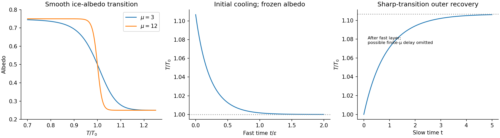

<h1 id="a/1/i/solution">Solution</h1>

↑ **Parent:** [I](../i.md)

The [heat capacity](../../../../../heat-capacity.md) per unit horizontal [area](../../../../../surface-area.md) is $C=\rho c_pd$: [mass density](../../../../../density.md) times [specific heat capacity](../../../../../specific-heat-capacity.md) times atmospheric depth. Thus $C\dot T$ is the rate of stored [thermal energy](../../../../../thermal-energy.md) per unit [area](../../../../../surface-area.md). The [solar constant](../../../../../solar-constant.md) $Q$ is the incident [radiative flux](../../../../../radiative-flux.md) on a surface normal to sunlight; the ratio of the Earth's intercepting disk [area](../../../../../surface-area.md) to its spherical [area](../../../../../surface-area.md) is $1/4$. The absorbed fraction is $1-a$, where [albedo](../../../../../albedo.md) $a$ is the reflected fraction. The outgoing [radiative flux](../../../../../radiative-flux.md) is $\sigma\gamma T^4$, a [Stefan–Boltzmann law](../../../../../stefan-boltzmann-law.md) with effective radiation factor $\gamma$ incorporating the simplified [greenhouse effect](../../../../../greenhouse-effect.md). Every term therefore has units of [power](../../../../../power.md) per [area](../../../../../surface-area.md).

The [albedo](../../../../../albedo.md) curve decreases smoothly, passes through $(T_0,1/2)$, and approaches $1/4$ at high [temperature](../../../../../temperature-split.md). At $T=0$ it is $(2+\tanh\mu)/4$, close to $3/4$ when $\mu$ is large. Its [derivative](../../../../../derivative.md) is

$$
a_0'(T)=-\frac{\mu T^3}{T_0^4}\operatorname{sech}^2\!\left[\mu(T^4/T_0^4-1)\right]\leq0.
$$

An ice-covered planet reflects more sunlight than exposed land or ocean. Warming removes reflective [ice](../../../../../ice.md), lowers [albedo](../../../../../albedo.md), and increases absorbed [radiative flux](../../../../../radiative-flux.md): this is [ice-albedo feedback](../../../../../ice-albedo-feedback.md). The parameter $\mu$ controls the sharpness of this transition; the formula is an idealized global response, rather than a local melting law.

**[Figure 1](#a/1/i/image-temperature-dependent-albedo-and-the-separated-fast-cooling-and-slow-recovery). Temperature-dependent albedo and the separated fast cooling and slow recovery**.

## ↑ Ancestors (13)

1. [I](../i.md)
2. [1](../../1.md)
3. [A](../../../a.md)
4. [2010](../../../../2010-split.md)
5. [Past exam of the mathematics and the environment and mathematical physiology course of the University of Oxford](../../../../split.md)
6. [Mathematics and the environment and mathematical physiology course of the University of Oxford](../../../../../mathematics-and-the-environment-and-mathematical-physiology-course-of-the-university-of-oxford.md)
7. [Year 4 of the mathematics course of the University of Oxford](../../../../../year-4-of-the-mathematics-course-of-the-university-of-oxford.md)
8. [Mathematics course of the University of Oxford](../../../../../mathematics-course-of-the-university-of-oxford.md)
9. [Undergraduate course of the University of Oxford](../../../../../undergraduate-course-of-the-university-of-oxford.md)
10. [Course of the University of Oxford](../../../../../course-of-the-university-of-oxford.md)
11. [University of Oxford](../../../../../university-of-oxford-split.md)
12. [List of universities](../../../../../list-of-universities.md)
13. [Codex Wiki](../../../../../split.md)
