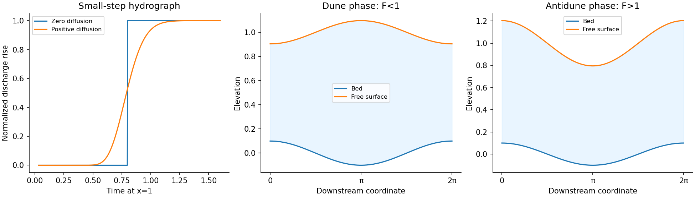

<h1 id="a/2/iv/solution">Solution</h1>

↑ **Parent:** [Iv](../iv.md)

Let the original [area](../../../../../surface-area.md) be $A_0>0$ and the increased upstream [area](../../../../../surface-area.md) be $A_1>A_0$. At $\epsilon=0$, the [conservation law flux](../../../../../conservation-law-flux.md) $q(A)=A^{5/4}$ is strictly [convex](../../../../../convex-function.md). [Characteristics](../../../../../characteristic-of-a-field.md) behind the increase travel faster than those ahead, forming an admissible [shock wave](../../../../../shock-wave.md). [Rankine-Hugoniot conditions](../../../../../rankine-hugoniot-conditions.md) give its speed

$$
c_s=\frac{A_1^{5/4}-A_0^{5/4}}{A_1-A_0}.
$$

At $x=1$ the idealized [hydrograph](../../../../../hydrograph.md) jumps from $Q_0=A_0^{5/4}$ to $Q_1=A_1^{5/4}$ at $t=1/c_s$. With positive $\epsilon$, the [diffusion](../../../../../diffusion.md) term spreads the rise over a finite interval. The [hydrograph](../../../../../hydrograph.md) is rounded, with an earlier small response and a later approach to the new [discharge](../../../../../discharge.md), rather than an instantaneous jump.

The physical cause is the longitudinal [pressure gradient](../../../../../pressure-gradient.md): a local increase in depth influences neighbouring sections and redistributes [water](../../../../../water.md) before pure downstream transport would deliver a discontinuity. For a small increase, [linearization](../../../../../linearization.md) about $A_0$ has speed $c=\tfrac54A_0^{1/4}$ and [diffusivity](../../../../../diffusion-coefficient.md) $D=\epsilon A_0^{3/4}/4$. The smooth curve in the figure is the exact half-line step response for this linearized [advection-diffusion equation](../../../../../advection-diffusion-equation.md); it illustrates the shape without claiming to solve a large nonlinear jump exactly.

**[Figure 2](#a/2/iv/image-sharp-and-diffused-downstream-hydrographs-with-subcritical-and-supercritical-bed-surface-phases). Sharp and diffused downstream hydrographs, with subcritical and supercritical bed-surface phases**.

## ↑ Ancestors (13)

1. [Iv](../iv.md)
2. [2](../../2.md)
3. [A](../../../a.md)
4. [2010](../../../../2010-split.md)
5. [Past exam of the mathematics and the environment and mathematical physiology course of the University of Oxford](../../../../split.md)
6. [Mathematics and the environment and mathematical physiology course of the University of Oxford](../../../../../mathematics-and-the-environment-and-mathematical-physiology-course-of-the-university-of-oxford.md)
7. [Year 4 of the mathematics course of the University of Oxford](../../../../../year-4-of-the-mathematics-course-of-the-university-of-oxford.md)
8. [Mathematics course of the University of Oxford](../../../../../mathematics-course-of-the-university-of-oxford.md)
9. [Undergraduate course of the University of Oxford](../../../../../undergraduate-course-of-the-university-of-oxford.md)
10. [Course of the University of Oxford](../../../../../course-of-the-university-of-oxford.md)
11. [University of Oxford](../../../../../university-of-oxford-split.md)
12. [List of universities](../../../../../list-of-universities.md)
13. [Codex Wiki](../../../../../split.md)
