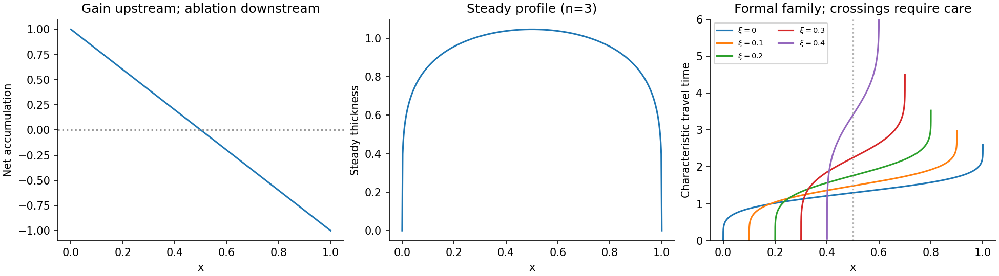

<h1 id="a/3/iv/solution">Solution</h1>

↑ **Parent:** [Iv](../iv.md)

A typical net [ice accumulation](../../../../../ice-accumulation.md) curve decreases downstream: snow gain at high elevation, zero at the [equilibrium](../../../../../equilibrium-point-of-a-dynamical-system.md) line, and negative values in the [ice ablation](../../../../../ice-ablation.md) zone. In a steady glacier with zero [volume flux](../../../../../volumetric-flow-rate.md) at its head, $Q(x)=\int_0^xa(X)\,dX$. If its terminus also has zero [volume flux](../../../../../volumetric-flow-rate.md), a natural glacier length $L$ is the positive root of $\int_0^La(X)\,dX=0$, with the integral positive between the endpoints. Such a root requires a suitable given accumulation profile; it is not guaranteed by [dimensional analysis](../../../../../dimensional-analysis.md) alone.

Let $a_0$ be a representative accumulation rate and $K=A(\rho g\sin\alpha)^n$. Choose

$$
H_*=\left(\frac{a_0L}{K}\right)^{1/(n+2)},\qquad Q_*=a_0L,\qquad t_*=H_*/a_0.
$$

Using $x=L\hat x$, $H=H_*\hat H$, $Q=Q_*\hat Q$, $t=t_*\hat t$, $a=a_0\hat a$, both terms in [mass conservation](../../../../../mass-conservation.md) have scale $a_0$. The dimensionless [flux](../../../../../flux.md) is

$$
\hat Q=(1-\mu\hat H_{\hat x})^n\frac{\hat H^{n+2}}{n+2},\qquad\boxed{\mu=\frac{H_*\cot\alpha}{L}.}
$$

Dropping hats gives the required [partial differential equation](../../../../../partial-differential-equation-split.md). The parameter measures the surface-thickness slope correction relative to the bed slope. For the linear example $a=1-2x$, accumulation changes sign at $x=1/2$ and its integrated balance vanishes at $x=1$.

**[Figure 3](#a/3/iv/image-accumulation-the-steady-ice-profile-and-the-domain-of-formal-glacier-characteristics). Accumulation, the steady ice profile, and the domain of formal glacier characteristics**.

## ↑ Ancestors (13)

1. [Iv](../iv.md)
2. [3](../../3.md)
3. [A](../../../a.md)
4. [2010](../../../../2010-split.md)
5. [Past exam of the mathematics and the environment and mathematical physiology course of the University of Oxford](../../../../split.md)
6. [Mathematics and the environment and mathematical physiology course of the University of Oxford](../../../../../mathematics-and-the-environment-and-mathematical-physiology-course-of-the-university-of-oxford.md)
7. [Year 4 of the mathematics course of the University of Oxford](../../../../../year-4-of-the-mathematics-course-of-the-university-of-oxford.md)
8. [Mathematics course of the University of Oxford](../../../../../mathematics-course-of-the-university-of-oxford.md)
9. [Undergraduate course of the University of Oxford](../../../../../undergraduate-course-of-the-university-of-oxford.md)
10. [Course of the University of Oxford](../../../../../course-of-the-university-of-oxford.md)
11. [University of Oxford](../../../../../university-of-oxford-split.md)
12. [List of universities](../../../../../list-of-universities.md)
13. [Codex Wiki](../../../../../split.md)
