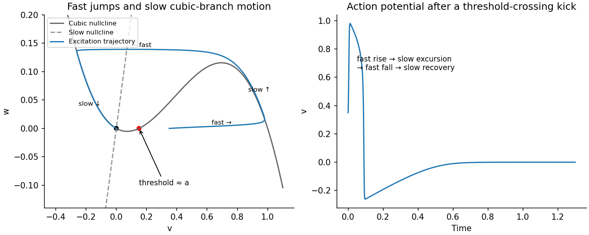

<h1 id="b/5/a/solution">Solution</h1>

↑ **Parent:** [A](../a.md)

The [nullclines](../../../../../nullcline.md) are the cubic $w=f(v)$ and the straight line $w=\gamma v$. At an [equilibrium](../../../../../equilibrium-point-of-a-dynamical-system.md) either $v=0$, or $\gamma=(a-v)(v-1)$. The latter quadratic has maximum $(1-a)^2/4$, so **$\gamma>(1-a)^2/4$ leaves only the resting state $(0,0)$**. Its [Jacobian matrix](../../../../../jacobian-matrix.md) is

$$
J=\begin{pmatrix}-a/\epsilon&-1/\epsilon\\\gamma&-1\end{pmatrix},\qquad\operatorname{tr}J=-a/\epsilon-1<0,\qquad\det J=(a+\gamma)/\epsilon>0.
$$

Both [eigenvalues](../../../../../eigenvalue.md) have negative real parts; the rest state is [linearly stable](../../../../../linear-stability.md) and [asymptotically stable](../../../../../asymptotic-stability.md).

On the fast time $t/\epsilon$, the [recovery variable](../../../../../recovery-variable.md) $w$ is approximately fixed. At $w\simeq0$, the [scalar](../../../../../scalar.md) fast equation has stable roots $v=0,1$ and an unstable root $v=a$. A small kick below $a$ decays towards rest; a kick above it moves rapidly towards the right attracting branch. For finite $\epsilon$, the threshold is displaced from the frozen root by slow recovery, but the leading threshold mechanism is this unstable middle branch.

After the fast excitation, $w_t=\gamma v-w>0$ raises $w$ while $v$ follows the right attracting branch of the cubic. At its upper fold the branch ends and $v$ makes a fast downward jump to the left branch. Recovery then lowers $w$ slowly, with a negative undershoot in $v$, before return towards $(0,0)$. Thus the [action potential](../../../../../action-potential.md) time trace has rapid depolarization, a slower high-voltage excursion, rapid repolarization, and slow recovery. On the fast segments $w$ scarcely changes; on slow segments $w\simeq f(v)$ and $f'(v)<0$. The figure shows a numerically integrated superthreshold excursion and its time trace, rather than just arrows on the [nullclines](../../../../../nullcline.md).

**[Figure 4](#b/5/a/image-fitzhugh-nagumo-resting-nullclines-threshold-excursion-and-action-potential-time-trace). FitzHugh-Nagumo resting nullclines, threshold excursion and action-potential time trace**.

## ↑ Ancestors (13)

1. [A](../a.md)
2. [5](../../5.md)
3. [B](../../../b.md)
4. [2010](../../../../2010-split.md)
5. [Past exam of the mathematics and the environment and mathematical physiology course of the University of Oxford](../../../../split.md)
6. [Mathematics and the environment and mathematical physiology course of the University of Oxford](../../../../../mathematics-and-the-environment-and-mathematical-physiology-course-of-the-university-of-oxford.md)
7. [Year 4 of the mathematics course of the University of Oxford](../../../../../year-4-of-the-mathematics-course-of-the-university-of-oxford.md)
8. [Mathematics course of the University of Oxford](../../../../../mathematics-course-of-the-university-of-oxford.md)
9. [Undergraduate course of the University of Oxford](../../../../../undergraduate-course-of-the-university-of-oxford.md)
10. [Course of the University of Oxford](../../../../../course-of-the-university-of-oxford.md)
11. [University of Oxford](../../../../../university-of-oxford-split.md)
12. [List of universities](../../../../../list-of-universities.md)
13. [Codex Wiki](../../../../../split.md)
