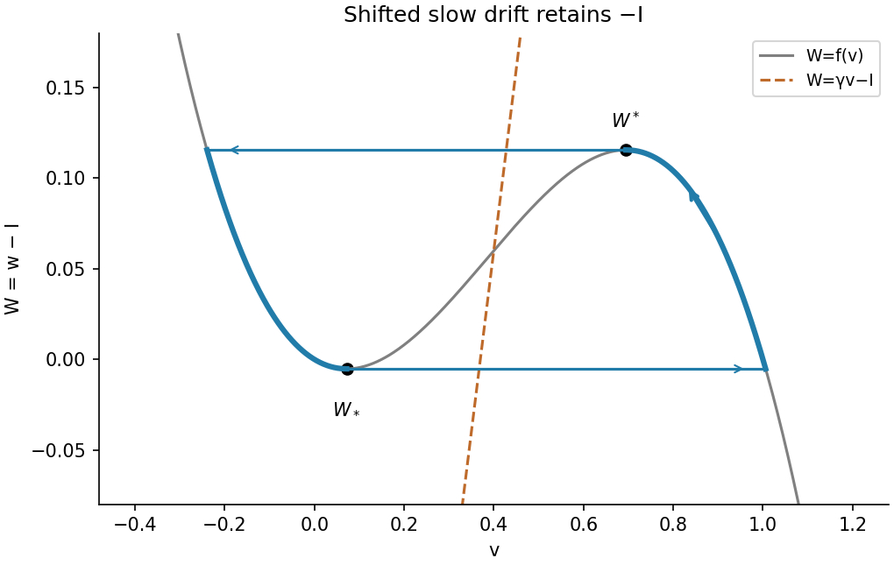

<h1 id="b/5/b/solution">Solution</h1>

↑ **Parent:** [B](../b.md)

Use $W=w-I$. The [nullclines](../../../../../nullcline.md) become $W=f(v)$ and $W=\gamma v-I$, while the slow equation becomes $W_t=\gamma v-W-I$. The cubic has folds

$$
v_\ell=\frac{1+a-\sqrt{1-a+a^2}}3,\qquad v_r=\frac{1+a+\sqrt{1-a+a^2}}3,
$$

with $W_*=f(v_\ell)$ its local minimum and $W^*=f(v_r)$ its local maximum. Let $V_-(W)$ and $V_+(W)$ be the left and right attracting roots of $f(v)=W$. A line whose intersection is on the repelling middle branch permits a [relaxation oscillation](../../../../../relaxation-oscillation.md): upward slow travel on the right branch from $W_*$ to $W^*$, a fast jump to the left branch, downward slow travel to $W_*$, and a return jump. For sufficiently large fixed $\gamma$ this occurs for currents between the fold values $\gamma v_\ell-f(v_\ell)$ and $\gamma v_r-f(v_r)$, away from the small-$\epsilon$ onset layers. The straight line then crosses each outer branch beyond the relevant slow excursion, so the slow velocities have the required signs.

Neglecting the fast-jump durations, integrate $dt=dW/(\gamma V_\pm(W)-W-I)$ along the two slow segments. Their opposite orientations give

$$
\boxed{T\simeq\int_{W_*}^{W^*}\left[\frac1{\gamma V_+(W)-W-I}-\frac1{\gamma V_-(W)-W-I}\right]dW.}
$$

**The printed period omits the current shift.** With the source's definition that $V_\pm$ solve $f(v)=w$, both denominators must retain $-I$ in the shifted coordinate. Equivalently, in the physical recovery coordinate the bounds are $I+W_*,I+W^*$ and the integrand uses $\gamma V_\pm(w-I)-w$. The printed formula is therefore not the leading slow period for the displayed $I>0$ equations unless its notation is changed or an additional approximation justifying the omitted term is supplied.

**[Figure 5](#b/5/b/image-shifted-cubic-nullclines-and-the-two-slow-branches-of-a-relaxation-oscillation). Shifted cubic nullclines and the two slow branches of a relaxation oscillation**.

## ↑ Ancestors (13)

1. [B](../b.md)
2. [5](../../5.md)
3. [B](../../../b.md)
4. [2010](../../../../2010-split.md)
5. [Past exam of the mathematics and the environment and mathematical physiology course of the University of Oxford](../../../../split.md)
6. [Mathematics and the environment and mathematical physiology course of the University of Oxford](../../../../../mathematics-and-the-environment-and-mathematical-physiology-course-of-the-university-of-oxford.md)
7. [Year 4 of the mathematics course of the University of Oxford](../../../../../year-4-of-the-mathematics-course-of-the-university-of-oxford.md)
8. [Mathematics course of the University of Oxford](../../../../../mathematics-course-of-the-university-of-oxford.md)
9. [Undergraduate course of the University of Oxford](../../../../../undergraduate-course-of-the-university-of-oxford.md)
10. [Course of the University of Oxford](../../../../../course-of-the-university-of-oxford.md)
11. [University of Oxford](../../../../../university-of-oxford-split.md)
12. [List of universities](../../../../../list-of-universities.md)
13. [Codex Wiki](../../../../../split.md)
