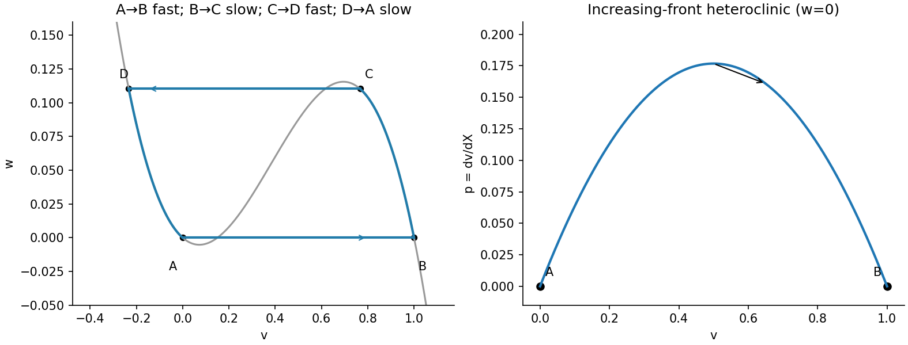

<h1 id="b/5/c/i/solution">Solution</h1>

↑ **Parent:** [I](../i.md)

For $z=ct-x$ the [chain rule](../../../../../../chain-rule.md) gives $\partial_t=c\,d/dz$, $\partial_x=-d/dz$, $\partial_{xx}=d^2/dz^2$. Thus

$$
\boxed{\epsilon c v_z=f(v)-w+\epsilon^2v_{zz},\qquad cw_z=\gamma v-w.}
$$

As $z$ increases from the material ahead of the wave towards that behind it, the singular pulse construction is $A\to B\to C\to D\to A$. The front $AB$ raises $v$ at approximately fixed $w=0$ from the low root to the high root. On the plateau $BC$, $f(v)\simeq w$ on the right attracting branch while $w$ rises slowly. The back $CD$ decreases $v$ at approximately fixed $w=w_0$ to the left attracting branch. The recovery tail then lowers $w$ back to zero on that branch, returning to $A=(0,0)$. Both sharp transitions have thickness $O(\epsilon)$ in $z$; the other segments have the slower recovery scale.

The figure labels all four points and the front/back orientations. This frozen-recovery construction needs $\epsilon\gamma\ll1$ as well as $\epsilon\ll1$ if $\gamma$ is large, so that the [recovery variable](../../../../../../recovery-variable.md) remains nearly fixed in an inner transition. It also needs an admissible positive front speed for the chosen orientation, addressed below.

**[Figure 6](#b/5/c/i/image-matched-front-plateau-back-and-recovery-tail-with-the-inner-front-heteroclinic-orbit). Matched front, plateau, back and recovery tail, with the inner front heteroclinic orbit**.

## ↑ Ancestors (14)

1. [I](../i.md)
2. [C](../../c.md)
3. [5](../../../5.md)
4. [B](../../../../b.md)
5. [2010](../../../../../2010-split.md)
6. [Past exam of the mathematics and the environment and mathematical physiology course of the University of Oxford](../../../../../split.md)
7. [Mathematics and the environment and mathematical physiology course of the University of Oxford](../../../../../../mathematics-and-the-environment-and-mathematical-physiology-course-of-the-university-of-oxford.md)
8. [Year 4 of the mathematics course of the University of Oxford](../../../../../../year-4-of-the-mathematics-course-of-the-university-of-oxford.md)
9. [Mathematics course of the University of Oxford](../../../../../../mathematics-course-of-the-university-of-oxford.md)
10. [Undergraduate course of the University of Oxford](../../../../../../undergraduate-course-of-the-university-of-oxford.md)
11. [Course of the University of Oxford](../../../../../../course-of-the-university-of-oxford.md)
12. [University of Oxford](../../../../../../university-of-oxford-split.md)
13. [List of universities](../../../../../../list-of-universities.md)
14. [Codex Wiki](../../../../../../split.md)
