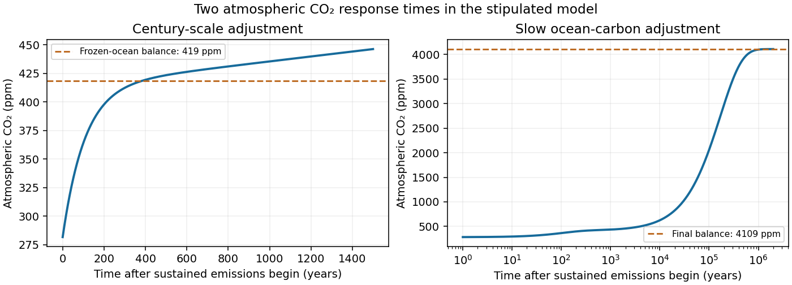
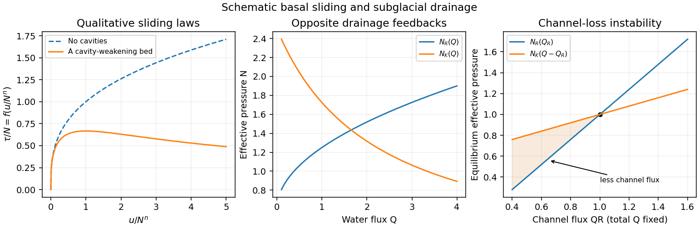

# 2011

↑ **Parent:** [Past exam of the mathematics and the environment course of the University of Oxford](../past-exam-of-the-mathematics-and-the-environment-course-of-the-university-of-oxford.md)

**Table of contents**

- [1](#1)
  - [Solution](#1/solution)
- [2](#2)
  - [Solution](#2/solution)
- [3](#3)
  - [i](#3/i)
    - [Solution](#3/i/solution)
  - [ii](#3/ii)
    - [Solution](#3/ii/solution)
  - [iii](#3/iii)
    - [Solution](#3/iii/solution)
  - [iv](#3/iv)
    - [Solution](#3/iv/solution)

## 1

↑ **Parent:** [2011](2011.md)

<h3 id="1/solution">Solution</h3>

↑ **Parent:** [1](#1)

**Balances and meanings.** The first equation is [conservation of energy](../mathematical-physics.md#conservation-of-energy) per unit area. Here $c$ is effective areal [heat capacity](../heat.md#heat-capacity), $Q$ is the [solar constant](../geophysics.md#solar-constant), and $Q/4$ accounts for the ratio of the Earth's intercepting disc area to its total surface area. The [albedo](../geophysics.md#albedo) $a$ reflects a fraction of that input. The outgoing [thermal radiation](../electromagnetic-radiation.md#thermal-radiation) is the [Stefan–Boltzmann law](../heat.md#stefan-boltzmann-law) modified by $\gamma(p)$, an effective transmission factor for the [greenhouse effect](../exoplanet.md#greenhouse-effect); it normally decreases as atmospheric [carbon dioxide](../chemical-substance.md#carbon-dioxide) increases.

The [albedo](../geophysics.md#albedo) relaxes towards its [temperature](../temperature.md)-dependent equilibrium on the [ice](../chemical-substance.md#ice)-adjustment time $t_i$. The atmospheric mass inventory per unit [pressure](../pressure.md) is $M_{\mathrm{CO}_2}A/(M_ag)$, using the [molar mass](../chemistry.md#molar-mass) ratio of [carbon dioxide](../chemical-substance.md#carbon-dioxide) to air and hydrostatic atmospheric mass. Its sources and sinks are volcanic input $v$, removal by [chemical weathering](../planetary-science.md#chemical-weathering) over land area $A_L$ at rate $W$, and the atmosphere-to-ocean exchange $h(p-p_s)$. The ocean equation is a molar [mass conservation](../continuum-mechanics.md#mass-conservation) balance: $\rho_{\mathrm{H_2O}}V_{\mathrm{oc}}$ is ocean [water](../chemical-substance.md#water) mass, division by $M_{\mathrm{CO}_2}$ converts the incoming carbon-dioxide mass to moles, and $bC$ removes dissolved carbon by burial/export. With $C$ in moles per kilogram, $b$ has units of kilograms of [water](../chemical-substance.md#water)-equivalent per year.

**Times and reduction.** Linearize the [temperature](../temperature.md) equation at fixed $a,p$ about [radiative equilibrium](../heat.md#radiative-equilibrium). Its [exponential relaxation time](../differential-equation.md#exponential-relaxation-time) is

$$
\boxed{t_T=\frac{c}{4\sigma\gamma(p)T^3}=\frac{cT}{Q(1-a)}=3.00\times10^6\ \mathrm{s}=0.0952\ \mathrm y.}
$$

The equality uses $\sigma\gamma T^4=Q(1-a)/4$. A stock-over-flux thermal time, sometimes used as a scale, is four times this, $0.381\ \mathrm y$; both describe a rapid thermal response relative to the other processes.

For [pressure](../pressure.md) in atmospheres, write $I=M_{\mathrm{CO}_2}A\,10^5/(M_ag)$ for the atmospheric carbon-dioxide mass per atmosphere. The factor $10^5$ is essential because $h$ is given per atmosphere. The [pressure](../pressure.md) and slow ocean [exponential relaxation times](../differential-equation.md#exponential-relaxation-time) are

$$
\boxed{t_p=\frac{I}{h}=108.8\ \mathrm y,\qquad t_C=\frac{\rho_{\mathrm{H_2O}}V_{\mathrm{oc}}}{b}=1.667\times10^5\ \mathrm y.}
$$

Thus $t_T\ll t_p\ll t_i=10^4\ \mathrm y<t_C$. The leading [quasi-steady approximation](../mathematics.md#quasi-steady-approximation) gives

$$
T=\Theta(a,p)=\left[\frac{Q(1-a)}{4\sigma\gamma(p)}\right]^{1/4},\qquad h(p-p_s)=v-A_LW.
$$

Substitution in the two remaining equations yields

$$
\boxed{t_i\dot a=B(a,p)-a,\quad B(a,p)=a_{\mathrm{eq}}(\Theta(a,p)),\qquad t_C\dot C=C_0-C,\quad C_0=\frac{v}{M_{\mathrm{CO}_2}b}.}
$$

**The coefficient of $\dot a$ remains $t_i$; the printed $t_T$ in the reduced equation is a typographical error.** Eliminating a fast [temperature](../temperature.md) variable does not replace the [ice](../chemical-substance.md#ice)-response time. The ocean time here is the slow time after atmospheric balance cancels the exchange flux; holding [pressure](../pressure.md) fixed after imposing a carbon-dependent $p_s$ would describe a different conditional relaxation.

The supplied volcanic input gives

$$
\boxed{C_0=8.21\times10^{-4}\ \mathrm{mol\,kg^{-1}},}
$$

about $41.1\%$ of the stated present value $2.0\times10^{-3}$; that value is about $2.43C_0$.

**Carbon-dioxide levels.** Since $A_LW=3.0\times10^{11}\ \mathrm{kg\,y^{-1}}=v$, the atmospheric balance with $p_s=C/K$ gives

$$
\boxed{p_0=\frac{2.0\times10^{-3}}{7.1}=2.817\times10^{-4}\ \mathrm{atm}\approx282\ \mathrm{ppm}.}
$$

This uses the specified present ocean [concentration](../mathematical-physics.md#concentration), as requested, rather than replacing it by the model's smaller volcanic-only equilibrium.

After sustained additional input $v_i$, $C$ barely changes during the atmospheric adjustment. At this stage

$$
p(t)\simeq\frac{C(0)}K+\frac{v_i}{h}(1-e^{-t/t_p}),\qquad\boxed{p_{\mathrm{fast}}\simeq4.187\times10^{-4}\ \mathrm{atm}\approx419\ \mathrm{ppm}.}
$$

This is an intermediate balance, approached over several centuries. On the slower ocean time,

$$
C(t)\simeq C_\infty+[C(0)-C_\infty]e^{-t/t_C},\qquad C_\infty=\frac{v+v_i}{M_{\mathrm{CO}_2}b}=2.820\times10^{-2}\ \mathrm{mol\,kg^{-1}},
$$

with [pressure](../pressure.md) following $p\simeq C/K+v_i/h$. Since $C(0)<C_\infty$, [pressure](../pressure.md) continues to rise slowly. Its eventual level in this stipulated constant-parameter model is

$$
\boxed{p_\infty=\frac{C_\infty}{K}+\frac{v_i}{h}=4.109\times10^{-3}\ \mathrm{atm}\approx4109\ \mathrm{ppm}.}
$$

The [two-reservoir carbon adjustment](../geophysics.md#two-reservoir-carbon-adjustment) therefore has a rapid rise towards the frozen-ocean balance followed by a much longer increase. The figure solves the coupled linear [pressure](../pressure.md)–ocean equations, retaining their small inventory correction to the reduced [time scales](../mathematical-physics.md#time-scale).

**[Figure 1](#1/image-atmospheric-carbon-dioxide-adjustment-over-centuries-and-over-the-slow-ocean-carbon-time). Atmospheric carbon dioxide adjustment over centuries and over the slow ocean-carbon time**.

## 2

↑ **Parent:** [2011](2011.md)

<h3 id="2/solution">Solution</h3>

↑ **Parent:** [2](#2)

**Sliding and cavities.** [Regelation](../geophysics.md#regelation) is melting under increased [pressure](../pressure.md) and refreezing when the [pressure](../pressure.md) is released. For [ice](../chemical-substance.md#ice) near its melting point, the [Clapeyron equation](../thermodynamic-potential.md#clausius-clapeyron-relation) gives a lower melting [temperature](../temperature.md) at greater [pressure](../pressure.md). Against an obstacle, [ice](../chemical-substance.md#ice) melts on the high-[pressure](../pressure.md) upstream face, the [water](../chemical-substance.md#water) passes around it, and it refreezes on the lower-[pressure](../pressure.md) downstream face. Transport of the released [latent heat](../thermodynamic-potential.md#latent-heat) back towards the melting face sustains the process. Together with viscous deformation around obstacles, this permits [basal sliding](../geophysics.md#basal-sliding); [regelation](../geophysics.md#regelation) is especially effective for small obstacles, for which heat conduction distances are short.

[Subglacial cavitation](../geophysics.md#subglacial-cavitation) occurs where the contact [pressure](../pressure.md) predicted behind an obstacle falls below the [water pressure](../fluid-mechanics.md#fluid-pressure): the [ice](../chemical-substance.md#ice) separates from the bed and a [water](../chemical-substance.md#water)-filled cavity opens. The [effective pressure in subglacial drainage](../geophysics.md#effective-pressure-in-subglacial-drainage) is

$$
\boxed{N=p_i-p_w,}
$$

the [ice](../chemical-substance.md#ice) overburden [pressure](../pressure.md) minus [water pressure](../fluid-mechanics.md#fluid-pressure). Smaller $N$ facilitates larger cavities and reduces the resisting [ice](../chemical-substance.md#ice)–bed contact. The exponent $n$ comes from [Glen's flow law](../geophysics.md#glen-s-flow-law), with [strain rate](../continuum-mechanics.md#strain-rate) proportional to the $n$th power of [deviatoric stress](../continuum-mechanics.md#deviatoric-stress), commonly $n\simeq3$. Its homogeneity makes $N^n$ the natural [velocity](../classical-mechanics.md#velocity) scale, yielding $\tau/N=f(u/N^n)$ after including the fixed bed and [ice](../chemical-substance.md#ice)-rheology scales.

Without cavities, [material creep](../engineering.md#creep-deformation) gives a drag law with $f(x)\propto x^{1/n}$. Cavities lower the resistance relative to that extrapolation. On a bounded-slope bed the drag is bounded in proportion to $N$; depending on bed geometry, the curve may level off or pass through a maximum and weaken as contact diminishes. The illustrated weakening curve is a qualitative possibility, not a universal formula for all beds.

**Channels versus distributed drainage.** In [Röthlisberger channel drainage](../geophysics.md#rothlisberger-channel-drainage), frictional dissipation of flowing [water](../chemical-substance.md#water) supplies heat to melt the channel walls, while [material creep](../engineering.md#creep-deformation) of [ice](../chemical-substance.md#ice) closes them under effective [pressure](../pressure.md). An area balance has the schematic form

$$
\dot S_{\mathrm{ch}}=\frac{Q\Psi}{\rho_i L_f}-\mathcal A N^nS_{\mathrm{ch}},
$$

where $\Psi$ is hydraulic-potential drop per length, $L_f$ is [latent heat](../thermodynamic-potential.md#latent-heat) per mass, and the positive constant $\mathcal A$ incorporates [ice](../chemical-substance.md#ice) [material creep](../engineering.md#creep-deformation) and geometry. [Water](../chemical-substance.md#water)-flow resistance relates the flux to channel size and potential gradient. Balancing melting against closure produces the stated increasing relation $N_R(Q)$.

A channel gaining flux can maintain lower [water pressure](../fluid-mechanics.md#fluid-pressure), since larger $N$ means smaller $p_w$. It draws still more [water](../chemical-substance.md#water) from neighboring routes, melts wider, and causes competing small conduits to lose flux and close. This [positive feedback](../signal-transduction.md#positive-feedback) concentrates flow into an arterial network.

A [linked cavity drainage system](../geophysics.md#linked-cavity-drainage-system) consists of [water](../chemical-substance.md#water)-filled lee-side cavities connected by narrow passages. Sliding over bed obstacles opens cavities; [ice](../chemical-substance.md#ice) [material creep](../engineering.md#creep-deformation) tends to close them. The given decreasing relation $N_K(Q)$ means that carrying more [water](../chemical-substance.md#water) requires higher [water pressure](../fluid-mechanics.md#fluid-pressure). A route gaining flux then has a higher [pressure](../pressure.md) and diverts [water](../chemical-substance.md#water) towards neighboring routes. This negative redistribution feedback supports many connected routes and a distributed system.

**Coexistence instability.** At a coexistence point let $N_R(Q_R)=N_K(Q_K)$ and hold $Q=Q_R+Q_K$ fixed. A loss $\Delta Q_R=-\varepsilon$ from the channel gives $\Delta Q_K=\varepsilon$. The changes in the two equilibrium effective pressures are

$$
\Delta N_R=-N_R'(Q_R)\varepsilon,\qquad\Delta N_K=N_K'(Q_K)\varepsilon=-|N_K'(Q_K)|\varepsilon.
$$

Consequently

$$
N_R(Q_R-\varepsilon)-N_K(Q_K+\varepsilon)\simeq-\bigl[N_R'(Q_R)-|N_K'(Q_K)|\bigr]\varepsilon.
$$

If the bracket is positive, the cavity system's common effective [pressure](../pressure.md) exceeds what the reduced-flux channel can support against [material creep](../engineering.md#creep-deformation) closure. The channel shrinks, loses further flux, and closes down. Thus the [channel-cavity drainage instability](../geophysics.md#channel-cavity-drainage-instability) condition is

$$
\boxed{N_R'(Q_R)>|N_K'(Q_K)|.}
$$

**[Figure 2](#2/image-qualitative-cavity-modified-sliding-and-the-different-feedbacks-of-channel-and-cavity-drainage). Qualitative cavity-modified sliding and the different feedbacks of channel and cavity drainage**.

## 3

↑ **Parent:** [2011](2011.md)

<h3 id="3/i">i</h3>

↑ **Parent:** [3](#3)

<h4 id="3/i/solution">Solution</h4>

↑ **Parent:** [I](#3/i)

These are the one-dimensional [shallow water equations](../mathematical-physics.md#shallow-water-equations) with bed slope and [friction](../newtonian-mechanics.md#friction). The coordinate $s$ measures distance downstream, $t$ is time, $A(s,t)$ is the wetted cross-sectional area, $u(s,t)$ is section-averaged downstream [velocity](../classical-mechanics.md#velocity), and $h(s,t)$ is [water](../chemical-substance.md#water) [water depth](../mathematical-physics.md#water-depth) above the bed. Thus $Au$ is [water](../chemical-substance.md#water) volume flux and the first equation expresses [mass conservation](../continuum-mechanics.md#mass-conservation).

In the [momentum](../momentum.md) equation, $u_t+uu_s$ is the material acceleration, $g$ is gravitational acceleration, and $S$ is the positive downward bed slope, so $gS$ drives the flow. The wetted perimeter is $l$ and $f$ is a dimensionless [friction](../newtonian-mechanics.md#friction) coefficient in the stated convention. The frictional deceleration is $flu^2/A$ for downstream flow, while $-gh_s$ is the [hydrostatic pressure](../fluid-mechanics.md#hydrostatic-pressure) contribution from surface-height variation relative to the sloping bed. The formula $u^2$ assumes the chosen positive-flow direction; a bidirectional [friction](../newtonian-mechanics.md#friction) model uses $u|u|$.

<h3 id="3/ii">ii</h3>

↑ **Parent:** [3](#3)

<h4 id="3/ii/solution">Solution</h4>

↑ **Parent:** [Ii](#3/ii)

Let $B$ be the constant canal width, large compared with [water depth](../mathematical-physics.md#water-depth). Then $A\simeq Bh$ and $l\simeq B$, so [friction](../newtonian-mechanics.md#friction) is $fu^2/h$. Choose a reference uniform [water depth](../mathematical-physics.md#water-depth) $H$, normal-flow speed $U$ satisfying $fU^2/H=gS$, and scales

$$
\ell=H/S,\qquad t_0=\ell/U,\qquad h=H\widehat h,\quad u=U\widehat u,\quad s=\ell\widehat s,\quad t=t_0\widehat t.
$$

The [continuity equation](../mathematical-physics.md#continuity-equation) becomes $\widehat h_{\widehat t}+(\widehat h\widehat u)_{\widehat s}=0$. Dividing [momentum](../momentum.md) by $gS$ and dropping hats gives

$$
\boxed{h_t+(hu)_s=0,\qquad F^2(u_t+uu_s)=1-\frac{u^2}{h}-h_s,\qquad F=\frac{U}{\sqrt{gH}}=\sqrt{\frac Sf}.}
$$

The [Froude number](../reduced-gravity.md#froude-number) compares [velocity](../classical-mechanics.md#velocity) to long gravity-[wave speed](../wave-equation.md#wave-speed). At the reference state, $F<1$ is [subcritical flow](../reduced-gravity.md#subcritical-flow), $F=1$ critical flow, and $F>1$ [supercritical flow](../reduced-gravity.md#supercritical-flow). In dimensional variables the [wave](../wave.md) characteristics travel at $u\pm\sqrt{gh}$: one can propagate upstream in subcritical flow, while both move downstream in supercritical flow. Away from the reference state the local [Froude number](../reduced-gravity.md#froude-number) is $F|u|/\sqrt h$.

<h3 id="3/iii">iii</h3>

↑ **Parent:** [3](#3)

<h4 id="3/iii/solution">Solution</h4>

↑ **Parent:** [Iii](#3/iii)

For the [travelling wave](../analysis.md#travelling-wave) $\xi=s+ct$, continuity gives $(ch+hu)'=0$. The upstream state fixes the constant as $1+c$, hence

$$
\boxed{u=-c+\frac{1+c}{h},\qquad u'=-\frac{1+c}{h^2}h'.}
$$

Substituting in [momentum](../momentum.md) yields

$$
-\frac{F^2(1+c)^2}{h^3}h'=1-\frac{(1+c-ch)^2}{h^3}-h',
$$

so

$$
\boxed{h'=\frac{h^3-(1+c-ch)^2}{h^3-(1+c)^2F^2}.}
$$

A constant downstream state $H=h_+>1$ requires $H^3=(1+c-cH)^2$. The positive square-root choice would give $c<0$, so the upstream-moving [wave](../wave.md) uses $1+c-cH=-H^{3/2}$. Thus

$$
\boxed{c=\frac{H^{3/2}+1}{H-1},\qquad u(H)=-\sqrt H.}
$$

The downstream flow reverses. Where the numerator is positive in $1<h<H$, a smooth increasing profile requires a positive denominator. Its minimum occurs at $h=1$, giving

$$
1-(1+c)^2F^2>0,\qquad\boxed{F<\frac1{1+c}=\frac{H-1}{H+H^{3/2}}.}
$$

Equality does not give the prescribed asymptotic upstream state: cancellation of the two simple zeros at $h=1$ leaves a nonzero slope there. For the strict inequality, separation of variables constructs the monotone profile whenever the numerator remains positive between its endpoint zeros.

**There is an additional restriction hidden in the printed positivity hint.** Put $r=\sqrt h$ and $R=\sqrt H$. Since $c=R+1/(R-1)$, the potentially vanishing factor of the numerator is

$$
h^{3/2}+1+c-ch=(r+1)(r-R)\left(r-\frac{R}{R-1}\right).
$$

The other factor, $h^{3/2}-(1+c-ch)$, is positive for $h>1$. Therefore the asserted positivity throughout $1<h<H$ holds precisely for $1<R\leq2$, that is $1<H\leq4$. For $H>4$, the zero at $h=[R/(R-1)]^2$ intervenes before $H$, preventing the requested monotone connection. For example $H=9$, $c=3.5$, $h=4$ gives $h^3-(1+c-ch)^2=-26.25$. Thus the [smooth upstream tidal-wave admissibility](../mathematical-physics.md#smooth-upstream-tidal-wave-admissibility) conditions are

$$
\boxed{1<h_+\leq4,\qquad F<\frac{h_+-1}{h_++h_+^{3/2}}.}
$$

At $h_+=4$ the downstream zero is double, giving an algebraic approach; below four the endpoint approaches are exponential. The displayed [Froude number](../reduced-gravity.md#froude-number) bound is the requested necessary condition, with the source's missing amplitude qualification made explicit.

<h3 id="3/iv">iv</h3>

↑ **Parent:** [3](#3)

<h4 id="3/iv/solution">Solution</h4>

↑ **Parent:** [Iv](#3/iv)

Write $e=E'(1)>0$, $q_1=q'(1)>0$ and introduce perturbations $(H,U,C,S)e^{\lambda t+ikx}$ to [water depth](../mathematical-physics.md#water-depth), [velocity](../classical-mechanics.md#velocity), [concentration](../mathematical-physics.md#concentration) and bed height. Take the leading [quasi-steady approximation](../mathematics.md#quasi-steady-approximation) $\epsilon=0$ for the fast [water](../chemical-substance.md#water) and suspension response, retaining the small [friction](../newtonian-mechanics.md#friction) parameter $\delta$. For $k\ne0$, the linearized equations are

$$
\begin{aligned}
&H+U=0,\\
&[ik(F^2-1)+3\delta]U=-ikS,\\
&(\gamma+ik)C=\gamma eU,\\
&\lambda S+ikq_1U=\beta(C-eU).
\end{aligned}
$$

Here surface height is $H+S$, and [linearization](../algebra.md#linearization) of $1-u^2/h$ gives $H-2U=-3U$. Eliminating $H,C,U$ gives the [dispersion relation](../dispersion-relation.md)

$$
\boxed{\lambda(k)=-\frac{k^2\left(q_1+\dfrac{\beta e}{\gamma+ik}\right)}{3\delta+ik(F^2-1)}.}
$$

In particular, putting $B=F^2-1\ne0$ and expanding at large $|k|$,

$$
\boxed{\lambda(k)=i\frac{q_1}{B}k+\frac{\beta e}{B}-\frac{3\delta q_1}{B^2}+O(k^{-1}).}
$$

Thus the temporal growth rate tends to a finite constant, while the [phase velocity](../dispersion-relation.md#phase-velocity) is

$$
\boxed{v_{\mathrm{ph}}=-\frac{\operatorname{Im}\lambda}{k}\longrightarrow-\frac{q_1}{F^2-1}.}
$$

For [supercritical flow](../reduced-gravity.md#supercritical-flow) $F>1$, the waves propagate upstream. They grow if $\beta e(F^2-1)>3\delta q_1$; at leading order in small $\delta$, this holds for fixed positive $\beta,e$ away from critical flow. They are [antidunes](../fluid-mechanics.md#antidune), upstream-migrating bedforms coupled to the free surface. Indeed $H=-U$ and $S\simeq-(F^2-1)U$, so surface height $H+S\simeq-F^2U$ is in phase with the bed perturbation in this regime.

For clarity, neglecting $\delta$ completely gives the exact leading-order expressions

$$
\operatorname{Re}\lambda=\frac{\beta e}{F^2-1}\frac{k^2}{\gamma^2+k^2},\qquad v_{\mathrm{ph}}=-\frac1{F^2-1}\left(q_1+\frac{\beta e\gamma}{\gamma^2+k^2}\right).
$$

These also identify the missing qualification in the source: **the unstable upstream branch requires $F>1$.** For $F<1$ this leading model gives decay and downstream propagation. The near-critical case $F^2-1\simeq0$ needs a different balance; it is not covered by the expansion. Small nonzero $\epsilon$ perturbs the slow bedform branch and adds fast [water](../chemical-substance.md#water) modes, so the stated result concerns the leading slow morphodynamic branch. This is the [high-wavenumber antidune dispersion](../fluid-mechanics.md#high-wavenumber-antidune-dispersion) calculation.

## ↑ Ancestors (9)

1. [Past exam of the mathematics and the environment course of the University of Oxford](../past-exam-of-the-mathematics-and-the-environment-course-of-the-university-of-oxford.md)
2. [Mathematics and the environment course of the University of Oxford](../university-of-oxford.md#mathematics-and-the-environment-course-of-the-university-of-oxford)
3. [Year 4 of the mathematics course of the University of Oxford](../university-of-oxford.md#year-4-of-the-mathematics-course-of-the-university-of-oxford)
4. [Mathematics course of the University of Oxford](../university-of-oxford.md#mathematics-course-of-the-university-of-oxford)
5. [Undergraduate course of the University of Oxford](../university-of-oxford.md#undergraduate-course-of-the-university-of-oxford)
6. [Course of the University of Oxford](../university-of-oxford.md#course-of-the-university-of-oxford)
7. [University of Oxford](../university-of-oxford.md)
8. [List of universities](../README.md#list-of-universities)
9. [Codex Wiki](../README.md)
