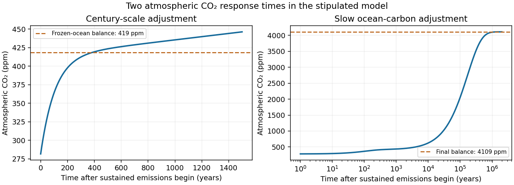

<h1 id="1/solution">Solution</h1>

↑ **Parent:** [1](../1.md)

**Balances and meanings.** The first equation is [conservation of energy](../../../conservation-of-energy.md) per unit area. Here $c$ is effective areal [heat capacity](../../../heat-capacity.md), $Q$ is the [solar constant](../../../solar-constant.md), and $Q/4$ accounts for the ratio of the Earth's intercepting disc area to its total surface area. The [albedo](../../../albedo.md) $a$ reflects a fraction of that input. The outgoing [thermal radiation](../../../thermal-radiation.md) is the [Stefan–Boltzmann law](../../../stefan-boltzmann-law.md) modified by $\gamma(p)$, an effective transmission factor for the [greenhouse effect](../../../greenhouse-effect.md); it normally decreases as atmospheric [carbon dioxide](../../../carbon-dioxide.md) increases.

The [albedo](../../../albedo.md) relaxes towards its [temperature](../../../temperature-split.md)-dependent equilibrium on the [ice](../../../ice.md)-adjustment time $t_i$. The atmospheric mass inventory per unit [pressure](../../../pressure-split.md) is $M_{\mathrm{CO}_2}A/(M_ag)$, using the [molar mass](../../../molar-mass.md) ratio of [carbon dioxide](../../../carbon-dioxide.md) to air and hydrostatic atmospheric mass. Its sources and sinks are volcanic input $v$, removal by [chemical weathering](../../../chemical-weathering.md) over land area $A_L$ at rate $W$, and the atmosphere-to-ocean exchange $h(p-p_s)$. The ocean equation is a molar [mass conservation](../../../mass-conservation.md) balance: $\rho_{\mathrm{H_2O}}V_{\mathrm{oc}}$ is ocean [water](../../../water.md) mass, division by $M_{\mathrm{CO}_2}$ converts the incoming carbon-dioxide mass to moles, and $bC$ removes dissolved carbon by burial/export. With $C$ in moles per kilogram, $b$ has units of kilograms of [water](../../../water.md)-equivalent per year.

**Times and reduction.** Linearize the [temperature](../../../temperature-split.md) equation at fixed $a,p$ about [radiative equilibrium](../../../radiative-equilibrium.md). Its [exponential relaxation time](../../../exponential-relaxation-time.md) is

$$
\boxed{t_T=\frac{c}{4\sigma\gamma(p)T^3}=\frac{cT}{Q(1-a)}=3.00\times10^6\ \mathrm{s}=0.0952\ \mathrm y.}
$$

The equality uses $\sigma\gamma T^4=Q(1-a)/4$. A stock-over-flux thermal time, sometimes used as a scale, is four times this, $0.381\ \mathrm y$; both describe a rapid thermal response relative to the other processes.

For [pressure](../../../pressure-split.md) in atmospheres, write $I=M_{\mathrm{CO}_2}A\,10^5/(M_ag)$ for the atmospheric carbon-dioxide mass per atmosphere. The factor $10^5$ is essential because $h$ is given per atmosphere. The [pressure](../../../pressure-split.md) and slow ocean [exponential relaxation times](../../../exponential-relaxation-time.md) are

$$
\boxed{t_p=\frac{I}{h}=108.8\ \mathrm y,\qquad t_C=\frac{\rho_{\mathrm{H_2O}}V_{\mathrm{oc}}}{b}=1.667\times10^5\ \mathrm y.}
$$

Thus $t_T\ll t_p\ll t_i=10^4\ \mathrm y<t_C$. The leading [quasi-steady approximation](../../../quasi-steady-approximation.md) gives

$$
T=\Theta(a,p)=\left[\frac{Q(1-a)}{4\sigma\gamma(p)}\right]^{1/4},\qquad h(p-p_s)=v-A_LW.
$$

Substitution in the two remaining equations yields

$$
\boxed{t_i\dot a=B(a,p)-a,\quad B(a,p)=a_{\mathrm{eq}}(\Theta(a,p)),\qquad t_C\dot C=C_0-C,\quad C_0=\frac{v}{M_{\mathrm{CO}_2}b}.}
$$

**The coefficient of $\dot a$ remains $t_i$; the printed $t_T$ in the reduced equation is a typographical error.** Eliminating a fast [temperature](../../../temperature-split.md) variable does not replace the [ice](../../../ice.md)-response time. The ocean time here is the slow time after atmospheric balance cancels the exchange flux; holding [pressure](../../../pressure-split.md) fixed after imposing a carbon-dependent $p_s$ would describe a different conditional relaxation.

The supplied volcanic input gives

$$
\boxed{C_0=8.21\times10^{-4}\ \mathrm{mol\,kg^{-1}},}
$$

about $41.1\%$ of the stated present value $2.0\times10^{-3}$; that value is about $2.43C_0$.

**Carbon-dioxide levels.** Since $A_LW=3.0\times10^{11}\ \mathrm{kg\,y^{-1}}=v$, the atmospheric balance with $p_s=C/K$ gives

$$
\boxed{p_0=\frac{2.0\times10^{-3}}{7.1}=2.817\times10^{-4}\ \mathrm{atm}\approx282\ \mathrm{ppm}.}
$$

This uses the specified present ocean [concentration](../../../concentration.md), as requested, rather than replacing it by the model's smaller volcanic-only equilibrium.

After sustained additional input $v_i$, $C$ barely changes during the atmospheric adjustment. At this stage

$$
p(t)\simeq\frac{C(0)}K+\frac{v_i}{h}(1-e^{-t/t_p}),\qquad\boxed{p_{\mathrm{fast}}\simeq4.187\times10^{-4}\ \mathrm{atm}\approx419\ \mathrm{ppm}.}
$$

This is an intermediate balance, approached over several centuries. On the slower ocean time,

$$
C(t)\simeq C_\infty+[C(0)-C_\infty]e^{-t/t_C},\qquad C_\infty=\frac{v+v_i}{M_{\mathrm{CO}_2}b}=2.820\times10^{-2}\ \mathrm{mol\,kg^{-1}},
$$

with [pressure](../../../pressure-split.md) following $p\simeq C/K+v_i/h$. Since $C(0)<C_\infty$, [pressure](../../../pressure-split.md) continues to rise slowly. Its eventual level in this stipulated constant-parameter model is

$$
\boxed{p_\infty=\frac{C_\infty}{K}+\frac{v_i}{h}=4.109\times10^{-3}\ \mathrm{atm}\approx4109\ \mathrm{ppm}.}
$$

The [two-reservoir carbon adjustment](../../../two-reservoir-carbon-adjustment.md) therefore has a rapid rise towards the frozen-ocean balance followed by a much longer increase. The figure solves the coupled linear [pressure](../../../pressure-split.md)–ocean equations, retaining their small inventory correction to the reduced [time scales](../../../time-scale.md).

**[Figure 1](#1/image-atmospheric-carbon-dioxide-adjustment-over-centuries-and-over-the-slow-ocean-carbon-time). Atmospheric carbon dioxide adjustment over centuries and over the slow ocean-carbon time**.

## ↑ Ancestors (11)

1. [1](../1.md)
2. [2011](../../2011-split.md)
3. [Past exam of the mathematics and the environment course of the University of Oxford](../../split.md)
4. [Mathematics and the environment course of the University of Oxford](../../../mathematics-and-the-environment-course-of-the-university-of-oxford.md)
5. [Year 4 of the mathematics course of the University of Oxford](../../../year-4-of-the-mathematics-course-of-the-university-of-oxford.md)
6. [Mathematics course of the University of Oxford](../../../mathematics-course-of-the-university-of-oxford.md)
7. [Undergraduate course of the University of Oxford](../../../undergraduate-course-of-the-university-of-oxford.md)
8. [Course of the University of Oxford](../../../course-of-the-university-of-oxford.md)
9. [University of Oxford](../../../university-of-oxford-split.md)
10. [List of universities](../../../list-of-universities.md)
11. [Codex Wiki](../../../split.md)
