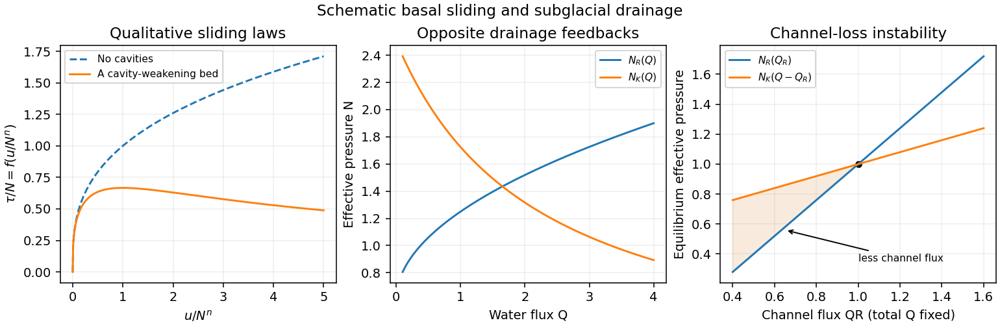

<h1 id="2/solution">Solution</h1>

↑ **Parent:** [2](../2.md)

**Sliding and cavities.** [Regelation](../../../regelation.md) is melting under increased [pressure](../../../pressure-split.md) and refreezing when the [pressure](../../../pressure-split.md) is released. For [ice](../../../ice.md) near its melting point, the [Clapeyron equation](../../../clausius-clapeyron-relation.md) gives a lower melting [temperature](../../../temperature-split.md) at greater [pressure](../../../pressure-split.md). Against an obstacle, [ice](../../../ice.md) melts on the high-[pressure](../../../pressure-split.md) upstream face, the [water](../../../water.md) passes around it, and it refreezes on the lower-[pressure](../../../pressure-split.md) downstream face. Transport of the released [latent heat](../../../latent-heat.md) back towards the melting face sustains the process. Together with viscous deformation around obstacles, this permits [basal sliding](../../../basal-sliding.md); [regelation](../../../regelation.md) is especially effective for small obstacles, for which heat conduction distances are short.

[Subglacial cavitation](../../../subglacial-cavitation.md) occurs where the contact [pressure](../../../pressure-split.md) predicted behind an obstacle falls below the [water pressure](../../../fluid-pressure.md): the [ice](../../../ice.md) separates from the bed and a [water](../../../water.md)-filled cavity opens. The [effective pressure in subglacial drainage](../../../effective-pressure-in-subglacial-drainage.md) is

$$
\boxed{N=p_i-p_w,}
$$

the [ice](../../../ice.md) overburden [pressure](../../../pressure-split.md) minus [water pressure](../../../fluid-pressure.md). Smaller $N$ facilitates larger cavities and reduces the resisting [ice](../../../ice.md)–bed contact. The exponent $n$ comes from [Glen's flow law](../../../glen-s-flow-law.md), with [strain rate](../../../strain-rate.md) proportional to the $n$th power of [deviatoric stress](../../../deviatoric-stress.md), commonly $n\simeq3$. Its homogeneity makes $N^n$ the natural [velocity](../../../velocity.md) scale, yielding $\tau/N=f(u/N^n)$ after including the fixed bed and [ice](../../../ice.md)-rheology scales.

Without cavities, [material creep](../../../creep-deformation.md) gives a drag law with $f(x)\propto x^{1/n}$. Cavities lower the resistance relative to that extrapolation. On a bounded-slope bed the drag is bounded in proportion to $N$; depending on bed geometry, the curve may level off or pass through a maximum and weaken as contact diminishes. The illustrated weakening curve is a qualitative possibility, not a universal formula for all beds.

**Channels versus distributed drainage.** In [Röthlisberger channel drainage](../../../rothlisberger-channel-drainage.md), frictional dissipation of flowing [water](../../../water.md) supplies heat to melt the channel walls, while [material creep](../../../creep-deformation.md) of [ice](../../../ice.md) closes them under effective [pressure](../../../pressure-split.md). An area balance has the schematic form

$$
\dot S_{\mathrm{ch}}=\frac{Q\Psi}{\rho_i L_f}-\mathcal A N^nS_{\mathrm{ch}},
$$

where $\Psi$ is hydraulic-potential drop per length, $L_f$ is [latent heat](../../../latent-heat.md) per mass, and the positive constant $\mathcal A$ incorporates [ice](../../../ice.md) [material creep](../../../creep-deformation.md) and geometry. [Water](../../../water.md)-flow resistance relates the flux to channel size and potential gradient. Balancing melting against closure produces the stated increasing relation $N_R(Q)$.

A channel gaining flux can maintain lower [water pressure](../../../fluid-pressure.md), since larger $N$ means smaller $p_w$. It draws still more [water](../../../water.md) from neighboring routes, melts wider, and causes competing small conduits to lose flux and close. This [positive feedback](../../../positive-feedback.md) concentrates flow into an arterial network.

A [linked cavity drainage system](../../../linked-cavity-drainage-system.md) consists of [water](../../../water.md)-filled lee-side cavities connected by narrow passages. Sliding over bed obstacles opens cavities; [ice](../../../ice.md) [material creep](../../../creep-deformation.md) tends to close them. The given decreasing relation $N_K(Q)$ means that carrying more [water](../../../water.md) requires higher [water pressure](../../../fluid-pressure.md). A route gaining flux then has a higher [pressure](../../../pressure-split.md) and diverts [water](../../../water.md) towards neighboring routes. This negative redistribution feedback supports many connected routes and a distributed system.

**Coexistence instability.** At a coexistence point let $N_R(Q_R)=N_K(Q_K)$ and hold $Q=Q_R+Q_K$ fixed. A loss $\Delta Q_R=-\varepsilon$ from the channel gives $\Delta Q_K=\varepsilon$. The changes in the two equilibrium effective pressures are

$$
\Delta N_R=-N_R'(Q_R)\varepsilon,\qquad\Delta N_K=N_K'(Q_K)\varepsilon=-|N_K'(Q_K)|\varepsilon.
$$

Consequently

$$
N_R(Q_R-\varepsilon)-N_K(Q_K+\varepsilon)\simeq-\bigl[N_R'(Q_R)-|N_K'(Q_K)|\bigr]\varepsilon.
$$

If the bracket is positive, the cavity system's common effective [pressure](../../../pressure-split.md) exceeds what the reduced-flux channel can support against [material creep](../../../creep-deformation.md) closure. The channel shrinks, loses further flux, and closes down. Thus the [channel-cavity drainage instability](../../../channel-cavity-drainage-instability.md) condition is

$$
\boxed{N_R'(Q_R)>|N_K'(Q_K)|.}
$$

**[Figure 2](#2/image-qualitative-cavity-modified-sliding-and-the-different-feedbacks-of-channel-and-cavity-drainage). Qualitative cavity-modified sliding and the different feedbacks of channel and cavity drainage**.

## ↑ Ancestors (11)

1. [2](../2.md)
2. [2011](../../2011-split.md)
3. [Past exam of the mathematics and the environment course of the University of Oxford](../../split.md)
4. [Mathematics and the environment course of the University of Oxford](../../../mathematics-and-the-environment-course-of-the-university-of-oxford.md)
5. [Year 4 of the mathematics course of the University of Oxford](../../../year-4-of-the-mathematics-course-of-the-university-of-oxford.md)
6. [Mathematics course of the University of Oxford](../../../mathematics-course-of-the-university-of-oxford.md)
7. [Undergraduate course of the University of Oxford](../../../undergraduate-course-of-the-university-of-oxford.md)
8. [Course of the University of Oxford](../../../course-of-the-university-of-oxford.md)
9. [University of Oxford](../../../university-of-oxford-split.md)
10. [List of universities](../../../list-of-universities.md)
11. [Codex Wiki](../../../split.md)
