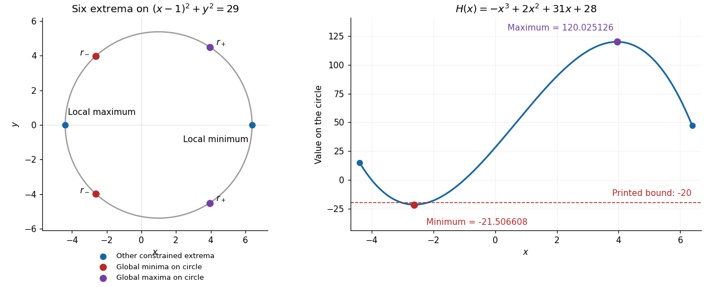

# Mathematics III

↑ **Parent:** [Prelims](../prelims.md)

Source: [released examination PDF, bundle pages 94–99](https://www.whatdotheyknow.com/request/bsc_mathematics_prelims_and_part/response/2784209/attach/3/202409%20817%20annex.pdf#page=94).

Solutions to all seven questions, including every optional part. Question 3(c) contains a false numerical lower bound in the printed paper; the corrected [global minimum](../../../analysis.md#global-minimum) and a direct counterexample are given below.

**Table of contents**

- [1](#1)
  - [a](#1/a)
    - [Solution](#1/a/solution)
  - [b](#1/b)
    - [Solution](#1/b/solution)
  - [c](#1/c)
    - [Solution](#1/c/solution)
- [2](#2)
  - [a](#2/a)
    - [Solution](#2/a/solution)
  - [b](#2/b)
    - [Solution](#2/b/solution)
  - [c](#2/c)
    - [Solution](#2/c/solution)
- [3](#3)
  - [a](#3/a)
    - [Solution](#3/a/solution)
  - [b](#3/b)
    - [Solution](#3/b/solution)
  - [c](#3/c)
    - [Solution](#3/c/solution)
- [4](#4)
  - [a](#4/a)
    - [i](#4/a/i)
      - [Solution](#4/a/i/solution)
    - [ii](#4/a/ii)
      - [Solution](#4/a/ii/solution)
  - [b](#4/b)
    - [i](#4/b/i)
      - [Solution](#4/b/i/solution)
    - [ii](#4/b/ii)
      - [Solution](#4/b/ii/solution)
  - [c](#4/c)
    - [i](#4/c/i)
      - [Solution](#4/c/i/solution)
    - [ii](#4/c/ii)
      - [Solution](#4/c/ii/solution)
- [5](#5)
  - [a](#5/a)
    - [i](#5/a/i)
      - [Solution](#5/a/i/solution)
    - [ii](#5/a/ii)
      - [Solution](#5/a/ii/solution)
    - [iii](#5/a/iii)
      - [Solution](#5/a/iii/solution)
    - [iv](#5/a/iv)
      - [Solution](#5/a/iv/solution)
  - [b](#5/b)
    - [i](#5/b/i)
      - [Solution](#5/b/i/solution)
    - [ii](#5/b/ii)
      - [Solution](#5/b/ii/solution)
    - [iii](#5/b/iii)
      - [Solution](#5/b/iii/solution)
    - [iv](#5/b/iv)
      - [Solution](#5/b/iv/solution)
- [6](#6)
  - [a](#6/a)
    - [i](#6/a/i)
      - [Solution](#6/a/i/solution)
    - [ii](#6/a/ii)
      - [Solution](#6/a/ii/solution)
  - [b](#6/b)
    - [i](#6/b/i)
      - [Solution](#6/b/i/solution)
    - [ii](#6/b/ii)
      - [Solution](#6/b/ii/solution)
  - [c](#6/c)
    - [i](#6/c/i)
      - [Solution](#6/c/i/solution)
    - [ii](#6/c/ii)
      - [Solution](#6/c/ii/solution)
    - [iii](#6/c/iii)
      - [Solution](#6/c/iii/solution)
- [7](#7)
  - [a](#7/a)
    - [i](#7/a/i)
      - [Solution](#7/a/i/solution)
    - [ii](#7/a/ii)
      - [Solution](#7/a/ii/solution)
  - [b](#7/b)
    - [i](#7/b/i)
      - [Solution](#7/b/i/solution)
    - [ii](#7/b/ii)
      - [Solution](#7/b/ii/solution)
    - [iii](#7/b/iii)
      - [Solution](#7/b/iii/solution)
    - [iv](#7/b/iv)
      - [Solution](#7/b/iv/solution)
    - [v](#7/b/v)
      - [Solution](#7/b/v/solution)

## 1

↑ **Parent:** [Mathematics III](mathematics-iii.md)

<h3 id="1/a">a</h3>

↑ **Parent:** [1](#1)

<h4 id="1/a/solution">Solution</h4>

↑ **Parent:** [A](#1/a)

The [integrating factor](../../../linear-ordinary-differential-equation.md#integrating-factor) for this [linear ordinary differential equation](../../../linear-ordinary-differential-equation.md) is $\mu(x)=e^{x^3/3}$. Multiplication gives an exact [derivative](../../../calculus.md#derivative):

$$
\frac{d}{dx}\left(e^{x^3/3}y\right)=x^2e^{x^3/3}=\frac{d}{dx}e^{x^3/3}.
$$

Consequently $y=1+Ce^{-x^3/3}$. The [initial condition](../../../differential-equation.md#initial-condition) $y(1)=2$ gives $C=e^{1/3}$, so the [initial value problem](../../../differential-equation.md#initial-value-problem) has solution

$$
\boxed{y(x)=1+\exp\left(\frac{1-x^3}{3}\right),\qquad x\in\mathbb R.}
$$

The [integrating factor](../../../linear-ordinary-differential-equation.md#integrating-factor) calculation determines every solution, and the [initial condition](../../../differential-equation.md#initial-condition) fixes its remaining [constant of integration](../../../integral.md#constant-of-integration) uniquely.

<h3 id="1/b">b</h3>

↑ **Parent:** [1](#1)

<h4 id="1/b/solution">Solution</h4>

↑ **Parent:** [B](#1/b)

For the given [matrix](../../../vector-space.md#matrix) $A$, the [characteristic polynomial](../../../linear-operator-theory.md#characteristic-polynomial) is

$$
\det(A-\lambda I)=(2-\lambda)(1-\lambda)-6=\lambda^2-3\lambda-4=(\lambda-4)(\lambda+1).
$$

For $\lambda=4$, the [eigenvector](../../../linear-operator-theory.md#eigenvector) equation gives $v_2=v_1$; for $\lambda=-1$, it gives $3v_1+2v_2=0$. Thus the [eigenvalues](../../../linear-operator-theory.md#eigenvalue) and their corresponding [eigenspaces](../../../linear-operator-theory.md#eigenspace) are

$$
\boxed{\lambda=4:\ \operatorname{span}\{(1,1)^T\},\qquad \lambda=-1:\ \operatorname{span}\{(2,-3)^T\}.}
$$

For any [eigenvector](../../../linear-operator-theory.md#eigenvector) $v$ with [eigenvalue](../../../linear-operator-theory.md#eigenvalue) $\lambda$, the vector-valued [function](../../../function.md) $e^{\lambda x}v$ satisfies $Y'=AY$, since its [derivative](../../../calculus.md#derivative) is $\lambda e^{\lambda x}v=e^{\lambda x}Av$. The two displayed [eigenvectors](../../../linear-operator-theory.md#eigenvector) are [linearly independent](../../../vector-space.md#linear-independence), so the [general solution](../../../linear-ordinary-differential-equation.md#general-solution) of the [linear system of ordinary differential equations](../../../linear-ordinary-differential-equation.md#linear-system-of-differential-equations) is

$$
\boxed{\begin{pmatrix}y_1(x)\\y_2(x)\end{pmatrix}=C_1e^{4x}\begin{pmatrix}1\\1\end{pmatrix}+C_2e^{-x}\begin{pmatrix}2\\-3\end{pmatrix},\qquad C_1,C_2\in\mathbb R.}
$$

<h3 id="1/c">c</h3>

↑ **Parent:** [1](#1)

<h4 id="1/c/solution">Solution</h4>

↑ **Parent:** [C](#1/c)

The [function](../../../function.md) $y_1=x$ solves the [linear ordinary differential equation](../../../linear-ordinary-differential-equation.md). Apply [reduction of order](../../../linear-ordinary-differential-equation.md#reduction-of-order) by writing $y=xv(x)$. Substituting $y'=v+xv'$ and $y''=2v'+xv''$ and cancelling the terms in $v$ gives

$$
x^2(1-x)v''+(2x-3x^2)v'=0.
$$

For $w=v'$, this becomes a first-order [linear ordinary differential equation](../../../linear-ordinary-differential-equation.md):

$$
w'+\left(\frac2x+\frac1{x-1}\right)w=0,\qquad w=\frac{C}{x^2(x-1)}.
$$

A [partial fraction decomposition](../../../isolated-singularity.md#partial-fraction-decomposition) provides the required [antiderivative](../../../integral.md#antiderivative):

$$
\frac1{x^2(x-1)}=-\frac1x-\frac1{x^2}+\frac1{x-1},\qquad v=C_1+C_2\left(\log\frac{x-1}{x}+\frac1x\right).
$$

Therefore

$$
\boxed{y(x)=C_1x+C_2\left(1+x\log\frac{x-1}{x}\right),\qquad x>1.}
$$

The [logarithm](../../../calculus.md#logarithm) has positive argument on the required [interval](../../../real-analysis.md#interval-mathematics). The [Wronskian](../../../linear-ordinary-differential-equation.md#wronskian) of $x$ and $1+x\log((x-1)/x)$ is $1/(x-1)\ne0$, proving their [linear independence](../../../vector-space.md#linear-independence) and hence completeness of this [general solution](../../../linear-ordinary-differential-equation.md#general-solution).

## 2

↑ **Parent:** [Mathematics III](mathematics-iii.md)

<h3 id="2/a">a</h3>

↑ **Parent:** [2](#2)

<h4 id="2/a/solution">Solution</h4>

↑ **Parent:** [A](#2/a)

In a [partial derivative](../../../multivariable-calculus.md#partial-derivative), the variable held fixed matters. Holding $u$ fixed gives $x_v=-v$. To find $v_y$, hold $x$ fixed and invert the [Jacobian matrix](../../../multivariable-calculus.md#jacobian-matrix):

$$
\begin{pmatrix}dx\\dy\end{pmatrix}=\begin{pmatrix}u&-v\\v&u\end{pmatrix}\begin{pmatrix}du\\dv\end{pmatrix},\qquad \begin{pmatrix}du\\dv\end{pmatrix}=\frac1{u^2+v^2}\begin{pmatrix}u&v\\-v&u\end{pmatrix}\begin{pmatrix}dx\\dy\end{pmatrix}.
$$

Thus

$$
\boxed{\left.\frac{\partial x}{\partial v}\right|_u=-v,\qquad \left.\frac{\partial v}{\partial y}\right|_x=\frac{u}{u^2+v^2}.}
$$

The second formula holds on each local inverse branch away from $(u,v)=(0,0)$, where the [Jacobian determinant](../../../multivariable-calculus.md#jacobian-determinant) vanishes. These are [planar parabolic coordinates](../../../multivariable-calculus.md#parabolic-polar-coordinates); the pairs $(u,v)$ and $(-u,-v)$ represent the same $(x,y)$, so no global choice of inverse is implicit.

<h3 id="2/b">b</h3>

↑ **Parent:** [2](#2)

<h4 id="2/b/solution">Solution</h4>

↑ **Parent:** [B](#2/b)

The [multivariable chain rule](../../../calculus.md#multivariable-chain-rule) first gives

$$
g_u=uf_x+vf_y,\qquad g_v=-vf_x+uf_y.
$$

Taking a second [partial derivative](../../../multivariable-calculus.md#partial-derivative) in each variable, with the [partial derivatives](../../../multivariable-calculus.md#partial-derivative) of $f$ evaluated at $(x(u,v),y(u,v))$, gives

$$
\begin{aligned}
g_{uu}&=f_x+u^2f_{xx}+uv(f_{xy}+f_{yx})+v^2f_{yy},\\
g_{vv}&=-f_x+v^2f_{xx}-uv(f_{xy}+f_{yx})+u^2f_{yy}.
\end{aligned}
$$

The [mixed partial derivatives](../../../multivariable-calculus.md#mixed-partial-derivative) cancel even without using their equality. Hence the [Laplacians](../../../multivariable-calculus.md#laplacian) satisfy

$$
\boxed{g_{uu}+g_{vv}=(u^2+v^2)(f_{xx}+f_{yy}).}
$$

Away from the origin the factor $u^2+v^2$ is positive, so **$g$ is a [harmonic function](../../../partial-differential-equation.md#harmonic-function) if and only if $f$ is a [harmonic function](../../../partial-differential-equation.md#harmonic-function)** on the corresponding local coordinate patch. This is the [Laplacian in planar parabolic coordinates](../../../multivariable-calculus.md#laplacian-in-planar-parabolic-coordinates).

<h3 id="2/c">c</h3>

↑ **Parent:** [2](#2)

<h4 id="2/c/solution">Solution</h4>

↑ **Parent:** [C](#2/c)

Using the first [partial derivatives](../../../multivariable-calculus.md#partial-derivative) from part (b),

$$
vg_u-ug_v=2uvf_x+(v^2-u^2)f_y=2yf_x-2xf_y.
$$

Also $uvg=yf$. Therefore the first [partial differential equation](../../../partial-differential-equation.md) becomes

$$
\boxed{2y\frac{\partial f}{\partial x}-2x\frac{\partial f}{\partial y}+yf=0.}
$$

For the second [partial differential equation](../../../partial-differential-equation.md), the same [chain rule](../../../calculus.md#chain-rule) gives

$$
ug_u-vg_v=(u^2+v^2)f_x,\qquad (u^4-v^4)g=2x(u^2+v^2)f.
$$

Away from the origin, cancellation yields $f_x+2xf=0$. Treating $y$ as fixed, an [integrating factor](../../../linear-ordinary-differential-equation.md#integrating-factor) gives $\partial_x(e^{x^2}f)=0$. Thus

$$
\boxed{f(x,y)=e^{-x^2}F(y),}
$$

where $F$ is an arbitrary sufficiently [differentiable function](../../../analysis.md#differentiable-function). This is the local [general solution](../../../linear-ordinary-differential-equation.md#general-solution), and the global form when $f$ is defined on the whole plane. If $f$ and its first [partial derivatives](../../../multivariable-calculus.md#partial-derivative) are continuous at the origin, the reduced [partial differential equation](../../../partial-differential-equation.md) also holds there by [continuity](../../../calculus.md#continuous-function).

## 3

↑ **Parent:** [Mathematics III](mathematics-iii.md)

<h3 id="3/a">a</h3>

↑ **Parent:** [3](#3)

<h4 id="3/a/solution">Solution</h4>

↑ **Parent:** [A](#3/a)

The [gradient](../../../multivariable-calculus.md#gradient) of the given [polynomial](../../../polynomial.md) is

$$
\nabla f=(2x+y^2+1,\ 2y(1+x)).
$$

Its second component vanishes when $y=0$ or $x=-1$. The first component then gives exactly three [critical points](../../../analysis.md#critical-point):

$$
(-\tfrac12,0),\qquad (-1,1),\qquad (-1,-1).
$$

The [Hessian matrix](../../../multivariable-calculus.md#hessian-matrix) and its [determinant](../../../multilinear-algebra.md#determinant) are

$$
H_f=\begin{pmatrix}2&2y\\2y&2+2x\end{pmatrix},\qquad \det H_f=4(1+x-y^2).
$$

At $(-1/2,0)$ the [Hessian matrix](../../../multivariable-calculus.md#hessian-matrix) is $\operatorname{diag}(2,1)$, whose [positive definiteness](../../../bilinear-form.md#positive-definiteness) proves a strict [local minimum](../../../analysis.md#local-minimum) by the [second-derivative test](../../../multivariable-calculus.md#second-derivative-test). At $(-1,\pm1)$ its [determinant](../../../multilinear-algebra.md#determinant) is $-4$, so both points are [saddle points of a scalar function](../../../analysis.md#saddle-point-of-a-scalar-function). Their values and classifications are

$$
\boxed{\begin{aligned}
f(-\tfrac12,0)&=-\tfrac14&&\text{strict local minimum},\\
f(-1,\pm1)&=0&&\text{saddle points}.
\end{aligned}}
$$

There are **no [local maxima](../../../analysis.md#local-maximum)**.

<h3 id="3/b">b</h3>

↑ **Parent:** [3](#3)

<h4 id="3/b/solution">Solution</h4>

↑ **Parent:** [B](#3/b)

At a regular point of the [optimization constraint](../../../numerical-analysis.md#optimization-constraint), meaning $\nabla g\ne0$, the necessary [Lagrange multiplier](../../../mathematical-optimization.md#lagrange-multiplier) condition is

$$
\boxed{\nabla f=\lambda\nabla g\quad\text{for some }\lambda\in\mathbb R.}
$$

Indeed, every allowed [tangent vector](../../../tangent-vector.md) $t$ to the [level set](../../../topology.md#level-set) $g=0$ satisfies $\nabla g\cdot t=0$. At a constrained [extremum](../../../mathematical-optimization.md#maximum-and-minimum), the [directional derivative](../../../multivariable-calculus.md#directional-derivative) $\nabla f\cdot t$ must vanish too. Thus both [gradients](../../../multivariable-calculus.md#gradient) are normal to the same [tangent line](../../../calculus.md#tangent-line) and are parallel. This includes $\nabla f=0$. At a singular point with $\nabla g=0$, the displayed condition need not be necessary; those points require a separate examination.

<h3 id="3/c">c</h3>

↑ **Parent:** [3](#3)

<h4 id="3/c/solution">Solution</h4>

↑ **Parent:** [C](#3/c)

For $g=(x-1)^2+y^2-29$, the [gradient](../../../multivariable-calculus.md#gradient) $\nabla g=2(x-1,y)$ never vanishes on the [circle](../../../topology.md#circle). The [Lagrange multiplier](../../../mathematical-optimization.md#lagrange-multiplier) equations are

$$
2x+y^2+1=2\lambda(x-1),\qquad 2y(1+x)=2\lambda y,\qquad (x-1)^2+y^2=29.
$$

If $y=0$, the two possibilities are $(1\pm\sqrt{29},0)$. If $y\ne0$, then $\lambda=1+x$, and the first equation gives $y^2=2x^2-2x-3$. Combining this with $y^2=28+2x-x^2$ yields

$$
3x^2-4x-31=0.
$$

Put

$$
s=\sqrt{97},\qquad r_-=\frac{2-s}{3},\qquad r_+=\frac{2+s}{3},\qquad h_-=\frac{\sqrt{163-2s}}3,\qquad h_+=\frac{\sqrt{163+2s}}3.
$$

Both $h_-$ and $h_+$ are positive, giving the other four points $(r_-,\pm h_-)$ and $(r_+,\pm h_+)$. To classify all six, restrict $f$ to the [circle](../../../topology.md#circle) by eliminating $y^2$:

$$
f=H(x)=-x^3+2x^2+31x+28,\qquad 1-\sqrt{29}\leq x\leq1+\sqrt{29}.
$$

Its [derivatives](../../../calculus.md#derivative) are $H'=-3x^2+4x+31$ and $H''=4-6x$. In the interior, $H''(r_-)=2s>0$ and $H''(r_+)=-2s<0$. At either endpoint $H'<0$; along the [circle](../../../topology.md#circle), $x$ has a strict [local minimum](../../../analysis.md#local-minimum) at the left endpoint and a strict [local maximum](../../../analysis.md#local-maximum) at the right endpoint. Consequently the six constrained [extrema](../../../mathematical-optimization.md#maximum-and-minimum) are

$$
\boxed{\begin{array}{c|c|c}
\text{point}&f&\text{classification on the circle}\\ \hline
(1-\sqrt{29},0)&31-3\sqrt{29}&\text{strict local maximum}\\
(1+\sqrt{29},0)&31+3\sqrt{29}&\text{strict local minimum}\\
(r_-,\pm h_-)&\dfrac{1330-194\sqrt{97}}{27}&\text{global minima}\\
(r_+,\pm h_+)&\dfrac{1330+194\sqrt{97}}{27}&\text{global maxima}
\end{array}}
$$

The [circle](../../../topology.md#circle) is a [compact set](../../../topology.md#compact-space), so the [extreme value theorem](../../../real-analysis.md#extreme-value-theorem) guarantees that its [global minimum](../../../analysis.md#global-minimum) and [global maximum](../../../function.md#global-maximum) occur among these six points. Their values give the corrected sharp bound

$$
\boxed{f(x,y)\geq\frac{1330-194\sqrt{97}}{27}\approx-21.50660791\quad\text{on the circle}.}
$$

**The printed lower bound $-20$ is false.** A particularly short counterexample is

$$
(x,y)=\left(-\frac52,\frac{\sqrt{67}}2\right),\qquad (x-1)^2+y^2=\frac{49+67}{4}=29,\qquad f(x,y)=-\frac{171}{8}<-20.
$$

The sole [local minimum](../../../analysis.md#local-minimum) in part (a), $(-1/2,0)$, has value $-1/4$, larger than values on this [circle](../../../topology.md#circle); it is therefore **not a [global minimum](../../../analysis.md#global-minimum)**. In fact $f(-2,y)=2-y^2\to-\infty$, so $f$ has **no [global minimum](../../../analysis.md#global-minimum) on the plane**.

**[Figure 1](#3/c/image-all-six-extrema-on-the-constraint-circle-and-the-corrected-minimum-of-the-restricted-polynomial). All six extrema on the constraint circle and the corrected minimum of the restricted polynomial**.

## 4

↑ **Parent:** [Mathematics III](mathematics-iii.md)

<h3 id="4/a">a</h3>

↑ **Parent:** [4](#4)

<h4 id="4/a/i">i</h4>

↑ **Parent:** [A](#4/a)

<h5 id="4/a/i/solution">Solution</h5>

↑ **Parent:** [I](#4/a/i)

The [events](../../../probability-space.md#event) $B_1,B_2,\ldots$ form a [partition of a sample space](../../../probability-space.md#partition-of-a-sample-space) $\Omega$ when they are pairwise [disjoint sets](../../../set.md#disjoint-sets) and cover the whole [sample space](../../../probability-space.md#sample-space):

$$
\boxed{B_i\cap B_j=\varnothing\ (i\ne j),\qquad \bigcup_{i\geq1}B_i=\Omega.}
$$

Thus exactly one of these [events](../../../probability-space.md#event) occurs on every outcome. Under the usual [set partition](../../../combinatorics.md#set-partition) convention the parts are nonempty; empty parts can simply be discarded.

<h4 id="4/a/ii">ii</h4>

↑ **Parent:** [A](#4/a)

<h5 id="4/a/ii/solution">Solution</h5>

↑ **Parent:** [Ii](#4/a/ii)

For an [integrable](../../../measure-theory.md#integrability) [random variable](../../../random-variable.md) $X$, the [law of total expectation](../../../measure-theory.md#law-of-total-expectation) for the [partition of a sample space](../../../probability-space.md#partition-of-a-sample-space) is

$$
\boxed{\mathbb E[X]=\sum_{i:\,\mathbb P(B_i)>0}\mathbb E[X\mid B_i]\,\mathbb P(B_i).}
$$

Parts of zero [probability](../../../probability-theory.md#probability) contribute zero and need no definition of $\mathbb E[X\mid B_i]$. To see the identity, write $X=\sum_i X\mathbf1_{B_i}$ and use [linearity of expectation](../../../expected-value.md#linearity-of-expectation); integrability justifies the countable sum since $\sum_i\mathbb E[|X|\mathbf1_{B_i}]=\mathbb E[|X|]<\infty$.

<h3 id="4/b">b</h3>

↑ **Parent:** [4](#4)

<h4 id="4/b/i">i</h4>

↑ **Parent:** [B](#4/b)

<h5 id="4/b/i/solution">Solution</h5>

↑ **Parent:** [I](#4/b/i)

First the [expected value](../../../expected-value.md) of the [absorption time](../../../markov-chain.md#absorption-time) is finite. From any interior state, consecutive leftward moves lead to absorption within at most $n$ steps, with [probability](../../../probability-theory.md#probability) at least $p=3^{-n}$. By [independence](../../../random-variable.md#independent-random-variables) of the subsequent steps, the [probability](../../../probability-theory.md#probability) of surviving $jn$ steps is at most $(1-p)^j$. Summing this [geometric series](../../../sequence-and-series.md#geometric-series) bounds the [expected value](../../../expected-value.md) of the [absorption time](../../../markov-chain.md#absorption-time) by $n/p$.

Now apply [first-step analysis](../../../analysis.md#first-step-analysis). Starting from $k$ in the interior, one step is always used. Conditional on that step, the remaining [expected values](../../../expected-value.md) are $e_{k+1}$, $e_k$, and $e_{k-1}$, each with [probability](../../../probability-theory.md#probability) $1/3$. The [law of total expectation](../../../measure-theory.md#law-of-total-expectation) therefore gives

$$
e_k=1+\frac13e_{k+1}+\frac13e_k+\frac13e_{k-1}.
$$

The term $1$ remains even when the particle stays at $k$, because a step has elapsed. Rearranging gives

$$
\boxed{\frac13e_{k+1}-\frac23e_k+\frac13e_{k-1}=-1,\qquad 1\leq k\leq n-1.}
$$

<h4 id="4/b/ii">ii</h4>

↑ **Parent:** [B](#4/b)

<h5 id="4/b/ii/solution">Solution</h5>

↑ **Parent:** [Ii](#4/b/ii)

At an [absorbing state](../../../markov-chain.md#absorbing-state), the remaining [absorption time](../../../markov-chain.md#absorption-time) is zero, so $e_0=e_n=0$. Multiplying the [linear recurrence relation](../../../algebra.md#linear-recurrence-relation) by three gives

$$
e_{k+1}-2e_k+e_{k-1}=-3.
$$

The second [finite difference](../../../finite-difference.md) of $k^2$ is two. A [particular solution](../../../linear-ordinary-differential-equation.md#particular-solution) is therefore $-3k^2/2$, while every solution of the corresponding homogeneous [linear recurrence relation](../../../algebra.md#linear-recurrence-relation) has the form $A+Bk$. The [boundary conditions](../../../differential-equation.md#boundary-condition) give $A=0$ and $B=3n/2$, hence

$$
\boxed{e_k=\frac32k(n-k),\qquad 0\leq k\leq n.}
$$

This is the [mean absorption time of a lazy symmetric random walk](../../../random-walk.md#mean-absorption-time-of-a-lazy-symmetric-random-walk) with holding [probability](../../../probability-theory.md#probability) $1/3$.

<h3 id="4/c">c</h3>

↑ **Parent:** [4](#4)

<h4 id="4/c/i">i</h4>

↑ **Parent:** [C](#4/c)

<h5 id="4/c/i/solution">Solution</h5>

↑ **Parent:** [I](#4/c/i)

Each [random variable](../../../random-variable.md) has [mean](../../../expected-value.md) zero and second [moment](../../../expected-value.md#moment) $2/3$, so its [variance](../../../variance.md) is $2/3$. For $S_m=\sum_{i=1}^mX_i$, [linearity of expectation](../../../expected-value.md#linearity-of-expectation) and [variance additivity for independent random variables](../../../variance.md#variance-additivity-for-independent-random-variables) give

$$
\boxed{\mathbb E[S_m]=0,\qquad \operatorname{var}(S_m)=\frac{2m}{3}.}
$$

<h4 id="4/c/ii">ii</h4>

↑ **Parent:** [C](#4/c)

<h5 id="4/c/ii/solution">Solution</h5>

↑ **Parent:** [Ii](#4/c/ii)

Each $X_i$ has the same [probability distribution](../../../probability-distribution.md) as $-X_i$, and [independence](../../../random-variable.md#independent-random-variables) makes $S_m$ and $-S_m$ identically distributed. Thus their two strict tail [probabilities](../../../probability-theory.md#probability) are equal:

$$
\mathbb P(S_m>m/2)=\mathbb P(S_m<-m/2)=\frac12\mathbb P(|S_m|>m/2).
$$

Apply [Chebyshev's inequality](../../../probability-inequality.md#chebyshev-s-inequality) using the [mean](../../../expected-value.md) and [variance](../../../variance.md) from part (i):

$$
\boxed{\mathbb P(S_m>m/2)\leq\frac12\frac{2m/3}{(m/2)^2}=\frac4{3m}.}
$$

The equal-tail argument is essential: applying [Chebyshev's inequality](../../../probability-inequality.md#chebyshev-s-inequality) directly to the absolute tail alone gives the weaker bound $8/(3m)$.

## 5

↑ **Parent:** [Mathematics III](mathematics-iii.md)

<h3 id="5/a">a</h3>

↑ **Parent:** [5](#5)

<h4 id="5/a/i">i</h4>

↑ **Parent:** [A](#5/a)

<h5 id="5/a/i/solution">Solution</h5>

↑ **Parent:** [I](#5/a/i)

For a nonnegative integer-valued [random variable](../../../random-variable.md), its [probability generating function](../../../probability-distribution.md#probability-generating-function) is

$$
\boxed{G(s)=\mathbb E[s^X]=\sum_{j=0}^\infty p(j)s^j.}
$$

The convention $s^0=1$, including at $s=0$, gives $G(0)=p(0)$. The [power series](../../../sequence-and-series.md#power-series) has [absolute convergence](../../../sequence-and-series.md#absolute-convergence) for every real $|s|\leq1$, since $\sum_jp(j)|s|^j\leq1$. More generally its real domain as a finite [expected value](../../../expected-value.md) is $\{s\in\mathbb R:\sum_jp(j)|s|^j<\infty\}$, which may extend beyond $[-1,1]$. No extension beyond that guaranteed [interval](../../../real-analysis.md#interval-mathematics) is automatic.

<h4 id="5/a/ii">ii</h4>

↑ **Parent:** [A](#5/a)

<h5 id="5/a/ii/solution">Solution</h5>

↑ **Parent:** [Ii](#5/a/ii)

Under the extra hypothesis that $G(s)$ exists for every real $s$, its [power series](../../../sequence-and-series.md#power-series) has infinite [radius of convergence](../../../sequence-and-series.md#radius-of-convergence). [Termwise differentiation of a power series](../../../sequence-and-series.md#termwise-differentiation-of-a-power-series) is therefore valid to every finite order. For $k\geq1$,

$$
G^{(k)}(s)=\sum_{j=k}^\infty j(j-1)\cdots(j-k+1)p(j)s^{j-k}.
$$

At $s=1$ this is the [expected value](../../../expected-value.md) of the [falling factorial](../../../combinatorics.md#falling-factorial) of $X$:

$$
\boxed{G^{(k)}(1)=\mathbb E[(X)_k]=\mathbb E[X(X-1)\cdots(X-k+1)].}
$$

In particular $\boxed{G'(1)=\mathbb E[X]}$. The terms with $j<k$ vanish because their [falling factorials](../../../combinatorics.md#falling-factorial) contain a zero factor. These [factorial moments](../../../continuous-time-markov-chain.md#factorial-moment) are finite under the stated hypothesis.

<h4 id="5/a/iii">iii</h4>

↑ **Parent:** [A](#5/a)

<h5 id="5/a/iii/solution">Solution</h5>

↑ **Parent:** [Iii](#5/a/iii)

Since $X^2=X(X-1)+X$, the second [moment](../../../expected-value.md#moment) is $\mathbb E[X^2]=G''(1)+G'(1)$. Subtracting the squared [mean](../../../expected-value.md) gives

$$
\boxed{\operatorname{var}(X)=G''(1)+G'(1)-\bigl(G'(1)\bigr)^2.}
$$

<h4 id="5/a/iv">iv</h4>

↑ **Parent:** [A](#5/a)

<h5 id="5/a/iv/solution">Solution</h5>

↑ **Parent:** [Iv](#5/a/iv)

For the specified [Poisson distribution](../../../discrete-probability-distribution.md#poisson-distribution), the [exponential series](../../../calculus.md#exponential-series) gives the [probability generating function](../../../probability-distribution.md#probability-generating-function)

$$
G(s)=e^{-1}\sum_{j=0}^\infty\frac{s^j}{j!}=\boxed{e^{s-1},\qquad s\in\mathbb R.}
$$

Every [derivative](../../../calculus.md#derivative) of $G$ is again $e^{s-1}$, so the [factorial moments](../../../continuous-time-markov-chain.md#factorial-moment) and [variance](../../../variance.md) are

$$
\boxed{\mathbb E[(X)_k]=1\quad(k\geq1),\qquad \operatorname{var}(X)=1+1-1=1.}
$$

Also $\mathbb E[X]=1$.

<h3 id="5/b">b</h3>

↑ **Parent:** [5](#5)

<h4 id="5/b/i">i</h4>

↑ **Parent:** [B](#5/b)

<h5 id="5/b/i/solution">Solution</h5>

↑ **Parent:** [I](#5/b/i)

Each of the $n$ distinct elements can receive any of the $x$ labelled colours. The [multiplication principle](../../../combinatorics.md#rule-of-product) therefore gives

$$
\boxed{x^n}
$$

colour assignments; colours are allowed to remain unused.

<h4 id="5/b/ii">ii</h4>

↑ **Parent:** [B](#5/b)

<h5 id="5/b/ii/solution">Solution</h5>

↑ **Parent:** [Ii](#5/b/ii)

Every assignment determines a unique [set partition](../../../combinatorics.md#set-partition) into its nonempty colour classes. If there are $k$ such [blocks of a set partition](../../../combinatorics.md#block-of-a-set-partition), there are $A(n,k)$ choices for that [set partition](../../../combinatorics.md#set-partition). For each fixed choice, assign distinct colours to the $k$ [blocks of a set partition](../../../combinatorics.md#block-of-a-set-partition) in

$$
(x)_k=x(x-1)\cdots(x-k+1)
$$

ways. Although the [blocks of a set partition](../../../combinatorics.md#block-of-a-set-partition) are unlabelled, they are distinguishable by their elements: ordering them temporarily, for instance by their least elements, counts each assignment exactly once. The [falling factorial](../../../combinatorics.md#falling-factorial) is zero when $k>x$, as it should be. Summing over the possible numbers of used colours proves

$$
\boxed{x^n=\sum_{k=1}^n A(n,k)(x)_k.}
$$

Here $A(n,k)$ is the [Stirling number of the second kind](../../../combinatorics.md#stirling-numbers-of-the-second-kind). Both sides are [polynomials](../../../polynomial.md) in $x$ and agree at infinitely many integers $x>2$, so the identity also holds for every real $x$, including $0,1,2$. This extension will justify substituting the [random variable](../../../random-variable.md) $X$ in part (iii).

<h4 id="5/b/iii">iii</h4>

↑ **Parent:** [B](#5/b)

<h5 id="5/b/iii/solution">Solution</h5>

↑ **Parent:** [Iii](#5/b/iii)

Substitute $X$ into the [polynomial](../../../polynomial.md) identity and apply [linearity of expectation](../../../expected-value.md#linearity-of-expectation) to its finite sum. The [factorial moments](../../../continuous-time-markov-chain.md#factorial-moment) of the [Poisson distribution](../../../discrete-probability-distribution.md#poisson-distribution) in part (a)(iv) are all one, giving

$$
\boxed{\mathbb E[X^n]=\sum_{k=1}^n A(n,k)\mathbb E[(X)_k]=\sum_{k=1}^n A(n,k)=B(n).}
$$

Thus its $n$th [moment](../../../expected-value.md#moment) counts [set partitions](../../../combinatorics.md#set-partition): it equals the $n$th [Bell number](../../../combinatorics.md#bell-number).

<h4 id="5/b/iv">iv</h4>

↑ **Parent:** [B](#5/b)

<h5 id="5/b/iv/solution">Solution</h5>

↑ **Parent:** [Iv](#5/b/iv)

Computing the same [expected value](../../../expected-value.md) directly from the [Poisson distribution](../../../discrete-probability-distribution.md#poisson-distribution) instead gives

$$
\boxed{B(n)=\mathbb E[X^n]=\sum_{j=0}^\infty j^n\frac{e^{-1}}{j!}=\frac1e\sum_{j=0}^\infty\frac{j^n}{j!}.}
$$

For each fixed positive integer $n$, the [ratio test](../../../sequence-and-series.md#ratio-test) shows that this sum converges. This identity is [Dobiński's formula](../../../combinatorics.md#dobinski-s-formula). The case $n=0$ also gives $B(0)=1$ if $0^0$ is interpreted as one in this particular [moment](../../../expected-value.md#moment) formula.

## 6

↑ **Parent:** [Mathematics III](mathematics-iii.md)

<h3 id="6/a">a</h3>

↑ **Parent:** [6](#6)

<h4 id="6/a/i">i</h4>

↑ **Parent:** [A](#6/a)

<h5 id="6/a/i/solution">Solution</h5>

↑ **Parent:** [I](#6/a/i)

For a [random variable](../../../random-variable.md) with a [continuous probability distribution](../../../continuous-probability-distribution.md) and [probability density function](../../../continuous-probability-distribution.md#probability-density-function) $f_X$, the [mean](../../../expected-value.md) and [variance](../../../variance.md) are

$$
\boxed{\mu=\mathbb E[X]=\int_{-\infty}^{\infty}x f_X(x)\,dx,\qquad \operatorname{var}(X)=\mathbb E[(X-\mu)^2]=\int_{-\infty}^{\infty}(x-\mu)^2f_X(x)\,dx.}
$$

A finite [mean](../../../expected-value.md) requires $\int |x|f_X(x)\,dx<\infty$. A finite [variance](../../../variance.md) additionally requires the second [moment](../../../expected-value.md#moment) to be finite; without that condition the nonnegative integral for the [variance](../../../variance.md) may be infinite.

<h4 id="6/a/ii">ii</h4>

↑ **Parent:** [A](#6/a)

<h5 id="6/a/ii/solution">Solution</h5>

↑ **Parent:** [Ii](#6/a/ii)

Expand the square and use [linearity of expectation](../../../expected-value.md#linearity-of-expectation), together with $\mathbb E[X]=\mu$ and $\mathbb E[1]=1$:

$$
\begin{aligned}
\operatorname{var}(X)&=\mathbb E[X^2-2\mu X+\mu^2]\\
&=\mathbb E[X^2]-2\mu\mathbb E[X]+\mu^2\\
&=\boxed{\mathbb E[X^2]-(\mathbb E[X])^2.}
\end{aligned}
$$

This proof applies whenever the second [moment](../../../expected-value.md#moment) is finite, and does not require the [random variable](../../../random-variable.md) to be continuous.

<h3 id="6/b">b</h3>

↑ **Parent:** [6](#6)

<h4 id="6/b/i">i</h4>

↑ **Parent:** [B](#6/b)

<h5 id="6/b/i/solution">Solution</h5>

↑ **Parent:** [I](#6/b/i)

Normalization of the [probability density function](../../../continuous-probability-distribution.md#probability-density-function) and the specified [mean](../../../expected-value.md) give two equations:

$$
1=\int_0^b ax\,dx=\frac{ab^2}{2},\qquad 1=\mathbb E[X]=\int_0^b ax^2\,dx=\frac{ab^3}{3}.
$$

Dividing the second by the first gives $2b/3=1$. Consequently

$$
\boxed{b=\frac32,\qquad a=\frac{2}{b^2}=\frac89.}
$$

Both are positive, as required for the stated [probability density function](../../../continuous-probability-distribution.md#probability-density-function).

<h4 id="6/b/ii">ii</h4>

↑ **Parent:** [B](#6/b)

<h5 id="6/b/ii/solution">Solution</h5>

↑ **Parent:** [Ii](#6/b/ii)

The second [moment](../../../expected-value.md#moment) is

$$
\mathbb E[X^2]=\int_0^b ax^3\,dx=\frac{ab^4}{4}=\frac{b^2}{2}=\frac98.
$$

Using the [mean](../../../expected-value.md) $\mathbb E[X]=1$, the [variance](../../../variance.md) is therefore

$$
\boxed{\operatorname{var}(X)=\frac98-1=\frac18.}
$$

<h3 id="6/c">c</h3>

↑ **Parent:** [6](#6)

<h4 id="6/c/i">i</h4>

↑ **Parent:** [C](#6/c)

<h5 id="6/c/i/solution">Solution</h5>

↑ **Parent:** [I](#6/c/i)

Since $Y=Z^2/2$ is nonnegative, its [cumulative distribution function](../../../probability-distribution.md#cumulative-distribution-function) is zero for $y<0$. For $y\geq0$,

$$
\begin{aligned}
F_Y(y)&=\mathbb P(Z^2\leq2y)=\mathbb P(-\sqrt{2y}\leq Z\leq\sqrt{2y})\\
&=\Phi(\sqrt{2y})-\Phi(-\sqrt{2y})=2\Phi(\sqrt{2y})-1.
\end{aligned}
$$

The last equality uses the symmetry of the [standard normal distribution](../../../probability-distribution.md#standard-normal-distribution). Thus

$$
\boxed{F_Y(y)=\begin{cases}2\Phi(\sqrt{2y})-1,&y\geq0,\\0,&y<0.\end{cases}}
$$

<h4 id="6/c/ii">ii</h4>

↑ **Parent:** [C](#6/c)

<h5 id="6/c/ii/solution">Solution</h5>

↑ **Parent:** [Ii](#6/c/ii)

Differentiate the [cumulative distribution function](../../../probability-distribution.md#cumulative-distribution-function) for $y>0$, using $\Phi'(z)=(2\pi)^{-1/2}e^{-z^2/2}$ and $d\sqrt{2y}/dy=1/\sqrt{2y}$. The [probability density function](../../../continuous-probability-distribution.md#probability-density-function) is

$$
\boxed{f_Y(y)=\begin{cases}\dfrac{e^{-y}}{\sqrt{\pi y}},&y>0,\\0,&y<0.\end{cases}}
$$

Its value at zero can be assigned arbitrarily without changing any [probability](../../../probability-theory.md#probability). Although this [probability density function](../../../continuous-probability-distribution.md#probability-density-function) diverges as $y\downarrow0$, $F_Y(0)=0$ and there is no [point mass](../../../classical-mechanics.md#point-mass) at zero. Equivalently, $Y$ has a [gamma distribution](../../../continuous-probability-distribution.md#gamma-distribution) with shape $1/2$ and rate one.

<h4 id="6/c/iii">iii</h4>

↑ **Parent:** [C](#6/c)

<h5 id="6/c/iii/solution">Solution</h5>

↑ **Parent:** [Iii](#6/c/iii)

The [probability density function](../../../continuous-probability-distribution.md#probability-density-function) must integrate to one, so

$$
1=\frac1{\sqrt\pi}\int_0^\infty y^{-1/2}e^{-y}\,dy,\qquad \boxed{\int_0^\infty t^{-1/2}e^{-t}\,dt=\sqrt\pi.}
$$

Also, [linearity of expectation](../../../expected-value.md#linearity-of-expectation) and the [mean](../../../expected-value.md) and [variance](../../../variance.md) of the [standard normal distribution](../../../probability-distribution.md#standard-normal-distribution) give

$$
\mathbb E[Y]=\frac12\mathbb E[Z^2]=\frac12\left(\operatorname{var}(Z)+(\mathbb E[Z])^2\right)=\frac12.
$$

Using the [probability density function](../../../continuous-probability-distribution.md#probability-density-function) to compute this [expected value](../../../expected-value.md) gives

$$
\frac12=\frac1{\sqrt\pi}\int_0^\infty y^{1/2}e^{-y}\,dy,\qquad \boxed{\int_0^\infty t^{1/2}e^{-t}\,dt=\frac{\sqrt\pi}{2}.}
$$

These are the values $\Gamma(1/2)$ and $\Gamma(3/2)$ of the [gamma function](../../../complex-analysis.md#gamma-function).

## 7

↑ **Parent:** [Mathematics III](mathematics-iii.md)

<h3 id="7/a">a</h3>

↑ **Parent:** [7](#7)

<h4 id="7/a/i">i</h4>

↑ **Parent:** [A](#7/a)

<h5 id="7/a/i/solution">Solution</h5>

↑ **Parent:** [I](#7/a/i)

The [central limit theorem](../../../convergence-of-random-variables.md#central-limit-theorem) states that if $W_1,W_2,\ldots$ are [independent and identically distributed random variables](../../../random-variable.md#independent-and-identically-distributed-random-variables) with finite [mean](../../../expected-value.md) $\mu$ and finite positive [variance](../../../variance.md) $\sigma^2$, then

$$
\boxed{\frac{\sum_{i=1}^nW_i-n\mu}{\sigma\sqrt n}\xrightarrow{d}N(0,1).}
$$

Here the arrow means [convergence in distribution](../../../convergence-of-random-variables.md#convergence-in-distribution): for every real $z$, the [probability](../../../probability-theory.md#probability) that the expression on the left is at most $z$ tends to $\Phi(z)$, the [standard normal distribution function](../../../probability-distribution.md#standard-normal-distribution-function). If $\sigma^2=0$, the variables equal $\mu$ [almost surely](../../../convergence-of-random-variables.md#almost-sure-convergence) and their [sample mean](../../../variance.md#sample-mean) is exactly $\mu$.

<h4 id="7/a/ii">ii</h4>

↑ **Parent:** [A](#7/a)

<h5 id="7/a/ii/solution">Solution</h5>

↑ **Parent:** [Ii](#7/a/ii)

Assuming $g$ is [measurable](../../../measure-theory.md#measurability), applying it separately to [independent and identically distributed random variables](../../../random-variable.md#independent-and-identically-distributed-random-variables) preserves those properties. Thus $W_i=g(X_i)$ have common [mean](../../../expected-value.md) $\mu_g$ and [variance](../../../variance.md) $\sigma_g^2$. For $\sigma_g^2>0$, the [central limit theorem](../../../convergence-of-random-variables.md#central-limit-theorem) gives

$$
\frac{\sqrt n}{\sigma_g}\left(\frac1n\sum_{i=1}^ng(X_i)-\mu_g\right)\xrightarrow{d}N(0,1).
$$

Hence, for large $n$, the approximate [probability distribution](../../../probability-distribution.md) is

$$
\boxed{\frac1n\sum_{i=1}^ng(X_i)\ \approx\ N\left(\mu_g,\frac{\sigma_g^2}{n}\right).}
$$

The second argument is the [variance](../../../variance.md). If $\sigma_g^2=0$, this [sample mean](../../../variance.md#sample-mean) equals $\mu_g$ [almost surely](../../../convergence-of-random-variables.md#almost-sure-convergence), so the appropriate description is a [point mass](../../../classical-mechanics.md#point-mass) at $\mu_g$.

<h3 id="7/b">b</h3>

↑ **Parent:** [7](#7)

<h4 id="7/b/i">i</h4>

↑ **Parent:** [B](#7/b)

<h5 id="7/b/i/solution">Solution</h5>

↑ **Parent:** [I](#7/b/i)

For an observed [random sample](../../../random-variable.md#independent-and-identically-distributed-random-variables) with all $x_i>0$, which happens [almost surely](../../../convergence-of-random-variables.md#almost-sure-convergence), [independence](../../../random-variable.md#independent-random-variables) gives the [likelihood function](../../../maximum-likelihood-estimation.md#likelihood-function)

$$
L(\theta)=\prod_{i=1}^n\frac{2x_i}{\theta}e^{-x_i^2/\theta}=2^n\left(\prod_{i=1}^nx_i\right)\theta^{-n}\exp\left(-\frac{S}{\theta}\right),\qquad S=\sum_{i=1}^nx_i^2>0.
$$

Ignoring a term independent of $\theta$, the [log-likelihood](../../../maximum-likelihood-estimation.md#log-likelihood) and its [derivative](../../../calculus.md#derivative) are

$$
\ell(\theta)=-n\log\theta-\frac S\theta+C,\qquad \ell'(\theta)=\frac{S-n\theta}{\theta^2}.
$$

This [derivative](../../../calculus.md#derivative) is positive for $0<\theta<S/n$ and negative for $\theta>S/n$. Thus there is a unique [global maximum](../../../function.md#global-maximum), and the [maximum-likelihood estimator](../../../maximum-likelihood-estimation.md#maximum-likelihood-estimator) is

$$
\boxed{\widehat\theta(\mathbf X)=\frac1n\sum_{i=1}^nX_i^2.}
$$

<h4 id="7/b/ii">ii</h4>

↑ **Parent:** [B](#7/b)

<h5 id="7/b/ii/solution">Solution</h5>

↑ **Parent:** [Ii](#7/b/ii)

For $I_1$, the [change of variables](../../../multivariable-calculus.md#change-of-variables-formula) $t=x^2/\theta$ gives

$$
\boxed{I_1=\int_0^\infty e^{-t}\,dt=1.}
$$

For $k\geq1$, use $d(e^{-x^2/\theta})=-(2x/\theta)e^{-x^2/\theta}\,dx$ and [integration by parts](../../../calculus.md#integration-by-parts):

$$
\begin{aligned}
I_{k+2}&=-\int_0^\infty x^{k+1}\,d(e^{-x^2/\theta})\\
&=-\left[x^{k+1}e^{-x^2/\theta}\right]_0^\infty+(k+1)\int_0^\infty x^ke^{-x^2/\theta}\,dx\\
&=\boxed{\frac{(k+1)\theta}{2}I_k.}
\end{aligned}
$$

The boundary term vanishes: $x^{k+1}\to0$ at zero, and the [exponential decay](../../../analysis.md#exponential-decay) dominates the power at infinity. These estimates also establish convergence of the [improper integrals](../../../real-analysis.md#improper-integral) used above.

<h4 id="7/b/iii">iii</h4>

↑ **Parent:** [B](#7/b)

<h5 id="7/b/iii/solution">Solution</h5>

↑ **Parent:** [Iii](#7/b/iii)

Be careful about the index: the [probability density function](../../../continuous-probability-distribution.md#probability-density-function) already contains a factor $x$, so $\mathbb E[X_i^r]=I_{r+1}$. The [recurrence relation](../../../sequence-and-series.md#recurrence-relation) at $k=1$ yields $I_3=\theta I_1=\theta$. Therefore [linearity of expectation](../../../expected-value.md#linearity-of-expectation) gives

$$
\boxed{\mathbb E[\widehat\theta]=\frac1n\sum_{i=1}^n\mathbb E[X_i^2]=I_3=\theta.}
$$

Thus **$\widehat\theta$ is an [unbiased estimator](../../../statistical-modelling.md#unbiased-estimator)**.

<h4 id="7/b/iv">iv</h4>

↑ **Parent:** [B](#7/b)

<h5 id="7/b/iv/solution">Solution</h5>

↑ **Parent:** [Iv](#7/b/iv)

The [recurrence relation](../../../sequence-and-series.md#recurrence-relation) at $k=3$ gives $I_5=2\theta I_3=2\theta^2$. Consequently

$$
\operatorname{var}(X_i^2)=\mathbb E[X_i^4]-\bigl(\mathbb E[X_i^2]\bigr)^2=I_5-I_3^2=2\theta^2-\theta^2=\theta^2.
$$

By [variance additivity for independent random variables](../../../variance.md#variance-additivity-for-independent-random-variables), the [variance](../../../variance.md) of their [sample mean](../../../variance.md#sample-mean) is

$$
\boxed{\operatorname{var}(\widehat\theta)=\frac{n\theta^2}{n^2}=\frac{\theta^2}{n}.}
$$

<h4 id="7/b/v">v</h4>

↑ **Parent:** [B](#7/b)

<h5 id="7/b/v/solution">Solution</h5>

↑ **Parent:** [V](#7/b/v)

Apply the [central limit theorem](../../../convergence-of-random-variables.md#central-limit-theorem) to the [independent and identically distributed random variables](../../../random-variable.md#independent-and-identically-distributed-random-variables) $X_i^2$, whose [mean](../../../expected-value.md) and [variance](../../../variance.md) are $\theta$ and $\theta^2$. It gives the approximate [standard normal distribution](../../../probability-distribution.md#standard-normal-distribution)

$$
\frac{\sqrt n(\widehat\theta-\theta)}{\theta}\ \approx\ N(0,1).
$$

The supplied [standard normal quantile](../../../probability-distribution.md#standard-normal-quantile) $c=1.96$ leaves [probability](../../../probability-theory.md#probability) $0.025$ in each tail. Hence

$$
\mathbb P\left(-1.96<\frac{\sqrt n(\widehat\theta-\theta)}{\theta}<1.96\right)\approx0.95.
$$

Since $\theta>0$, this event is equivalent to

$$
\theta\left(1-\frac{1.96}{\sqrt n}\right)<\widehat\theta<\theta\left(1+\frac{1.96}{\sqrt n}\right).
$$

For $n>1.96^2$, equivalently integer $n\geq4$, both denominators below are positive. Inverting the inequalities gives the approximate $95\%$ [confidence interval](../../../statistical-inference.md#confidence-interval)

$$
\boxed{\left(\frac{\widehat\theta}{1+1.96/\sqrt n},\ \frac{\widehat\theta}{1-1.96/\sqrt n}\right),\qquad c=1.96.}
$$

The approximation is justified for large $n$; positivity at $n\geq4$ by itself does not guarantee accurate coverage. This construction is a [confidence interval from a relative normal pivot](../../../statistical-inference.md#confidence-interval-from-a-relative-normal-pivot): the unknown scale remains inside the pivotal ratio until the inequalities are inverted. Its meaning is that the random interval covers the fixed [statistical parameter](../../../statistical-model.md#statistical-parameter) $\theta$ with [probability](../../../probability-theory.md#probability) approximately $0.95$ under repeated sampling.

## ↑ Ancestors (9)

1. [Prelims](../prelims.md)
2. [2015](../../2015.md)
3. [Past exam of the mathematics course of the University of Oxford](../../../past-exam-of-the-mathematics-course-of-the-university-of-oxford.md)
4. [Mathematics course of the University of Oxford](../../../university-of-oxford.md#mathematics-course-of-the-university-of-oxford)
5. [Undergraduate course of the University of Oxford](../../../university-of-oxford.md#undergraduate-course-of-the-university-of-oxford)
6. [Course of the University of Oxford](../../../university-of-oxford.md#course-of-the-university-of-oxford)
7. [University of Oxford](../../../university-of-oxford.md)
8. [List of universities](../../../README.md#list-of-universities)
9. [Codex Wiki](../../../README.md)
