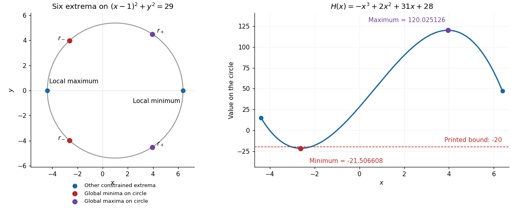

<h1 id="3/c/solution">Solution</h1>

↑ **Parent:** [C](../c.md)

For $g=(x-1)^2+y^2-29$, the [gradient](../../../../../../gradient.md) $\nabla g=2(x-1,y)$ never vanishes on the [circle](../../../../../../circle.md). The [Lagrange multiplier](../../../../../../lagrange-multiplier.md) equations are

$$
2x+y^2+1=2\lambda(x-1),\qquad 2y(1+x)=2\lambda y,\qquad (x-1)^2+y^2=29.
$$

If $y=0$, the two possibilities are $(1\pm\sqrt{29},0)$. If $y\ne0$, then $\lambda=1+x$, and the first equation gives $y^2=2x^2-2x-3$. Combining this with $y^2=28+2x-x^2$ yields

$$
3x^2-4x-31=0.
$$

Put

$$
s=\sqrt{97},\qquad r_-=\frac{2-s}{3},\qquad r_+=\frac{2+s}{3},\qquad h_-=\frac{\sqrt{163-2s}}3,\qquad h_+=\frac{\sqrt{163+2s}}3.
$$

Both $h_-$ and $h_+$ are positive, giving the other four points $(r_-,\pm h_-)$ and $(r_+,\pm h_+)$. To classify all six, restrict $f$ to the [circle](../../../../../../circle.md) by eliminating $y^2$:

$$
f=H(x)=-x^3+2x^2+31x+28,\qquad 1-\sqrt{29}\leq x\leq1+\sqrt{29}.
$$

Its [derivatives](../../../../../../derivative.md) are $H'=-3x^2+4x+31$ and $H''=4-6x$. In the interior, $H''(r_-)=2s>0$ and $H''(r_+)=-2s<0$. At either endpoint $H'<0$; along the [circle](../../../../../../circle.md), $x$ has a strict [local minimum](../../../../../../local-minimum.md) at the left endpoint and a strict [local maximum](../../../../../../local-maximum.md) at the right endpoint. Consequently the six constrained [extrema](../../../../../../maximum-and-minimum.md) are

$$
\boxed{\begin{array}{c|c|c}
\text{point}&f&\text{classification on the circle}\\ \hline
(1-\sqrt{29},0)&31-3\sqrt{29}&\text{strict local maximum}\\
(1+\sqrt{29},0)&31+3\sqrt{29}&\text{strict local minimum}\\
(r_-,\pm h_-)&\dfrac{1330-194\sqrt{97}}{27}&\text{global minima}\\
(r_+,\pm h_+)&\dfrac{1330+194\sqrt{97}}{27}&\text{global maxima}
\end{array}}
$$

The [circle](../../../../../../circle.md) is a [compact set](../../../../../../compact-space.md), so the [extreme value theorem](../../../../../../extreme-value-theorem.md) guarantees that its [global minimum](../../../../../../global-minimum.md) and [global maximum](../../../../../../global-maximum.md) occur among these six points. Their values give the corrected sharp bound

$$
\boxed{f(x,y)\geq\frac{1330-194\sqrt{97}}{27}\approx-21.50660791\quad\text{on the circle}.}
$$

**The printed lower bound $-20$ is false.** A particularly short counterexample is

$$
(x,y)=\left(-\frac52,\frac{\sqrt{67}}2\right),\qquad (x-1)^2+y^2=\frac{49+67}{4}=29,\qquad f(x,y)=-\frac{171}{8}<-20.
$$

The sole [local minimum](../../../../../../local-minimum.md) in part (a), $(-1/2,0)$, has value $-1/4$, larger than values on this [circle](../../../../../../circle.md); it is therefore **not a [global minimum](../../../../../../global-minimum.md)**. In fact $f(-2,y)=2-y^2\to-\infty$, so $f$ has **no [global minimum](../../../../../../global-minimum.md) on the plane**.

**[Figure 1](#3/c/image-all-six-extrema-on-the-constraint-circle-and-the-corrected-minimum-of-the-restricted-polynomial). All six extrema on the constraint circle and the corrected minimum of the restricted polynomial**.

## ↑ Ancestors (12)

1. [C](../c.md)
2. [3](../../3.md)
3. [Mathematics III](../../../mathematics-iii-split.md)
4. [Prelims](../../../split.md)
5. [2015](../../../../split.md)
6. [Past exam of the mathematics course of the University of Oxford](../../../../../split.md)
7. [Mathematics course of the University of Oxford](../../../../../../mathematics-course-of-the-university-of-oxford.md)
8. [Undergraduate course of the University of Oxford](../../../../../../undergraduate-course-of-the-university-of-oxford.md)
9. [Course of the University of Oxford](../../../../../../course-of-the-university-of-oxford.md)
10. [University of Oxford](../../../../../../university-of-oxford-split.md)
11. [List of universities](../../../../../../list-of-universities.md)
12. [Codex Wiki](../../../../../../split.md)
