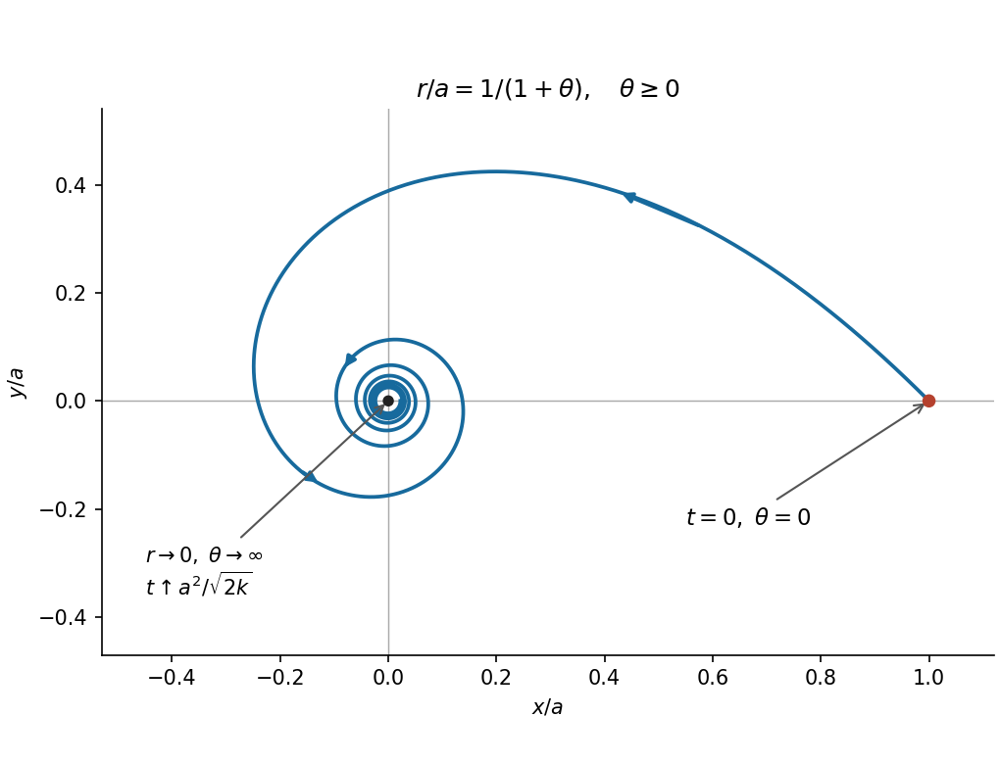
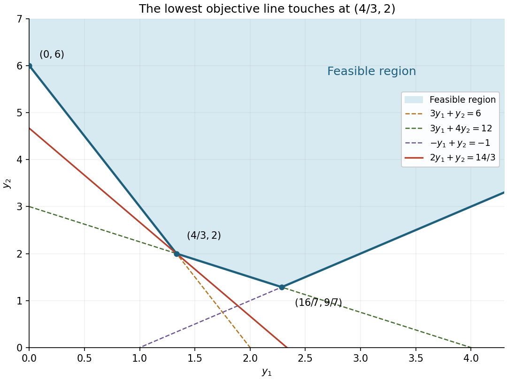

# Mathematics IV

↑ **Parent:** [Prelims](../prelims.md)

Source: [released examination PDF, bundle pages 161–165](https://www.whatdotheyknow.com/request/bsc_mathematics_prelims_and_part/response/2784209/attach/3/202409%20817%20annex.pdf#page=161).

**Table of contents**

- [1](#1)
  - [a](#1/a)
    - [Solution](#1/a/solution)
  - [b](#1/b)
    - [i](#1/b/i)
      - [Solution](#1/b/i/solution)
    - [ii](#1/b/ii)
      - [Solution](#1/b/ii/solution)
- [2](#2)
  - [a](#2/a)
    - [Solution](#2/a/solution)
  - [b](#2/b)
    - [Solution](#2/b/solution)
- [3](#3)
  - [a](#3/a)
    - [Solution](#3/a/solution)
  - [b](#3/b)
    - [Solution](#3/b/solution)
    - [i](#3/b/i)
      - [Solution](#3/b/i/solution)
    - [ii](#3/b/ii)
      - [Solution](#3/b/ii/solution)
- [4](#4)
  - [a](#4/a)
    - [Solution](#4/a/solution)
  - [b](#4/b)
    - [Solution](#4/b/solution)
  - [c](#4/c)
    - [Solution](#4/c/solution)
- [5](#5)
  - [a](#5/a)
    - [i](#5/a/i)
      - [Solution](#5/a/i/solution)
    - [ii](#5/a/ii)
      - [Solution](#5/a/ii/solution)
    - [iii](#5/a/iii)
      - [Solution](#5/a/iii/solution)
    - [iv](#5/a/iv)
      - [Solution](#5/a/iv/solution)
  - [b](#5/b)
    - [i](#5/b/i)
      - [Solution](#5/b/i/solution)
    - [ii](#5/b/ii)
      - [Solution](#5/b/ii/solution)
    - [iii](#5/b/iii)
      - [Solution](#5/b/iii/solution)
    - [iv](#5/b/iv)
      - [Solution](#5/b/iv/solution)
- [6](#6)
  - [a](#6/a)
    - [i](#6/a/i)
      - [Solution](#6/a/i/solution)
    - [ii](#6/a/ii)
      - [Solution](#6/a/ii/solution)
  - [b](#6/b)
    - [Solution](#6/b/solution)
  - [c](#6/c)
    - [Solution](#6/c/solution)
- [7](#7)
  - [a](#7/a)
    - [i](#7/a/i)
      - [Solution](#7/a/i/solution)
    - [ii](#7/a/ii)
      - [Solution](#7/a/ii/solution)
    - [iii](#7/a/iii)
      - [Solution](#7/a/iii/solution)
  - [b](#7/b)
    - [Solution](#7/b/solution)

## 1

↑ **Parent:** [Mathematics IV](mathematics-iv.md)

<h3 id="1/a">a</h3>

↑ **Parent:** [1](#1)

<h4 id="1/a/solution">Solution</h4>

↑ **Parent:** [A](#1/a)

Let

$$
\mathbf r_0=\frac{\mathbf a\wedge\mathbf b}{|\mathbf a|^2},\qquad
\mathbf N=\mathbf b+\mathbf a\wedge\mathbf y.
$$

The [vector triple product](../../../multivariable-calculus.md#vector-triple-product) identity $(\mathbf a\wedge\mathbf b)\wedge\mathbf a=|\mathbf a|^2\mathbf b-(\mathbf a\cdot\mathbf b)\mathbf a$ shows that $\mathbf r_0\wedge\mathbf a=\mathbf b$. Moreover, $(\mathbf r-\mathbf r_0)\wedge\mathbf a=\mathbf0$ exactly when $\mathbf r-\mathbf r_0$ is a [scalar multiple](../../../vector-space.md#scalar-multiple) of $\mathbf a$. Thus the given [line](../../../euclidean-geometry.md#straight-line) is

$$
L=\{\mathbf r_0+t\mathbf a:t\in\mathbb R\}.
$$

Also $\mathbf a\wedge\mathbf r_0=-\mathbf b$, so $\mathbf N=\mathbf a\wedge(\mathbf y-\mathbf r_0)$. The assumption $\mathbf N\ne\mathbf0$ says precisely that $\mathbf y$ is outside $L$. Consequently $L$ and $\mathbf y$ determine a unique [plane](../../../geometry-and-topology.md#plane), with [normal vector](../../../differential-geometry.md#normal-vector) $\mathbf N$.

To identify its equation, use cyclic invariance of the [scalar triple product](../../../multilinear-algebra.md#scalar-triple-product):

$$
\mathbf r\cdot(\mathbf a\wedge\mathbf y)
=\mathbf y\cdot(\mathbf r\wedge\mathbf a).
$$

For $\mathbf r\in L$, this equals $\mathbf y\cdot\mathbf b$, while $\mathbf r\cdot\mathbf b=\mathbf r\cdot(\mathbf r\wedge\mathbf a)=0$. Hence $\mathbf r\cdot\mathbf N=\mathbf y\cdot\mathbf b$ throughout $L$. The [point](../../../geometry-and-topology.md#point-geometry) $\mathbf y$ also satisfies that equation because $\mathbf y\cdot(\mathbf a\wedge\mathbf y)=0$. Since $\mathbf N\ne\mathbf0$, the required [plane](../../../geometry-and-topology.md#plane) is therefore exactly

$$
\boxed{\mathbf r\cdot(\mathbf b+\mathbf a\wedge\mathbf y)=\mathbf y\cdot\mathbf b.}
$$

This also proves the reusable [plane through a point and a line given by a cross product](../../../geometry-and-topology.md#plane-through-a-point-and-a-line-given-by-a-cross-product) construction.

<h3 id="1/b">b</h3>

↑ **Parent:** [1](#1)

<h4 id="1/b/i">i</h4>

↑ **Parent:** [B](#1/b)

<h5 id="1/b/i/solution">Solution</h5>

↑ **Parent:** [I](#1/b/i)

The three [lines](../../../euclidean-geometry.md#straight-line) have the convenient [parametric equations](../../../geometry-and-topology.md#parametric-equation)

$$
L_1:\ (s,0,1),\qquad L_2:\ (1,s,0),\qquad L_3:\ (0,1,s),\qquad s\in\mathbb R.
$$

For $L_1$, substitute $\mathbf a=\mathbf i$, $\mathbf b=\mathbf j$ in the [plane through a point and a line given by a cross product](../../../geometry-and-topology.md#plane-through-a-point-and-a-line-given-by-a-cross-product) formula. Its [normal vector](../../../differential-geometry.md#normal-vector) is $\mathbf j+\mathbf i\wedge\mathbf y=(0,1-y_3,y_2)$. Cyclically permuting the [coordinates](../../../vector-space.md#coordinate-linear-algebra) gives all three [planes](../../../geometry-and-topology.md#plane):

$$
\boxed{\begin{aligned}
\Pi_1:&\quad(1-y_3)r_2+y_2r_3=y_2,\\
\Pi_2:&\quad y_3r_1+(1-y_1)r_3=y_3,\\
\Pi_3:&\quad(1-y_2)r_1+y_1r_2=y_1.
\end{aligned}}
$$

Each [normal vector](../../../differential-geometry.md#normal-vector) is nonzero because $\mathbf y$ is not on the corresponding [line](../../../euclidean-geometry.md#straight-line). Thus these are genuine [planes](../../../geometry-and-topology.md#plane), and each is unique.

<h4 id="1/b/ii">ii</h4>

↑ **Parent:** [B](#1/b)

<h5 id="1/b/ii/solution">Solution</h5>

↑ **Parent:** [Ii](#1/b/ii)

Suppose a [line](../../../euclidean-geometry.md#straight-line) $T$ through $\mathbf y$ meets each $L_i$. Its intersection with $L_i$ is different from $\mathbf y$, so $T$ lies in $\Pi_i$. A nonzero [direction vector](../../../euclidean-geometry.md#direction-vector) $\mathbf d$ for $T$ must therefore satisfy

$$
M\mathbf d=\mathbf0,\qquad
M=\begin{pmatrix}
0&1-y_3&y_2\\
y_3&0&1-y_1\\
1-y_2&y_1&0
\end{pmatrix}.
$$

A square [matrix](../../../vector-space.md#matrix) admitting a nonzero [vector](../../../vector-space.md#vector) $\mathbf d$ with $M\mathbf d=\mathbf0$ has zero [determinant](../../../multilinear-algebra.md#determinant). Expanding gives

$$
\begin{aligned}
0=\det M
&=(1-y_1)(1-y_2)(1-y_3)+y_1y_2y_3\\
&=1-y_1-y_2-y_3+y_1y_2+y_2y_3+y_3y_1.
\end{aligned}
$$

Thus the necessary condition is

$$
\boxed{y_1+y_2+y_3-y_1y_2-y_2y_3-y_3y_1=1.}
$$

**The condition is not sufficient.** Take $\mathbf y=(2,1,0)$, which is on none of the three original [lines](../../../euclidean-geometry.md#straight-line). It satisfies the condition, since $2+1-2=1$. The three [plane](../../../geometry-and-topology.md#plane) equations become

$$
r_2+r_3=1,\qquad -r_3=0,\qquad 2r_2=2.
$$

Their common intersection is the single [line](../../../euclidean-geometry.md#straight-line) $T=\{(s,1,0):s\in\mathbb R\}$. Any proposed [line](../../../euclidean-geometry.md#straight-line) through $\mathbf y$ meeting all three original [lines](../../../euclidean-geometry.md#straight-line) would have to be this $T$. But $T$ never meets $L_1=\{(s,0,1):s\in\mathbb R\}$: their second and third [coordinates](../../../vector-space.md#coordinate-linear-algebra) differ. The zero [determinant](../../../multilinear-algebra.md#determinant) guarantees a common direction for the three [planes](../../../geometry-and-topology.md#plane); it does not guarantee the required intersections. This is a [parallel obstruction to a transversal of three skew lines](../../../euclidean-geometry.md#parallel-obstruction-to-a-transversal-of-three-skew-lines).

## 2

↑ **Parent:** [Mathematics IV](mathematics-iv.md)

<h3 id="2/a">a</h3>

↑ **Parent:** [2](#2)

<h4 id="2/a/solution">Solution</h4>

↑ **Parent:** [A](#2/a)

By [Newton's second law](../../../force.md#newton-s-second-law), the [central force](../../../mathematical-physics.md#central-force) obeys

$$
m\ddot{\mathbf r}=-\Phi'(r)\frac{\mathbf r}{r}.
$$

Differentiating the [cross product](../../../vector-space.md#cross-product) gives

$$
\dot{\mathbf n}=\dot{\mathbf r}\wedge\dot{\mathbf r}+\mathbf r\wedge\ddot{\mathbf r}=\mathbf0,
$$

since the [acceleration](../../../classical-mechanics.md#acceleration) is parallel to $\mathbf r$. Hence $\mathbf n=\mathbf n(0)$ is constant. Since $\mathbf r\cdot\mathbf n=0$, the entire motion lies in the fixed [plane](../../../geometry-and-topology.md#plane) through the origin with nonzero [normal vector](../../../differential-geometry.md#normal-vector) $\mathbf n(0)$.

Choose [polar coordinates](../../../multivariable-calculus.md#polar-coordinates) in that [plane](../../../geometry-and-topology.md#plane), orienting $\theta$ so that its positive [normal vector](../../../differential-geometry.md#normal-vector) points along $\mathbf n(0)$. The [velocity](../../../classical-mechanics.md#velocity) is

$$
\dot{\mathbf r}=\dot r\,\mathbf e_r+r\dot\theta\,\mathbf e_\theta,
\qquad
\mathbf r\wedge\dot{\mathbf r}=r^2\dot\theta\,\mathbf e_z.
$$

Therefore

$$
\boxed{r^2\dot\theta=h=|\mathbf n(0)|>0.}
$$

Multiplication by $m$ identifies this with [conservation of angular momentum](../../../momentum.md#conservation-of-angular-momentum); geometrically, the swept [area](../../../differential-geometry.md#surface-area) per unit time is $h/2$.

Taking the [dot product](../../../inner-product.md#dot-product) of [Newton's second law](../../../force.md#newton-s-second-law) with the [velocity](../../../classical-mechanics.md#velocity) gives

$$
\frac{d}{dt}\left(\frac m2|\dot{\mathbf r}|^2+\Phi(r)\right)
=m\dot{\mathbf r}\cdot\ddot{\mathbf r}+\Phi'(r)\dot r=0.
$$

Thus

$$
\boxed{\frac m2\left(\dot r^2+r^2\dot\theta^2\right)+\Phi(r)=E.}
$$

This expresses [conservation of mechanical energy](../../../energy.md#conservation-of-mechanical-energy), the sum of [kinetic energy](../../../energy.md#kinetic-energy) and [potential energy](../../../energy.md#potential-energy).

Finally, for $u=1/r$ and a prime denoting a [derivative](../../../calculus.md#derivative) with respect to $\theta$, the [chain rule](../../../calculus.md#chain-rule) gives

$$
\dot\theta=hu^2,\qquad
\dot r=-u^{-2}u'\dot\theta=-hu',\qquad
r\dot\theta=hu.
$$

Substitution into the conserved [energy](../../../energy.md) yields

$$
\boxed{\frac{mh^2}{2}\left[\left(\frac{du}{d\theta}\right)^2+u^2\right]+\Phi(1/u)=E.}
$$

<h3 id="2/b">b</h3>

↑ **Parent:** [2](#2)

<h4 id="2/b/solution">Solution</h4>

↑ **Parent:** [B](#2/b)

The initial transverse [velocity](../../../classical-mechanics.md#velocity) gives $h=a(\sqrt{2k}/a)=\sqrt{2k}$. The initial [mechanical energy](../../../energy.md#mechanical-energy) is

$$
E=\frac m2\left(\frac{2k}{a^2}+\frac{2k}{a^2}\right)-\frac{mk}{a^2}
=\frac{mk}{a^2}.
$$

Since $\Phi(1/u)=-mku^2$ and $mh^2/2=mk$, the $u^2$ terms cancel in the conserved [energy](../../../energy.md) equation:

$$
mk(u')^2=\frac{mk}{a^2}.
$$

The initial radial [velocity](../../../classical-mechanics.md#velocity) fixes the sign, because $\dot r=-hu'$ gives $u'(0)=1/a$. The [continuous](../../../calculus.md#continuous-function) [derivative](../../../calculus.md#derivative) $u'$ cannot change sign while its square remains $1/a^2$. As $u(0)=1/a$, this gives

$$
u=\frac{1+\theta}{a},\qquad
\boxed{r(\theta)=\frac{a}{1+\theta}\quad(\theta\ge0).}
$$

The future [orbit](../../../dynamical-systems.md#orbit-dynamical-system) is a [hyperbolic spiral](../../../topology.md#hyperbolic-spiral): it starts at $(a,0)$, turns counterclockwise and winds indefinitely towards the origin. Its radial [distance](../../../geometry-and-topology.md#distance) decreases on every turn. The positive-$r$ continuation has $\theta>-1$, but only $\theta\ge0$ is needed after release.

**[Figure 1](#2/b/image-future-orbit-in-question-2-scaled-by-the-initial-radius). Future orbit in question 2, scaled by the initial radius**.

To decide whether infinitely many turns require infinite time, use the conserved [angular momentum](../../../momentum.md#angular-momentum):

$$
\frac{dt}{d\theta}=\frac{r^2}{h}
=\frac{a^2}{\sqrt{2k}(1+\theta)^2}.
$$

Integrating from $0$ gives

$$
t=\frac{a^2}{\sqrt{2k}}\frac{\theta}{1+\theta}.
$$

Consequently

$$
\boxed{t_* =\frac{a^2}{\sqrt{2k}}<\infty,\qquad
r(t)=a-\frac{\sqrt{2k}}a\,t\quad(0\le t<t_*).}
$$

**The particle reaches the origin in finite time**, in the sense that $r\to0$ as $t\uparrow t_*$. Meanwhile $\theta=t/(t_*-t)\to\infty$. The [central force](../../../mathematical-physics.md#central-force) is undefined at the origin, so these formulas describe motion up to collision. This is [finite-time collision in an inverse-cube central force](../../../mathematical-physics.md#finite-time-collision-in-an-inverse-cube-central-force).

## 3

↑ **Parent:** [Mathematics IV](mathematics-iv.md)

<h3 id="3/a">a</h3>

↑ **Parent:** [3](#3)

<h4 id="3/a/solution">Solution</h4>

↑ **Parent:** [A](#3/a)

In [cylindrical coordinates](../../../multivariable-calculus.md#cylindrical-coordinate-system),

$$
\mathbf e_r=(\cos\theta,\sin\theta,0),\quad
\mathbf e_\theta=(-\sin\theta,\cos\theta,0),\quad
\dot{\mathbf e}_r=\dot\theta\mathbf e_\theta,\quad
\dot{\mathbf e}_\theta=-\dot\theta\mathbf e_r.
$$

Differentiating the [position vector](../../../classical-mechanics.md#position-vector) $\mathbf r=r\mathbf e_r+z\mathbf e_z$ twice gives the [velocity](../../../classical-mechanics.md#velocity) and [acceleration](../../../classical-mechanics.md#acceleration)

$$
\begin{aligned}
\dot{\mathbf r}&=\dot r\mathbf e_r+r\dot\theta\mathbf e_\theta+\dot z\mathbf e_z,\\
\ddot{\mathbf r}&=(\ddot r-r\dot\theta^2)\mathbf e_r
+(r\ddot\theta+2\dot r\dot\theta)\mathbf e_\theta+\ddot z\mathbf e_z.
\end{aligned}
$$

This derives [acceleration in cylindrical coordinates](../../../multivariable-calculus.md#acceleration-in-cylindrical-coordinates) rather than assuming it.

At a fixed time, the wire has [parametrization](../../../geometry-and-topology.md#parametric-equation) $r\mapsto r\mathbf e_r+f(r)\mathbf e_z$. Its [derivative](../../../calculus.md#derivative) is the nonzero [tangent vector](../../../tangent-vector.md)

$$
\mathbf t=\mathbf e_r+f'(r)\mathbf e_z.
$$

A smooth wire exerts a [constraint force](../../../force.md#constraint-force) $\mathbf R$ with $\mathbf R\cdot\mathbf t=0$. Because $g$ is the [gravitational acceleration](../../../newton-s-law-of-universal-gravitation.md#gravitational-acceleration), the gravitational [force](../../../force.md) is $-mg\mathbf e_z$; the printed $-g\mathbf e_z$ is interpreted per unit mass. Projecting [Newton's second law](../../../force.md#newton-s-second-law), $m\ddot{\mathbf r}=\mathbf R-mg\mathbf e_z$, along $\mathbf t$ eliminates $\mathbf R$:

$$
\ddot r-r\omega^2+f'(r)\ddot z=-gf'(r).
$$

The [chain rule](../../../calculus.md#chain-rule) gives $\ddot z=f'(r)\ddot r+f''(r)\dot r^2$. Rearrangement yields

$$
\boxed{\left(1+f'(r)^2\right)\ddot r
=r\omega^2-f'(r)\left(g+f''(r)\dot r^2\right).}
$$

This is the governing equation for a [bead on a uniformly rotating wire](../../../classical-mechanics.md#bead-on-a-uniformly-rotating-wire). Its azimuthal [acceleration](../../../classical-mechanics.md#acceleration) contributes nothing to the projection because $\mathbf e_\theta\cdot\mathbf t=0$.

<h3 id="3/b">b</h3>

↑ **Parent:** [3](#3)

<h4 id="3/b/solution">Solution</h4>

↑ **Parent:** [B](#3/b)

Here [equilibrium](../../../dynamical-systems.md#equilibrium-point-of-a-dynamical-system) means fixed position relative to the rotating wire: $r=a$ and $z=f(a)$ are constant, while $\theta=\omega t$ continues to change. Substituting $\dot r=\ddot r=0$ into the equation gives

$$
\boxed{f'(a)=\frac{a\omega^2}{g}.}
$$

For the [linear stability](../../../dynamical-systems.md#linear-stability) calculation, set $r=a+\epsilon$ and retain terms of first order in $\epsilon$ and $\dot\epsilon$. The term $\dot r^2$ contributes only at second order, and variation of the factor multiplying $\ddot\epsilon$ also contributes only at second order. Thus

$$
\boxed{\left(1+f'(a)^2\right)\ddot\epsilon
=\left(\omega^2-gf''(a)\right)\epsilon.}
$$

The two strict sign cases are treated in the following parts. If $gf''(a)=\omega^2$, this [linearization](../../../algebra.md#linearization) has no restoring term and higher orders are needed to classify the [equilibrium](../../../dynamical-systems.md#equilibrium-point-of-a-dynamical-system).

For the specified wire,

$$
f'(r)=\frac{\omega^2r}{g}-\sin(r/b),\qquad
f''(r)=\frac{\omega^2}{g}-\frac1b\cos(r/b).
$$

Hence the complete set of positive [equilibrium](../../../dynamical-systems.md#equilibrium-point-of-a-dynamical-system) radii is

$$
\boxed{a_n=n\pi b,\qquad n=1,2,3,\ldots.}
$$

At $a_n$,

$$
\left[1+\left(\frac{n\pi b\omega^2}{g}\right)^2\right]\ddot\epsilon
=\frac gb(-1)^n\epsilon.
$$

Therefore **odd $n$ give a [stable equilibrium](../../../dynamical-systems.md#stable-equilibrium), and even $n$ give an [unstable equilibrium](../../../dynamical-systems.md#unstable-equilibrium)**. There is no degenerate sign case in this example. The corresponding heights are $f(a_n)=\omega^2n^2\pi^2b^2/(2g)+b(-1)^n$.

<h4 id="3/b/i">i</h4>

↑ **Parent:** [B](#3/b)

<h5 id="3/b/i/solution">Solution</h5>

↑ **Parent:** [I](#3/b/i)

If $gf''(a)>\omega^2$, define

$$
\nu^2=\frac{gf''(a)-\omega^2}{1+f'(a)^2}>0.
$$

The [linearized equation](../../../differential-equation.md#linearized-equation) is $\ddot\epsilon+\nu^2\epsilon=0$, with bounded [simple harmonic motion](../../../classical-mechanics.md#simple-harmonic-motion)

$$
\epsilon(t)=\epsilon(0)\cos(\nu t)+\frac{\dot\epsilon(0)}\nu\sin(\nu t).
$$

Thus the strict [stable equilibrium](../../../dynamical-systems.md#stable-equilibrium) condition is

$$
\boxed{f''(a)>\frac{\omega^2}{g}.}
$$

This is also a sufficient condition for local nonlinear [Lyapunov stability](../../../dynamical-systems.md#lyapunov-stability). Indeed the equation for the [bead on a uniformly rotating wire](../../../classical-mechanics.md#bead-on-a-uniformly-rotating-wire) has the [conserved quantity](../../../hamiltonian-mechanics.md#conserved-quantity)

$$
\mathcal H=\frac12\left(1+f'(r)^2\right)\dot r^2+gf(r)-\frac12\omega^2r^2.
$$

Its [derivative](../../../calculus.md#derivative) is $\dot r$ times the governing equation moved to one side, so it vanishes. At $a$, the last two terms have zero first [derivative](../../../calculus.md#derivative) and positive second [derivative](../../../calculus.md#derivative) $gf''(a)-\omega^2$. Their strict local minimum traps sufficiently small perturbations. The motion is bounded rather than asymptotically returning to rest.

<h4 id="3/b/ii">ii</h4>

↑ **Parent:** [B](#3/b)

<h5 id="3/b/ii/solution">Solution</h5>

↑ **Parent:** [Ii](#3/b/ii)

If $gf''(a)<\omega^2$, put

$$
\lambda^2=\frac{\omega^2-gf''(a)}{1+f'(a)^2}>0.
$$

The [linearized equation](../../../differential-equation.md#linearized-equation) becomes $\ddot\epsilon-\lambda^2\epsilon=0$, so

$$
\epsilon(t)=C_1e^{\lambda t}+C_2e^{-\lambda t}.
$$

Arbitrarily small initial perturbations can have $C_1\ne0$ and grow exponentially. Hence the strict [unstable equilibrium](../../../dynamical-systems.md#unstable-equilibrium) condition is

$$
\boxed{f''(a)<\frac{\omega^2}{g}.}
$$

For the particular wire, this occurs precisely at $a=2j\pi b$, $j=1,2,\ldots$; the alternating radii $a=(2j-1)\pi b$ satisfy the [stable equilibrium](../../../dynamical-systems.md#stable-equilibrium) condition.

## 4

↑ **Parent:** [Mathematics IV](mathematics-iv.md)

<h3 id="4/a">a</h3>

↑ **Parent:** [4](#4)

<h4 id="4/a/solution">Solution</h4>

↑ **Parent:** [A](#4/a)

Define the classical axial spin by the [axial angular velocity of a symmetric top](../../../rigid-body-dynamics.md#axial-angular-velocity-of-a-symmetric-top),

$$
\boxed{n=\boldsymbol\omega\cdot\mathbf e.}
$$

Since $\mathbf e$ is a [unit vector](../../../vector-space.md#unit-vector), $\mathbf e\cdot\dot{\mathbf e}=0$. The [vector triple product](../../../multivariable-calculus.md#vector-triple-product) identity applied to $\dot{\mathbf e}=\boldsymbol\omega\wedge\mathbf e$ gives

$$
\mathbf e\wedge\dot{\mathbf e}
=\boldsymbol\omega-(\boldsymbol\omega\cdot\mathbf e)\mathbf e,
\qquad
\boldsymbol\omega=\mathbf e\wedge\dot{\mathbf e}+n\mathbf e.
$$

The [inertia tensor](../../../rigid-body-dynamics.md#inertia-tensor) multiplies the component perpendicular to $\mathbf e$ by $A$ and the component along $\mathbf e$ by $C$. Therefore the [angular momentum](../../../momentum.md#angular-momentum) about $Q$ is

$$
\mathbf L_Q=A\mathbf e\wedge\dot{\mathbf e}+Cn\mathbf e.
$$

Its time [derivative](../../../calculus.md#derivative) is

$$
\dot{\mathbf L}_Q=A\mathbf e\wedge\ddot{\mathbf e}+C\dot n\mathbf e+Cn\dot{\mathbf e},
$$

because $\dot{\mathbf e}\wedge\dot{\mathbf e}=\mathbf0$.

The gravitational [torque](../../../momentum.md#torque) about $Q$ is $h\mathbf e\wedge(-mg\mathbf k)$, and the applied [torque](../../../momentum.md#torque) is $\ell\mathbf e\wedge(\kappa\mathbf s)$. The support [force](../../../force.md) acts at $Q$, so has zero [torque](../../../momentum.md#torque) about $Q$. The [angular momentum](../../../momentum.md#angular-momentum) equation is consequently

$$
\boxed{A\mathbf e\wedge\ddot{\mathbf e}+C\dot n\mathbf e+Cn\dot{\mathbf e}
=-mgh\mathbf e\wedge\mathbf k+\kappa\ell\mathbf e\wedge\mathbf s.}
$$

<h3 id="4/b">b</h3>

↑ **Parent:** [4](#4)

<h4 id="4/b/solution">Solution</h4>

↑ **Parent:** [B](#4/b)

Write $c=\mathbf k\cdot\mathbf e$. Since $\mathbf s=\ell(\mathbf k-\mathbf e)$, the total [torque](../../../momentum.md#torque) simplifies to

$$
\boldsymbol\tau=(\kappa\ell^2-mgh)\mathbf e\wedge\mathbf k.
$$

Taking the [dot product](../../../inner-product.md#dot-product) of the equation of motion with $\mathbf e$ gives $C\dot n=0$: both [torque](../../../momentum.md#torque) terms are perpendicular to $\mathbf e$, as are the other terms on the left. Hence

$$
\boxed{n=\text{constant}.}
$$

Taking the [dot product](../../../inner-product.md#dot-product) of $\dot{\mathbf L}_Q=\boldsymbol\tau$ with the fixed [vector](../../../vector-space.md#vector) $\mathbf k$ gives

$$
\dot p=\mathbf k\cdot\dot{\mathbf L}_Q=0,\qquad
\boxed{p=\mathbf k\cdot\mathbf L_Q=\text{constant}.}
$$

These are conservation of the axial spin and of the vertical component of [angular momentum](../../../momentum.md#angular-momentum).

For [energy](../../../energy.md), the [kinetic energy](../../../energy.md#kinetic-energy) and [potential energy](../../../energy.md#potential-energy) are

$$
T=\frac12\boldsymbol\omega\cdot\mathbf L_Q
=\frac A2|\dot{\mathbf e}|^2+\frac C2n^2,
\qquad
V=mghc+\frac\kappa2|\mathbf s|^2
=mghc+\kappa\ell^2(1-c).
$$

Dot the equation of motion, with $\dot n=0$, with $\mathbf e\wedge\dot{\mathbf e}$. The [cross product](../../../vector-space.md#cross-product) identity $(\mathbf e\wedge\mathbf u)\cdot(\mathbf e\wedge\mathbf v)=\mathbf u\cdot\mathbf v-(\mathbf e\cdot\mathbf u)(\mathbf e\cdot\mathbf v)$ gives

$$
A\ddot{\mathbf e}\cdot\dot{\mathbf e}
=(\kappa\ell^2-mgh)\mathbf k\cdot\dot{\mathbf e}.
$$

It follows that

$$
\dot T=(\kappa\ell^2-mgh)\dot c,\qquad
\dot V=(mgh-\kappa\ell^2)\dot c,
$$

so

$$
\boxed{E=T+V=\frac12\boldsymbol\omega\cdot\mathbf L_Q+mgh\mathbf k\cdot\mathbf e+\frac\kappa2|\mathbf s|^2=\text{constant}.}
$$

The applied [force](../../../force.md) is conservative even if $\kappa$ is negative: its [potential energy](../../../energy.md#potential-energy) is $\kappa|\mathbf s|^2/2$. This is a [symmetric top with a quadratic alignment potential](../../../rigid-body-dynamics.md#symmetric-top-with-a-quadratic-alignment-potential).

<h3 id="4/c">c</h3>

↑ **Parent:** [4](#4)

<h4 id="4/c/solution">Solution</h4>

↑ **Parent:** [C](#4/c)

For steady [precession](../../../rigid-body-dynamics.md#precession) at rate $\Omega$ about the fixed vertical [unit vector](../../../vector-space.md#unit-vector) $\mathbf k$,

$$
\dot{\mathbf e}=\Omega\mathbf k\wedge\mathbf e,\qquad
\ddot{\mathbf e}=\Omega^2(\cos\alpha\,\mathbf k-\mathbf e).
$$

Consequently $\mathbf e\wedge\ddot{\mathbf e}=\Omega^2\cos\alpha\,\mathbf e\wedge\mathbf k$ and $\dot{\mathbf e}=-\Omega\mathbf e\wedge\mathbf k$. Since the [axial angular velocity of a symmetric top](../../../rigid-body-dynamics.md#axial-angular-velocity-of-a-symmetric-top) $n$ is constant, substitution in the equation of motion gives

$$
\left(A\Omega^2\cos\alpha-Cn\Omega\right)\mathbf e\wedge\mathbf k
=(\kappa\ell^2-mgh)\mathbf e\wedge\mathbf k.
$$

As $0<\alpha<\pi/2$, the [cross product](../../../vector-space.md#cross-product) can be cancelled. For a specified axial spin, the required value is

$$
\boxed{\kappa=\frac{mgh+A\Omega^2\cos\alpha-Cn\Omega}{\ell^2}.}
$$

The corresponding total [angular velocity](../../../rigid-body-dynamics.md#angular-velocity) is

$$
\boldsymbol\omega=\Omega\mathbf k+(n-\Omega\cos\alpha)\mathbf e.
$$

If the stated [angular velocity](../../../rigid-body-dynamics.md#angular-velocity) $\Omega\mathbf k$ is the total [angular velocity](../../../rigid-body-dynamics.md#angular-velocity) of the top, then $n=\Omega\cos\alpha$ and the requested value specializes to

$$
\boxed{\kappa=\frac{mgh+(A-C)\Omega^2\cos\alpha}{\ell^2}.}
$$

This specialization permits a direct check: $\mathbf L_Q=A\Omega\mathbf k+(C-A)\Omega\cos\alpha\,\mathbf e$, whose time [derivative](../../../calculus.md#derivative) is $(A-C)\Omega^2\cos\alpha\,\mathbf e\wedge\mathbf k$, exactly the required [torque](../../../momentum.md#torque). The first formula keeps the separate axial spin explicit when $\Omega$ is understood as the rate of [precession](../../../rigid-body-dynamics.md#precession).

## 5

↑ **Parent:** [Mathematics IV](mathematics-iv.md)

<h3 id="5/a">a</h3>

↑ **Parent:** [5](#5)

<h4 id="5/a/i">i</h4>

↑ **Parent:** [A](#5/a)

<h5 id="5/a/i/solution">Solution</h5>

↑ **Parent:** [I](#5/a/i)

If $A$ has $m$ rows and $n$ columns, attach a nonnegative [dual variable](../../../linear-programming.md#dual-variable) $y_i$ to each of the $m$ upper-bound constraints. The [dual linear program](../../../linear-programming.md#dual-linear-program) is

$$
\boxed{\text{minimise }\mathbf b^T\mathbf y
\quad\text{subject to }A^T\mathbf y\ge\mathbf c,\quad\mathbf y\ge\mathbf0.}
$$

Here $A^T$ is the [transpose](../../../vector-space.md#transpose) of $A$, and all [vector](../../../vector-space.md#vector) inequalities hold componentwise. Nonnegative [dual variables](../../../linear-programming.md#dual-variable) preserve the direction of the original inequalities when taking weighted sums.

<h4 id="5/a/ii">ii</h4>

↑ **Parent:** [A](#5/a)

<h5 id="5/a/ii/solution">Solution</h5>

↑ **Parent:** [Ii](#5/a/ii)

For [feasible solutions](../../../mathematical-optimization.md#feasible-point) $\mathbf x,\mathbf y$, nonnegativity gives

$$
\boxed{\mathbf c^T\mathbf x
\le (A^T\mathbf y)^T\mathbf x
=\mathbf y^TA\mathbf x
\le\mathbf y^T\mathbf b
=\mathbf b^T\mathbf y.}
$$

The first inequality uses $A^T\mathbf y\ge\mathbf c$ and $\mathbf x\ge\mathbf0$; the second uses $A\mathbf x\le\mathbf b$ and $\mathbf y\ge\mathbf0$. This is [weak duality](../../../linear-programming.md#weak-duality).

<h4 id="5/a/iii">iii</h4>

↑ **Parent:** [A](#5/a)

<h5 id="5/a/iii/solution">Solution</h5>

↑ **Parent:** [Iii](#5/a/iii)

For every primal [feasible solution](../../../mathematical-optimization.md#feasible-point) $\mathbf x$, [weak duality](../../../linear-programming.md#weak-duality) gives

$$
\mathbf c^T\mathbf x\le\mathbf b^T\mathbf y^*=\mathbf c^T\mathbf x^*.
$$

Thus no primal [feasible solution](../../../mathematical-optimization.md#feasible-point) improves on $\mathbf x^*$. Similarly, for every dual [feasible solution](../../../mathematical-optimization.md#feasible-point) $\mathbf y$,

$$
\mathbf b^T\mathbf y\ge\mathbf c^T\mathbf x^*=\mathbf b^T\mathbf y^*.
$$

Therefore **both candidates are optimal**, with the same [objective function](../../../mathematical-optimization.md#objective-function) value. Equality is a [linear programming optimality certificate](../../../linear-programming.md#linear-programming-optimality-certificate) and does not require a separate existence argument.

<h4 id="5/a/iv">iv</h4>

↑ **Parent:** [A](#5/a)

<h5 id="5/a/iv/solution">Solution</h5>

↑ **Parent:** [Iv](#5/a/iv)

The [complementary slackness](../../../linear-programming.md#complementary-slackness) conditions are

$$
\boxed{y_i\bigl(b_i-(A\mathbf x)_i\bigr)=0\quad(1\le i\le m),\qquad
x_j\bigl((A^T\mathbf y)_j-c_j\bigr)=0\quad(1\le j\le n).}
$$

To see their role, decompose the [duality gap](../../../linear-programming.md#duality-gap) as

$$
\mathbf b^T\mathbf y-\mathbf c^T\mathbf x
=\sum_i y_i\bigl(b_i-(A\mathbf x)_i\bigr)
+\sum_j x_j\bigl((A^T\mathbf y)_j-c_j\bigr).
$$

Every summand is nonnegative for [feasible solutions](../../../mathematical-optimization.md#feasible-point), so the gap is zero exactly when every displayed product vanishes. Zero gap implies optimality by [weak duality](../../../linear-programming.md#weak-duality). Conversely, [strong duality](../../../linear-programming.md#strong-duality) states that primal and dual optima, when both are attained, have equal values, and hence satisfy these conditions.

<h3 id="5/b">b</h3>

↑ **Parent:** [5](#5)

<h4 id="5/b/i">i</h4>

↑ **Parent:** [B](#5/b)

<h5 id="5/b/i/solution">Solution</h5>

↑ **Parent:** [I](#5/b/i)

There are two primal inequalities, so there are two nonnegative [dual variables](../../../linear-programming.md#dual-variable). The five primal [variables](../../../mathematics.md#variable-mathematics) yield five dual inequalities:

$$
\boxed{\begin{gathered}
\text{minimise }2y_1+y_2,\\
y_1+y_2\ge1,\qquad -y_1+y_2\ge-1,\\
-y_1+3y_2\ge-5,\qquad 3y_1+4y_2\ge12,\\
3y_1+y_2\ge6,\qquad y_1,y_2\ge0.
\end{gathered}}
$$

Each coefficient column of the primal [linear program](../../../linear-programming.md) becomes one row of this [dual linear program](../../../linear-programming.md#dual-linear-program).

<h4 id="5/b/ii">ii</h4>

↑ **Parent:** [B](#5/b)

<h5 id="5/b/ii/solution">Solution</h5>

↑ **Parent:** [Ii](#5/b/ii)

The inequality $3y_1+y_2\ge6$, together with $y_2\ge0$, implies

$$
y_1+y_2=\frac13(3y_1+y_2)+\frac23y_2\ge2>1.
$$

Also $-y_1+y_2\ge-1$ implies

$$
-y_1+3y_2=(-y_1+y_2)+2y_2\ge-1>-5.
$$

Thus **both inequalities are strictly slack throughout the feasible region**. They are redundant: the remaining inequalities imply them, even with strict inequality. By [complementary slackness](../../../linear-programming.md#complementary-slackness), any primal optimum must therefore have $x_1=x_3=0$; this is the principle that [strictly slack dual constraints force zero primal variables](../../../linear-programming.md#strictly-slack-dual-constraints-force-zero-primal-variables).

<h4 id="5/b/iii">iii</h4>

↑ **Parent:** [B](#5/b)

<h5 id="5/b/iii/solution">Solution</h5>

↑ **Parent:** [Iii](#5/b/iii)

After removing the two redundant inequalities, the [feasible region](../../../mathematical-optimization.md#feasible-region) is

$$
y_1\ge0,\qquad
 y_2\ge\max\left\{0,\ y_1-1,\ 3-\frac34y_1,\ 6-3y_1\right\}.
$$

Its lower boundary consists of three [line segments](../../../convex-set.md#line-segment) or rays: $y_2=6-3y_1$ for $0\le y_1\le4/3$, then $y_2=3-3y_1/4$ for $4/3\le y_1\le16/7$, then $y_2=y_1-1$ for $y_1\ge16/7$. The [feasible region](../../../mathematical-optimization.md#feasible-region) is everything on or above this boundary in the first quadrant.

**[Figure 2](#5/b/iii/image-dual-feasible-region-and-optimal-supporting-line-in-question-5). Dual feasible region and optimal supporting line in question 5**.

The boundary [extreme points](../../../convex-set.md#extreme-point) are

$$
(0,6),\qquad (4/3,2),\qquad (16/7,9/7).
$$

Along its three successive pieces, the [objective function](../../../mathematical-optimization.md#objective-function) $2y_1+y_2$ has respective slopes $-1$, $5/4$ and $3$ as $y_1$ increases. Thus it decreases to the middle [extreme point](../../../convex-set.md#extreme-point) and increases thereafter. For fixed $y_1$, moving above the boundary only increases the [objective function](../../../mathematical-optimization.md#objective-function). Hence

$$
\boxed{\mathbf y^*=(4/3,2),\qquad \min(2y_1+y_2)=\frac{14}{3}.}
$$

As an algebraic check of the graphical answer, the active inequalities give

$$
2y_1+y_2=\frac19(3y_1+4y_2)+\frac59(3y_1+y_2)
\ge\frac{12}{9}+\frac{30}{9}=\frac{14}{3},
$$

with equality at the stated [extreme point](../../../convex-set.md#extreme-point).

<h4 id="5/b/iv">iv</h4>

↑ **Parent:** [B](#5/b)

<h5 id="5/b/iv/solution">Solution</h5>

↑ **Parent:** [Iv](#5/b/iv)

At $\mathbf y^*=(4/3,2)$, the first three dual left sides are $10/3$, $2/3$ and $14/3$, strictly above their bounds $1$, $-1$ and $-5$. Thus [complementary slackness](../../../linear-programming.md#complementary-slackness) forces $x_1=x_2=x_3=0$. Both [dual variables](../../../linear-programming.md#dual-variable) are positive, so both primal inequalities are equalities:

$$
3x_4+3x_5=2,\qquad 4x_4+x_5=1.
$$

Solving this [linear system](../../../linear-algebra.md#system-of-linear-equations) gives

$$
\boxed{\mathbf x^*=\left(0,0,0,\frac19,\frac59\right),\qquad
\max\left(x_1-x_2-5x_3+12x_4+6x_5\right)=\frac{14}{3}.}
$$

All components are nonnegative, the two original upper bounds are met exactly, and the [objective function](../../../mathematical-optimization.md#objective-function) equals the dual value. The [weak duality](../../../linear-programming.md#weak-duality) bound therefore certifies optimality. The forced zero components and unique solution of the two remaining equalities also prove that the primal optimum is unique.

## 6

↑ **Parent:** [Mathematics IV](mathematics-iv.md)

<h3 id="6/a">a</h3>

↑ **Parent:** [6](#6)

<h4 id="6/a/i">i</h4>

↑ **Parent:** [A](#6/a)

<h5 id="6/a/i/solution">Solution</h5>

↑ **Parent:** [I](#6/a/i)

The divisions in the [Euclidean algorithm](../../../number-theory.md#euclidean-algorithm) are

$$
\begin{aligned}
323&=1\cdot187+136,\\
187&=1\cdot136+51,\\
136&=2\cdot51+34,\\
51&=1\cdot34+17,\\
34&=2\cdot17+0.
\end{aligned}
$$

The last nonzero [remainder](../../../integer.md#remainder) is $17$, so

$$
\boxed{\gcd(323,187)=17.}
$$

As a check, $323=19\cdot17$ and $187=11\cdot17$; back-substitution also gives $17=-4\cdot323+7\cdot187$.

<h4 id="6/a/ii">ii</h4>

↑ **Parent:** [A](#6/a)

<h5 id="6/a/ii/solution">Solution</h5>

↑ **Parent:** [Ii](#6/a/ii)

At any division step $u=qv+r$, an [integer](../../../integer.md) divides both $u,v$ exactly when it divides both $v,r$: one direction uses $r=u-qv$, and the other uses $u=qv+r$. Hence

$$
\gcd(u,v)=\gcd(v,r).
$$

Starting with $r_0=a$, $r_1=b$, the [Euclidean division](../../../integer.md#euclidean-division) produces

$$
r_{j-1}=q_jr_j+r_{j+1},\qquad 0\le r_{j+1}<r_j.
$$

The nonzero [remainders](../../../integer.md#remainder) form a strictly decreasing sequence of positive [integers](../../../integer.md). Such a sequence must terminate, since there are only finitely many positive [integers](../../../integer.md) below $b$. Suppose $r_N$ is the last nonzero [remainder](../../../integer.md#remainder), so $r_{N+1}=0$. The unchanged [greatest common divisor](../../../divisibility.md#greatest-common-divisor) at each step gives

$$
\boxed{\gcd(a,b)=\gcd(r_1,r_2)=\cdots=\gcd(r_N,0)=r_N.}
$$

The final equality holds because the positive common [divisors](../../../divisibility.md#divisor) of $r_N$ and $0$ are precisely the positive [divisors](../../../divisibility.md#divisor) of $r_N$. This proves both termination and correctness of the [Euclidean algorithm](../../../number-theory.md#euclidean-algorithm).

<h3 id="6/b">b</h3>

↑ **Parent:** [6](#6)

<h4 id="6/b/solution">Solution</h4>

↑ **Parent:** [B](#6/b)

Apply the [Euclidean algorithm](../../../number-theory.md#euclidean-algorithm) to $19$ and $11$:

$$
19=11+8,\quad 11=8+3,\quad 8=2\cdot3+2,\quad 3=2+1.
$$

Back-substitution gives the [Bézout's identity](../../../algebra.md#bezout-s-identity)

$$
1=3-2=3\cdot3-8=3\cdot11-4\cdot8=7\cdot11-4\cdot19.
$$

Thus $(x,y)=(-4,7)$ is one solution of the [Diophantine equation](../../../number-theory.md#diophantine-equation). Subtracting this solution from any other gives

$$
19(x+4)+11(y-7)=0.
$$

Since $19$ and $11$ are [coprime](../../../divisibility.md#coprime-integers), $11$ divides $x+4$. To justify that step directly, multiply $1=-4\cdot19+7\cdot11$ by $x+4$: both terms on the right are divisible by $11$, because $19(x+4)=-11(y-7)$. Write $x+4=11t$; substitution then gives $y-7=-19t$. Therefore the complete solution set is

$$
\boxed{x=-4+11t,\qquad y=7-19t,\qquad t\in\mathbb Z.}
$$

Every such pair satisfies the original [Diophantine equation](../../../number-theory.md#diophantine-equation), since the $t$ terms cancel.

<h3 id="6/c">c</h3>

↑ **Parent:** [6](#6)

<h4 id="6/c/solution">Solution</h4>

↑ **Parent:** [C](#6/c)

First recall why the two-variable [Bézout's identity](../../../algebra.md#bezout-s-identity) follows from the [Euclidean algorithm](../../../number-theory.md#euclidean-algorithm). The initial values $a,b$ are [integer linear combinations](../../../vector-space.md#integer-linear-combination) of $a,b$. At every subsequent step, $r_{j+1}=r_{j-1}-q_jr_j$ is again an [integer linear combination](../../../vector-space.md#integer-linear-combination) of $a,b$. Therefore the last nonzero [remainder](../../../integer.md#remainder), which is their [greatest common divisor](../../../divisibility.md#greatest-common-divisor), has that form.

Put $e=\gcd(a,b)$. The preceding argument supplies [integers](../../../integer.md) $u,v$ with $e=au+bv$. Applying the same argument to $e,c$ gives [integers](../../../integer.md) $p,q$ such that

$$
\gcd(e,c)=ep+cq.
$$

An [integer](../../../integer.md) divides $a,b,c$ exactly when it divides $e,c$: if it divides $a,b$, it divides $e=au+bv$, while $e$ itself divides both $a,b$. Hence $\gcd(e,c)=\gcd(a,b,c)=d$. Substituting the expression for $e$ proves

$$
d=(au+bv)p+cq=a(up)+b(vp)+cq.
$$

Thus

$$
\boxed{x=up,\qquad y=vp,\qquad z=q}
$$

are [integers](../../../integer.md) satisfying $ax+by+cz=d$. This also explains how to construct the coefficients using two applications of the [Euclidean algorithm](../../../number-theory.md#euclidean-algorithm).

## 7

↑ **Parent:** [Mathematics IV](mathematics-iv.md)

<h3 id="7/a">a</h3>

↑ **Parent:** [7](#7)

<h4 id="7/a/i">i</h4>

↑ **Parent:** [A](#7/a)

<h5 id="7/a/i/solution">Solution</h5>

↑ **Parent:** [I](#7/a/i)

For $0\le x\le7$, we have $2\le2+x\le9$. Taking the nonnegative [square root](../../../algebra.md#square-root) gives

$$
\boxed{G([0,7])=[\sqrt2,3]\subseteq[0,7].}
$$

The [derivative](../../../calculus.md#derivative) is

$$
G'(x)=\frac1{2\sqrt{2+x}},
$$

so

$$
\boxed{|G'(x)|\le\frac1{2\sqrt2}<1\qquad(0\le x\le7).}
$$

In particular, the [mean value theorem](../../../calculus.md#mean-value-theorem) makes $G$ a [contraction mapping](../../../analysis.md#contraction-mapping) on this interval.

<h4 id="7/a/ii">ii</h4>

↑ **Parent:** [A](#7/a)

<h5 id="7/a/ii/solution">Solution</h5>

↑ **Parent:** [Ii](#7/a/ii)

Set $H(x)=g(x)-x$. This [function](../../../function.md) is [continuous](../../../calculus.md#continuous-function) on $[a,b]$. Since $g$ takes values in $[a,b]$,

$$
H(a)=g(a)-a\ge0,\qquad H(b)=g(b)-b\le0.
$$

The [intermediate value theorem](../../../calculus.md#intermediate-value-theorem) therefore supplies $\xi\in[a,b]$ with $H(\xi)=0$, equivalently $g(\xi)=\xi$. This includes the possibility that one endpoint is already a [fixed point](../../../function.md#fixed-point).

For uniqueness, the [mean value theorem](../../../calculus.md#mean-value-theorem) gives, for any $x,y\in[a,b]$,

$$
|g(x)-g(y)|\le\gamma|x-y|.
$$

If both $\xi$ and $\eta$ are [fixed points](../../../function.md#fixed-point), then

$$
|\xi-\eta|=|g(\xi)-g(\eta)|\le\gamma|\xi-\eta|.
$$

Since $\gamma<1$, this forces $|\xi-\eta|=0$. Thus **there exists exactly one [fixed point](../../../function.md#fixed-point)**. When $a=b$, the conclusion follows immediately from $g(a)=a$; otherwise the argument above applies. The [contraction mapping](../../../analysis.md#contraction-mapping) estimate also proves convergence of the associated [fixed-point iteration](../../../numerical-analysis.md#fixed-point-iteration), as used next.

<h4 id="7/a/iii">iii</h4>

↑ **Parent:** [A](#7/a)

<h5 id="7/a/iii/solution">Solution</h5>

↑ **Parent:** [Iii](#7/a/iii)

The [fixed-point iteration](../../../numerical-analysis.md#fixed-point-iteration) stays inside $[0,7]$ because $G$ maps that interval to itself. A [fixed point](../../../function.md#fixed-point) satisfies $\xi=\sqrt{2+\xi}$, so $\xi\ge0$ and

$$
\xi^2-\xi-2=(\xi-2)(\xi+1)=0.
$$

Only $\xi=2$ is admissible; $-1$ fails the unsquared equation. With $q=1/(2\sqrt2)$, the [mean value theorem](../../../calculus.md#mean-value-theorem) gives the [error bound](../../../numerical-analysis.md#error-bound)

$$
|x_{k+1}-2|=|G(x_k)-G(2)|\le q|x_k-2|.
$$

Induction yields $|x_k-2|\le q^k|x_0-2|\le5q^k\to0$, since $0<q<1$. Therefore, for every allowed starting value,

$$
\boxed{\lim_{k\to\infty}x_k=2.}
$$

This estimate proves convergence directly, without assuming in advance that the sequence has a limit.

<h3 id="7/b">b</h3>

↑ **Parent:** [7](#7)

<h4 id="7/b/solution">Solution</h4>

↑ **Parent:** [B](#7/b)

For [Newton's method for nonlinear systems](../../../numerical-analysis.md#multivariable-newton-iteration), solve $J(\mathbf z_0)\boldsymbol\delta=-\mathbf F(\mathbf z_0)$ and set $\mathbf z_1=\mathbf z_0+\boldsymbol\delta$. The [Jacobian matrix](../../../multivariable-calculus.md#jacobian-matrix) here is

$$
J(x,y)=\begin{pmatrix}
3x^2+3&-2\\
3x^2&6y-1
\end{pmatrix}.
$$

At $(0,0)$,

$$
\mathbf F(0,0)=\begin{pmatrix}-1\\-1\end{pmatrix},\qquad
J(0,0)=\begin{pmatrix}3&-2\\0&-1\end{pmatrix}.
$$

The correction [linear system](../../../linear-algebra.md#system-of-linear-equations) is $3\delta_x-2\delta_y=1$, $-\delta_y=1$. Hence $\delta_y=-1$, $\delta_x=-1/3$, and one iteration gives

$$
\boxed{(x_1,y_1)=(-1/3,-1).}
$$

At the alternative starting value $(1,0)$,

$$
\mathbf F(1,0)=\begin{pmatrix}3\\0\end{pmatrix},\qquad
J(1,0)=\begin{pmatrix}6&-2\\3&-1\end{pmatrix}.
$$

This [Jacobian matrix](../../../multivariable-calculus.md#jacobian-matrix) is a [singular matrix](../../../linear-algebra.md#singular-matrix): its first row is twice its second. In fact the correction equations would be

$$
6\delta_x-2\delta_y=-3,\qquad 3\delta_x-\delta_y=0,
$$

which are inconsistent, since twice the second left side equals the first while twice its right side is $0$, rather than $-3$. Thus **Newton's iteration cannot take its first step from $(1,0)$**. This is failure of the correction [linear system](../../../linear-algebra.md#system-of-linear-equations), not merely nonuniqueness of a possible correction.

## ↑ Ancestors (9)

1. [Prelims](../prelims.md)
2. [2015](../../2015.md)
3. [Past exam of the mathematics course of the University of Oxford](../../../past-exam-of-the-mathematics-course-of-the-university-of-oxford.md)
4. [Mathematics course of the University of Oxford](../../../university-of-oxford.md#mathematics-course-of-the-university-of-oxford)
5. [Undergraduate course of the University of Oxford](../../../university-of-oxford.md#undergraduate-course-of-the-university-of-oxford)
6. [Course of the University of Oxford](../../../university-of-oxford.md#course-of-the-university-of-oxford)
7. [University of Oxford](../../../university-of-oxford.md)
8. [List of universities](../../../README.md#list-of-universities)
9. [Codex Wiki](../../../README.md)
