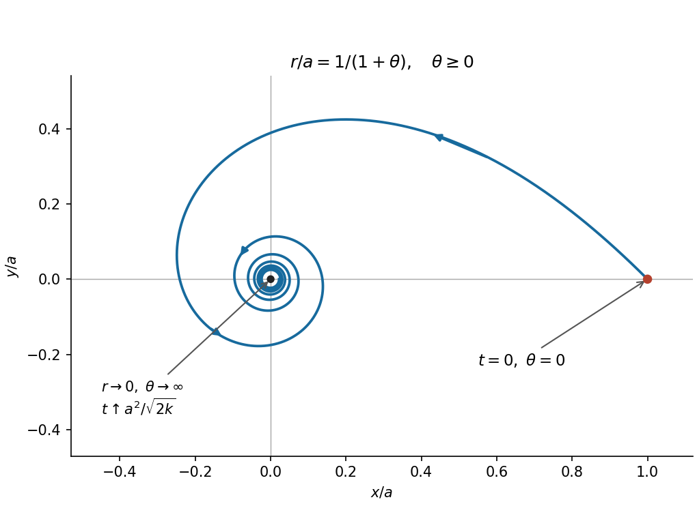

<h1 id="2/b/solution">Solution</h1>

↑ **Parent:** [B](../b.md)

The initial transverse [velocity](../../../../../../velocity.md) gives $h=a(\sqrt{2k}/a)=\sqrt{2k}$. The initial [mechanical energy](../../../../../../mechanical-energy.md) is

$$
E=\frac m2\left(\frac{2k}{a^2}+\frac{2k}{a^2}\right)-\frac{mk}{a^2}
=\frac{mk}{a^2}.
$$

Since $\Phi(1/u)=-mku^2$ and $mh^2/2=mk$, the $u^2$ terms cancel in the conserved [energy](../../../../../../energy-split.md) equation:

$$
mk(u')^2=\frac{mk}{a^2}.
$$

The initial radial [velocity](../../../../../../velocity.md) fixes the sign, because $\dot r=-hu'$ gives $u'(0)=1/a$. The [continuous](../../../../../../continuous-function.md) [derivative](../../../../../../derivative.md) $u'$ cannot change sign while its square remains $1/a^2$. As $u(0)=1/a$, this gives

$$
u=\frac{1+\theta}{a},\qquad
\boxed{r(\theta)=\frac{a}{1+\theta}\quad(\theta\ge0).}
$$

The future [orbit](../../../../../../orbit-dynamical-system.md) is a [hyperbolic spiral](../../../../../../hyperbolic-spiral.md): it starts at $(a,0)$, turns counterclockwise and winds indefinitely towards the origin. Its radial [distance](../../../../../../distance.md) decreases on every turn. The positive-$r$ continuation has $\theta>-1$, but only $\theta\ge0$ is needed after release.

**[Figure 1](#2/b/image-future-orbit-in-question-2-scaled-by-the-initial-radius). Future orbit in question 2, scaled by the initial radius**.

To decide whether infinitely many turns require infinite time, use the conserved [angular momentum](../../../../../../angular-momentum.md):

$$
\frac{dt}{d\theta}=\frac{r^2}{h}
=\frac{a^2}{\sqrt{2k}(1+\theta)^2}.
$$

Integrating from $0$ gives

$$
t=\frac{a^2}{\sqrt{2k}}\frac{\theta}{1+\theta}.
$$

Consequently

$$
\boxed{t_* =\frac{a^2}{\sqrt{2k}}<\infty,\qquad
r(t)=a-\frac{\sqrt{2k}}a\,t\quad(0\le t<t_*).}
$$

**The particle reaches the origin in finite time**, in the sense that $r\to0$ as $t\uparrow t_*$. Meanwhile $\theta=t/(t_*-t)\to\infty$. The [central force](../../../../../../central-force.md) is undefined at the origin, so these formulas describe motion up to collision. This is [finite-time collision in an inverse-cube central force](../../../../../../finite-time-collision-in-an-inverse-cube-central-force.md).

## ↑ Ancestors (12)

1. [B](../b.md)
2. [2](../../2.md)
3. [Mathematics IV](../../../mathematics-iv-split.md)
4. [Prelims](../../../split.md)
5. [2015](../../../../split.md)
6. [Past exam of the mathematics course of the University of Oxford](../../../../../split.md)
7. [Mathematics course of the University of Oxford](../../../../../../mathematics-course-of-the-university-of-oxford.md)
8. [Undergraduate course of the University of Oxford](../../../../../../undergraduate-course-of-the-university-of-oxford.md)
9. [Course of the University of Oxford](../../../../../../course-of-the-university-of-oxford.md)
10. [University of Oxford](../../../../../../university-of-oxford-split.md)
11. [List of universities](../../../../../../list-of-universities.md)
12. [Codex Wiki](../../../../../../split.md)
