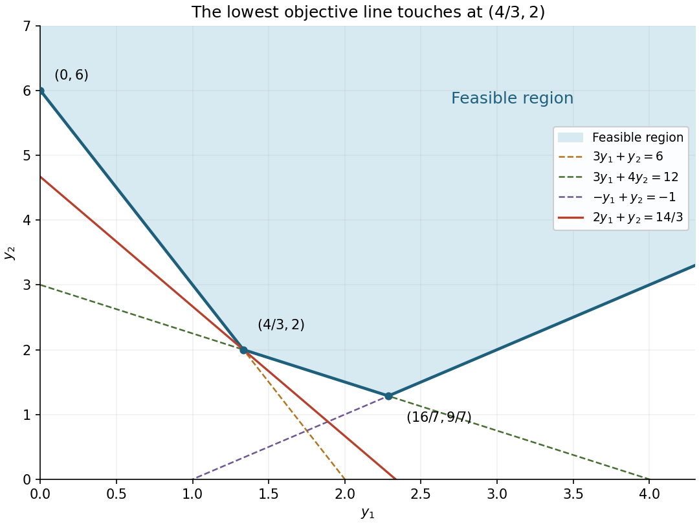

<h1 id="5/b/iii/solution">Solution</h1>

↑ **Parent:** [Iii](../iii.md)

After removing the two redundant inequalities, the [feasible region](../../../../../../../feasible-region.md) is

$$
y_1\ge0,\qquad
 y_2\ge\max\left\{0,\ y_1-1,\ 3-\frac34y_1,\ 6-3y_1\right\}.
$$

Its lower boundary consists of three [line segments](../../../../../../../line-segment.md) or rays: $y_2=6-3y_1$ for $0\le y_1\le4/3$, then $y_2=3-3y_1/4$ for $4/3\le y_1\le16/7$, then $y_2=y_1-1$ for $y_1\ge16/7$. The [feasible region](../../../../../../../feasible-region.md) is everything on or above this boundary in the first quadrant.

**[Figure 2](#5/b/iii/image-dual-feasible-region-and-optimal-supporting-line-in-question-5). Dual feasible region and optimal supporting line in question 5**.

The boundary [extreme points](../../../../../../../extreme-point.md) are

$$
(0,6),\qquad (4/3,2),\qquad (16/7,9/7).
$$

Along its three successive pieces, the [objective function](../../../../../../../objective-function.md) $2y_1+y_2$ has respective slopes $-1$, $5/4$ and $3$ as $y_1$ increases. Thus it decreases to the middle [extreme point](../../../../../../../extreme-point.md) and increases thereafter. For fixed $y_1$, moving above the boundary only increases the [objective function](../../../../../../../objective-function.md). Hence

$$
\boxed{\mathbf y^*=(4/3,2),\qquad \min(2y_1+y_2)=\frac{14}{3}.}
$$

As an algebraic check of the graphical answer, the active inequalities give

$$
2y_1+y_2=\frac19(3y_1+4y_2)+\frac59(3y_1+y_2)
\ge\frac{12}{9}+\frac{30}{9}=\frac{14}{3},
$$

with equality at the stated [extreme point](../../../../../../../extreme-point.md).

## ↑ Ancestors (13)

1. [Iii](../iii.md)
2. [B](../../b.md)
3. [5](../../../5.md)
4. [Mathematics IV](../../../../mathematics-iv-split.md)
5. [Prelims](../../../../split.md)
6. [2015](../../../../../split.md)
7. [Past exam of the mathematics course of the University of Oxford](../../../../../../split.md)
8. [Mathematics course of the University of Oxford](../../../../../../../mathematics-course-of-the-university-of-oxford.md)
9. [Undergraduate course of the University of Oxford](../../../../../../../undergraduate-course-of-the-university-of-oxford.md)
10. [Course of the University of Oxford](../../../../../../../course-of-the-university-of-oxford.md)
11. [University of Oxford](../../../../../../../university-of-oxford-split.md)
12. [List of universities](../../../../../../../list-of-universities.md)
13. [Codex Wiki](../../../../../../../split.md)
