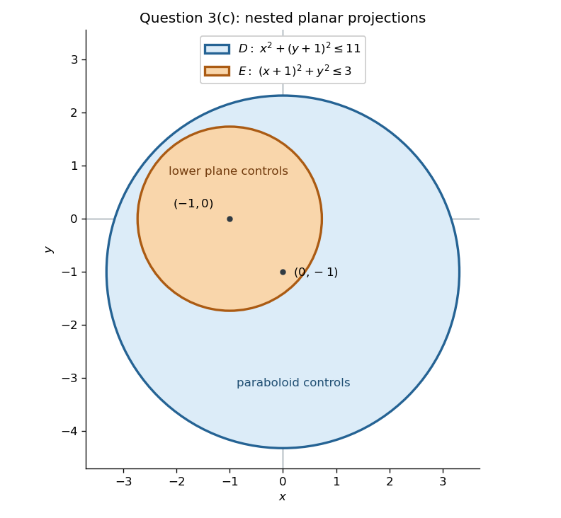

# Mathematics V resit

↑ **Parent:** [Prelims](../prelims.md)

Source: [released examination PDF, bundle pages 234–237](https://www.whatdotheyknow.com/request/bsc_mathematics_prelims_and_part/response/2784209/attach/3/202409%20817%20annex.pdf#page=234).

**Table of contents**

- [Question 1](#question-1)
  - [a](#question-1/a)
    - [Solution](#question-1/a/solution)
  - [b](#question-1/b)
    - [i](#question-1/b/i)
      - [Solution](#question-1/b/i/solution)
    - [ii](#question-1/b/ii)
      - [Solution](#question-1/b/ii/solution)
- [Question 2](#question-2)
  - [a](#question-2/a)
    - [i](#question-2/a/i)
      - [Solution](#question-2/a/i/solution)
    - [ii](#question-2/a/ii)
      - [Solution](#question-2/a/ii/solution)
    - [iii](#question-2/a/iii)
      - [Solution](#question-2/a/iii/solution)
  - [b](#question-2/b)
    - [Solution](#question-2/b/solution)
- [Question 3](#question-3)
  - [a](#question-3/a)
    - [Solution](#question-3/a/solution)
  - [b](#question-3/b)
    - [Solution](#question-3/b/solution)
  - [c](#question-3/c)
    - [Solution](#question-3/c/solution)
- [Question 4](#question-4)
  - [a](#question-4/a)
    - [Solution](#question-4/a/solution)
  - [b](#question-4/b)
    - [Solution](#question-4/b/solution)
  - [c](#question-4/c)
    - [Solution](#question-4/c/solution)
- [Question 5](#question-5)
  - [a](#question-5/a)
    - [Solution](#question-5/a/solution)
  - [b](#question-5/b)
    - [Solution](#question-5/b/solution)
  - [c](#question-5/c)
    - [Solution](#question-5/c/solution)
- [Question 6](#question-6)
  - [a](#question-6/a)
    - [Solution](#question-6/a/solution)
  - [b](#question-6/b)
    - [Solution](#question-6/b/solution)
  - [c](#question-6/c)
    - [Solution](#question-6/c/solution)
- [Question 7](#question-7)
  - [a](#question-7/a)
    - [i](#question-7/a/i)
      - [Solution](#question-7/a/i/solution)
    - [ii](#question-7/a/ii)
      - [Solution](#question-7/a/ii/solution)
    - [iii](#question-7/a/iii)
      - [Solution](#question-7/a/iii/solution)
  - [b](#question-7/b)
    - [i](#question-7/b/i)
      - [Solution](#question-7/b/i/solution)
    - [ii](#question-7/b/ii)
      - [Solution](#question-7/b/ii/solution)
    - [iii](#question-7/b/iii)
      - [Solution](#question-7/b/iii/solution)

## Question 1

↑ **Parent:** [Mathematics V resit](mathematics-v-resit.md)

<h3 id="question-1/a">a</h3>

↑ **Parent:** [Question 1](#question-1)

<h4 id="question-1/a/solution">Solution</h4>

↑ **Parent:** [A](#question-1/a)

Here $\phi$ is a [scalar field](../../../classical-field-theory.md#scalar-field): the source's description as a [vector field](../../../multivariable-calculus.md#vector-field) is a typographical slip, since the displayed formula is for its [gradient](../../../multivariable-calculus.md#gradient). For [cylindrical coordinates](../../../multivariable-calculus.md#cylindrical-coordinate-system), write $x=r\cos\theta$, $y=r\sin\theta$. Away from $r=0$, a local choice of $\theta$ gives the [partial derivatives](../../../multivariable-calculus.md#partial-derivative)

$$
r_x=\cos\theta,\quad r_y=\sin\theta,\quad
\theta_x=-\frac{\sin\theta}{r},\quad
\theta_y=\frac{\cos\theta}{r}.
$$

The [chain rule](../../../calculus.md#chain-rule) therefore gives

$$
\phi_x=\Phi_r\cos\theta-\frac{\Phi_\theta}{r}\sin\theta,
\qquad
\phi_y=\Phi_r\sin\theta+\frac{\Phi_\theta}{r}\cos\theta,
\qquad \phi_z=\Phi_z.
$$

Use the [Cartesian coordinates](../../../linear-algebra.md#cartesian-coordinate-system) definition $\nabla\phi=\phi_x\mathbf e_x+\phi_y\mathbf e_y+\phi_z\mathbf e_z$ and the [unit vectors](../../../vector-space.md#unit-vector)

$$
\mathbf e_r=\cos\theta\,\mathbf e_x+\sin\theta\,\mathbf e_y,
\qquad
\mathbf e_\theta=-\sin\theta\,\mathbf e_x+\cos\theta\,\mathbf e_y.
$$

Collecting their coefficients proves

$$
\boxed{\nabla\phi=\Phi_r\mathbf e_r+\frac1r\Phi_\theta\mathbf e_\theta+\Phi_z\mathbf e_z,\qquad r>0.}
$$

This is the [gradient in cylindrical coordinates](../../../multivariable-calculus.md#gradient-in-cylindrical-coordinates). The factor $1/r$ converts a change in angle into a change per unit [arc length](../../../riemannian-geometry.md#arc-length).

<h3 id="question-1/b">b</h3>

↑ **Parent:** [Question 1](#question-1)

<h4 id="question-1/b/i">i</h4>

↑ **Parent:** [B](#question-1/b)

<h5 id="question-1/b/i/solution">Solution</h5>

↑ **Parent:** [I](#question-1/b/i)

In [cylindrical coordinates](../../../multivariable-calculus.md#cylindrical-coordinate-system), $(-y,x,0)=r\mathbf e_\theta$ and $x+r=r(1+\cos\theta)$. Hence the [vector field](../../../multivariable-calculus.md#vector-field) simplifies to

$$
\mathbf F=\frac{\sqrt{1+\cos\theta}}{r}\mathbf e_\theta.
$$

Take the [orientation](../../../algebraic-topology.md#orientation-of-a-simplex) of $C$ to be increasing $\theta$, as in its given [parametrization](../../../geometry-and-topology.md#parametric-equation). On the [circle](../../../topology.md#circle), $d\mathbf r=a\mathbf e_\theta\,d\theta$, so its [line integral](../../../multivariable-calculus.md#line-integral) is

$$
\int_C\mathbf F\cdot d\mathbf r
=\int_{-\pi}^{\pi}\sqrt{1+\cos\theta}\,d\theta
=\sqrt2\int_{-\pi}^{\pi}\cos(\theta/2)\,d\theta
=\boxed{4\sqrt2}.
$$

We used $\sqrt{1+\cos\theta}=\sqrt2|\cos(\theta/2)|$; the [cosine](../../../geometry-and-topology.md#cosine) is nonnegative on this interval. In particular, the answer does not depend on $a$.

<h4 id="question-1/b/ii">ii</h4>

↑ **Parent:** [B](#question-1/b)

<h5 id="question-1/b/ii/solution">Solution</h5>

↑ **Parent:** [Ii](#question-1/b/ii)

Here a [potential of a conservative vector field](../../../multivariable-calculus.md#potential-of-a-conservative-vector-field) means a single-valued [scalar field](../../../classical-field-theory.md#scalar-field) $\psi$ with $\nabla\psi=\mathbf F$. By the [fundamental theorem for line integrals](../../../multivariable-calculus.md#fundamental-theorem-for-line-integrals), its [line integral](../../../multivariable-calculus.md#line-integral) around every closed [curve](../../../topology.md#curve) must vanish. Here the [angular circulation obstruction to a cylindrical potential](../../../multivariable-calculus.md#angular-circulation-obstruction-to-a-cylindrical-potential) lets us test this using a [circle](../../../topology.md#circle) about the axis.

On $V_1$, the [circle](../../../topology.md#circle) from [i](#question-1/b/i) lies entirely in the region and has [line integral](../../../multivariable-calculus.md#line-integral) $4\sqrt2$. Therefore **there is no [potential of a conservative vector field](../../../multivariable-calculus.md#potential-of-a-conservative-vector-field) on $V_1$**.

On $V_2$, choose the continuous angular branch $-\pi<\theta<\pi$. By [a](#question-1/a), the equation for a [potential of a conservative vector field](../../../multivariable-calculus.md#potential-of-a-conservative-vector-field) reduces to $\psi_r=\psi_z=0$ and $\psi_\theta=\sqrt2\cos(\theta/2)$. Thus

$$
\boxed{\psi=2\sqrt2\sin(\theta/2)+C
=\frac{2y}{\sqrt{r(r+x)}}+C,\qquad r=\sqrt{x^2+y^2},\quad\text{on }V_2.}
$$

The denominator is positive throughout $V_2$, including when $y=0$ and $x>0$, so this is a well-defined differentiable [potential of a conservative vector field](../../../multivariable-calculus.md#potential-of-a-conservative-vector-field) on the entire region.

For $V_3$, choose the particular [circle](../../../topology.md#circle) $x=2\cos\theta$, $y=2\sin\theta$, $z=0$. Its only point on the removed half-plane's supporting cut is $(-2,0,0)$, where $(x+2)^2+z^2=0<1$; this point is retained by $V_3$. Thus the whole [circle](../../../topology.md#circle) lies in $V_3$ and again has [line integral](../../../multivariable-calculus.md#line-integral) $4\sqrt2$. Consequently **there is no [potential of a conservative vector field](../../../multivariable-calculus.md#potential-of-a-conservative-vector-field) on $V_3$**. The opening in the cut allows a closed [curve](../../../topology.md#curve) to go around the excluded axis.

Finally $V_4\subset V_2$. Restricting the [potential of a conservative vector field](../../../multivariable-calculus.md#potential-of-a-conservative-vector-field) already constructed on $V_2$ gives

$$
\boxed{\psi=\frac{2y}{\sqrt{r(r+x)}}+C\quad\text{on }V_4.}
$$

The extra excluded [cylinder](../../../geometry-and-topology.md#cylinder-geometry) does not invalidate an existing [potential of a conservative vector field](../../../multivariable-calculus.md#potential-of-a-conservative-vector-field). Thus being [simply connected](../../../algebraic-topology.md#simply-connected-space) is a sufficient condition in the usual [curl](../../../multivariable-calculus.md#curl)-free criterion, not a necessary condition for a particular [vector field](../../../multivariable-calculus.md#vector-field) to have a [potential of a conservative vector field](../../../multivariable-calculus.md#potential-of-a-conservative-vector-field).

## Question 2

↑ **Parent:** [Mathematics V resit](mathematics-v-resit.md)

<h3 id="question-2/a">a</h3>

↑ **Parent:** [Question 2](#question-2)

<h4 id="question-2/a/i">i</h4>

↑ **Parent:** [A](#question-2/a)

<h5 id="question-2/a/i/solution">Solution</h5>

↑ **Parent:** [I](#question-2/a/i)

For a bounded region $V\subset\mathbb R^3$ with piecewise smooth boundary, suppose $\mathbf F$ is a [continuously differentiable vector field](../../../multivariable-calculus.md#continuously-differentiable-vector-field) on an open neighbourhood of its [closure](../../../topology.md#closure-topology). The [divergence theorem](../../../multivariable-calculus.md#divergence-theorem), with outward [unit normal vector](../../../differential-geometry.md#unit-normal) $\mathbf n$, is

$$
\boxed{\iiint_V\nabla\cdot\mathbf F\,dV
=\iint_{\partial V}\mathbf F\cdot\mathbf n\,dS.}
$$

The [surface integral](../../../multivariable-calculus.md#surface-integral) measures total outward [flux](../../../mathematical-physics.md#flux). Edges and isolated vertices have zero [surface area](../../../differential-geometry.md#surface-area) and do not affect the [integral](../../../integral.md).

<h4 id="question-2/a/ii">ii</h4>

↑ **Parent:** [A](#question-2/a)

<h5 id="question-2/a/ii/solution">Solution</h5>

↑ **Parent:** [Ii](#question-2/a/ii)

In [Cartesian coordinates](../../../linear-algebra.md#cartesian-coordinate-system), write the constant [vector](../../../vector-space.md#vector) as $\mathbf c=(c_1,c_2,c_3)$. The [product rule](../../../calculus.md#product-rule) and constancy of its components give

$$
\nabla\cdot(\phi\mathbf c)
=\partial_x(c_1\phi)+\partial_y(c_2\phi)+\partial_z(c_3\phi)
=c_1\phi_x+c_2\phi_y+c_3\phi_z.
$$

The last expression is the [dot product](../../../inner-product.md#dot-product) with the [gradient](../../../multivariable-calculus.md#gradient), so

$$
\boxed{\nabla\cdot(\phi\mathbf c)=\mathbf c\cdot\nabla\phi.}
$$

<h4 id="question-2/a/iii">iii</h4>

↑ **Parent:** [A](#question-2/a)

<h5 id="question-2/a/iii/solution">Solution</h5>

↑ **Parent:** [Iii](#question-2/a/iii)

Apply the [divergence theorem](../../../multivariable-calculus.md#divergence-theorem) to $\phi\mathbf c$, using [ii](#question-2/a/ii). Because the [vector](../../../vector-space.md#vector) $\mathbf c$ is constant, it can be taken outside both [integrals](../../../integral.md):

$$
\mathbf c\cdot\iiint_V\nabla\phi\,dV
=\iiint_V\nabla\cdot(\phi\mathbf c)\,dV
=\iint_{\partial V}\phi\mathbf c\cdot\mathbf n\,dS
=\mathbf c\cdot\iint_{\partial V}\phi\mathbf n\,dS.
$$

This holds for every $\mathbf c$, in particular each of the three Cartesian [basis vectors](../../../vector-space.md#basis-vector). Equality of the three components proves the [gradient volume-to-boundary identity](../../../multivariable-calculus.md#gradient-volume-to-boundary-identity)

$$
\boxed{\iiint_V\nabla\phi\,dV=\iint_{\partial V}\phi\mathbf n\,dS.}
$$

It suffices that $\phi$ be a [continuously differentiable function](../../../multivariable-calculus.md#continuously-differentiable-function) on a neighbourhood of the [closure](../../../topology.md#closure-topology) of $V$.

<h3 id="question-2/b">b</h3>

↑ **Parent:** [Question 2](#question-2)

<h4 id="question-2/b/solution">Solution</h4>

↑ **Parent:** [B](#question-2/b)

Use [cylindrical coordinates](../../../multivariable-calculus.md#cylindrical-coordinate-system). The real square root restricts the [projection](../../../vector-space.md#projection-linear-algebra) to $0\leq r\leq1$, and there $r-1\leq0\leq\sqrt{1-r^2}$. Since $\nabla x=\mathbf e_x$, the [volume integral](../../../multivariable-calculus.md#volume-integral) is

$$
\begin{aligned}
\iiint_V\nabla x\,dV
&=2\pi\mathbf e_x\int_0^1r\bigl(\sqrt{1-r^2}-r+1\bigr)\,dr\\
&=2\pi\mathbf e_x\left(\frac13-\frac13+\frac12\right)
=\boxed{\pi\mathbf e_x}.
\end{aligned}
$$

For an independent boundary calculation, split $\partial V$ into an upper [hemisphere](../../../euclidean-geometry.md#hemisphere) $S_+$ and a lower [right circular conical surface](../../../euclidean-geometry.md#right-circular-conical-surface) $S_-$. They meet in the [circle](../../../topology.md#circle) $r=1,z=0$ and there is no additional planar face.

On $S_+$, use the [parametrization](../../../geometry-and-topology.md#parametric-equation)

$$
\mathbf R(\alpha,\theta)
=(\sin\alpha\cos\theta,\sin\alpha\sin\theta,\cos\alpha),
\qquad 0\leq\alpha\leq\pi/2,\quad0\leq\theta\leq2\pi.
$$

The outward [unit normal vector](../../../differential-geometry.md#unit-normal) is $\mathbf R$, and the [surface area element](../../../multivariable-calculus.md#surface-area-element) is $\sin\alpha\,d\alpha\,d\theta$. The $y$ and $z$ components of $\iint_{S_+}x\mathbf n\,dS$ vanish by the angular [integrals](../../../integral.md) of $\sin\theta\cos\theta$ and $\cos\theta$. The $x$ component is

$$
\int_0^{2\pi}\cos^2\theta\,d\theta\int_0^{\pi/2}\sin^3\alpha\,d\alpha
=\pi\cdot\frac23=\frac{2\pi}{3}.
$$

On $S_-$, the [parametrization](../../../geometry-and-topology.md#parametric-equation) $(r\cos\theta,r\sin\theta,r-1)$ has outward [vector area element](../../../differential-geometry.md#vector-area-element)

$$
\mathbf n\,dS=(\cos\theta,\sin\theta,-1)r\,dr\,d\theta.
$$

Its negative vertical component points out below the solid. Multiplying by $x=r\cos\theta$ and using the same angular [symmetry in integration](../../../calculus.md#symmetry-in-integration) gives

$$
\iint_{S_-}x\mathbf n\,dS
=\mathbf e_x\int_0^1r^2\,dr\int_0^{2\pi}\cos^2\theta\,d\theta
=\frac\pi3\mathbf e_x.
$$

Therefore the independently evaluated [surface integral](../../../multivariable-calculus.md#surface-integral) is

$$
\boxed{\iint_{\partial V}x\mathbf n\,dS
=\left(\frac{2\pi}{3}+\frac\pi3\right)\mathbf e_x
=\pi\mathbf e_x,}
$$

in agreement with the [volume integral](../../../multivariable-calculus.md#volume-integral). The isolated apex of the [cone](../../../euclidean-geometry.md#cone-geometry) does not contribute to the [surface integral](../../../multivariable-calculus.md#surface-integral).

## Question 3

↑ **Parent:** [Mathematics V resit](mathematics-v-resit.md)

<h3 id="question-3/a">a</h3>

↑ **Parent:** [Question 3](#question-3)

<h4 id="question-3/a/solution">Solution</h4>

↑ **Parent:** [A](#question-3/a)

The [annulus](../../../topology.md#annulus-mathematics) is $1\leq r\leq2$ in [polar coordinates](../../../multivariable-calculus.md#polar-coordinates). Their [Jacobian determinant](../../../multivariable-calculus.md#jacobian-determinant) supplies $dx\,dy=r\,dr\,d\theta$, so

$$
\begin{aligned}
\iint_D e^{-x^2-y^2}\,dx\,dy
&=\int_0^{2\pi}\int_1^2 e^{-r^2}r\,dr\,d\theta\\
&=\pi\left[-e^{-r^2}\right]_1^2
=\boxed{\pi(e^{-1}-e^{-4})}.
\end{aligned}
$$

<h3 id="question-3/b">b</h3>

↑ **Parent:** [Question 3](#question-3)

<h4 id="question-3/b/solution">Solution</h4>

↑ **Parent:** [B](#question-3/b)

The original [double integral](../../../integral.md#double-integral) covers the [triangle](../../../euclidean-geometry.md#triangle) $0\leq y\leq x\leq1$. By [Fubini's theorem](../../../measure-theory.md#fubini-s-theorem), after reversing the order, $y$ runs from $0$ to $1$ and $x$ from $y$ to $1$. Since a [continuous function](../../../calculus.md#continuous-function) is integrable on this bounded region,

$$
\int_0^1\int_0^x f(y)\,dy\,dx
=\int_0^1\int_y^1 f(y)\,dx\,dy
=\boxed{\int_0^1(1-y)f(y)\,dy}.
$$

For the [square pyramid](../../../euclidean-geometry.md#square-pyramid), a horizontal section at height $z$ is a [square](../../../euclidean-geometry.md#square) of side $2(1-z)$: each vertex moves linearly from the base towards $(1,1,1)$. Hence its [cross-sectional area](../../../euclidean-geometry.md#cross-sectional-area) is $4(1-z)^2$, and its [volume](../../../geometry-and-topology.md#volume) is $4\int_0^1(1-z)^2\,dz$. To use the identity just proved, choose $f(y)=1-y$:

$$
\begin{aligned}
\operatorname{Vol}
&=4\int_0^1\int_0^x(1-y)\,dy\,dx\\
&=4\int_0^1\left(x-\frac{x^2}{2}\right)dx
=4\left(\frac12-\frac16\right)
=\boxed{\frac43}.
\end{aligned}
$$

<h3 id="question-3/c">c</h3>

↑ **Parent:** [Question 3](#question-3)

<h4 id="question-3/c/solution">Solution</h4>

↑ **Parent:** [C](#question-3/c)

Start with the solid between the [elliptic paraboloid](../../../euclidean-geometry.md#elliptic-paraboloid) $z=x^2+y^2$ and the upper [plane](../../../geometry-and-topology.md#plane) $z=10-2y$. Its [projection](../../../vector-space.md#projection-linear-algebra) is the [disk](../../../topology.md#disk-mathematics)

$$
D:\quad x^2+(y+1)^2\leq11,
$$

since their vertical separation is $11-x^2-(y+1)^2$. The second lower bound, $z\geq2-2x$, removes the part between the [elliptic paraboloid](../../../euclidean-geometry.md#elliptic-paraboloid) and this lower [plane](../../../geometry-and-topology.md#plane) wherever

$$
2-2x>x^2+y^2
\quad\Longleftrightarrow\quad
(x+1)^2+y^2<3.
$$

Call this second [disk](../../../topology.md#disk-mathematics) $E$. Its centre is distance $\sqrt2$ from the centre of $D$, and

$$
\sqrt2+\sqrt3<\sqrt{11}
$$

because $5+2\sqrt6<11$. Thus $E$ lies wholly inside $D$. In particular the lower [plane](../../../geometry-and-topology.md#plane) never exceeds the upper [plane](../../../geometry-and-topology.md#plane) on $E$, so the subtraction describes exactly the requested solid.

**[Figure 1](#question-3/c/image-nested-projections-of-the-upper-and-lower-planar-faces-in-question-3-c). Nested projections of the upper and lower planar faces in Question 3(c)** The blue [disk](../../../topology.md#disk-mathematics) $D$ has centre $(0,-1)$ and radius $\sqrt{11}$; the orange [disk](../../../topology.md#disk-mathematics) $E$ has centre $(-1,0)$ and radius $\sqrt3$. Over $E$ the lower [plane](../../../geometry-and-topology.md#plane) replaces the [elliptic paraboloid](../../../euclidean-geometry.md#elliptic-paraboloid) as the bottom of the solid.

The [nested-disk subtraction for paraboloid volumes](../../../euclidean-geometry.md#nested-disk-subtraction-for-paraboloid-volumes) therefore gives a difference of two [double integrals](../../../integral.md#double-integral):

$$
\operatorname{Vol}(R)
=\iint_D\bigl(11-x^2-(y+1)^2\bigr)\,dx\,dy
-\iint_E\bigl(3-(x+1)^2-y^2\bigr)\,dx\,dy.
$$

Translate [polar coordinates](../../../multivariable-calculus.md#polar-coordinates) to the centre of each [disk](../../../topology.md#disk-mathematics). A general [integral](../../../integral.md) of this form is

$$
\int_0^{2\pi}\int_0^{\sqrt A}(A-r^2)r\,dr\,d\theta
=\frac{\pi A^2}{2}.
$$

Using $A=11$ and $A=3$ gives

$$
\boxed{\operatorname{Vol}(R)=\frac\pi2(11^2-3^2)=56\pi.}
$$

## Question 4

↑ **Parent:** [Mathematics V resit](mathematics-v-resit.md)

<h3 id="question-4/a">a</h3>

↑ **Parent:** [Question 4](#question-4)

<h4 id="question-4/a/solution">Solution</h4>

↑ **Parent:** [A](#question-4/a)

Assume the rod has constant [cross-sectional area](../../../euclidean-geometry.md#cross-sectional-area) $A$, no internal source of [heat](../../../heat.md), no bulk motion, and no lateral [heat flux](../../../heat.md#heat-flux-density). Assume also that each section has a uniform [temperature](../../../temperature.md), so that $T$ depends only on $x,t$, and that [Fourier's law](../../../heat.md#fourier-s-law) applies with the stated constant [thermal conductivity](../../../heat.md#thermal-conductivity) $k$. The longitudinal [heat flux density](../../../heat.md#heat-flux-density) is then $q=-kT_x$.

By [conservation of energy](../../../mathematical-physics.md#conservation-of-energy), the rate of increase of [internal energy](../../../internal-energy.md) in a slice $[x,x+\Delta x]$ equals incoming minus outgoing [heat](../../../heat.md):

$$
\rho c A\int_x^{x+\Delta x}T_t(s,t)\,ds
=A\bigl(q(x,t)-q(x+\Delta x,t)\bigr).
$$

Divide by $A\Delta x$ and take the [limit](../../../calculus.md#limit-of-a-function) $\Delta x\to0$. For a sufficiently differentiable [temperature](../../../temperature.md) field this gives $\rho cT_t=-q_x=kT_{xx}$, and hence

$$
\boxed{T_t=\kappa T_{xx},\qquad\kappa=\frac{k}{\rho c},\qquad0<x<L,\quad t>0.}
$$

Here $\rho$ is [mass density](../../../fluid-mechanics.md#density), $c$ is [specific heat capacity](../../../heat.md#specific-heat-capacity), and $\kappa$ is [thermal diffusivity](../../../heat.md#thermal-diffusivity).

<h3 id="question-4/b">b</h3>

↑ **Parent:** [Question 4](#question-4)

<h4 id="question-4/b/solution">Solution</h4>

↑ **Parent:** [B](#question-4/b)

A [steady state](../../../dynamical-systems.md#steady-state) has $T_s''=0$, so $T_s=a+bx$. The fixed [temperature](../../../temperature.md) gives $T_s(0)=T_0$, and [thermal insulation](../../../heat.md#thermal-insulation) gives $T_s'(L)=0$. Thus

$$
\boxed{T_s(x)=T_0.}
$$

Subtracting this [steady state](../../../dynamical-systems.md#steady-state) produces the homogeneous [mixed boundary conditions](../../../differential-equation.md#mixed-boundary-condition)

$$
\boxed{U_t=\kappa U_{xx},\quad U(0,t)=0,\quad U_x(L,t)=0,\quad
U(x,0)=-\frac{T_0x}{L}.}
$$

The [partial differential equation](../../../partial-differential-equation.md) and [boundary conditions](../../../differential-equation.md#boundary-condition) apply for $t>0$. The [initial condition](../../../differential-equation.md#initial-condition) is attained as $t\downarrow0$. Its slope at $x=L$ is $-T_0/L$, so it does not satisfy the insulated-end condition at the instant $t=0$. The resulting [heat equation](../../../diffusion-equation.md#heat-equation) solution is smooth for $t>0$ and approaches the initial [temperature](../../../temperature.md) continuously; its [spatial derivative](../../../multivariable-calculus.md#spatial-derivative) need not be continuous at $(L,0)$.

<h3 id="question-4/c">c</h3>

↑ **Parent:** [Question 4](#question-4)

<h4 id="question-4/c/solution">Solution</h4>

↑ **Parent:** [C](#question-4/c)

For [separation of variables](../../../partial-differential-equation.md#separation-of-variables), put $U=X(x)H(t)$ and set $X''/X=H'/(\kappa H)=-\lambda$. The [boundary conditions](../../../differential-equation.md#boundary-condition) are $X(0)=0$, $X'(L)=0$. Multiplying $-X''=\lambda X$ by $X$ and using [integration by parts](../../../calculus.md#integration-by-parts) gives

$$
\lambda\int_0^L X^2\,dx=\int_0^L(X')^2\,dx.
$$

A nonzero solution therefore has $\lambda>0$: the zero case forces $X$ constant, and then $X(0)=0$ forces $X=0$. Writing $\lambda=\mu^2$, the [eigenfunctions](../../../linear-operator-theory.md#eigenfunction) and their temporal factors are

$$
X_n(x)=\sin(\mu_nx),\qquad
\mu_n=\frac{(n+1/2)\pi}{L},\qquad
H_n(t)=e^{-\kappa\mu_n^2t},\qquad n=0,1,\ldots.
$$

These [sine](../../../geometry-and-topology.md#sine) functions are [orthogonal](../../../inner-product.md#orthogonal-vectors) on $[0,L]$, with squared [norm](../../../normed-vector-space.md#norm) $L/2$. Expanding the [initial condition](../../../differential-equation.md#initial-condition) and multiplying by $\sin(\mu_mx)$ gives, using the permitted interchange of the [sum](../../../arithmetic.md#sum) and [integral](../../../integral.md),

$$
\begin{aligned}
b_n
&=\frac2L\int_0^L\left(-\frac{T_0x}{L}\right)\sin(\mu_nx)\,dx\\
&=-\frac{2T_0}{L^2}
\left[-\frac{x\cos(\mu_nx)}{\mu_n}
+\frac{\sin(\mu_nx)}{\mu_n^2}\right]_0^L\\
&=-\frac{2T_0(-1)^n}{L^2\mu_n^2}
=-\frac{8T_0(-1)^n}{\pi^2(2n+1)^2}.
\end{aligned}
$$

Here $\cos(\mu_nL)=0$ and $\sin(\mu_nL)=(-1)^n$. Thus the [Fourier series](../../../fourier-series.md) solution is

$$
\boxed{U(x,t)=-\frac{8T_0}{\pi^2}\sum_{n=0}^\infty
\frac{(-1)^n}{(2n+1)^2}
\sin\left(\frac{(2n+1)\pi x}{2L}\right)
\exp\left(-\frac{\kappa(2n+1)^2\pi^2t}{4L^2}\right),\qquad T=T_0+U.}
$$

The [exponential decay](../../../analysis.md#exponential-decay) permits differentiation of the [series](../../../sequence-and-series.md#series-mathematics) for $t>0$, and each term satisfies both [boundary conditions](../../../differential-equation.md#boundary-condition). At $t=0$ it is the mixed-end [Fourier expansion](../../../fourier-series.md) of $-T_0x/L$.

The gained [heat](../../../heat.md) is the increase in [internal energy](../../../internal-energy.md). Since the paper specifies no [cross-sectional area](../../../euclidean-geometry.md#cross-sectional-area), first give the answer per unit [cross-sectional area](../../../euclidean-geometry.md#cross-sectional-area); multiply by $A$ for a rod of [cross-sectional area](../../../euclidean-geometry.md#cross-sectional-area) $A$. The initial [temperature](../../../temperature.md) has [integral](../../../integral.md) $T_0L/2$, whereas $\int_0^L\sin(\mu_nx)\,dx=1/\mu_n$. At $t_*=L^2/\kappa$ this gives

$$
\boxed{\frac{\Delta Q}{A}
=\rho cT_0L\left[
\frac12-\frac{16}{\pi^3}\sum_{n=0}^\infty
\frac{(-1)^n}{(2n+1)^3}
\exp\left(-\frac{(2n+1)^2\pi^2}{4}\right)
\right].}
$$

Numerically $\Delta Q/A\simeq0.45623855\,\rho cT_0L$. This is positive and less than the eventual gain $\rho cT_0L/2$, as expected from relaxation towards the uniform [steady state](../../../dynamical-systems.md#steady-state).

## Question 5

↑ **Parent:** [Mathematics V resit](mathematics-v-resit.md)

<h3 id="question-5/a">a</h3>

↑ **Parent:** [Question 5](#question-5)

<h4 id="question-5/a/solution">Solution</h4>

↑ **Parent:** [A](#question-5/a)

Assume $\rho$ is [mass](../../../classical-mechanics.md#mass) per unit equilibrium [length](../../../physics.md#length), the [tension](../../../force.md#tension) has constant magnitude $T$, the string has negligible bending stiffness, and there is no damping or external transverse [force](../../../force.md). Assume small slopes $|y_x|\ll1$ and purely transverse motion. Then a short segment has [mass](../../../classical-mechanics.md#mass) $\rho\Delta x$ to first order. If $\alpha$ is the angle of its tangent, the small-slope approximation gives $\sin\alpha\simeq\tan\alpha=y_x$.

The vertical components of [tension](../../../force.md#tension) at the two ends give net transverse [force](../../../force.md) $T[y_x(x+\Delta x,t)-y_x(x,t)]$. [Newton's second law](../../../force.md#newton-s-second-law) therefore gives

$$
\rho\Delta x\,y_{tt}
=T\bigl[y_x(x+\Delta x,t)-y_x(x,t)\bigr]
$$

to first order. Dividing by $\Delta x$ and taking its [limit](../../../calculus.md#limit-of-a-function) to zero yields

$$
\boxed{y_{tt}=c^2y_{xx},\qquad c=\sqrt{\frac{T}{\rho}}.}
$$

Thus $c$ is the propagation [speed](../../../classical-mechanics.md#speed) of small transverse [waves](../../../wave.md).

<h3 id="question-5/b">b</h3>

↑ **Parent:** [Question 5](#question-5)

<h4 id="question-5/b/solution">Solution</h4>

↑ **Parent:** [B](#question-5/b)

Write $y(x,t)=Y(\xi,\eta)$ with $\xi=x-ct$, $\eta=x+ct$. The [chain rule](../../../calculus.md#chain-rule) gives the [differential operators](../../../analysis.md#differential-operator)

$$
\partial_x=\partial_\xi+\partial_\eta,
\qquad
\partial_t=-c\partial_\xi+c\partial_\eta.
$$

Their squared difference is

$$
y_{tt}-c^2y_{xx}=-4c^2Y_{\xi\eta}.
$$

Consequently the [wave equation](../../../wave-equation.md) becomes $Y_{\xi\eta}=0$. Integrating first in $\eta$ gives $Y_\xi=F'(\xi)$; integrating in $\xi$ gives the general solution

$$
\boxed{y(x,t)=F(x-ct)+G(x+ct).}
$$

The arbitrary twice differentiable [functions](../../../function.md) describe right-moving and left-moving [waves](../../../wave.md), respectively. Conversely the [chain rule](../../../calculus.md#chain-rule) shows that each such sum satisfies the [wave equation](../../../wave-equation.md).

<h3 id="question-5/c">c</h3>

↑ **Parent:** [Question 5](#question-5)

<h4 id="question-5/c/solution">Solution</h4>

↑ **Parent:** [C](#question-5/c)

Enforce the fixed-end [Dirichlet boundary condition](../../../differential-equation.md#dirichlet-boundary-condition) by taking the [odd extension](../../../calculus.md#odd-extension) of the initial [velocity](../../../classical-mechanics.md#velocity) to the whole line:

$$
v_o(s)=\kappa s e^{-|s|/L}.
$$

This agrees with the specified [initial condition](../../../differential-equation.md#initial-condition) for $s\geq0$. To derive the relevant form of [D'Alembert's formula](../../../wave-equation.md#d-alembert-s-formula), the zero initial displacement in [b](#question-5/b) gives $G=-F$, up to a cancelling constant. The initial [velocity](../../../classical-mechanics.md#velocity) then gives $-2cF'=v_o$. Hence

$$
y(x,t)=\frac1{2c}\int_{x-ct}^{x+ct}v_o(s)\,ds.
$$

An [antiderivative](../../../integral.md#antiderivative), valid across $s=0$, is

$$
\int s e^{-|s|/L}\,ds=-L(|s|+L)e^{-|s|/L}.
$$

Evaluation therefore gives the solution throughout $x>0,t>0$:

$$
\boxed{y(x,t)=\frac{\kappa L}{2c}
\left[(|x-ct|+L)e^{-|x-ct|/L}
-(x+ct+L)e^{-(x+ct)/L}\right].}
$$

For $ct\leq x$, replace $|x-ct|$ by $x-ct$; for $ct\geq x$, replace it by $ct-x$. Thus the same expression includes the reflected [wave](../../../wave.md) after it reaches the fixed end.

At $x=0$ the two terms agree, so $y(0,t)=0$. At $t=0$ they again agree, so $y(x,0)=0$. Differentiating the [integral](../../../integral.md) with respect to $t$ gives

$$
y_t(x,t)=\frac12\bigl[v_o(x+ct)+v_o(x-ct)\bigr],
$$

which recovers $y_t(x,0)=\kappa xe^{-x/L}$. Since $v_o$ is a [continuously differentiable function](../../../multivariable-calculus.md#continuously-differentiable-function), the formula is twice continuously differentiable even across $x=ct$, and satisfies the [wave equation](../../../wave-equation.md) there as well.

## Question 6

↑ **Parent:** [Mathematics V resit](mathematics-v-resit.md)

<h3 id="question-6/a">a</h3>

↑ **Parent:** [Question 6](#question-6)

<h4 id="question-6/a/solution">Solution</h4>

↑ **Parent:** [A](#question-6/a)

Let $w$ be the difference of two solutions. It is a [harmonic function](../../../partial-differential-equation.md#harmonic-function) in the open [rectangle](../../../euclidean-geometry.md#rectangle), continuous on its [closure](../../../topology.md#closure-topology), with

$$
w(x,0)=0,\qquad w_y(x,\pi)=0,\qquad
w_x(0,y)=w_x(\pi,y)=0.
$$

Interpret these [Neumann boundary conditions](../../../differential-equation.md#neumann-boundary-condition) classically on the open edges, with the corresponding first [derivatives](../../../calculus.md#derivative) extending there. We use the [strong maximum principle for harmonic functions](../../../partial-differential-equation.md#strong-maximum-principle-for-harmonic-functions) together with [even reflection across a homogeneous Neumann boundary](../../../differential-equation.md#even-reflection-across-a-homogeneous-neumann-boundary). This avoids imposing differentiability at the two bottom corners, where the original data fail a [corner compatibility condition for mixed boundary data](../../../differential-equation.md#corner-compatibility-condition-for-mixed-boundary-data).

By continuity on the compact [rectangle](../../../euclidean-geometry.md#rectangle), $w$ attains a maximum $M$. Suppose $M>0$. It cannot occur on the bottom edge, where $w=0$. If it occurs in the interior, the [strong maximum principle for harmonic functions](../../../partial-differential-equation.md#strong-maximum-principle-for-harmonic-functions) makes $w$ constant, contradicting its bottom value. If it occurs on an open vertical or top edge, the zero [normal derivative](../../../differential-geometry.md#normal-derivative) allows an even [reflection](../../../linear-algebra.md#reflection-mathematics) across that edge. The reflected [harmonic function](../../../partial-differential-equation.md#harmonic-function) then has an interior maximum, giving the same contradiction.

The only remaining possibilities are the two top corners. Reflect evenly across both meeting edges. This gives a bounded [harmonic function](../../../partial-differential-equation.md#harmonic-function) on a punctured neighbourhood of the corner. The [removable singularity for a bounded harmonic function](../../../partial-differential-equation.md#removable-singularity-for-a-bounded-harmonic-function) fills the centre with its continuous value. The corner is now an interior maximum, again impossible. Therefore $w\leq0$. Applying the identical argument to $-w$ gives $w\geq0$.

Thus $\boxed{w=0}$, and **the solution is unique** among the continuous classical solutions with the stated edge conditions.

<h3 id="question-6/b">b</h3>

↑ **Parent:** [Question 6](#question-6)

<h4 id="question-6/b/solution">Solution</h4>

↑ **Parent:** [B](#question-6/b)

For $0<y<\pi$, define $J(y)=\int_0^\pi u_y(x,y)\,dx$. Differentiate under the [integral](../../../integral.md) and use [Laplace's equation](../../../partial-differential-equation.md#laplace-equation):

$$
J'(y)=\int_0^\pi u_{yy}(x,y)\,dx
=-\int_0^\pi u_{xx}(x,y)\,dx
=-\bigl[u_x(\pi,y)-u_x(0,y)\bigr]=0.
$$

Thus $J$ is constant. The top [Neumann boundary condition](../../../differential-equation.md#neumann-boundary-condition) gives $J(\pi)=0$, so

$$
\boxed{\int_0^\pi u_y(x,y^*)\,dx=0,\qquad0<y^*<\pi.}
$$

For the included endpoint $y^*=0$, the [integral](../../../integral.md) is interpreted as an [improper integral](../../../real-analysis.md#improper-integral) at the bottom corners if necessary. The [Fourier series](../../../fourier-series.md) constructed in [c](#question-6/c) gives, on $0<x<\pi$,

$$
u_y(x,0)=-2\log(2\sin x)
+2\sum_{m=1}^\infty\frac{\tanh(2m\pi)-1}{m}\cos(2mx).
$$

The second [series](../../../sequence-and-series.md#series-mathematics) is absolutely and uniformly convergent; the first term has only integrable [logarithmic singularities](../../../analysis.md#logarithmic-singularity). Its [integral](../../../integral.md) is zero since $\int_0^\pi\log(2\sin x)\,dx=0$, while every [cosine](../../../geometry-and-topology.md#cosine) term also has zero [integral](../../../integral.md). This proves the endpoint as well:

$$
\boxed{\int_0^\pi u_y(x,y^*)\,dx=0,\qquad0\leq y^*<\pi.}
$$

For completeness, the logarithmic [integral](../../../integral.md) follows without any endpoint differentiation. Put $I=\int_0^{\pi/2}\log(\sin x)\,dx$ and substitute $x\mapsto\pi/2-x$ to obtain $I=\int_0^{\pi/2}\log(\cos x)\,dx$. Adding and using $\sin x\cos x=\sin(2x)/2$ gives $2I=I-(\pi/2)\log2$, hence $I=-(\pi/2)\log2$ and the required full-interval result.

<h3 id="question-6/c">c</h3>

↑ **Parent:** [Question 6](#question-6)

<h4 id="question-6/c/solution">Solution</h4>

↑ **Parent:** [C](#question-6/c)

For [separation of variables](../../../partial-differential-equation.md#separation-of-variables), set $u=X(x)Y(y)$, with $X''/X=-Y''/Y=-\lambda$. The side [Neumann boundary conditions](../../../differential-equation.md#neumann-boundary-condition) give $X'(0)=X'(\pi)=0$. As in the standard [Sturm-Liouville problem](../../../sturm-liouville-theory.md#sturm-liouville-problem), [integration by parts](../../../calculus.md#integration-by-parts) shows $\lambda\geq0$. The zero [eigenvalue](../../../linear-operator-theory.md#eigenvalue) gives constant $X$, and $Y''=0$ together with $Y'(\pi)=0$ makes $Y$ constant too.

For positive [eigenvalues](../../../linear-operator-theory.md#eigenvalue), the side conditions give $\lambda=n^2$, $X_n=\cos(nx)$, $n\geq1$. The top condition chooses the [hyperbolic cosine](../../../calculus.md#hyperbolic-cosine) factor $\cosh(n(\pi-y))$. Normalize it to one at $y=0$, obtaining

$$
u(x,y)=A_0+\sum_{n=1}^\infty a_n\cos(nx)
\frac{\cosh(n(\pi-y))}{\cosh(n\pi)}.
$$

The [orthogonality of integer Fourier modes](../../../fourier-series.md#orthogonality-of-integer-fourier-modes) and the permitted interchange of [summation](../../../arithmetic.md#summation) and [integration](../../../integral.md) give

$$
A_0=\frac1\pi\int_0^\pi x(\pi-x)\,dx=\frac{\pi^2}{6},
\qquad
 a_n=\frac2\pi\int_0^\pi x(\pi-x)\cos(nx)\,dx.
$$

For the remaining [Fourier coefficients](../../../fourier-series.md#fourier-coefficient), integrate by parts twice. The [sine](../../../geometry-and-topology.md#sine) boundary term vanishes, and with $f=x(\pi-x)$,

$$
\begin{aligned}
\int_0^\pi f(x)\cos(nx)\,dx
&=-\frac1n\int_0^\pi f'(x)\sin(nx)\,dx\\
&=\frac{[f'(x)\cos(nx)]_0^\pi}{n^2}
-\frac1{n^2}\int_0^\pi f''(x)\cos(nx)\,dx\\
&=-\frac{\pi(1+(-1)^n)}{n^2}.
\end{aligned}
$$

The last [integral](../../../integral.md) vanishes because $f''=-2$ and $n$ is a positive [integer](../../../integer.md). Thus $a_n=-2(1+(-1)^n)/n^2$: only even [Fourier modes](../../../fourier-analysis.md#fourier-mode) survive, as expected from [reflection symmetry](../../../physics.md#reflection-symmetry) about $x=\pi/2$. Writing $n=2m$ gives

$$
\boxed{u(x,y)=\frac{\pi^2}{6}
-\sum_{m=1}^\infty\frac{\cos(2mx)}{m^2}
\frac{\cosh(2m(\pi-y))}{\cosh(2m\pi)}.}
$$

The factor involving [hyperbolic cosine](../../../calculus.md#hyperbolic-cosine) lies between zero and one on the closed [rectangle](../../../euclidean-geometry.md#rectangle). Comparison with $\sum m^{-2}$ proves [uniform convergence](../../../sequence-and-series.md#uniform-convergence), so the solution is continuous on the entire boundary and takes the prescribed bottom values. On every strip $y\geq\varepsilon>0$, the [Fourier coefficients](../../../fourier-series.md#fourier-coefficient) have additional [exponential decay](../../../analysis.md#exponential-decay), allowing differentiation and verifying [Laplace's equation](../../../partial-differential-equation.md#laplace-equation) and all three [Neumann boundary conditions](../../../differential-equation.md#neumann-boundary-condition).

To justify the endpoint calculation in [b](#question-6/b), differentiate at $0<x<\pi$, $y=0$ in the interior-edge sense:

$$
u_y(x,0)=2\sum_{m=1}^\infty\frac{\tanh(2m\pi)}m\cos(2mx).
$$

Subtracting $1$ from the [hyperbolic tangent](../../../calculus.md#hyperbolic-tangent) leaves an absolutely convergent [series](../../../sequence-and-series.md#series-mathematics). For the remaining part, the [power series](../../../sequence-and-series.md#power-series) $-\log(1-z)=\sum_{m\geq1}z^m/m$ gives, by taking real parts at $z=re^{2ix}$ and then $r\uparrow1$,

$$
\sum_{m=1}^\infty\frac{\cos(2mx)}m=-\log(2\sin x),\qquad0<x<\pi.
$$

The same formula follows as the limit of the differentiated interior solution, since its leading multiplier is $e^{-2my}$. This establishes the boundary [normal derivative](../../../differential-geometry.md#normal-derivative) used in [b](#question-6/b). It also explains why the failure of the [corner compatibility condition for mixed boundary data](../../../differential-equation.md#corner-compatibility-condition-for-mixed-boundary-data) affects first [derivatives](../../../calculus.md#derivative) at the bottom corners without spoiling continuity of $u$ itself.

## Question 7

↑ **Parent:** [Mathematics V resit](mathematics-v-resit.md)

<h3 id="question-7/a">a</h3>

↑ **Parent:** [Question 7](#question-7)

<h4 id="question-7/a/i">i</h4>

↑ **Parent:** [A](#question-7/a)

<h5 id="question-7/a/i/solution">Solution</h5>

↑ **Parent:** [I](#question-7/a/i)

Use the convention that the [Newtonian gravitational potential](../../../newton-s-law-of-universal-gravitation.md#newtonian-gravitational-potential) tends to zero at infinity and the [gravitational field](../../../physics.md#gravitational-field) is $-\nabla\phi$. A source element of [mass](../../../classical-mechanics.md#mass) $dm$ at [position vector](../../../classical-mechanics.md#position-vector) $\mathbf r'$ contributes $-G\,dm/|\mathbf r-\mathbf r'|$, where $G$ is the [gravitational constant](../../../newton-s-law-of-universal-gravitation.md#gravitational-constant). For the curve, $dm=\gamma\,ds'$, so

$$
\boxed{\phi(\mathbf r)=-G\gamma\int_C\frac{ds'}{|\mathbf r-\mathbf r'|}.}
$$

Here $ds'$ is [arc length](../../../riemannian-geometry.md#arc-length) along the source [curve](../../../topology.md#curve); the expression is finite away from it. This normalization fixes the otherwise arbitrary additive constant.

<h4 id="question-7/a/ii">ii</h4>

↑ **Parent:** [A](#question-7/a)

<h5 id="question-7/a/ii/solution">Solution</h5>

↑ **Parent:** [Ii](#question-7/a/ii)

For the surface, a source element has [mass](../../../classical-mechanics.md#mass) $dm=\sigma\,dS'$. Superposing its [Newtonian gravitational potential](../../../newton-s-law-of-universal-gravitation.md#newtonian-gravitational-potential) gives the [surface integral](../../../multivariable-calculus.md#surface-integral)

$$
\boxed{\phi(\mathbf r)=-G\sigma\iint_S\frac{dS'}{|\mathbf r-\mathbf r'|}.}
$$

Here $dS'$ is the source [surface area element](../../../multivariable-calculus.md#surface-area-element), $\mathbf r'$ the source [position vector](../../../classical-mechanics.md#position-vector), and $G$ the [gravitational constant](../../../newton-s-law-of-universal-gravitation.md#gravitational-constant). The same zero-at-infinity convention applies.

<h4 id="question-7/a/iii">iii</h4>

↑ **Parent:** [A](#question-7/a)

<h5 id="question-7/a/iii/solution">Solution</h5>

↑ **Parent:** [Iii](#question-7/a/iii)

For a volume source of constant [mass density](../../../fluid-mechanics.md#density) $\rho$, use $dm=\rho\,dV'$. Its [Newtonian gravitational potential](../../../newton-s-law-of-universal-gravitation.md#newtonian-gravitational-potential) is the [volume integral](../../../multivariable-calculus.md#volume-integral)

$$
\boxed{\phi(\mathbf r)=-G\rho\iiint_V\frac{dV'}{|\mathbf r-\mathbf r'|},\qquad\phi(\infty)=0.}
$$

The source and observation [position vectors](../../../classical-mechanics.md#position-vector) are $\mathbf r'$ and $\mathbf r$, respectively; $G$ is the [gravitational constant](../../../newton-s-law-of-universal-gravitation.md#gravitational-constant). With this sign convention positive source [mass](../../../classical-mechanics.md#mass) gives negative [Newtonian gravitational potential](../../../newton-s-law-of-universal-gravitation.md#newtonian-gravitational-potential).

<h3 id="question-7/b">b</h3>

↑ **Parent:** [Question 7](#question-7)

<h4 id="question-7/b/i">i</h4>

↑ **Parent:** [B](#question-7/b)

<h5 id="question-7/b/i/solution">Solution</h5>

↑ **Parent:** [I](#question-7/b/i)

Write the observation point as $(0,0,h)$ with $h>0$, reserving source coordinates for the [integral](../../../integral.md). For the straight segment, $ds'=dx'$ and the separation is $\sqrt{x'^2+h^2}$. Therefore its [Newtonian gravitational potential](../../../newton-s-law-of-universal-gravitation.md#newtonian-gravitational-potential) is

$$
\begin{aligned}
\phi(h)
&=-G\gamma\int_{-a}^a\frac{dx'}{\sqrt{x'^2+h^2}}\\
&=-2G\gamma\left[\log\bigl(x'+\sqrt{x'^2+h^2}\bigr)\right]_0^a\\
&=\boxed{-2G\gamma\log\left(\frac{a+\sqrt{a^2+h^2}}{h}\right)}.
\end{aligned}
$$

Equivalently $\phi(h)=-2G\gamma\operatorname{arsinh}(a/h)$. At large $h$ it approaches $-G(2a\gamma)/h$, the [Newtonian potential of a point mass](../../../newton-s-law-of-universal-gravitation.md#newtonian-potential-of-a-point-mass) with the segment's total [mass](../../../classical-mechanics.md#mass).

<h4 id="question-7/b/ii">ii</h4>

↑ **Parent:** [B](#question-7/b)

<h5 id="question-7/b/ii/solution">Solution</h5>

↑ **Parent:** [Ii](#question-7/b/ii)

Use source [polar coordinates](../../../multivariable-calculus.md#polar-coordinates) $x'=s\cos\theta$, $y'=s\sin\theta$ on the [semicircular disk](../../../topology.md#semicircular-disk), with $0\leq s\leq a$ and $0\leq\theta\leq\pi$. Its [surface area element](../../../multivariable-calculus.md#surface-area-element) is $s\,ds\,d\theta$, and the separation from $(0,0,h)$ is $\sqrt{s^2+h^2}$. Thus

$$
\begin{aligned}
\phi(h)
&=-G\sigma\int_0^\pi\int_0^a\frac{s\,ds\,d\theta}{\sqrt{s^2+h^2}}\\
&=-\pi G\sigma\left[\sqrt{s^2+h^2}\right]_0^a
=\boxed{-\pi G\sigma\bigl(\sqrt{a^2+h^2}-h\bigr)},\qquad h>0.
\end{aligned}
$$

This [Newtonian gravitational potential](../../../newton-s-law-of-universal-gravitation.md#newtonian-gravitational-potential) is half that of the full [disk](../../../topology.md#disk-mathematics) because the separation is independent of the polar angle. At large $h$ it approaches $-G(\pi a^2\sigma/2)/h$, with the correct total [mass](../../../classical-mechanics.md#mass).

<h4 id="question-7/b/iii">iii</h4>

↑ **Parent:** [B](#question-7/b)

<h5 id="question-7/b/iii/solution">Solution</h5>

↑ **Parent:** [Iii](#question-7/b/iii)

Use source [spherical coordinates](../../../multivariable-calculus.md#spherical-coordinate-system) with radius $s$, polar angle $\alpha$ measured from the positive $z$-axis, and azimuth $\theta$. The lower half of the [spherical shell](../../../euclidean-geometry.md#spherical-shell) has $a\leq s\leq2a$, $\pi/2\leq\alpha\leq\pi$, and $0\leq\theta\leq2\pi$. Its [volume element](../../../integral.md#volume-element) is $s^2\sin\alpha\,ds\,d\alpha\,d\theta$. At the observation point $(0,0,h)$, $h>0$, the separation is $\sqrt{s^2+h^2-2sh\cos\alpha}$, so

$$
\phi(h)=-2\pi G\rho\int_a^{2a}s^2
\int_{\pi/2}^{\pi}\frac{\sin\alpha\,d\alpha}
{\sqrt{s^2+h^2-2sh\cos\alpha}}\,ds.
$$

The angular [integral](../../../integral.md) is elementary: put $q=\cos\alpha$ to obtain

$$
\int_{-1}^0\frac{dq}{\sqrt{s^2+h^2-2shq}}
=\frac{s+h-\sqrt{s^2+h^2}}{sh}.
$$

We used $\sqrt{(s+h)^2}=s+h$ since both $s,h$ are positive. Hence

$$
\begin{aligned}
\phi(h)
&=-\frac{2\pi G\rho}{h}\int_a^{2a}
\bigl(s^2+hs-s\sqrt{s^2+h^2}\bigr)\,ds\\
&=-\frac{2\pi G\rho}{h}
\left[\frac{s^3}{3}+\frac{hs^2}{2}
-\frac{(s^2+h^2)^{3/2}}{3}\right]_a^{2a}.
\end{aligned}
$$

Thus the [axial potential of a uniform hemispherical shell](../../../newton-s-law-of-universal-gravitation.md#axial-potential-of-a-uniform-hemispherical-shell), at every point of the positive $z$-axis, is

$$
\boxed{\phi(h)=-\frac{2\pi G\rho}{3h}
\left[7a^3+\frac92ha^2-(4a^2+h^2)^{3/2}+(a^2+h^2)^{3/2}\right],\qquad h>0.}
$$

There is no need to split into $h<a$, $a<h<2a$, and $h>2a$: the observation point is outside the lower [hemisphere](../../../euclidean-geometry.md#hemisphere) in all three cases. As checks, $\phi(h)\to-3\pi G\rho a^2$ as $h\downarrow0$, and at large $h$,

$$
\phi(h)\sim-\frac{G}{h}\,\frac{14\pi\rho a^3}{3}.
$$

The last factor is exactly the total [mass](../../../classical-mechanics.md#mass) of the lower half of the [spherical shell](../../../euclidean-geometry.md#spherical-shell).

## ↑ Ancestors (9)

1. [Prelims](../prelims.md)
2. [2015](../../2015.md)
3. [Past exam of the mathematics course of the University of Oxford](../../../past-exam-of-the-mathematics-course-of-the-university-of-oxford.md)
4. [Mathematics course of the University of Oxford](../../../university-of-oxford.md#mathematics-course-of-the-university-of-oxford)
5. [Undergraduate course of the University of Oxford](../../../university-of-oxford.md#undergraduate-course-of-the-university-of-oxford)
6. [Course of the University of Oxford](../../../university-of-oxford.md#course-of-the-university-of-oxford)
7. [University of Oxford](../../../university-of-oxford.md)
8. [List of universities](../../../README.md#list-of-universities)
9. [Codex Wiki](../../../README.md)
