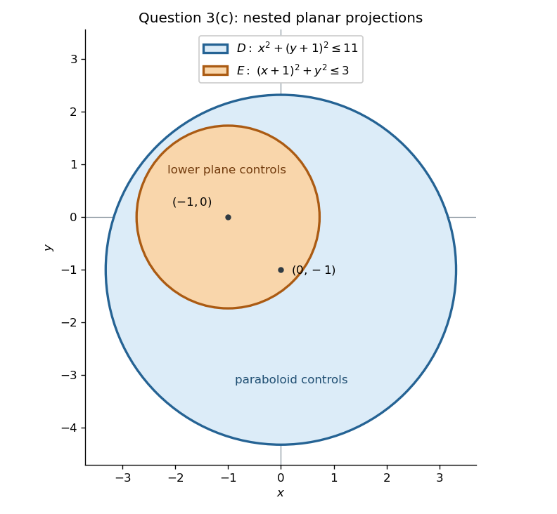

<h1 id="question-3/c/solution">Solution</h1>

↑ **Parent:** [C](../c.md)

Start with the solid between the [elliptic paraboloid](../../../../../../elliptic-paraboloid.md) $z=x^2+y^2$ and the upper [plane](../../../../../../plane.md) $z=10-2y$. Its [projection](../../../../../../projection-linear-algebra.md) is the [disk](../../../../../../disk-mathematics.md)

$$
D:\quad x^2+(y+1)^2\leq11,
$$

since their vertical separation is $11-x^2-(y+1)^2$. The second lower bound, $z\geq2-2x$, removes the part between the [elliptic paraboloid](../../../../../../elliptic-paraboloid.md) and this lower [plane](../../../../../../plane.md) wherever

$$
2-2x>x^2+y^2
\quad\Longleftrightarrow\quad
(x+1)^2+y^2<3.
$$

Call this second [disk](../../../../../../disk-mathematics.md) $E$. Its centre is distance $\sqrt2$ from the centre of $D$, and

$$
\sqrt2+\sqrt3<\sqrt{11}
$$

because $5+2\sqrt6<11$. Thus $E$ lies wholly inside $D$. In particular the lower [plane](../../../../../../plane.md) never exceeds the upper [plane](../../../../../../plane.md) on $E$, so the subtraction describes exactly the requested solid.

**[Figure 1](#question-3/c/image-nested-projections-of-the-upper-and-lower-planar-faces-in-question-3-c). Nested projections of the upper and lower planar faces in Question 3(c)** The blue [disk](../../../../../../disk-mathematics.md) $D$ has centre $(0,-1)$ and radius $\sqrt{11}$; the orange [disk](../../../../../../disk-mathematics.md) $E$ has centre $(-1,0)$ and radius $\sqrt3$. Over $E$ the lower [plane](../../../../../../plane.md) replaces the [elliptic paraboloid](../../../../../../elliptic-paraboloid.md) as the bottom of the solid.

The [nested-disk subtraction for paraboloid volumes](../../../../../../nested-disk-subtraction-for-paraboloid-volumes.md) therefore gives a difference of two [double integrals](../../../../../../double-integral.md):

$$
\operatorname{Vol}(R)
=\iint_D\bigl(11-x^2-(y+1)^2\bigr)\,dx\,dy
-\iint_E\bigl(3-(x+1)^2-y^2\bigr)\,dx\,dy.
$$

Translate [polar coordinates](../../../../../../polar-coordinates.md) to the centre of each [disk](../../../../../../disk-mathematics.md). A general [integral](../../../../../../integral-split.md) of this form is

$$
\int_0^{2\pi}\int_0^{\sqrt A}(A-r^2)r\,dr\,d\theta
=\frac{\pi A^2}{2}.
$$

Using $A=11$ and $A=3$ gives

$$
\boxed{\operatorname{Vol}(R)=\frac\pi2(11^2-3^2)=56\pi.}
$$

## ↑ Ancestors (12)

1. [C](../c.md)
2. [Question 3](../../question-3.md)
3. [Mathematics V resit](../../../mathematics-v-resit-split.md)
4. [Prelims](../../../split.md)
5. [2015](../../../../split.md)
6. [Past exam of the mathematics course of the University of Oxford](../../../../../split.md)
7. [Mathematics course of the University of Oxford](../../../../../../mathematics-course-of-the-university-of-oxford.md)
8. [Undergraduate course of the University of Oxford](../../../../../../undergraduate-course-of-the-university-of-oxford.md)
9. [Course of the University of Oxford](../../../../../../course-of-the-university-of-oxford.md)
10. [University of Oxford](../../../../../../university-of-oxford-split.md)
11. [List of universities](../../../../../../list-of-universities.md)
12. [Codex Wiki](../../../../../../split.md)
